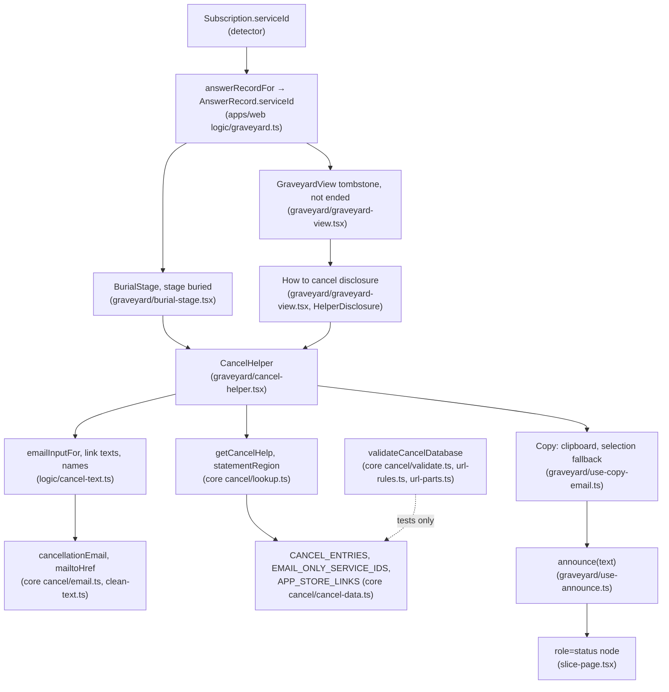

# Design Document: cancel-helper

## Overview

`cancel-helper` replaces the tombstone's closing line "Cancel it with the provider to stop the charges." with a helper that tells the user how to cancel. It has two halves:

1. **Cancel module** (`packages/core/src/cancel`, exported from `@zombills/core`). Frozen data keyed on the normalizer's `serviceId`, plus four pure functions: `statementRegion`, `getCancelHelp`, `cancellationEmail` and `mailtoHref`, and the data checker `validateCancelDatabase`. Like the other core modules it is synchronous and pure: no network, no DOM, no storage, no clock, no randomness, no logging and no runtime dependencies (Req 4).
2. **Helper panel** (`apps/web/src/slice/graveyard/cancel-helper.tsx`). Rendered under the stage tombstone once it has risen, and behind a `How to cancel` disclosure under each tombstone in the Graveyard view. It builds everything from the Answer record and the Cancel module (Req 7.9).

One render of a Helper panel for an Answer record `r` with Display name `d`:

1. **Look up.** `help = getCancelHelp(r.serviceId, r.currency)` (Req 2.6). A `Map` lookup, so any id without a Cancel entry, including `null`, gives `"email-only"` (Req 2.4).
2. **Write the email.** `email = cancellationEmail(emailInputFor(r))`, where `emailInputFor` takes the Known display name or `r.merchant`, `formatMoney(r.currentAmountCents, r.currency)`, the currency, the cadence and `cadenceAssumed` (Req 3.9).
3. **Render.** Heading `Seal the grave`, the plain line, then for `"link"`: the cancel link, the steps, the app-store note and the `Link checked` line; for `"email-only"`: the email-only intro. Both end with the email block, Copy and `Open in my email app` (Req 7.4–7.7).
4. **Copy.** On click, `navigator.clipboard.writeText(subject + "\n\n" + body)`; on success the live region is cleared and, one frame later, reads `Email for <d> copied.`; on failure the email text is selected and the failure sentence is announced (Req 8.3, 8.4).

The spec also changes three other places, covered at the end of this document:

- the graveyard-ui `AnswerRecord` gains `serviceId: string | null` (Req 9);
- the tombstone's stone line becomes `Still feeding until you cancel.`, or `It has stopped charging.` for an Ended tombstone, which also gets no helper (Req 7.1, 7.3);
- the vertical-slice and graveyard-ui tests that pin the old line and the demo path are amended (Req 10).

The 59 Cancel database records are written in five small data tasks, in `serviceId` order, each with `lastChecked: null`. Only the last task of `tasks.md`, a human step, opens the URLs and sets the dates (Req 1.4, 6.12).

### Design decisions

| Decision | Choice | Reason |
| --- | --- | --- |
| One data file | `cancel-data.ts` holds `CANCEL_ENTRIES`, `EMAIL_ONLY_SERVICE_IDS` and `APP_STORE_LINKS` as literals written in `serviceId` order, built with small freezing helpers (`cancelEntry`, `emailOnly`), the same pattern as `service()` in `known-services.ts` | Req 6.11: a reviewer sees every URL and domain in one diff. Writing the array already sorted, instead of sorting at load time, keeps the `unsorted` rule meaningful for the real data. |
| Data written in batches | Five data tasks fill the file by `serviceId` range (table in "Data file layout"). The data test holds a `WRITTEN_THROUGH` id; until the last batch it accepts `missing-service` issues only for Known ids after that id | Each batch is small enough to review by hand, and every batch is checked against every other rule as soon as it lands. The last batch deletes `WRITTEN_THROUGH`, so the test of Req 5.5 is then exactly as written. |
| `URL` typing | A module-scoped `declare const URL` in `url-parts.ts`, the only file that calls `new URL`, instead of a global `url-global.d.ts` | A global `declare var URL` clashes with the one in `@types/node` (`TS2403 Subsequent variable declarations must have the same type`) under `tsconfig.test.json`; today only `skipLibCheck: true` in `tsconfig.base.json` hides it, and it also skips type-checking our own `.d.ts`. A module-scoped declaration shadows the global type in that one file, is type-checked under both `tsconfig.json` (`types: []`) and `tsconfig.test.json` (`types: ["node"]`), emits nothing, and declares no other browser global. Both configs were tried with `skipLibCheck: false`. See "Design review decisions" 1. |
| No `toWellFormed` | `clean-text.ts` repairs lone surrogates with its own loop over code units | `String.prototype.toWellFormed` is ES2024 and the core `lib` is `ES2022`; adding `ES2024.String` to `lib` would be a config change for one call. The loop is ten lines and is checked against the reference cleaner in P1. |
| Lookup table | An internal `lookupIn(entries)` in `lookup.ts` builds a `Map` from a list of Cancel entries and returns the lookup function. `getCancelHelp` is `lookupIn(CANCEL_ENTRIES)`, built once at module load and never written | Req 2.4: `"constructor"` and `"__proto__"` give `"email-only"`. Same pattern as `SERVICES_BY_ID` in `known-services.ts`. Neither the Map nor `lookupIn` is exported from the package, so no caller can change the table (Req 4.2). `lookupIn` lets the unit tests check region choice and the store note on fixture entries, so no unit test pins a fact about the real data. |
| Validator output order | Every check pushes issues into one array; the result is sorted once by the key `(list, index, field, sub-field, rule)` with fixed ranks | Req 5.2. Sorting at the end means the checks can run in whatever order reads best, and the order never depends on which check ran first. Ranks are in "Validator". |
| Web text built in `logic/` | `apps/web/src/slice/logic/cancel-text.ts` builds the Email input, link texts, accessible names, the `Link checked` line and the live-region sentences as pure functions | Same split as `label-text.ts`: the strings are unit-tested without rendering, and the existing purity lint for `logic/` covers them. Clipboard and selection calls stay in the component. |
| Copy announcement | A new `AnnounceContext` gives the panel an `announce(text)` function. `SlicePage` keeps a `notice` state and renders `notice ?? announcement(model)` in the existing `role="status"` node | Req 8.3 asks for one live region, cleared and then rewritten in a later task. The copy result is view-local and does not belong in `PageModel`, whose `event` field describes haunt events. `notice` is cleared only when the string `announcement(model)` changes, so a new haunt sentence takes over again and an unchanged one is never re-announced. |
| Disclosure content stays mounted | The `How to cancel` panel is always rendered, with the `hidden` attribute while collapsed | `aria-controls` must point at an element that exists (Req 7.3), and Req 8.5 checks names with both panels mounted. `hidden` removes collapsed content from the accessibility tree and the tab order. |
| Region names | The panel heading shows `Seal the grave` and carries `aria-label="Seal the grave: <Display name>"`, so each panel's region name is distinct | Several panels in the Graveyard view would otherwise give several regions all named `Seal the grave`. Req 7.4 states this name (amended by design review 1 #11). See "Design review decisions" 3. |
| New dependencies | None | Framer Motion, React, Tailwind, Vitest, fast-check, Testing Library and Playwright cover everything (`tech.md`). |

---

## Architecture

Each box names the file that owns it.



The web app calls only `getCancelHelp`, `cancellationEmail`, `mailtoHref`, `APP_STORE_LINKS` and `getKnownService` from `@zombills/core`. `validateCancelDatabase` is exported for the tests and the Reaper; no web code calls it. Nothing in the diagram makes a request: links are rendered, never fetched (Req 4.6).

---

## Module layout

### Core (`packages/core/src/cancel/`)

File names are kebab-case and constants are `SCREAMING_SNAKE_CASE` (`structure.md`).

| File | Responsibility | Exported from package root? |
| --- | --- | --- |
| `index.ts` | Public barrel (Req 1.1) | yes (via `packages/core/src/index.ts`) |
| `types.ts` | `CancelRegion`, `CancelLinkKind`, `CancelEntry`, `EmailOnlyService`, `AppStoreLink`, `AppStoreLinks`, `CancelHelp`, `EmailInput`, `CancellationEmail`, `CancelDataRule`, `CancelDataIssue`, `ValidateCancelOptions` | yes, except `AppStoreLink` and `AppStoreLinks` (internal names; the public type is `typeof APP_STORE_LINKS`) |
| `cancel-data.ts` | `CANCEL_ENTRIES`, `EMAIL_ONLY_SERVICE_IDS`, `APP_STORE_LINKS`; private helpers `cancelEntry`, `emailOnly`, `appStoreLink` that freeze what they build (Req 1.2–1.8) | the three constants |
| `lookup.ts` | `statementRegion`, `getCancelHelp`; internal `lookupIn(entries)`, exported for `lookup.test.ts` only; private `hostOf` (Req 2) | the two public functions |
| `clean-text.ts` | `toWellFormedText`, `cleanField` (Req 3.2) | no |
| `email.ts` | `cancellationEmail`, `mailtoHref` (Req 3) | both |
| `url-parts.ts` | Module-scoped `URL` declaration and `parseUrl(text): UrlParts \| null`, the only `new URL` call (Req 5.4) | no |
| `url-rules.ts` | `TRACKING_PARAMS`, `DENIED_DOMAINS`, `isOnDomain`, `checkUrl`, `checkDomains` (Req 6.2–6.4, 6.10) | no |
| `date-rules.ts` | `isCheckedDate` (Req 6.7) | no |
| `validate.ts` | `validateCancelDatabase`; coverage, sort, field-type, steps, region and date checks; the final sort (Req 5, 6) | `validateCancelDatabase` only |
| `test-arbitraries.ts` | fast-check generators for Email inputs, ids, currencies, domains and hosts (Req 11.1) | no; excluded from build |
| `test-reference.ts` | Reference cleaner and template builder for P1–P3, written from the requirement text and sharing no code with `src/cancel` | no; excluded from build |
| `*.test.ts`, `*.property.test.ts` | Co-located tests | no; excluded from build |
| `no-network.test.ts`, `node-env.test.ts` | Req 4.3, 4.4 | no |

`packages/core/src/index.ts` gains `export * from "./cancel/index.js";` after the classifier line. `src/cancel` imports only `../detect/types.js` (the `Cadence` type, erased at build). It does not import the normalizer: the Known service ids reach the validator as an argument (Req 5.1), so the data and the Known list are never tied together outside the tests. The build `tsconfig` already excludes `**/*.test.ts`, `**/*.property.test.ts` and `**/test-*.ts`, so no build config changes.

`src/test-no-network-scan.ts` gains one exported helper, `findCodeReferences` (see "Privacy and environment").

### Web (`apps/web/`)

| File | Status | Responsibility | Req |
| --- | --- | --- | --- |
| `src/slice/logic/graveyard.ts` | changed | `AnswerRecord` gains `serviceId`; `answerRecordFor` copies it | 9.1–9.3 |
| `src/slice/logic/cancel-text.ts` | new | `knownNameFor`, `emailInputFor`, `copyTextOf`, `cancelLinkText`, `withFor`, `checkedLine`, `copiedNotice`, `COPY_FAILED_NOTICE`, the fixed panel strings | 3.9, 7.4–7.7, 8.3–8.5 |
| `src/slice/graveyard/cancel-helper.tsx` | new | `CancelHelper`: the Helper panel section, link block, email block, Copy button | 7.4–7.9, 8.1, 8.5–8.8 |
| `src/slice/graveyard/use-copy-email.ts` | new | `useCopyEmail(text, displayName, emailRef)`: clipboard call, `Copied` state, selection fallback, announcements | 8.3, 8.4 |
| `src/slice/graveyard/use-announce.ts` | new | `AnnounceContext`, `useAnnounce()` | 8.3, 8.4 |
| `src/slice/graveyard/tombstone.tsx` | changed | New `ended` prop and stone line; old line removed | 7.1 |
| `src/slice/graveyard/burial-stage.tsx` | changed | Renders `CancelHelper` below the clipped stage area while the stage is `buried` | 7.2, 8.2 |
| `src/slice/graveyard/graveyard-view.tsx` | changed | Computes `ended` per tombstone; `HelperDisclosure` (button plus panel) in the action slot for tombstones that are not ended | 7.3 |
| `src/slice/graveyard/motion.ts` | changed | `helperPanelMotion(reduced)` (mount fade), `helperPanelVariants(reduced)` (`collapsed`, `shown`), `COPY_LABEL_FADE` | 7.8, 8.7 |
| `src/slice/graveyard/test-a11y.ts` | changed | `expectUniqueButtonNames` also checks `a[href]` and uses `aria-label`, else text | 8.5 |
| `src/slice/slice-page.tsx` | changed | `notice` state, `AnnounceContext.Provider`, live region text `notice ?? announcement(model)` | 8.3 |
| `e2e/demo-path.spec.ts`, `e2e/layout.spec.ts` | changed | Helper panel checks; 320 px and 390 px overflow checks | 10.4, 10.5 |
| `.kiro/specs/graveyard-ui/requirements.md` | changed | The four notes of Req 9.2 (documentation only) | 9.2 |

No new design token, no CSS file change and no new dependency. `index.css` already has the `--moss` `:focus-visible` ring and the `sr-only` utility comes from Tailwind.

---

## Types and public API

### `types.ts`

```ts
import type { Cadence } from "../detect/types.js";

export type CancelRegion = "US" | "UK" | "EU";
export type CancelLinkKind = "cancel" | "manage" | "help";

export interface CancelEntry {
  readonly serviceId: string;
  readonly providerDomains: readonly string[];
  readonly url: string;
  readonly kind: CancelLinkKind;
  readonly regionalUrls: Readonly<Partial<Record<CancelRegion, string>>>;
  readonly steps: readonly string[];
  readonly appStoreMayApply: boolean;
  /** yyyy-mm-dd, the day a person opened the URLs; null = unverified (Req 6.12) */
  readonly lastChecked: string | null;
}

export interface EmailOnlyService {
  readonly serviceId: string;
  /** Why there is no link, for reviewers; never shown */
  readonly reason: string;
  readonly lastChecked: string | null;
}

/** Internal names for the shape of APP_STORE_LINKS. */
export interface AppStoreLink {
  readonly label: string;
  readonly url: string;
  readonly providerDomains: readonly string[];
}
export interface AppStoreLinks {
  readonly apple: AppStoreLink;
  readonly google: AppStoreLink;
}

export type CancelHelp =
  | {
      readonly kind: "link";
      readonly serviceId: string;
      readonly url: string;
      readonly linkKind: CancelLinkKind;
      /** Host name of url, lower case, without a leading "www." */
      readonly host: string;
      readonly steps: readonly string[];
      readonly appStoreMayApply: boolean;
      readonly lastChecked: string | null;
    }
  | { readonly kind: "email-only"; readonly serviceId: string | null };

export interface EmailInput {
  serviceName: string;
  amountText: string;
  currency: string;
  cadence: Cadence;
  cadenceAssumed: boolean;
}

export interface CancellationEmail {
  subject: string;
  body: string;
}

/** Exactly the rule names of Req 6, in this order (the validator's rule rank). */
export type CancelDataRule =
  | "missing-service" | "unknown-service" | "duplicate-id" | "listed-twice" | "unsorted"
  | "https-only" | "url-form" | "provider-domain" | "domain-form" | "tracking-param"
  | "steps-count" | "step-text" | "region-key" | "region-duplicate" | "date-form"
  | "field-type" | "unverified";

export interface ValidateCancelOptions {
  requireVerified?: boolean;
}

export interface CancelDataIssue {
  /** null for an App-store link or a whole-list issue */
  serviceId: string | null;
  /** e.g. "url", "regionalUrls.UK", "steps[2]", "providerDomains[0]", "lastChecked" */
  field: string;
  rule: CancelDataRule;
  /** Plain sentence naming the value */
  message: string;
}
```

The Req 1.2 shapes are written as `interface` with `readonly` fields, following `detect/types.ts` and `classify/types.ts`; `CancelHelp` is a type alias because it is a union. `exactOptionalPropertyTypes` is on, so `ValidateCancelOptions` is passed as `{}` or `{ requireVerified: true }` and never as `{ requireVerified: undefined }`.

### `index.ts`

```ts
export { APP_STORE_LINKS, CANCEL_ENTRIES, EMAIL_ONLY_SERVICE_IDS } from "./cancel-data.js";
export { cancellationEmail, mailtoHref } from "./email.js";
export { getCancelHelp, statementRegion } from "./lookup.js";
export { validateCancelDatabase } from "./validate.js";
export type {
  CancelDataIssue,
  CancelDataRule,
  CancelEntry,
  CancelHelp,
  CancelLinkKind,
  CancelRegion,
  CancellationEmail,
  EmailInput,
  EmailOnlyService,
  ValidateCancelOptions,
} from "./types.js";
```

This is exactly the Req 1.1 list. `index.test.ts` imports `* as core from "../index.js"` and asserts each of the eight value names (three constants, five functions) is present with the expected `typeof`; the type names are covered by `npm run typecheck`, because the test files import them from `../index.js`.

### Function signatures

```ts
// cancel-data.ts
export const CANCEL_ENTRIES: readonly CancelEntry[];
export const EMAIL_ONLY_SERVICE_IDS: readonly EmailOnlyService[];
export const APP_STORE_LINKS: AppStoreLinks;

// lookup.ts
export function statementRegion(currency: string): CancelRegion | null;
/** Never throws. A serviceId that is neither a string nor null gives { kind: "email-only", serviceId: null }. */
export function getCancelHelp(serviceId: string | null, currency: string): CancelHelp;
/** Internal (not in the barrel): the lookup over any entry list. getCancelHelp = lookupIn(CANCEL_ENTRIES). */
export function lookupIn(
  entries: readonly CancelEntry[],
): (serviceId: string | null, currency: string) => CancelHelp;

// email.ts
/** Pure and total; ignores extra properties of input (Req 3.5–3.7). */
export function cancellationEmail(input: EmailInput): CancellationEmail;
/** "mailto:?subject=…&body=…" with CRLF line breaks; never throws (Req 3.8). */
export function mailtoHref(email: CancellationEmail): string;

// validate.ts
/** Pure and total; [] when the data follows every rule of Req 6 (Req 5). */
export function validateCancelDatabase(
  entries: readonly CancelEntry[],
  emailOnly: readonly EmailOnlyService[],
  knownServiceIds: readonly string[],
  appStoreLinks: typeof APP_STORE_LINKS,
  options?: ValidateCancelOptions,
): CancelDataIssue[];

// clean-text.ts (internal)
export function toWellFormedText(text: string): string;
/** Req 3.2 cleaning of one field; a non-string gives "". */
export function cleanField(value: unknown): string;

// url-parts.ts (internal)
export interface UrlParts {
  readonly href: string;
  readonly protocol: string;
  readonly username: string;
  readonly password: string;
  readonly port: string;
  readonly hostname: string;
  readonly search: string;
}
/** null when the WHATWG parser rejects text or text is not a string. */
export function parseUrl(text: unknown): UrlParts | null;

// url-rules.ts (internal)
export const TRACKING_PARAMS: ReadonlySet<string>;   // the exact names of the Glossary, lower case
export const DENIED_DOMAINS: ReadonlySet<string>;    // the Req 6.3 deny list
/** Glossary "is on": host === domain or host ends with "." + domain. */
export function isOnDomain(host: string, domain: string): boolean;

// date-rules.ts (internal)
/** yyyy-mm-dd, a real proleptic Gregorian date, not before 2025-01-01 (Req 6.7). */
export function isCheckedDate(value: string): boolean;
```

The public signatures keep the declared parameter types of Req 1, 2, 3 and 5. Each function starts with `typeof` and `Array.isArray` checks on its arguments, so values outside the declared types (as P4, P6 and P8 pass through `unknown`) take a defined path instead of throwing.

---

## Data file layout (`cancel-data.ts`)

### Shape of the file

```ts
// Cancel database. Data only: never built from or fetched from any external source (Req 1.8).
// Every lastChecked stays null until the human step of tasks.md opens the URLs (Req 6.12).
import type { AppStoreLink, AppStoreLinks, CancelEntry, EmailOnlyService } from "./types.js";

function cancelEntry(entry: CancelEntry): CancelEntry {
  return Object.freeze({
    ...entry,
    providerDomains: Object.freeze([...entry.providerDomains]),
    regionalUrls: Object.freeze({ ...entry.regionalUrls }),
    steps: Object.freeze([...entry.steps]),
  });
}

function emailOnly(record: EmailOnlyService): EmailOnlyService {
  return Object.freeze({ ...record });
}

function appStoreLink(link: AppStoreLink): AppStoreLink {
  return Object.freeze({ ...link, providerDomains: Object.freeze([...link.providerDomains]) });
}

export const APP_STORE_LINKS: AppStoreLinks = Object.freeze({
  apple: appStoreLink({ label: "Apple subscriptions", url: "https://…", providerDomains: ["apple.com"] }),
  google: appStoreLink({ label: "Google Play subscriptions", url: "https://…", providerDomains: ["google.com"] }),
});

/** Sorted by serviceId in code-unit order (Req 1.3). */
export const CANCEL_ENTRIES: readonly CancelEntry[] = Object.freeze([
  // --- Batch 1: 1password … crunchyroll ---
  cancelEntry({
    serviceId: "1password",
    providerDomains: ["1password.com"],
    url: "https://…/",
    kind: "help",
    regionalUrls: {},
    steps: ["Sign in to your account on the website.", "…"],
    appStoreMayApply: true,
    lastChecked: null,
  }),
  // …
]);

/** Sorted by serviceId in code-unit order (Req 1.3). */
export const EMAIL_ONLY_SERVICE_IDS: readonly EmailOnlyService[] = Object.freeze([
  // emailOnly({ serviceId: "…", reason: "Cancels only in person or by post.", lastChecked: null }),
]);
```

The `…` stand for the values each data task writes; the design fixes none of the URLs. Rules the data tasks follow, beyond what the validator checks:

- Every object, array and record reachable from the three constants is frozen by these helpers (Req 1.7). `cancel-data.test.ts` walks every value with a recursive `Object.isFrozen` check.
- Each URL is written in the exact form the WHATWG parser prints back, because `href` must equal the stored text (Req 6.2). That means a lower-case host and a trailing `/` after a bare host (`https://netflix.com/`, never `https://netflix.com`).
- A step follows Req 1.5 and avoids the words of the shared `findForbiddenReferences` scan as whole words (`fetch`, `XMLHttpRequest`, `sendBeacon`, `WebSocket`, `document`, `window`, `navigator`, `localStorage`), so `browser tab`, never `browser window` (Req 4.3). The same holds for `reason`, for every URL string (`url`, each `regionalUrls` value, the App-store `url`s) and for every other string literal in the file, because the scan reads all of them. If the real page for a service has one of these words in its URL, the data task or the human step picks another official page (for example the account page instead of the help article). The scan has no exception for `cancel-data.ts`.
- `regionalUrls` is `{}` unless the provider really uses a different page for that Region (Req 6.6). `amazon-prime` may need one (`amazon.com` and `amazon.co.uk`, with both domains in `providerDomains`), but no test depends on which entries have regional URLs. An `"EU"` key needs one page shared EU-wide; a provider with per-country sites gets no `"EU"` key.
- `appStoreMayApply` is `true` when the provider sells the subscription inside its iOS or Android app.
- A Known id goes to `EMAIL_ONLY_SERVICE_IDS` only when no official page lets a signed-in user cancel or manage the subscription (Req 1.4). The agent writing a batch decides from what it knows and records the reason; the human step confirms or moves it. Few or none are expected; `planet-fitness` is the likely candidate.
- `lastChecked` is `null` in every record a task agent writes (Req 1.4, 6.12).

### Batches

The data is written in five tasks in `serviceId` order, so each task appends to the end of both arrays and the file stays sorted at every step. App-store links are written in batch 1.

| Batch | Known ids (code-unit order) | Count |
| --- | --- | --- |
| 1 | `1password`, `adobe`, `amazon-music`, `amazon-prime`, `apple-music`, `apple-tv-plus`, `audible`, `calm`, `canva`, `chatgpt-plus`, `classpass`, `crunchyroll`, plus `APP_STORE_LINKS` | 12 |
| 2 | `dazn`, `deezer`, `deliveroo-plus`, `discovery-plus`, `disney-plus`, `doordash-dashpass`, `dropbox`, `duolingo`, `ea-play`, `espn-plus`, `expressvpn`, `google-one` | 12 |
| 3 | `grammarly`, `grubhub-plus`, `headspace`, `hellofresh`, `hulu`, `icloud`, `instacart-plus`, `kindle-unlimited`, `linkedin-premium`, `max`, `medium`, `microsoft-365` | 12 |
| 4 | `netflix`, `new-york-times`, `nintendo-switch-online`, `nordvpn`, `pandora`, `paramount-plus`, `peacock`, `peloton`, `planet-fitness`, `playstation-plus`, `siriusxm`, `sling-tv` | 12 |
| 5 | `spotify`, `strava`, `the-economist`, `the-guardian`, `tidal`, `uber-one`, `wall-street-journal`, `washington-post`, `xbox-game-pass`, `youtube-music`, `youtube-premium` | 11 |

`cancel-data.test.ts` is written in batch 1 with:

```ts
/** Last Known id written so far. Batch 5 deletes this constant and the filter below. */
const WRITTEN_THROUGH = "crunchyroll";
const pending = (id: string) => id > WRITTEN_THROUGH;
```

Until batch 5, the data test asserts that the issues are exactly one `missing-service` issue for each Known id with `pending(id)`, and nothing else. A batch that forgets an id, adds a record past its range or breaks any other rule fails at once. Batch 5 removes `WRITTEN_THROUGH`, and the test becomes the Req 5.5 test as written: the result must be empty, and the failure message prints every issue's `message`.

The Known id list is read from `KNOWN_SERVICES` at test time and never copied into `src/cancel` (Glossary "Known service id"), so a 60th Known service fails this test until it has a record.

### Task order

`tasks.md` follows this order, because some tests read the real data:

- **Batch 1 comes before the lookup and property task.** P6 and P7 read `CANCEL_ENTRIES`, and P7's `fc.constantFrom(...CANCEL_ENTRIES)` throws on an empty array. After batch 1 the array is non-empty.
- **Batch 4 (which writes `netflix`) comes before every task that tests real Netflix data.** These are `graveyard-flow.test.tsx` (the Req 7.10 Netflix panel), `e2e/demo-path.spec.ts`, `e2e/layout.spec.ts` (which buries Netflix), `node-env.test.ts` and the `build.test.ts` case (both call `getCancelHelp("netflix", "USD")`).
- **No other test reads real data.** `cancel-helper.test.tsx` mocks `@zombills/core` with fixture entries; `lookup.test.ts` uses `lookupIn` on fixtures; `validate.test.ts` uses fixtures. These tasks may run after batch 1 or earlier.

---

## Algorithms

### Cleaning (`clean-text.ts`, Req 3.2)

```
toWellFormedText(s):
  out = ""
  for i from 0 while i < s.length:
    c = s.charCodeAt(i)
    if 0xD800 <= c <= 0xDBFF and i + 1 < s.length and 0xDC00 <= s.charCodeAt(i + 1) <= 0xDFFF:
      out += s[i] + s[i + 1]; i += 2                         // a pair stays
    else if 0xD800 <= c <= 0xDFFF:
      out += "\uFFFD"; i += 1                                // a lone surrogate
    else:
      out += s[i]; i += 1
  return out

SEPARATORS = /[\s\p{Cc}\p{Cf}\u2028\u2029]+/gu

cleanField(value):
  s = typeof value === "string" ? value : ""
  s = toWellFormedText(s).replace(SEPARATORS, " ").trim()
  cut = Array.from(s).slice(0, 80).join("")                  // code points, never half a pair
  return cut.trim()
```

- "Whitespace" in Req 3.2 means JS `\s`: the Unicode White_Space characters plus U+FEFF. `\p{Cc}` is exactly U+0000–U+001F and U+007F–U+009F. `\p{Cf}` is the whole Unicode `Cf` category: the Req 3.2 list (U+00AD, U+200B–U+200F, U+202A–U+202E, U+2060–U+2064, U+2066–U+2069, U+FEFF) gives examples, and characters such as U+0600 and U+E0001 are cleaned too. One regex replaces a mixed run, such as `"\n\t "` or `"\u200B "`, with one space.
- The surrogate repair runs first, so the `u`-flag regex and `Array.from` only ever see a well-formed string, and U+FFFD (not `Cf`) survives as a visible mark (`"Net\u200Bflix\uD800"` → `"Net flix\uFFFD"`, Req 3.10).
- `Array.from` splits by code point, so the cut at 80 never leaves half a pair. The second `trim` removes a space left at the cut.
- No `String.prototype.toWellFormed`: it is ES2024 and the core `lib` is `ES2022` (Design decisions).

### Email template (`email.ts`, Req 3.3–3.7)

```
CURRENCY_CODE = /^[A-Z]{3}$/

periodWord(cadence):                                         // a switch, so "constructor" is not a cadence
  switch cadence: "weekly" → "week"; "monthly" → "month"; "yearly" → "year"; otherwise → null

cancellationEmail(input):
  i = input is a non-null object ? input : {}
  N = cleanField(i.serviceName)
  A = cleanField(i.amountText)
  C = typeof i.currency === "string" && CURRENCY_CODE.test(i.currency) ? i.currency : null
  what = N === "" ? "my subscription" : "my " + N + " subscription"
  money = C === null ? A : A + " (" + C + ")"
  period = periodWord(i.cadence)
  amountLine =
    A === ""                                   → null
    i.cadenceAssumed === false and period ≠ null → "I am currently charged " + money + " every " + period + "."
    otherwise                                  → "My most recent charge was " + money + "."
  lines = [
    "Hello,", "",
    "Please cancel " + what + " and stop all future payments.", "",
    "Name on the account: [Your name]",
    "Account email: [Your account email]", "",
    ...(amountLine === null ? [] : [amountLine, ""]),
    "Please confirm in writing that the subscription is cancelled, the date it ends, and that no further payments will be taken.", "",
    "Thank you,",
    "[Your name]",
  ]
  return { subject: "Please cancel " + what, body: lines.join("\n") }
```

- The function reads exactly five properties, so an extra property such as `name` or `cardNumber` cannot reach the output (Req 3.5).
- Only `cadenceAssumed === false` states a cadence. A non-boolean value takes the safe line, which never claims a cadence (Req 3.7 extends this to an unknown cadence).
- `N`, `A` and `C` are inserted with `+`, never with `String.prototype.replace`, so `$&`, `$1` or `[Your name]` inside a name are copied as text (P1, P2).
- The template has no clock, locale or environment input, so the output depends only on the five values (Req 3.6).

Worked through the last two rows of Req 3.10: `""`, `""`, `"usd"`, monthly gives `what = "my subscription"`, `C = null`, `A = ""`, so the amount line and its blank line are left out. `"Net\u200Bflix\uD800"` gives `N = "Net flix\uFFFD"`.

### `mailtoHref` (`email.ts`, Req 3.8)

```
mailtoHref(email):
  e = email is a non-null object ? email : {}
  subject = toWellFormedText(typeof e.subject === "string" ? e.subject : "")
  body    = toWellFormedText(typeof e.body === "string" ? e.body : "").replaceAll("\n", "\r\n")
  return "mailto:?subject=" + encodeURIComponent(subject) + "&body=" + encodeURIComponent(body)
```

`encodeURIComponent` throws `URIError` only on a lone surrogate, which `toWellFormedText` has replaced, so the function cannot throw. It encodes `&`, `=`, `?`, `#` and `%`, so the query always has exactly one `&` and two `=` (P5). There is no recipient (Req 3.8).

### Lookup (`lookup.ts`, Req 2)

```
lookupIn(entries):                                                         // internal, not in the barrel
  byId = new Map(entries.map((e) => [e.serviceId, e]))                     // never written
  return (serviceId, currency) => help(byId, serviceId, currency)

getCancelHelp = lookupIn(CANCEL_ENTRIES)                                   // built once at module load

statementRegion(currency):
  currency === "USD" → "US"; "GBP" → "UK"; "EUR" → "EU"; anything else → null   // strict equality

hostOf(url):
  h = parseUrl(url)?.hostname ?? ""
  return h.startsWith("www.") ? h.slice(4) : h

help(byId, serviceId, currency):
  if typeof serviceId !== "string": return { kind: "email-only", serviceId: null }   // null and non-strings
  entry = byId.get(serviceId)
  if entry === undefined: return { kind: "email-only", serviceId }
  region = statementRegion(currency)
  url = (region !== null ? entry.regionalUrls[region] : undefined) ?? entry.url
  return { kind: "link", serviceId, url, linkKind: entry.kind, host: hostOf(url),
           steps: entry.steps, appStoreMayApply: entry.appStoreMayApply, lastChecked: entry.lastChecked }
```

- `Map.prototype.get` reads no prototype keys, so `"constructor"`, `"__proto__"`, `"toString"`, `"hasOwnProperty"`, `""`, `"Netflix"` and `" netflix"` all give `"email-only"` with the value passed in (Req 2.4, 2.7).
- `region` is one of the three fixed strings `"US"`, `"UK"`, `"EU"`, so the index never reads a prototype key. The expression has type `string` under `strict`, which `Object.hasOwn` would not give, because `hasOwn` does not narrow a `Partial` record. With `exactOptionalPropertyTypes` a present key is never `undefined`, so `??` falls back exactly when the key is absent (Req 2.3, P7). `currency` affects the result only through `statementRegion` (P6).
- `steps` is the entry's frozen array, shared by reference. `hostOf` cannot see an unparseable URL for validated data; `""` is the safe fallback, and the validator rejects such data first.
- `new Map(pairs)` keeps the **last** entry for a duplicated id, because a later pair overwrites an earlier one. Duplicates fail the `duplicate-id` rule before they ship.

### `URL` declaration (`url-parts.ts`, Req 5.4)

```ts
// The core typecheck has no DOM lib and `types: []`. This module-scoped declaration names the one
// browser and Node global the validator uses, with only the fields it reads. It shadows the type
// of the global inside this file only and emits nothing; at runtime `URL` is the platform's
// WHATWG parser. No other browser global is declared (Req 5.4).
declare const URL: new (input: string) => UrlParts;

export function parseUrl(text: unknown): UrlParts | null {
  if (typeof text !== "string") return null;
  try {
    return new URL(text);
  } catch {
    return null;
  }
}
```

This is the only `try`/`catch` and the only `new URL` in `src/cancel`. `UrlParts` lists `href`, `protocol`, `username`, `password`, `port`, `hostname` and `search`; there is no `searchParams`, because query names are split from `search` (Req 5.4). The parser never resolves a host name (Req 5.4). A module-scoped `declare const` cannot clash with the global `var URL` from `@types/node`, which the test config loads; a global `declare var URL` in a `.d.ts` file does clash (`TS2403`) and is hidden only by `skipLibCheck` (Design decisions).

---

### Validator (`validate.ts`, `url-rules.ts`, `date-rules.ts`, Req 5, 6)

`validateCancelDatabase` runs four passes and then sorts. Each pass pushes `{ serviceId, field, rule, message }` plus a private sort key; nothing throws, because every value is checked with `typeof`, `Array.isArray` and `Object.hasOwn` before it is read.

```
validateCancelDatabase(entries, emailOnly, knownServiceIds, appStoreLinks, options):
  issues = []
  E = Array.isArray(entries)   ? entries   : (push field-type "entries", null);   []
  O = Array.isArray(emailOnly) ? emailOnly : (push field-type "emailOnly", null); []
  K = Array.isArray(knownServiceIds) ? strings of knownServiceIds : []
  for each index i, value v of E: checkEntry(v, i)            // list "entries"
  for each index i, value v of O: checkEmailOnly(v, i)        // list "emailOnly"
  checkAppStoreLinks(appStoreLinks)                           // list "appStoreLinks"
  checkCoverage(E, O, K)                                      // lists "entries", "emailOnly", "known"
  if isObject(options) and options.requireVerified === true:
    push unverified (field "lastChecked") for every record of E and O whose lastChecked === null
  return issues sorted by key, without the key
```

The `requireVerified` read is guarded too: `options` that is absent, `null` or not an object means `{}` (Req 5.6).

#### Rules per record

| Field (in field order) | Check | Rule |
| --- | --- | --- |
| the record itself | not a non-null, non-array object: one issue, field `entry`, and no other check on it | `field-type` |
| `serviceId` | not a string | `unknown-service` |
| `providerDomains` | not a non-empty array | `field-type` |
| `providerDomains[i]` | not a string; not `^[a-z0-9-]+(\.[a-z0-9-]+)+$`; an empty label; starts with `www.`; in `DENIED_DOMAINS`; equal to an earlier element | `domain-form` (one issue per element) |
| `url` | see "URL checks" | `url-form`, `https-only`, `provider-domain`, `tracking-param` |
| `kind` | not `"cancel"`, `"manage"` or `"help"` | `field-type` |
| `regionalUrls` | not a non-null, non-array object | `region-key` (field `regionalUrls`) |
| `regionalUrls.<key>` | key not `US`, `UK` or `EU` | `region-key`; the URL checks are skipped for that key |
| `regionalUrls.<R>` | URL checks; equal to `url` or to an earlier regional URL (in `US`, `UK`, `EU` order) | URL rules, `region-duplicate` |
| `steps` | not an array, or length not 1 to 3 | `steps-count` |
| `steps[i]` | not a string; `trim()` length below 3 or above 120; differs from its `trim()`; contains `\n`, `\r`, U+2028, U+2029, `<`, `>`, `http://`, `https://`, `www.` or `!`; does not end with `.` | `step-text` (one issue per step; the message names the first failed check) |
| `appStoreMayApply` | not a boolean | `field-type` |
| `reason` (Email-only ids) | not a non-empty string after `trim()` | `field-type` |
| `lastChecked` | not `null` and not a string with `isCheckedDate` | `date-form` |
| `label` (App-store links) | not a non-empty string | `field-type` |

An Email-only id is checked for `serviceId`, `reason` and `lastChecked` only. An App-store link is checked for `label`, `providerDomains` and `url` (Req 6.10); `appStoreLinks` that is not an object gives one `field-type` issue with field `appStoreLinks` (list `appStoreLinks`, index −1). A missing or non-object `apple` or `google` gives one `field-type` issue with field `apple` (index 0) or `google` (index 1). Every App-store issue has `serviceId: null`; the issues on a link's own fields use that link's index and the field names `label`, `providerDomains[i]` and `url`.

#### URL checks (`url-rules.ts`)

For one URL field of a record whose valid Provider domains are `D` (the elements that passed `domain-form`):

```
checkUrl(text, D, field):
  u = parseUrl(text)
  if u === null: push url-form ("is not a URL the WHATWG parser accepts"); return
  formProblem = first of:
    u.username !== "" or u.password !== ""          → "has a user name or password"
    u.port !== ""                                    → "has an explicit port"
    isIpHost(u.hostname)                             → "uses an IP address"
    u.hostname === "localhost" or no "." in hostname → "has a single-label host"
    u.href !== text                                  → "is not in canonical form (" + u.href + ")"
  if u.protocol !== "https:": push https-only
  if !D.some((d) => isOnDomain(u.hostname, d)): push provider-domain
  for each part of u.search.slice(1).split("&") with part !== "":
    rawName = part up to the first "="
    name = try decodeURIComponent(rawName) else → formProblem ??= "has a query name that does not decode"; continue
    if isTracking(name.toLowerCase()): push tracking-param (message names the parameter); break
  if formProblem !== undefined: push url-form with formProblem

isOnDomain(h, d):  h === d || h.endsWith("." + d)
isIpHost(h):       h.startsWith("[") || /^\d+\.\d+\.\d+\.\d+$/.test(h)
isTracking(n):     n.startsWith("utm_") || TRACKING_PARAMS.has(n)
```

- At most one issue per rule per field, as Req 5.2 asks ("one issue for every broken rule … on every field"). The message names the first problem found for that rule.
- `decodeURIComponent` is wrapped in its own `try` inside `url-rules.ts`, the second and last `try` in `src/cancel`. The WHATWG parser already percent-encodes the query, so this only catches a malformed `%` sequence that was in the stored text.
- The WHATWG parser lower-cases the host and turns a numeric host into dotted IPv4, so the two `isIpHost` patterns cover every IP form it can return.
- A fragment is not read (Req 6.4).
- `isOnDomain` is pure string work, so `notnetflix.com` is not on `netflix.com` and `help.netflix.com` is (P9).

#### Coverage (`checkCoverage`)

With `K` as a set, and `E`, `O` the lists:

- `duplicate-id`: a record whose string `serviceId` equals that of an earlier record in the same list (reported at the later index).
- `listed-twice`: an Email-only id whose `serviceId` is also the `serviceId` of a Cancel entry (reported in `emailOnly`).
- `unknown-service`: a string `serviceId` not in `K`.
- `unsorted`: index `i > 0` where both `serviceId`s are strings and `list[i − 1].serviceId > list[i].serviceId` (code-unit `>`; equal ids are `duplicate-id`, not `unsorted`).
- `missing-service`: a Known id in neither list (list `known`, index = its position in `knownServiceIds`, field `serviceId`, `serviceId` = the id).

#### Dates (`date-rules.ts`)

```
isCheckedDate(s):
  m = /^(\d{4})-(\d{2})-(\d{2})$/.exec(s); if m === null: return false
  y, mo, d = the three numbers
  leap = (y % 4 === 0 && y % 100 !== 0) || y % 400 === 0
  days = [31, leap ? 29 : 28, 31, 30, 31, 30, 31, 31, 30, 31, 30, 31]
  return 1 <= mo <= 12 && 1 <= d <= days[mo − 1] && s >= "2025-01-01"
```

Integer arithmetic only; no `Date` object (Req 6.7, 4.1). The string comparison with `"2025-01-01"` is exact because both have the fixed `yyyy-mm-dd` form. The upper bound of Req 6.8 (UTC today + 1) is checked only in `cancel-data.test.ts`, which may read the clock.

#### Output order

Issues are sorted by the key `(list, index, field, sub-field, rule)`, compared left to right:

| Part | Ranks |
| --- | --- |
| list | `entries` 0, `emailOnly` 1, `appStoreLinks` 2, `known` 3; a whole-list issue (field `entries`, `emailOnly` or `appStoreLinks`) sorts first in its list, with index −1 |
| index | position in the list; App-store links `apple` 0, `google` 1 |
| field | rank −1: `entries`, `emailOnly`, `appStoreLinks`, `apple`, `google` (whole-list and whole-link issues); then from rank 0: `entry`, `serviceId`, `label`, `providerDomains`, `url`, `kind`, `regionalUrls`, `steps`, `appStoreMayApply`, `reason`, `lastChecked` (the declaration order of the types). No two rank −1 names can occur at the same list and index |
| sub-field | the number in `[i]` (numeric, so `steps[10]` follows `steps[2]`); Region keys `US` 0, `UK` 1, `EU` 2, any other key after them in code-unit order; none −1 |
| rule | the order of the `CancelDataRule` union |

`Array.prototype.sort` is stable, and no two issues share a full key, so the result is the same for equal input on every run (Req 5.2, P8). The issue `field` text is built from the same parts: `steps[2]`, `providerDomains[0]`, `regionalUrls.UK`.

---

## UI components (`apps/web`)

### Panel text (`logic/cancel-text.ts`)

```ts
import type { CancelLinkKind, CancellationEmail, EmailInput } from "@zombills/core";
import type { AnswerRecord } from "./graveyard";

/** Known display name when serviceId is a Known service id, else null (getKnownService is a Map lookup). */
export function knownNameFor(serviceId: string | null): string | null;
/** Req 3.9: Known display name or merchant; formatMoney(currentAmountCents, currency, locale). */
export function emailInputFor(record: AnswerRecord, locale?: string): EmailInput;
/** What Copy writes: subject, a blank line, body (Req 7.7). */
export function copyTextOf(email: CancellationEmail): string;
/** "Open the Netflix cancel page (netflix.com)" (Req 7.5). */
export function cancelLinkText(linkKind: CancelLinkKind, serviceName: string, host: string): string;
/** "<visible> for <displayName>" (Req 8.5). */
export function withFor(visible: string, displayName: string): string;
/** "Link checked November 2026." in the locale and UTC; null when lastChecked is null or malformed (Req 7.5). */
export function checkedLine(lastChecked: string | null, locale?: string): string | null;
/** "Email for Netflix copied." (Req 8.3). */
export function copiedNotice(displayName: string): string;

export const PANEL_HEADING = "Seal the grave";
export const APP_STORE_NOTE = "If you pay through the App Store or Google Play, cancel there instead:";
export const LINK_INTRO = "Or ask them in writing:";
export const EMAIL_ONLY_INTRO = "No cancel page on file. Send them this instead:";
export const BRACKETS_NOTE = "Replace the words in [brackets] before you send it.";
export const MAILTO_HINT = "Opens your email app with this text filled in.";
export const NEW_TAB_TEXT = "(opens in a new tab)";
export const COPY_FAILED_NOTICE =
  "Could not copy. The email is selected, so copy it with your keyboard or menu.";
export function panelLine(displayName: string): string; // "Cancel <d> with the provider. Burying it here does not stop the payments."
```

- `cancelLinkText` uses the words `cancel page`, `manage page` and `help page` from a `switch` on `linkKind`.
- `checkedLine` parses the digits with the same `yyyy-mm-dd` pattern as `display-date.ts` and formats `Date.UTC(y, m − 1, d)` with `new Intl.DateTimeFormat(locale, { month: "long", year: "numeric", timeZone: "UTC" })`. `format` takes the number, so no `Date` object is created and the clock is never read, as the `logic/` purity lint requires.
- `emailInputFor` passes no locale to `formatMoney` by default, like `Money`, so the email amount equals the amounts on the Page.
- The Email input is built from the record's `serviceId`, `merchant`, `currentAmountCents`, `currency`, `cadence` and `cadenceAssumed` only. It never uses the Display name, so ` (2)` and the long form stay out of the email (Req 3.9).

### Helper panel (`graveyard/cancel-helper.tsx`)

```ts
export interface CancelHelperProps {
  record: AnswerRecord;          // answer "not-using"
  displayName: string;           // the tombstone's Display name, for accessible names
  reduceMotion: boolean;
}
export function CancelHelper(props: CancelHelperProps): JSX.Element;
```

Structure, in DOM and tab order (Req 7.4–7.7, 8.1):

```
section  aria-labelledby=headingId  class="w-full max-w-[34rem] … [overflow-wrap:anywhere]"
  h3#headingId          "Seal the grave", aria-label="Seal the grave: {displayName}"
  p                     panelLine(displayName)
  span#newTabId.sr-only "(opens in a new tab)"                    // one per panel, for aria-describedby
  ── kind "link" ─────────────────────────────────────────────────
  a  href=url target=_blank rel="noopener noreferrer" aria-describedby=newTabId
     aria-label=withFor(text, displayName)      text = cancelLinkText(linkKind, knownName, host)
  ol                    one li per step, text as stored
  [appStoreMayApply]
    p                   APP_STORE_NOTE
    ul  li a Apple…  li a Google…               same target, rel, aria-describedby, aria-label=withFor(label, d)
  [checkedLine ≠ null]
    p                   checkedLine(lastChecked)
  p                     LINK_INTRO
  ── kind "email-only" ───────────────────────────────────────────
  p                     EMAIL_ONLY_INTRO
  ── both ────────────────────────────────────────────────────────
  p                     BRACKETS_NOTE
  div#emailId  data-email-text  class="whitespace-pre-wrap select-text …"
     <span class="font-semibold">{subject}</span>{"\n\n"}{body}
  div  class="flex flex-wrap gap-3"
    button  aria-label=withFor(visible, d)       visible = copied ? "Copied" : "Copy email"
    a  href=mailtoHref(email)  aria-label=withFor("Open in my email app", d)   (no target)
  p                     MAILTO_HINT
```

- The `textContent` of `[data-email-text]` is exactly `copyTextOf(email)`, so the selection fallback selects the same text Copy writes (Req 8.4).
- The email block is a `div`, not a `textarea`, so it adds no tab stop. The panel then has at most six controls: cancel link, two store links, Copy, email link (Req 8.2).
- The `(opens in a new tab)` span is one per panel, referenced by every `target="_blank"` link through `aria-describedby`, so it is the description and the name still ends with ` for <Display name>` (Req 8.5). The `mailto:` link has no `target` and no description.
- Every link and button has `inline-flex min-h-11 min-w-11 items-center` (44 CSS px) and the panel sets `[overflow-wrap:anywhere]`, so long hosts, names and email lines wrap at 320 px (Req 8.6). External links are underlined (`underline underline-offset-2`), so colour is never the only signal (Req 8.8). Focus uses the global `:focus-visible` `--moss` ring of `index.css`; no `tabindex` is set (Req 8.1).
- The panel uses `font-body` text on the `--fog` surface with `--bone` text, the same pair as the Graveyard view, which `contrast.test.ts` already covers. The undertaker voice is only in the heading and the stone line (Req 7.8). No logo, no icon.
- `CancelHelper` has no motion of its own. Each caller wraps it in a `motion.div` that uses `helperPanelMotion(reduceMotion)` from `motion.ts`: opacity 0→1 and `y` 6→0 over 0.2 s, or opacity only over `REDUCED_FADE` (0.15 s) when reduced (Req 7.8, 8.7). `reduceMotion` reaches the panel only for the Copy label fade.
- The panel reads only the record and the Cancel module; it takes no Subscription prop (Req 7.9).

### Copy flow (`graveyard/use-copy-email.ts`, `graveyard/use-announce.ts`)

```ts
// use-announce.ts
export interface AnnounceValue { announce(text: string): void }
export const AnnounceContext: React.Context<AnnounceValue>;     // default: announce does nothing
export function useAnnounce(): (text: string) => void;

// use-copy-email.ts
export const COPIED_MS = 2000;
export function useCopyEmail(
  text: string,
  displayName: string,
  emailRef: RefObject<HTMLElement | null>,
): { copied: boolean; onCopy: () => void };
```

```
onCopy():
  clipboard = navigator.clipboard
  if clipboard?.writeText is not a function: fail(); return
  try:
    clipboard.writeText(text).then(succeed, fail)
  catch: fail()

succeed():
  if unmounted: return
  setCopied(true); restart a COPIED_MS timer that sets copied false
  announce(copiedNotice(displayName))

fail():
  if unmounted: return
  try: selection = getSelection(); selection.selectAllChildren(emailRef.current)   // no focus move
  catch: (nothing; never logged)
  announce(COPY_FAILED_NOTICE)
```

- The button keeps focus throughout: neither branch calls `focus()`, and `selectAllChildren` changes the selection, not the focused element (Req 8.3, 8.4).
- The visible label is rendered in a keyed `motion.span` (`key={copied ? "copied" : "copy"}`) with `COPY_LABEL_FADE` (opacity only, 0.15 s) in both motion modes, and the `aria-label` follows the same state: `Copied for <d>`, then `Copy email for <d>` (Req 8.3, 8.7).
- The timer and the unmounted flag are cleared in the effect cleanup, so leaving the screen within 2 s neither warns nor writes state.
- Nothing is logged, stored or sent; the text exists only in the DOM and, on Copy, in the clipboard (Req 4.7).

`SlicePage` owns the live region:

```
const [notice, setNotice] = useState<string | null>(null)
const seq = useRef(0)
const sentence = announcement(model)
const lastSentence = useRef(sentence)
announce(text):
  seq.current += 1; mine = seq.current
  setNotice("")                                                   // clear first
  nextFrame().then(() => { if (seq.current === mine) setNotice(text) })   // write in a later task
useEffect(() => {                                                 // hand back only on a new sentence
  if (lastSentence.current === sentence) return
  lastSentence.current = sentence
  seq.current += 1; setNotice(null)
}, [sentence])
<p role="status" className="sr-only">{notice ?? sentence}</p>
```

Clearing to `""` and writing in the next animation frame makes a second Copy with the same sentence a new change that screen readers announce again (Req 8.3). `nextFrame` is the existing helper in `frame.ts`. The sequence number drops a pending write after a newer `announce` or a new haunt sentence, so a stale sentence never replaces a newer one. The effect compares strings, not models: a model change that leaves `announcement(model)` the same (for example a focus request while `event` is still `"buried"`) keeps the Copy notice, so the old burial sentence is never read out a second time. A change that produces a new sentence (the next card rises, an Unbury) replaces the notice. The `AnnounceContext.Provider` wraps `main` next to the existing `FocusRequestContext.Provider`.

### Tombstone (`graveyard/tombstone.tsx`)

`TombstoneProps` gains `ended?: boolean` (default `false`). The paragraph that held `Cancel it with the provider to stop the charges.` keeps its classes (`text-xs` on the stage, `text-[0.6875rem]` in the list) and reads `It has stopped charging.` when `ended`, else `Still feeding until you cancel.` (Req 7.1). Nothing else on the stone changes. The stage never passes `ended`, because only Risen subscriptions are buried on the Burial stage.

### Burial stage (`graveyard/burial-stage.tsx`)

When `stage.kind === "buried"` and `record !== null`, the stage renders `<CancelHelper record={record} displayName={displayName} reduceMotion={reduceMotion} />` in a `motion.div className="mt-6 flex justify-center px-3"` with `helperPanelMotion(reduceMotion)` (a fade-in on mount), placed after the clipped `relative isolate overflow-clip` box and inside the `[data-burial-stage]` container (Req 7.2):

- It is in normal flow below the ground band, so it can never overlap the stone, the Ground or the Burial mound, at any width.
- It sits between the tombstone and the `Next` (or `Visit the graveyard`) button that `RisingView` renders after `BurialStage`, in both DOM and tab order (Req 8.2).
- Focus still moves to the tombstone through `useFocusRequest("tombstone:<id>")`; the panel takes none.
- `BurialStage` is keyed by subscription id, so the next card unmounts the panel with the stage.

### Graveyard view (`graveyard/graveyard-view.tsx`)

For each tombstone record:

```
ended = haunt.byId.get(record.id)?.status === "ended"
<Tombstone … ended={ended}
  action={<TombstoneActions record={record} name={name} isCurrent={currentIds.has(record.id)} ended={ended} … />} />
```

`TombstoneActions` renders a `flex flex-wrap justify-center gap-3` row with `Unbury` (unchanged, Current records only) and, when not `ended`, `HelperDisclosure`:

```
HelperDisclosure({ record, name, reduceMotion }):
  const [open, setOpen] = useState(false); panelId = useId()
  <button type="button" aria-expanded={open} aria-controls={panelId}
          aria-label={"How to cancel " + name} onClick={() => setOpen(!open)}>How to cancel</button>
  <motion.div id={panelId} hidden={!open} className="mt-4 w-full"
              initial={false} animate={open ? "shown" : "collapsed"} variants={helperPanelVariants(reduceMotion)}>
    <CancelHelper record={record} displayName={name} reduceMotion={reduceMotion} />
  </motion.div>
```

- A native `button` toggles on Enter, Space and click and keeps focus (Req 7.3).
- The panel stays mounted while `hidden`, so `aria-controls` always resolves and both panels of two tombstones exist for the name check (Req 8.5). `hidden` keeps collapsed links out of the tab order and the accessibility tree. Opening removes `hidden` and animates from the `collapsed` variant (opacity 0) to `shown`, so the panel fades in; closing sets `hidden` at once, which hides it with no motion. The panel is never remounted, so a `Copied` state in progress is kept.
- `open` lives in `HelperDisclosure`, which is keyed by record id through the existing list, so it survives re-renders and resets when the Graveyard view is left.
- An Ended tombstone has neither the button nor the panel (Req 7.3). An Earlier record is never ended: `haunt.byId` holds only subscriptions of the current statement.
- `Tombstone` already renders `action` only in the list size, under the stone in a `mt-4` slot, so the open panel sits under the stone and its actions and never overlaps the art.

### Accessible-name check (`graveyard/test-a11y.ts`)

`expectUniqueButtonNames(container)` queries `button, a[href]` instead of `button`, with the same `aria-label`-then-text rule and the same assertions (Req 8.5). It keeps its name so the graveyard-ui tests that call it need no edit. Hidden panels are included, because `querySelectorAll` ignores `hidden`.

---

## Amendment to graveyard-ui (`serviceId` on the Answer record, Req 9)

### `logic/graveyard.ts`

```ts
export interface AnswerRecord {
  readonly id: string;
  readonly merchant: string;
  /** Subscription.serviceId: a Known service id, or null for generic and unidentified merchants (cancel-helper Req 9) */
  readonly serviceId: string | null;
  readonly currency: string;
  // … unchanged: cadence, currentAmountCents, answer, cadenceAssumed, yearlySavingCents
}
```

`answerRecordFor` adds `serviceId: subscription.serviceId`. Its TSDoc changes from "the eight fields it copies" to "the nine fields". Nothing else in the module changes:

- `refreshGraveyard` already rebuilds every Current record with `answerRecordFor`, so a new Analysis outcome refreshes `serviceId` too (Req 9.2).
- `id`, `displayNames` (which reads `Nameable`: `id`, `merchant`, `currency`, `cadence`, `currentAmountCents`), `savingsTotals`, `stillDraining` and the record order do not read `serviceId` (Req 9.3).
- "Unbury" then "Bury after all" still builds a deeply equal record, because both calls copy the same subscription.

The record still holds no transaction, date, price history, description or evidence (Req 9.1). `serviceId` is a fixed id from the Known service list or `null`; it carries no statement text.

### Hand-built records that gain `serviceId` (Req 9.4)

A search for `yearlySavingCents:` and `AnswerRecord` in `apps/web/src` finds these places that build a record by hand:

| File | Place | Value |
| --- | --- | --- |
| `src/slice/graveyard/tombstone.test.tsx` | `NETFLIX`; `GUESSED` spreads it and overrides the merchant | `serviceId: "netflix"` on `NETFLIX`; `serviceId: "amazon-prime"` on `GUESSED` |
| `src/slice/logic/graveyard.test.ts` | the expected records of the record and refresh tests, and the local `record(currency, yearlySavingCents, answer)` builder | the Subscription's `serviceId` in expectations; `null` in the builder |
| `src/slice/logic/graveyard.property.test.ts` | the overflow record of "P3: sums past the safe integer limit" | `null` |
| `src/slice/logic/test-arbitraries.ts` | `answerRecordArb` | `fc.option(fc.constantFrom("netflix", "spotify", "amazon-prime", "constructor", "merchant:x"), { nil: null })`; `subscriptionArb` gains a string `serviceId` branch (see below) |

The task that adds the field reruns the search and adds `serviceId` to any other literal it finds, so `npm run typecheck` passes. Records built with `answerRecordFor` (for example in `graveyard-view.test.tsx`) need no edit.

### Property and unit tests of Answer records

- `graveyard.property.test.ts` P4 ("answers keep one record per id and follow the Req 9 rules") gains: every record's `serviceId` equals its subscription's `serviceId`, after recording and after a refresh.
- `graveyard.test.ts` gains one case: a record built from a subscription with `serviceId: "netflix"` has `serviceId: "netflix"`; refreshing it from a subscription with the same id and `serviceId: null` gives `null`.
- The subscription arbitrary `subscriptionArb` in `apps/web/src/slice/logic/test-arbitraries.ts` hard-codes `serviceId: null` today (line 53), so a `serviceId` check against it could only compare `null` with `null` and could never fail. The task adds a field `serviceId: fc.option(fc.constantFrom("netflix", "spotify", "amazon-prime"), { nil: null })` to the record and maps it to `serviceId: v.source === "known" ? v.serviceId : null`, so `source: "known"` subscriptions carry a string id, and the others `null`, as the detector produces them. A known subscription drawn with `null` is still allowed, since the record must copy whatever the subscription holds. P4 then fails if `answerRecordFor` returns a constant `serviceId`.

### Requirement notes in `graveyard-ui/requirements.md`

Four notes, each naming this spec (Req 9.2):

1. Glossary "Answer record": the record also holds `serviceId`, added by cancel-helper Req 9.
2. Req 9.5: a refresh also copies `serviceId`.
3. Req 5.7: the tombstone's last line is now the one in cancel-helper Req 7.1.
4. Req 14.2: the Helper panel sits between the stage tombstone and `Next` in DOM and tab order on purpose (cancel-helper Req 8.2).

The graveyard-ui `design.md` and `tasks.md` do not change.

---

## Error handling

### Core

| Case | Behaviour |
| --- | --- |
| `getCancelHelp` with `null`, a number, an object or `undefined` as `serviceId` | `{ kind: "email-only", serviceId: null }` (Req 2.5) |
| `getCancelHelp` with an unknown, empty, case-changed, padded or prototype-key id | `{ kind: "email-only", serviceId }` with the value passed in (Req 2.4) |
| `getCancelHelp` with any currency other than `"USD"`, `"GBP"`, `"EUR"`, or a non-string | Default `url` (Req 2.2, 2.3) |
| `cancellationEmail` with a non-string name or amount | Treated as `""` (Req 3.7) |
| `cancellationEmail` with an invalid cadence, or `cadenceAssumed` other than `false` | The `My most recent charge was …` line (Req 3.4, 3.7) |
| `cancellationEmail` with an invalid currency | No ` (C)` in the amount line (Req 3.2) |
| `cancellationEmail` with an empty cleaned amount | No amount line and no blank line after it (Req 3.4) |
| `mailtoHref` with lone surrogates or non-string fields | Surrogates become U+FFFD; non-strings become `""`; never throws (Req 3.8) |
| `validateCancelDatabase` with values outside the declared types | One `field-type` (or the matching rule) issue per bad value; never throws (Req 5.3) |
| A URL the parser rejects | `url-form`; no other URL rule for that field (nothing else can be read) |
| A query name with a bad `%` sequence | `url-form` (Req 6.4) |

`src/cancel` has exactly two `try`/`catch` blocks: around `new URL` in `url-parts.ts` and around `decodeURIComponent` in `url-rules.ts`. Neither hides a bug: each turns a parser's documented rejection into a data issue. Every other path uses property reads guarded by `typeof`, `Array.isArray` and `Object.hasOwn`, string operations, `Map.prototype.get`, `Set.prototype.has` and integer comparison. Getters and proxies are outside the guarantee, as for the other core modules; fast-check's `anything()` produces neither.

### Web

| Case | Behaviour |
| --- | --- |
| `navigator.clipboard` missing, `writeText` not a function, `writeText` throws or rejects | Email text selected; live region reads `COPY_FAILED_NOTICE`; nothing thrown or logged (Req 8.4) |
| `getSelection` missing or `selectAllChildren` throws | The failure sentence is still announced; nothing thrown or logged |
| The panel unmounts while `writeText` is pending or `Copied` is showing | The result is ignored and the timer is cleared |
| A Cancel entry with no Known display name (impossible after the data test passes) | `knownNameFor` returns `null`; the link text uses `record.merchant` |
| `lastChecked` malformed (impossible after the data test passes) | `checkedLine` returns `null`; no `Link checked` line |
| `formatMoney` throws `RangeError` for a non-safe amount | Cannot happen: the detector guarantees safe-integer `currentAmountCents` (subscription-detector Req 6), and the tombstone's own `Money` would fail first |

---

## Privacy and environment

- `src/cancel` imports only `../detect/types.js` (types only). No third-party package and no new dependency anywhere in the repo.
- The module never fetches, stores, logs, reads the clock or uses randomness (Req 4.1, 4.2). Its only module-level values are the frozen constants, the `TRACKING_PARAMS` and `DENIED_DOMAINS` sets (typed `ReadonlySet`, not exported from the package, never written after load), and the private `Map` that `lookupIn(CANCEL_ENTRIES)` builds for `getCancelHelp` (never written after load).
- `no-network.test.ts` in `src/cancel` scans every non-test `.ts` file with `sourceFilesUnder`, `findForbiddenReferences` and `findClockAndRandomReferences`, unchanged, and asserts the file list is non-empty and includes `cancel-data.ts` and `url-parts.ts` (Req 4.3). `findForbiddenReferences` still reads string literals, so a step, a `reason` or a URL with `window` or `document` as a whole word fails here; that is intended, and the data rule of "Data file layout" makes the data task choose another page instead. There is no scan exception for `cancel-data.ts`.
- The extra Req 4.3 check uses a new helper in `src/test-no-network-scan.ts`:

  ```ts
  /**
   * Identifiers, and `object.property` accesses, only: never string literals, templates, regular
   * expressions or comments. Finds each of `words` as a whole identifier, and each `[object, property]`
   * pair as a property access.
   */
  export function findCodeReferences(
    source: string,
    file: string,
    words: readonly string[],
    accesses: readonly (readonly [string, string])[],
  ): Violation[];
  ```

  The cancel test calls it with `["console", "sessionStorage", "indexedDB"]` and `[["document", "cookie"]]`. The existing `findWordReferences`, which reads strings and is used by the classifier test, is unchanged. The test also checks the helper: `console.log(x)` and `document.cookie` are reported with file and line; `"On your console, open Settings."` and a comment that mentions `console` are not.
- `node-env.test.ts` imports every exported function from `../index.js` under Vitest's Node environment, asserts the same absent browser globals as the classifier's `node-env.test.ts` (Node's built-in `navigator` allowed), and calls each function once: `getCancelHelp("netflix", "USD")`, `cancellationEmail` of the Netflix row, `mailtoHref` of the result, and `validateCancelDatabase` on the real data (Req 4.4). The validator call proves the platform `URL` works without a polyfill.
- No test or script requests a cancel URL (Req 4.5). `build.test.ts` gains a case that imports the built `dist/index.js` in a fresh Node process and prints `getCancelHelp("netflix", "USD").kind`, so a missing `.js` extension or barrel line fails.
- Web: links are plain `<a>` elements. Nothing prefetches, preconnects, embeds or loads a favicon from a provider host (Req 4.6). The CSP of `csp-plugin.ts` (`connect-src 'none'`) is unchanged and already blocks any request a bug might add; navigation in a new tab is not a request from the Page. The `privacy-guard` hook and the `logic/` purity lint pass with no new exception (Req 10.6).
- The email text exists only in the DOM and, after Copy, in the clipboard. It is not written to storage, cookies, the URL or the console (Req 4.7). `MAILTO_HINT` sits right under the `mailto:` link, because the browser may hand the link to a webmail site.

---

## Testing strategy

Tools are Vitest and fast-check for `packages/core`, Vitest with jsdom, Testing Library and `userEvent` for components, and Playwright for the browser (`tech.md`). Tests are co-located (`structure.md`). Property tests use fast-check's default 100 runs (Req 11.1).

### Generators (`cancel/test-arbitraries.ts`, Req 11.1)

- `nastyStringArb`: `fc.string({ unit: "binary" })` (which yields lone surrogates and pairs) mixed by `fc.oneof` with strings built from a pool of hard pieces: `"\n"`, `"\r\n"`, `"\t"`, `"\u0000"`, `"\u007F"`, `"\u0085"`, `"\u2028"`, `"\u2029"`, `"\u00AD"`, `"\u200B"`, `"\u202E"`, `"\u2066"`, `"\uFEFF"`, `"\uD800"`, `"\uDC00"`, `"😀"`, `"["`, `"]"`, `"[Your name]"`, `"[Your account email]"`, `"%"`, `"&"`, `"?"`, `"#"`, `"="`, `"$&"`, `"Please"`, `"subscription"`, runs of digits, and runs of spaces, plus strings longer than 80 code points.
- `cadenceArb`: `"weekly"`, `"monthly"`, `"yearly"`, plus invalid values (`"daily"`, `""`, `"constructor"`, `"__proto__"`) typed through `unknown` with a comment.
- `currencyArb`: `"USD"`, `"GBP"`, `"EUR"`, `"JPY"`, and invalid values (`"usd"`, `" USD"`, `"US"`, `"USDX"`, `""`, and `nastyStringArb`).
- `emailInputArb`: a record of `nastyStringArb` name and amount (with a branch where they are equal and a branch where the name is `""`), `cadenceArb`, `fc.boolean()` for `cadenceAssumed`, `currencyArb`; and `emailInputWithExtrasArb`, the same plus extra properties (`name`, `email`, `cardNumber`, `description`) drawn from `nastyStringArb`.
- `serviceIdArb`: `null`, every `serviceId` of `CANCEL_ENTRIES`, every Known id, `"constructor"`, `"__proto__"`, `"toString"`, `"hasOwnProperty"`, `""`, case and space variants of Known ids, `merchant:` keys, and `fc.string()`.
- `domainArb` and `hostArb`: domains of 2 to 4 labels from `[a-z0-9-]`; hosts that equal a domain, add a label in front of it, prefix it without a dot (`"not" + d`), share its last label only, or are unrelated.

`test-reference.ts` holds the oracle for P1–P3, written from the requirement text: `referenceClean(s)` walks the string by code point with `for…of` (which yields a lone surrogate as its own code point) and maps any code point in U+D800–U+DFFF to U+FFFD, replaces runs of separator code points, and cuts with a counter in the same loop. A code point is a separator when it matches, tested one code point at a time, `/\p{Cf}/u`, `/\p{Cc}/u` or `/\p{Zs}/u`, or is one of U+0009–U+000D, U+0085, U+2028, U+2029 or U+FEFF. That is the same set as JS `\s` plus `Cc` and `Cf` (Cleaning), so the two agree on characters outside the Req 3.2 example list, such as U+0600, U+E0001 and U+1680. Independence comes from the per-code-point loop and the written-out pieces, not from avoiding the property escapes. It does not call `toWellFormed`, which neither the ES2022 `lib` nor `@types/node` types. It shares no code with `src/cancel`, so a bug in `cleanField` cannot hide in both.

### Correctness properties

| ID | Property | File | Validates |
| --- | --- | --- | --- |
| P1 | Template only: for every Email input, `subject` and `body` equal the strings built by concatenating the fixed template pieces of Req 3.3 and 3.4 with `N = referenceClean(name)`, `A = referenceClean(amount)` and the currency code, the template chosen by `cadence`, `cadenceAssumed`, currency validity, `A === ""` and `N === ""`; never by searching for `N` or `A` in the output. Holds for `N === ""`, `A === ""`, `N === A` and `N = "Please"` (all in the generator) | `email.property.test.ts` | 3.2–3.4, 3.5, 11.2 |
| P2 | Placeholders untouched: `[Your name]` occurs `2 + n(N, "[Your name]") + n(A, "[Your name]")` times and `[Your account email]` `1 + n(N, …) + n(A, …)` times in `body`, and `body` ends with `"\n[Your name]"` | `email.property.test.ts` | 3.5, 11.3 |
| P3 | Clean single-line fields: `subject` has no line break, `\p{Cc}`, `\p{Cf}` or lone surrogate, no leading or trailing space, and at most `17 + 80 + 13` code points; `body` has no `\p{Cc}` other than `\n`, no `\p{Cf}`, no lone surrogate, no U+2028 or U+2029, and no line with leading or trailing space | `email.property.test.ts` | 3.2, 11.4 |
| P4 | Deterministic and total: `cancellationEmail` never throws; two calls with deeply equal inputs (`structuredClone`) are equal; an input with extra properties gives the same result as the input without them; the input is deep-equal to its clone after the call | `email.property.test.ts` | 3.5–3.7, 4.2, 11.5 |
| P5 | `mailto` round trip: `mailtoHref(cancellationEmail(i))` never throws, starts with `mailto:?subject=`, has after `mailto:?` only characters in `A–Z a–z 0–9 - _ . ! ~ * ' ( )`, `%`, `=` and exactly one `&`, and splitting on `&` and each part's first `=` then `decodeURIComponent` gives back `subject` and `body.replaceAll("\n", "\r\n")`. A second run applies `mailtoHref` to hand-built emails of `nastyStringArb` fields (lone surrogates included) and checks it never throws and decodes to the U+FFFD-repaired text | `email.property.test.ts` | 3.8, 11.6 |
| P6 | Lookup is total and exact: for every `serviceIdArb` value and `currencyArb` value, `getCancelHelp` never throws; `kind === "link"` exactly when some Cancel entry has that `serviceId`; for a `"link"` result, `url` is the entry's `url` or one of its `regionalUrls` values, `host` is on the entry's Provider domain list, and the result deep-equals `getCancelHelp(id, c2)` for any `c2` with `statementRegion(c2) === statementRegion(c)` | `lookup.property.test.ts` | 2.1–2.5, 11.7 |
| P7 | Region choice: for every Cancel entry (`fc.constantFrom(...CANCEL_ENTRIES)`) and every `currencyArb` value, `url` is `regionalUrls[statementRegion(c)]` when that is defined and the entry's `url` otherwise | `lookup.property.test.ts` | 2.2, 2.3, 11.8 |
| P8 | Validator is total: for `fc.anything()` in place of `entries`, and separately of `emailOnly`, with the other arguments real, `validateCancelDatabase` never throws, returns an array of issues with the four fields of the right types, in the Output order (checked by re-sorting with the documented key and comparing), and deep-equals a second call | `validate.property.test.ts` | 5.2, 5.3, 11.9 |
| P9 | Host check: for every `domainArb` value `d` and `hostArb` value `h`, `isOnDomain(h, d)` equals `h === d \|\| h.endsWith("." + d)` computed independently. The same test also asserts fixed cases, so it can fail through more than a typo: `isOnDomain("notnetflix.com", "netflix.com") === false`, `isOnDomain("a.b.netflix.com", "netflix.com") === true`, and for every generated `d`, `isOnDomain("not" + d, d) === false` and `isOnDomain("help." + d, d) === true` | `url-rules.property.test.ts` | Glossary "is on", 6.3, 11.10 |

P6 and P7 read the real data and hold whatever it says: neither assumes a particular entry, a regional URL or a value of `appStoreMayApply`. The task that writes them comes after batch 1 ("Task order"), because P7's `fc.constantFrom(...CANCEL_ENTRIES)` throws on an empty array. During batches 1 to 4 they run on the entries written so far. The regional branch of region choice is covered by the `lookupIn` fixtures of `lookup.test.ts`, not by the real data.

### Example-based unit tests (`packages/core/src/cancel`)

| File | Cases | Validates |
| --- | --- | --- |
| `index.test.ts` | Every Req 1.1 value export exists on the package entry with the right `typeof` | 1.1 |
| `cancel-data.test.ts` | The data test of Req 5.5 (with the `WRITTEN_THROUGH` gate until batch 5), printing every `message` on failure; every non-null `lastChecked` is at most UTC today + 1 (Req 6.8); every value reachable from the three constants is frozen (Req 1.7); both arrays are sorted (redundant with `unsorted`, kept as a readable failure); `APP_STORE_LINKS` labels are `Apple subscriptions` and `Google Play subscriptions` (Req 1.6). The `requireVerified: true` test is added only by the human step (Req 5.6, 6.12) | 1.2–1.7, 5.5, 6.8 |
| `lookup.test.ts` | Every Req 2.7 row; `statementRegion` for `USD`, `GBP`, `EUR`, `usd`, `" USD"`, `JPY`, `""`; `getCancelHelp(42 as unknown as string, "USD")` gives `serviceId: null`; `"toString"` and `"hasOwnProperty"`; `host` drops `www.` and keeps other subdomains (on `lookupIn` fixtures). Region choice runs on `lookupIn` over fixture entries, never on real data: a fixture with `regionalUrls: { UK: … }` gives its UK URL for `GBP` and its default `url` for `EUR`, `USD` and `JPY`; a fixture with no regional URLs gives its default for every currency; `appStoreMayApply` and `lastChecked` are copied from the fixture. The Req 2.7 rows that expect `"email-only"` (`null`, `"Netflix"`, `"merchant:riverside-gym"`, `"constructor"`, `"__proto__"`) call `getCancelHelp` itself, because no data can turn them into links. The two `"netflix"` rows run on `lookupIn` with a fixture `netflix` entry (Req 2.7: "URLs stand for whatever the data holds"); `getCancelHelp` is the same function over `CANCEL_ENTRIES`, and P6 covers it on the real data | 2 |
| `clean-text.test.ts` | `toWellFormedText` on a pair, a lone high, a lone low, a reversed pair and an empty string; `cleanField` on each Req 3.2 character class, a mixed run, 80 and 81 code points, a cut that would split a pair, a cut that leaves a trailing space, a non-string | 3.2 |
| `email.test.ts` | Every Req 3.10 row, with the full body for the Netflix row written out as the Req 3.3 text; weekly, monthly and yearly lines; an invalid cadence with `cadenceAssumed: false` gives the assumed line; `$&` in a name is copied as text; extra properties ignored; `mailtoHref` of the Netflix email equals a literal string; `mailtoHref({ subject: "\uD800", body: "a\nb" })` gives `mailto:?subject=%EF%BF%BD&body=a%0D%0Ab` | 3 |
| `validate.test.ts` | The valid fixture (two Known ids, one entry, one email-only, both App-store links) gives `[]`. One failing fixture per rule of Req 6, each asserting exactly the expected `rule` and `field`: `missing-service`, `unknown-service`, `duplicate-id`, `listed-twice`, `unsorted`, `https-only` (`http://`), `url-form` (each of: not a URL, a non-string `url`, user info, port, IPv4, `[::1]`, `localhost`, single label, non-canonical `https://Netflix.com`, missing `/`, bad `%` in a query name), `provider-domain` (`notnetflix.com`), `domain-form` (upper case, `www.`, `co.uk`, single label, duplicate), `tracking-param` (`utm_source`, `UTM_Medium`, `%75tm_x`, `gclid`, `ref`), a fragment and a non-tracking `id=123` that pass, `steps-count` (0, 4, and a missing `steps`), `step-text` (each check), `region-key` (`FR`), `region-duplicate` (equal to `url`; two equal regionals), `date-form` (`2026-02-29`, `2026-13-01`, `2024-12-31`, `"2026-1-01"`), `2028-02-29` that passes, `field-type` (each field Req 6.9 lists; a `null` entry; `appStoreLinks` not an object; a missing `google` link). `requireVerified` on and off on a fixture with one `lastChecked: null` entry. One fixture with several issues across lists checks the Output order | 5, 6 |
| `url-rules.test.ts` | `isOnDomain` examples; every name of `TRACKING_PARAMS`; `DENIED_DOMAINS` holds the Req 6.3 list | 6.3, 6.4 |
| `date-rules.test.ts` | Leap years 2028, 2100 (not leap), 2400; month and day bounds; the 2025-01-01 floor | 6.7 |
| `no-network.test.ts`, `node-env.test.ts` | As in Privacy and environment | 4.3, 4.4 |

### Web unit tests

| File | Status | Cases |
| --- | --- | --- |
| `src/slice/logic/cancel-text.test.ts` | new | `emailInputFor` for a Known record (`"Netflix"`), a generic record (`"Riverside Gym Membership"`), a record with an unknown id; the Display name with ` (2)` never appears; `cancelLinkText` for the three kinds; `withFor`; `checkedLine("2026-11-17", "en-US")` is `Link checked November 2026.` and `null` for `null`; `copiedNotice`; `copyTextOf` |
| `src/slice/logic/graveyard.test.ts`, `graveyard.property.test.ts` | changed | Req 9.4, as in the amendment section |

### Component tests (Req 10.2)

All render with `MotionGlobalConfig.skipAnimations = true`, as the graveyard-ui component tests do, and spy on `console.error` and `console.warn`, failing on any call.

| File | Status | Cases |
| --- | --- | --- |
| `src/slice/graveyard/cancel-helper.test.tsx` | new | Reads no real data: `vi.mock("@zombills/core")` keeps the real module (`vi.importActual`) and replaces only `getCancelHelp` with a function that returns fixture `CancelHelp` values: a `"link"` result for the test record's `serviceId` (fixture `url`, `host`, steps, `appStoreMayApply: true`, `lastChecked: null`), a dated copy for a second record, and `"email-only"` for anything else. Link panel for the fixture record: heading, line, link text, `href` equal to the fixture `url`, `target="_blank"`, `rel="noopener noreferrer"` and `aria-describedby` on every external link, steps in an `ol`, the store note and both store links, no `Link checked` line while `lastChecked` is `null` and the line for the dated copy, the email intro, the email text, `MAILTO_HINT`. Email-only panel for a generic record. Every link and button name starts with its visible text and ends with ` for <Display name>`. Copy with a mocked `writeText`: called once with `subject + "\n\n" + body`, label `Copied` and name `Copied for <d>`, back to `Copy email` after 2 s, focus kept. The 2-second case uses `vi.useFakeTimers()`, `userEvent.setup({ advanceTimers: vi.advanceTimersByTime })` and `await vi.advanceTimersByTimeAsync(COPIED_MS)`. A rejecting mock and a missing `navigator.clipboard` give a selection equal to the email text. The panel is rendered inside a test `AnnounceContext.Provider` whose `announce` records its calls, so these cases assert `announce` was called with `copiedNotice(d)` or `COPY_FAILED_NOTICE`; the live region itself is tested in `graveyard-flow.test.tsx` |
| `src/slice/graveyard/tombstone.test.tsx` | changed | `Still feeding until you cancel.` by default; `It has stopped charging.` with `ended`; `Cancel it with the provider to stop the charges.` gone; `serviceId` on the two records |
| `src/slice/graveyard/graveyard-view.test.tsx` | changed | `How to cancel <name>` toggles `aria-expanded` with click, Enter and Space, keeps focus, and its `aria-controls` names the panel; an Ended tombstone (outcome where the buried Netflix has `status: "ended"`) shows `It has stopped charging.` and no `How to cancel Netflix`; two tombstones with both panels mounted pass `expectUniqueButtonNames` |
| `src/slice/graveyard-flow.test.tsx` | changed | With the `us-signed.csv` Sample: burying Netflix shows `Still feeding until you cancel.` and the Netflix panel of Req 7.10 below the tombstone and before `Next` in DOM order; burying Riverside Gym Membership shows the email-only panel with `I am currently charged $29.00 (USD) every month.`; focus lands on the tombstone, not the panel. Live region, through `SlicePage`'s real `role="status"` node: after Copy (mocked `writeText`) the region reads `Email for Netflix copied.`; a second Copy first empties the region, then rewrites it after the next frame (awaited with `findByText` on real timers); a rejecting mock gives `COPY_FAILED_NOTICE`; a model change that keeps the same `announcement(model)` leaves the Copy notice in place (Design review 1 #5). This file needs real Netflix data, so its task comes after batch 4 ("Task order"). Amounts are built with `formatMoney` in the default locale, like the other component tests; the `en-US` strings of Req 7.10 are pinned in the E2E test |
| `src/slice/graveyard-flow.reduced.test.tsx` | changed | With reduced motion, the panel's mount and the disclosure use only opacity, with a duration of at most 0.15 s, asserted on the `motion.ts` values as the existing reduced tests do |

### E2E tests

| File | Change |
| --- | --- |
| `e2e/demo-path.spec.ts` | Keeps every graveyard-ui step. After the Netflix tombstone appears: the panel's cancel link has an `https` URL whose host is on a Netflix Provider domain (read from the page and checked against `CANCEL_ENTRIES` imported in the test) and `rel="noopener noreferrer"`; `Open in my email app` has an `href` starting `mailto:?subject=Please%20cancel%20my%20Netflix%20subscription`; the amount line reads `I am currently charged $17.99 (USD) every month.` (Playwright runs with `locale: "en-US"`). Neither link is clicked. The step 10 request check is unchanged: any request to another origin fails, which proves the panel requests no provider URL (Req 10.4) |
| `e2e/layout.spec.ts` | New test at 320 × 568 and 390 × 844, and at 390 × 844 with `document.documentElement.style.fontSize = "200%"`: bury Netflix, wait for the panel, assert `document.documentElement.scrollWidth <= innerWidth` and that every link and button in the panel is at least 44 × 44 CSS px (Req 8.6, 10.5) |

### Existing tests that change, and why

| Test | Change | Why |
| --- | --- | --- |
| `apps/web/src/slice/graveyard/tombstone.test.tsx` | "shows the cancel line and never says 'cancelled'" now expects `Still feeding until you cancel.`; records gain `serviceId` | Req 7.1, 9.4, 10.3 |
| `apps/web/src/slice/logic/graveyard.test.ts`, `graveyard.property.test.ts`, `test-arbitraries.ts` | `serviceId` in records and the P4 check | Req 9.4 |
| `apps/web/src/slice/graveyard/test-a11y.ts` | Also checks links | Req 8.5 |
| `apps/web/e2e/demo-path.spec.ts`, `layout.spec.ts` | New checks | Req 10.4, 10.5 |
| `packages/core/src/test-no-network-scan.ts` | Gains `findCodeReferences`; existing exports unchanged | Req 4.3 |
| `packages/core/src/build.test.ts` | One new case through `dist/index.js` | Req 1.1 |

Unchanged and expected to pass: every parser, normalizer, detector and classifier test; every other web test. `announce.test.ts` is unchanged, because `announcement(model)` is unchanged; the copy notices go through the new `notice` state.

The full check after implementation is, at the repo root, `npm test`, `npm run typecheck` and `npm run lint`, then `npm run test:e2e --workspace @zombills/web`.

---

## Performance

`getCancelHelp` is one `Map.get`, at most one property read on `regionalUrls` and one `URL` parse. `cancellationEmail` is linear in the two input strings, which are cut to 80 code points. The validator is linear in the size of the data apart from the final sort of the issues, which is empty for valid data. The Graveyard view renders one panel per tombstone; a statement gives fewer than ten. No performance test is needed; no requirement sets a bound.

---

## Design review decisions

These are the places where the design narrows or interprets a requirement.

1. **`URL` declaration in a `.ts` module, not a global `.d.ts` (Req 5.4).** Req 5.4 asks for "one minimal ambient declaration file inside `packages/core/src/cancel` (for example `url-global.d.ts`)". A global `declare var URL` there conflicts with `@types/node`'s global `var URL` under `tsconfig.test.json` (`TS2403`), and only `skipLibCheck: true` hides the error, which also stops our own `.d.ts` from being checked. The design puts a module-scoped `declare const URL` in `url-parts.ts`, the only file that calls `new URL`. It is still one ambient declaration, declares only the constructor and the seven read-only strings, adds no DOM lib and no other global, and is type-checked under both configs. Req 5.4 now says this (amended by design review 1 #11).
2. **Data written in batches with a test gate.** Req 5.5 asks for a data test that fails unless the result is empty. Until all five batches are written, the test accepts `missing-service` for ids after `WRITTEN_THROUGH` and nothing else. Batch 5 removes the gate, so the final test is Req 5.5 as written.
3. **Region names (Req 7.4).** The visible heading text is `Seal the grave`. The heading has `aria-label="Seal the grave: <Display name>"` (not a visually hidden span, because Chromium puts a space before the colon when the span is absolutely positioned), so the heading name and the region name of each panel are exactly `Seal the grave: <Display name>` in every engine. Without it, the Graveyard view would have several regions with the same name, which makes landmark navigation useless. Visible text is unchanged. Req 7.4 now states this name (amended by design review 1 #11), so tests use `getByRole("region", { name: "Seal the grave: Netflix" })`.
4. **One issue per rule per field (Req 5.2).** A URL with both a port and user info gets one `url-form` issue that names the first problem. A field that fails `url-form` because it cannot be parsed gets no other URL issue, since nothing else can be read from it.
5. **Rules for malformed fields not listed in Req 6.9.** A non-string `serviceId` is `unknown-service`; a non-array `steps` is `steps-count`; a non-string step is `step-text`; a non-object `regionalUrls` is `region-key`; a non-string, non-null `lastChecked` is `date-form`; a non-string URL is `url-form`; a non-object record, list or App-store link is `field-type`. Each value gets the rule whose check it fails, so Req 5.3 ("each such value SHALL produce an issue") holds.
6. **`cadenceAssumed` other than `false` (Req 3.4, 3.7).** Only `cadenceAssumed === false` states a cadence. A non-boolean value, which the types do not allow, takes the assumed line, the same safe choice Req 3.7 makes for an invalid cadence.
7. **Copy notice outside `PageModel` (Req 8.3).** The copy result is shown through a `notice` state in `SlicePage`, not a new `PageModel.event`. It needs no reducer rule, a new `announcement(model)` sentence hands the live region back (an unchanged sentence does not, so it is never re-announced), and `announce.test.ts` stays unchanged.
8. **Disclosure close has no motion (Req 8.7).** Closing sets `hidden` at once. Req 8.7 limits motion under reduced motion and asks for none on close; instant hiding meets it in both modes.
9. **Ended state read from `haunt.byId` (Req 7.1, 7.3).** `GraveyardView` computes `ended` from the current statement's classified subscriptions, as the Glossary says. Outside the `results` view `byId` is empty, so no tombstone is ended and each keeps its helper. That is correct: without a current statement the app has no evidence that charges stopped.
10. **Docs changed by this spec.** `graveyard-ui/requirements.md` gets the four notes of Req 9.2. No other spec's `design.md` or `tasks.md` changes. This spec's `requirements.md` changes Req 5.4 (decision 1) and Req 7.4 (decision 3), recorded in the Resolution table of `review-requirements-1.md` as amended by design review 1 #11.
