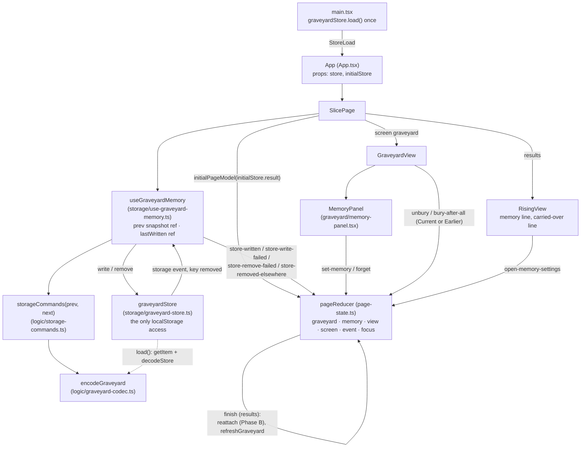
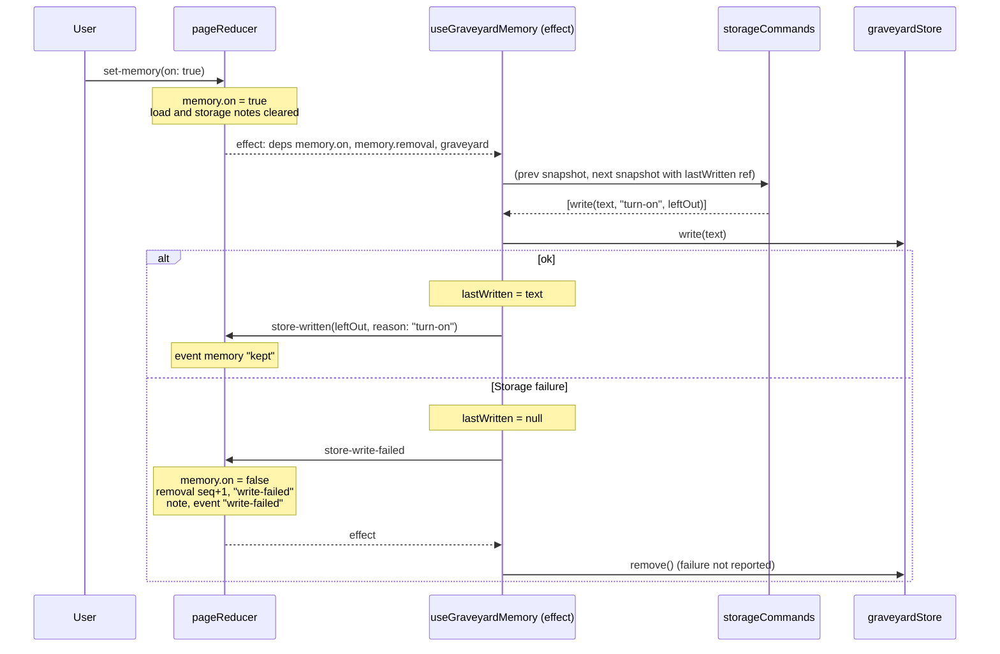

# Design Document: graveyard-memory

## Overview

`graveyard-memory` lets the user keep the Graveyard on their own device. Memory is off by default. Ticking "Remember my graveyard on this device" in a new Memory panel turns it on. While it is on, every change to the Graveyard is written to `localStorage` under one key, `zombills.graveyard.v1`. On the next visit `main.tsx` reads that key once, before the first render, and the Page starts with the restored Graveyard and Memory on. "Forget everything" removes the key and empties the Graveyard. Earlier records get a note and their own "Unbury" and "Bury after all" buttons. In Phase B, an answer whose id changed between statements moves to the one matching subscription (Req 6).

The design keeps the two layers of graveyard-ui and adds a third, very small one:

1. **Pure logic** (`apps/web/src/slice/logic/`): a Codec (`graveyard-codec.ts`) that turns a Graveyard into Store text and back; `storage-commands.ts`, which decides from two Memory snapshots what to write or remove; `reattach.ts` (Phase B); and `memory-text.ts` with every new sentence. No React, DOM, storage, clock, randomness or logging. The existing purity lint block covers the folder by path. Every PBT of this spec lives here or in `page-state.property.test.ts`.
2. **Storage** (`apps/web/src/slice/storage/`): `graveyard-store.ts`, the **only** file in `apps/web/src` that touches `localStorage`. It wraps every call so it never throws, and it owns the one `storage` event listener. `use-graveyard-memory.ts` is the React hook that runs the Commands after each state change.
3. **React view** (`apps/web/src/slice/`): `pageReducer` gains a `memory` field and new actions; `MemoryPanel` renders the checkbox, hint, notes and the "Forget everything" confirmation.

`packages/core` does not change. No new dependency. `CSP_POLICY`, `netlify.toml` and the Netlify headers do not change (Req 10.1, 10.5).

### Design decisions

| Decision | Choice | Reason |
| --- | --- | --- |
| Where storage access lives | `slice/storage/graveyard-store.ts`, created with `createGraveyardStore(target?)`. The default target reads `window.localStorage` lazily inside each wrapped call | Req 10.3 names this path. Reading the getter inside the `try` covers a throwing `window.localStorage` getter (Req 5.1). Tests pass a fake target, so no test has to patch `window` |
| The single read | `main.tsx` calls `graveyardStore.load()` once, at module level before `createRoot(…).render`, and passes the `StoreLoad` to `<App>` as a prop | Req 4.1 and spec review 1 #13. Outside React, Strict Mode cannot run it twice. No component calls `load` |
| What `load` returns | `StoreLoad = { result: ReadResult; text: string \| null }`: the Read result plus the raw text it was decoded from | Req 3.1 needs the raw text as the last-written text after an `ok` load. `result` is the Glossary's Read result unchanged |
| Who decides writes | Pure `storageCommands(prev, next)` over `MemorySnapshot`s. The hook builds the snapshots from the model plus a `lastWritten` ref, runs the Commands through the store, and dispatches the outcomes | Req 3.8 and spec review 1 #7. The reducer stays free of encoding and of storage outcomes it cannot know yet. The write protocol is a PBT without React |
| Where `lastWritten` lives | A `useRef` in `useGraveyardMemory`, not in the reducer. It is set to the raw text of an `ok` load, to the text of each successful write, and to `null` after any removal, a failed write or a removal by another tab | The value is only known after `setItem` returns. A ref survives Strict Mode's double effect run in the same component, so the second run sees the text the first run wrote and issues nothing (Req 3.7, 5.6) |
| Removals | The reducer asks for a removal by bumping `memory.removal = { seq, reason }`. `storageCommands` issues one `remove` when `seq` differs from the previous snapshot | Edge-triggered, so one request gives exactly one `removeItem` (Req 3.4). `reason` decides whether a failure shows the note of Req 5.3 (spec review 1 #11) |
| Where Memory lives | `PageModel.memory: MemoryModel`, next to `graveyard` | One reducer, as in graveyard-ui: "Forget" must empty the Graveyard, rebuild the Queue and turn Memory off in one step (Req 8.4). `tech.md` forbids state libraries |
| Codec validation | Encode keeps a record only when `parseStoredRecord(toStoredRecord(record))` is deeply equal to the record, and its `id` and `merchant` are at most 4,096 code units, and it is among the first 1,000 distinct ids | Every written record is then valid and round-trips by construction (Req 2.2). One rule covers every inconsistent record, for example a `currency` that differs from the id |
| Triple of a record | Always parsed from `id` with `STORED_ID_PATTERN` (`parseSubscriptionId`), in the Codec and in `reattach` | Req 2.4: a record cannot count in a currency its id does not name |
| `__proto__` and hostile JSON | `JSON.parse` inside `try`. Records are read only through `Object.hasOwn` and copied field by field into a fresh object literal. A plain object is one whose prototype is `Object.prototype` | `JSON.parse` defines `__proto__` as an own data property and never sets a prototype; copying named fields means no parsed object reaches the Graveyard (Req 4.6) |
| `storage` events | The store's `onRemovedElsewhere(listener)` adds one `window` `storage` listener. It calls `listener` when `event.key === STORE_KEY && event.newValue === null`, and also when `event.key === null` (another tab called `clear()`, which removes the Store key too) | Req 3.9 and spec review 1 #1. Writes by another tab are ignored: the last write wins (Out of scope) |
| Forget confirmation | Local `useState` in `MemoryPanel`; focus on "Cancel" and back on "Forget everything" with plain refs. "Forget" itself goes through the reducer, which focuses the heading | The confirmation changes nothing in the model until "Forget". The reducer's focus requests are for focus that depends on the model (graveyard-ui design, "Focus") |
| Earlier-record actions | `unbury` and `bury-after-all` keep their names. The reducer first tries the Current-record path of graveyard-ui; when the record is Earlier it calls `changeEarlierAnswer(graveyard, id, answer)`. The guard is `screen === "graveyard"` only | Req 7.9: they must work in `idle`, `error` and `no-subscriptions`. Same actions, so the buttons and the focus rules stay as they are |
| Announcements | `HauntEvent` gains `{ kind: "memory"; what: MemoryEventKind }`; the sentences live in `memory-text.ts` | The one `role="status"` region and `announcement(model)` stay as they are (graveyard-ui Req 14.3) |
| Cadence factor | `CADENCE_FACTOR` exported from `logic/graveyard.ts` with `yearlySavingFor(record)`. `graveyard-view.tsx` imports it in place of its local `PERIODS_PER_YEAR` | The Codec needs the factor (Req 2.4). One table instead of two |
| New dependencies | None | `localStorage`, `JSON`, `StorageEvent` and the existing stack cover everything |

---
## Architecture



### Write cycle



Each Graveyard change while Memory is on runs the same cycle with reason `"change"`. The effect runs after the commit, never during render (Req 3.7).

---

## Module layout

Paths are relative to `apps/web/`. New files are kebab-case (`structure.md`). **A** and **B** name the phase (Requirements, Introduction "Scope budget").

### New files

| File | Responsibility | Phase | Req |
| --- | --- | --- | --- |
| `src/slice/logic/graveyard-codec.ts` | `STORE_VERSION`, limits, `STORED_ID_PATTERN`, `parseSubscriptionId`, `parseStoredRecord`, `encodeGraveyard`, `decodeStore`, `ReadResult`, `StoredRecord`, `StoredGraveyard` | A | 2, 4.2–4.4, 4.6, 4.9, 4.10 |
| `src/slice/logic/storage-commands.ts` | `MemorySnapshot`, `StorageCommand`, `storageCommands`, `lastWrittenAfter` | A | 3.1, 3.3, 3.4, 3.8 |
| `src/slice/logic/memory-text.ts` | Every new sentence: the hint, the `idle` sentence, the restored line, the notes, the announcements, the Rising lines, the Forget confirmation text | A (carried-over sentences B) | 1.3–1.8, 1.10, 3.5, 4.3, 4.5, 4.10, 5.2, 5.3, 6.8, 7.1, 7.2, 8.2, 8.5 |
| `src/slice/logic/reattach.ts` | `reattach(graveyard, subscriptions)`, `qualifyingCandidates`, `carriedOverCount` | B | 6.1–6.5 |
| `src/slice/storage/graveyard-store.ts` | `STORE_KEY`, `StoreLoad`, `GraveyardStore`, `StoreTarget`, `createGraveyardStore`, `graveyardStore`, `EMPTY_STORE_LOAD`. The only `localStorage` access | A | 3.6, 3.9, 4.1, 5.1–5.5, 10.3 |
| `src/slice/storage/use-graveyard-memory.ts` | `useGraveyardMemory(model, store, initialText, dispatch)`: runs `storageCommands` in an effect, executes them, dispatches outcomes, subscribes to `onRemovedElsewhere` | A | 3.1–3.9, 5.2, 5.3 |
| `src/slice/graveyard/memory-panel.tsx` | `MemoryPanel`: heading "Memory", checkbox, hint, notes, `ForgetControl` with the confirmation group | A | 1.1–1.5, 3.5, 4.3, 4.5, 4.10, 5.2, 5.3, 8.1–8.3, 8.6, 9 |
| `src/slice/logic/graveyard-codec.test.ts`, `graveyard-codec.property.test.ts` | Codec examples and P1–P3 | A | 11.1, 11.2 |
| `src/slice/logic/storage-commands.test.ts`, `storage-commands.property.test.ts` | Command examples and P4 | A | 3.8, 11.1 |
| `src/slice/logic/memory-text.test.ts` | Exact copy, no `!`, no forbidden claim | A | 1.8 |
| `src/slice/logic/reattach.test.ts`, `reattach.property.test.ts` | The Req 6.9 table and P7, P8 | B | 6.9–6.11 |
| `src/slice/storage/graveyard-store.test.ts` | Store wrapping and the `storage` listener (jsdom) | A | 3.9, 5, 11.2 |
| `src/slice/storage/use-graveyard-memory.test.tsx` | Hook with a fake store: Strict Mode, failures, removal by another tab | A | 3.7, 5.6, 11.2 |
| `src/slice/graveyard/memory-panel.test.tsx` | Panel states and the confirmation | A | 1, 8, 9 |
| `src/slice/graveyard-memory-flow.test.tsx` | Page-level flows rendering `<App store initialStore>` | A (re-attach case B) | 11.3 |
| `src/slice/storage/test-store.ts` | `fakeStorage()`, `fakeStoreTarget()`, `storeLoadOf(text)` for tests; imported only by tests | A | 11.2, 11.3 |
| `storage-lint.test.ts` (next to `csp-plugin.test.ts`) | Lints fixture snippets with the ESLint Node API | A | 10.3 |
| `vitest.setup.ts` (next to `vite.config.ts`) | Shared test setup: `afterEach(() => { if (typeof window !== "undefined") window.localStorage.clear(); })`. Outside `src`, so the web lint block and the static text scan do not cover it | A | 11.2, 11.3 |

### Changed files

| File | Change | Phase | Req |
| --- | --- | --- | --- |
| `src/main.tsx` | Calls `graveyardStore.load()` once and renders `<App store={graveyardStore} initialStore={load} />` | A | 4.1 |
| `src/App.tsx` | `App({ store = graveyardStore, initialStore = EMPTY_STORE_LOAD })` passes both to `SlicePage` | A | 4.1 |
| `src/slice/logic/graveyard.ts` | `AnswerRecord.carriedOver`; `CADENCE_FACTOR`, `yearlySavingFor`, `changeEarlierAnswer`; `answerRecordFor` sets `carriedOver: false`; `refreshGraveyard` copies `carriedOver` | A | 2.4, 6.6, 7.3, 7.4 |
| `src/slice/page-state.ts` | `MemoryModel`, `initialPageModel`, new actions, `forget`, widened `unbury` and `bury-after-all`, `finish` clears the load notes; in Phase B `finish` calls `reattach` and the `results` view gains `carriedOver` | A, B | 1–8 |
| `src/slice/logic/haunt-view.ts` | `HauntView` gains `earlierIds` and `carriedOverIds` | A, B | 7.1, 7.2 |
| `src/slice/logic/announce.ts` | `memory` events; Phase B adds the carried-over sentence to the first `card` event | A, B | 1.3, 1.4, 5.2, 5.3, 6.8, 8.5, 9.2 |
| `src/slice/slice-page.tsx` | Takes `store` and `initialStore`; `useReducer(pageReducer, initialStore.result, initialPageModel)`; calls `useGraveyardMemory`; new `idle` sentence, restored line and load notes; passes `memory`, `enteringSeq` to `GraveyardView` and `memoryOn` to `RisingView` | A | 1.6, 1.7, 4 |
| `src/slice/graveyard/graveyard-view.tsx` | `GraveyardViewProps` gains `memory` and `enteringSeq`; `MemoryPanel` directly before the back button; "Unbury" and "Bury after all" on every record; the Earlier and carried-over notes; tracks the running tombstone rise for `busy` | A (carried-over note B) | 1.1, 7, 8.6 |
| `src/slice/graveyard/tombstone.tsx` | Optional `note?: string` under the title; optional `onRisen?: () => void` from the rise's `onAnimationComplete` | A | 7.1, 7.2, 8.6 |
| `src/slice/graveyard/rising-view.tsx` | The memory line with "Memory settings" (Req 1.10); Phase B adds the carried-over line under the Still-draining lines | A, B | 1.10, 6.8 |
| `src/slice/logic/test-arbitraries.ts` | `pageRecordArb`, `pageGraveyardArb`, `pageSubscriptionArb`, `pageOutcomeArb`, `memoryActionArb`, `sharedTripleOutcomeArb` (B); `answerRecordArb` gains `carriedOver` | A, B | 11.1 |
| `src/contrast.test.ts` | Only when the panel uses a new text and background pair (see "UI") | A | 1.9 |
| `eslint.config.js` | Storage and cookie bans, the Store module override, the `slice/logic` additions | A | 10.3 |
| `e2e/demo-path.spec.ts` | The memory path | A | 11.4 |
| `e2e/layout.spec.ts` | The Memory panel and the Forget confirmation group at 320 px | A | 9.5 |
| `vite.config.ts` | `test.setupFiles: ["./vitest.setup.ts"]` | A | 11.2, 11.3 |
| `tsconfig.json` | `include` gains `storage-lint.test.ts` and `vitest.setup.ts`, so `npm run typecheck` covers them like `csp-plugin.test.ts` | A | 10.3, 11.5 |
| `src/static-checks.test.ts` | The storage text scan and the single-`load` check (see "ESLint" and "Testing strategy") | A | 4.1, 10.3 |
| `.kiro/specs/graveyard-ui/requirements.md`, `.kiro/specs/vertical-slice/requirements.md` | Amendment notes of Req 10.2 and 10.8 (documentation only) | A | 10.2, 10.8 |

---
## Components and interfaces

### Graveyard logic (`logic/graveyard.ts`, changed)

```ts
export interface AnswerRecord {
  // …the nine graveyard-ui fields, unchanged…
  /** true after a Re-attach until the answer changes (Glossary "Answer record", amended) */
  readonly carriedOver: boolean;
}

export const CADENCE_FACTOR: Readonly<Record<Cadence, number>> = { weekly: 52, monthly: 12, yearly: 1 };

/** Req 2.4: null when cadenceAssumed, else currentAmountCents × factor. */
export function yearlySavingFor(
  record: Pick<AnswerRecord, "cadence" | "currentAmountCents" | "cadenceAssumed">,
): number | null;

/**
 * Req 7.3, 7.4: the Earlier record with this id gets `answer`, carriedOver false and
 * yearlySavingFor(record); same position, every other field and record unchanged.
 * Returns the same Graveyard object when no record has the id or the answer is already `answer`.
 */
export function changeEarlierAnswer(graveyard: Graveyard, id: string, answer: UsageAnswer): Graveyard;
```

- `answerRecordFor` adds `carriedOver: false`. `recordAnswer` therefore resets the flag on every recorded or changed answer of a Current record (Req 6.6).
- `refreshGraveyard` builds `{ ...answerRecordFor(subscription, record.answer), carriedOver: record.carriedOver }` (Req 6.6, spec review 1 #5). Earlier records are still kept by identity.
- `savingsTotals`, `answersMap`, `stillDraining` and `displayNames` do not change. With the Codec's limits (≤ 1,000 records, amounts ≤ `999_999_9900`) `savingsTotals` cannot throw on a restored Graveyard (Req 2.3).

### Codec (`logic/graveyard-codec.ts`, new, Phase A)

```ts
export const STORE_VERSION = 1;
export const MAX_STORED_RECORDS = 1_000;
export const MAX_ENCODED_TEXT_UNITS = 4_096;      // encode only (Req 2.2)
export const MAX_DECODED_TEXT_UNITS = 1_048_576;  // decode (Req 2.3)
export const MAX_STORED_AMOUNT_CENTS = 999_999_9900;
export const STORED_ID_PATTERN =
  /^sub:([A-Z]{3}):(weekly|monthly|yearly):(\*|\d+(?:-\d+)?):(.+)$/s;

export interface StoredRecord {
  id: string; merchant: string; serviceId: string | null; currentAmountCents: number;
  answer: UsageAnswer; cadenceAssumed: boolean; carriedOver: boolean;
}
export interface StoredGraveyard { version: 1; records: StoredRecord[] }

export interface Triple { currency: string; cadence: Cadence; merchantKey: string }

export type ReadResult =
  | { kind: "empty" }
  | { kind: "ok"; graveyard: Graveyard; dropped: number }
  | { kind: "newer" }
  | { kind: "unreadable" };

/** Currency, cadence, discriminator and merchantKey of a detector id, or null. */
export function parseSubscriptionId(id: string):
  (Triple & { discriminator: string }) | null;

/** Req 2.3 and 2.4: the Answer record of a Valid stored record, or null. Never throws. */
export function parseStoredRecord(value: unknown): AnswerRecord | null;

/** The seven stored fields of a record (Req 2.1). */
export function toStoredRecord(record: AnswerRecord): StoredRecord;

/** Req 2.1, 2.2: Store text plus the number of records left out. Never throws. */
export function encodeGraveyard(graveyard: Graveyard): { text: string; leftOut: number };

/** Req 4.2–4.4, 4.6, 4.9, 4.10. Never throws, for any string or null. */
export function decodeStore(text: string | null): ReadResult;
```

**`parseStoredRecord(value)`**, in order, returning `null` at the first failed check:

1. `value` is a non-null object, not an array, and `Object.getPrototypeOf(value) === Object.prototype`.
2. The seven fields are own properties (`Object.hasOwn`). Each is read once into a local.
3. `id` is a string of length ≤ `MAX_DECODED_TEXT_UNITS` (checked before the regex) and `parseSubscriptionId(id)` is not `null`.
4. `currentAmountCents` is a safe integer in `[1, MAX_STORED_AMOUNT_CENTS]`.
5. The discriminator is `*`, or its part before any `-` equals `String(currentAmountCents)`. `String` never writes leading zeros, so `"01099"` fails.
6. `merchant` is a string of length 1 to `MAX_DECODED_TEXT_UNITS`; `serviceId` is `null` or a non-empty string; `answer` is one of the two answers; `cadenceAssumed` and `carriedOver` are booleans.
7. The result is a fresh literal `{ id, merchant, serviceId, currency, cadence, currentAmountCents, answer, cadenceAssumed, carriedOver, yearlySavingCents: yearlySavingFor(…) }`, with `currency` and `cadence` from the id. Nothing else of `value` is read, so extra fields are dropped (Req 2.6).

**`encodeGraveyard(graveyard)`**: for each record in order, `toStoredRecord(record)` picks the seven fields. The record is kept when all hold: its `id` is not already kept; fewer than `MAX_STORED_RECORDS` are kept; `id.length` and `merchant.length` are ≤ `MAX_ENCODED_TEXT_UNITS`; and `parseStoredRecord(toStoredRecord(record))` is deeply equal to `record` (a ten-key field comparison, no library). Every other record adds 1 to `leftOut`. The text is `JSON.stringify({ version: 1, records })`. Inside a `try`, so a getter that throws counts as left out; with the Page's own records this never happens.

**`decodeStore(text)`**:

| Input | Result |
| --- | --- |
| `null` | `empty` |
| `JSON.parse` throws (inside `try`, including deep nesting) | `unreadable` |
| not a plain object (`null`, array, number, string) | `unreadable` |
| `version` is a number greater than 1 (`typeof === "number"`, finite) | `newer` |
| `version !== 1`, or `records` is not an array | `unreadable` |
| otherwise | `ok`: walk `records`; keep `parseStoredRecord(e)` when it is not `null`, its `id` is not kept yet and fewer than 1,000 are kept; `dropped = records.length − kept.length` |

The order of the `version` checks makes `{"version":2,"records":"x"}` `newer` (the key is kept) and `{"version":"1",…}` `unreadable` (Req 4.9, 4.10).

### Storage commands (`logic/storage-commands.ts`, new, Phase A)

```ts
export type RemovalReason = "untick" | "unreadable" | "forget" | "write-failed";
export interface RemovalRequest { seq: number; reason: RemovalReason }

export interface MemorySnapshot {
  on: boolean;
  graveyard: Graveyard;
  removal: RemovalRequest | null;
  /** Text last written, or read on an ok load; null after a removal or failed write */
  lastWritten: string | null;
}

export type StorageCommand =
  | { kind: "write"; text: string; leftOut: number; reason: "turn-on" | "load" | "change" }
  | { kind: "remove"; reason: RemovalReason };

/** `prev` is null on the first run after load. */
export function storageCommands(prev: MemorySnapshot | null, next: MemorySnapshot): StorageCommand[];

/** The last-written text after running `command` with outcome `ok`. */
export function lastWrittenAfter(lastWritten: string | null, command: StorageCommand, ok: boolean): string | null;
```

Rules of `storageCommands`, in this order:

0. When `prev !== null` and `prev.on`, `prev.removal` and `prev.graveyard` are the same values (by identity) as in `next`, issue nothing. A reducer step that changed nothing, and Strict Mode's second effect run on the same model, therefore never write, even after a failed write left `lastWritten` at `null`.
1. When `next.removal !== null` and `next.removal.seq !== prev?.removal?.seq`, issue `{ kind: "remove", reason }`.
2. When `next.on`: `const { text, leftOut } = encodeGraveyard(next.graveyard)`. The reason is `"turn-on"` when `prev !== null && !prev.on`, `"load"` when `prev === null`, else `"change"`. Issue `write` when the reason is `"turn-on"` or `text !== next.lastWritten`.
3. Nothing else. There is no `clear` command and no other key (Req 3.6).

`lastWrittenAfter`: a successful `write` gives its `text`; a failed `write` and any `remove` give `null`.

The reducer never sets `on` and a new removal in one step, so rules 1 and 2 never both fire. That makes "at most one write per step" (Req 5.6) and "no write while off" (Req 3.3) direct consequences, which P4 checks anyway.

### Store module (`storage/graveyard-store.ts`, new, Phase A)

```ts
export const STORE_KEY = "zombills.graveyard.v1";

export interface StoreLoad { result: ReadResult; text: string | null }
export const EMPTY_STORE_LOAD: StoreLoad = { result: { kind: "empty" }, text: null };

export interface StoreTarget {
  /** May throw (SecurityError) */
  storage: () => Storage;
  /** Called inside onRemovedElsewhere, never when the module loads (design review 1 #7) */
  events: () => Pick<Window, "addEventListener" | "removeEventListener">;
}

export interface GraveyardStore {
  /** One getItem, then decodeStore. Storage failure → EMPTY_STORE_LOAD (Req 5.1). */
  load(): StoreLoad;
  /** One setItem. false on a Storage failure. */
  write(text: string): boolean;
  /** One removeItem. false on a Storage failure. */
  remove(): boolean;
  /** Req 3.9. Returns the unsubscribe function. */
  onRemovedElsewhere(listener: () => void): () => void;
}

export function createGraveyardStore(target?: StoreTarget): GraveyardStore;
/** Default instance; touches nothing until a method is called. */
export const graveyardStore: GraveyardStore;
```

- The default target is `{ storage: () => window.localStorage, events: () => window }`. Building it reads nothing, so importing the module in a `node`-environment test is safe. `window.localStorage` is read inside each method's `try`, so a throwing getter is a Storage failure, not a crash (Req 5.1, 5.5). `window` is read inside `onRemovedElsewhere`.
- Every `catch` is bare (`catch {}`): nothing is logged, no error object is kept or returned (Req 5.5, 10.1).
- `load` calls `getItem(STORE_KEY)` once. Its text is decoded with `decodeStore`. The `text` field is the raw string for an `ok` result and `null` otherwise.
- The listener checks `(event.key === STORE_KEY && event.newValue === null) || event.key === null`. It reads no storage.
- The module calls only `getItem`, `setItem` and `removeItem`, always with `STORE_KEY` (Req 3.6).

### Memory hook (`storage/use-graveyard-memory.ts`, new, Phase A)

```ts
export function useGraveyardMemory(
  model: Pick<PageModel, "memory" | "graveyard">,
  store: GraveyardStore,
  initialText: string | null,
  dispatch: Dispatch<PageAction>,
): void;
```

- `lastWritten = useRef(initialText)`, `prev = useRef<MemorySnapshot | null>(null)`.
- One `useEffect` with deps `[model.memory.on, model.memory.removal, model.graveyard]` builds `next` from the model and `lastWritten.current`, computes `storageCommands(prev.current, next)`, stores `next` in `prev.current`, then runs each command:
  - `write`: `ok = store.write(text)`. On success, dispatch `store-written { leftOut, reason }` with the command's reason. On failure, dispatch `store-write-failed`.
  - `remove`: `ok = store.remove()`. On failure and `reason !== "write-failed"`, dispatch `store-remove-failed { reason }`.
  - After each, `lastWritten.current = lastWrittenAfter(…)`.
- A second effect, deps `[store]`, subscribes `store.onRemovedElsewhere(() => { lastWritten.current = null; dispatch({ type: "store-removed-elsewhere" }); })` and returns the unsubscribe (Req 3.9).
- Under Strict Mode the first effect runs twice on mount with the same model. The second run gets the same `on`, `removal` and `graveyard` as `prev.current`, so rule 0 issues nothing (Req 3.7, 5.6).

---
### Page state (`page-state.ts`, changed)

```ts
export type LoadNote =
  | { kind: "unreadable" }                 // Req 4.3
  | { kind: "dropped"; count: number }     // Req 4.5
  | { kind: "newer" };                     // Req 4.10

export type StorageNote = "write-failed" | "remove-failed";   // Req 5.2, 5.3

export interface MemoryModel {
  on: boolean;
  /** Bumped once per removal the Page asks for (storageCommands rule 1) */
  removal: RemovalRequest | null;
  /** Shown in the idle panel and the Memory panel */
  loadNote: LoadNote | null;
  /** Shown in the Memory panel only */
  storageNote: StorageNote | null;
  /** Records the last successful write left out (Req 3.5); 0 while off */
  leftOut: number;
  /** Show the Req 1.7 restored line in the idle panel */
  restored: boolean;
}

export type MemoryEventKind =
  | "kept"            // Req 1.3
  | "not-kept"        // Req 1.4
  | "write-failed"    // Req 5.2
  | "left-out"        // Req 3.5, when the count rises after a user action
  | "forgotten";      // Req 8.5

export type HauntEvent =
  | /* graveyard-ui kinds */
  | {
      kind: "memory";
      what: MemoryEventKind;
      /** Req 5.3: set by store-remove-failed on a not-kept or forgotten event (design review 1 #9) */
      removeFailed?: true;
    };

export type FocusTarget = /* graveyard-ui targets */ | "memory-checkbox";

export interface PageModel {
  // …graveyard-ui fields…
  /** Survives start, finish, reset; kept on reload only while memory.on (Req 9.7 amended) */
  graveyard: Graveyard;
  memory: MemoryModel;
}

export function initialPageModel(read: ReadResult): PageModel;
export const INITIAL_PAGE_MODEL: PageModel = initialPageModel({ kind: "empty" });
```

In Phase B the `results` view gains `carriedOver: number`, the count of records re-attached for its outcome. It lives in the view, so a new statement, "Start again" and a non-results outcome drop it with the view, and `forget` sets it to `0` (Req 8.4).

**`initialPageModel(read)`** (Req 4.2–4.5, 4.10, 5.1):

| `read.kind` | `graveyard` | `memory` |
| --- | --- | --- |
| `empty` | `[]` | off, no removal, no notes |
| `ok` | `read.graveyard` | on; `loadNote` `dropped` when `read.dropped > 0`; `restored: read.graveyard.length > 0` |
| `unreadable` | `[]` | off; `removal: { seq: 1, reason: "unreadable" }`; `loadNote` `unreadable` |
| `newer` | `[]` | off; no removal (the key is kept); `loadNote` `newer` |

`runId`, `view`, `screen`, `event` and `focus` are as in `INITIAL_PAGE_MODEL` today. A Storage failure on load is already `empty` from the store (Req 5.1).

**New and changed actions.** "Unchanged" means the reducer returns the same model object.

| Action | Guard (else unchanged) | Changes |
| --- | --- | --- |
| `{ type: "set-memory"; on: true }` | `!memory.on` | `on: true`; `loadNote`, `storageNote` `null`; `leftOut: 0`; `event: null`. The announcement waits for `store-written` (Req 1.3) |
| `{ type: "set-memory"; on: false }` | `memory.on` | `on: false`; `removal` seq + 1, `"untick"`; `loadNote` `null` when it is `dropped` (Req 4.5); `storageNote` `null`; `leftOut: 0`; `event` memory `not-kept`. Graveyard unchanged (Req 1.4) |
| `{ type: "store-written"; leftOut; reason }` | `memory.on`, and `reason === "turn-on"` or `leftOut !== memory.leftOut` | `leftOut`; `event` memory `kept` when `reason` is `"turn-on"`; memory `left-out` when `reason` is `"change"` and `leftOut > memory.leftOut`; no event when `reason` is `"load"`, because notes shown on load are not announced (Req 9.2, design review 1 #8) |
| `{ type: "store-write-failed" }` | `memory.on` | `on: false`; `removal` seq + 1, `"write-failed"`; `storageNote: "write-failed"`; `leftOut: 0`; `event` memory `write-failed`. Graveyard unchanged; focus stays (Req 5.2, 9.4) |
| `{ type: "store-remove-failed"; reason }` | `reason !== "write-failed"` | `storageNote: "remove-failed"`. For `"untick"` and `"forget"`: `event` becomes a new object `{ kind: "memory", what: "not-kept" \| "forgotten", removeFailed: true }`, so the region announces one combined sentence and the first message is not lost (Req 1.4, 8.5, 5.3). For `"unreadable"`: event unchanged (shown on load, not announced; Req 9.2) |
| `{ type: "store-removed-elsewhere" }` | `memory.on` | `on: false`; no removal; `leftOut: 0`; graveyard unchanged; no event (Req 3.9) |
| `{ type: "forget" }` | `screen === "graveyard"` | `graveyard: []`; `memory`: off, `removal` seq + 1 `"forget"`, every note `null`, `leftOut: 0`, `restored: false`; in `results`: `rising = { order: risingOrder(outcome.subscriptions, outcome.statement), stage: { kind: "ask" } }` and (B) `carriedOver: 0`; `event` memory `forgotten`; focus `graveyard-heading` (Req 8.4, 8.5). The Burial sequence cannot be running, because `open-graveyard` resets the stage |
| `{ type: "open-memory-settings" }` | `view.kind === "results"`, `screen === "main"` | As `open-graveyard`, but focus `memory-checkbox` (Req 1.10) |
| `unbury` (changed) | `screen === "graveyard"` and a record with the id and `answer: "not-using"` exists | Current record (view `results` and its id is in `outcome.subscriptions`): unchanged graveyard-ui path. Earlier record: `changeEarlierAnswer(graveyard, id, "still-using")`. Both: `event` `unburied`, focus `resting-item:id` (Req 7.3, 7.6, 7.9) |
| `bury-after-all` (changed) | as `unbury`, with `answer: "still-using"` | Current: unchanged path. Earlier: `changeEarlierAnswer(graveyard, id, "not-using")`. Both: `event` `buried`, focus `tombstone:id`, so the tombstone rises (Req 7.4) |
| `finish` (changed) | unchanged | Also sets `loadNote: null` and `restored: false` for every outcome (Req 1.7, 4.3, 4.5, 4.10). Phase B: for `results`, `const moved = reattach(model.graveyard, outcome.subscriptions)`, then `refreshGraveyard(moved, …)`, and `carriedOver = carriedOverCount(model.graveyard, moved)` (Req 6.1) |

No other action reads or writes `memory`, so `start`, `fail`, `reject`, `reset`, the Rising actions and the screen switches keep it unchanged. `pageReducer` stays pure; it never calls the store.

### Re-attach (`logic/reattach.ts`, new, Phase B)

```ts
/** Req 6.2: Free subscriptions with o's Triple, not guessed unless o is, whose history holds o's amount. */
export function qualifyingCandidates(
  orphan: AnswerRecord,
  free: readonly Subscription[],
): Subscription[];

/** Req 6.1–6.5. Pure; returns the same Graveyard object when nothing moves. */
export function reattach(graveyard: Graveyard, subscriptions: readonly Subscription[]): Graveyard;

/** Positions whose id differs between `before` and `after` (same length by Req 6.5). */
export function carriedOverCount(before: Graveyard, after: Graveyard): number;
```

One pass:

1. `currentIds` = ids of `subscriptions`; `recordIds` = ids of `graveyard`.
2. Orphans: records whose id is not in `currentIds`. Free: subscriptions whose id is not in `recordIds`.
3. For each Orphan `o`, `parseSubscriptionId(o.id)` gives its Triple; an id that does not parse has no candidates. A candidate `s` has `s.currency`, `s.cadence` and `s.merchantKey` equal to the Triple, `!s.evidence.cadenceAssumed || o.cadenceAssumed`, and `s.priceHistory.some(p => p.amountCents === o.currentAmountCents)`. There is no ratio rule (Glossary "Qualifying candidate").
4. `claims(s)` = the number of Orphans with `s` among their candidates.
5. Moves: every Orphan with exactly one candidate `s` and `claims(s) === 1`. All moves of a pass are decided before any is applied (Req 6.2).
6. Each move replaces `o` in place with `{ ...answerRecordFor(s, o.answer), carriedOver: true }`, so `cadenceAssumed` is `s.evidence.cadenceAssumed` (Req 6.3).

`reattach` repeats passes until one moves nothing (Req 6.4). Each move removes one Orphan and one Free subscription, so the loop ends after at most `orphans + 1` passes. A moved record is never guessed while its record was not, so the refresh of Req 9.5 that follows never removes it.

### Derived view (`logic/haunt-view.ts`, changed)

`HauntView` gains:

- `earlierIds: ReadonlySet<string>`: ids of records that are not Current records. In `idle`, `error` and `no-subscriptions` every record is Earlier.
- `carriedOverIds: ReadonlySet<string>` (B): Current records with `carriedOver: true`.

`tombstones`, `kept`, `savings` and `fogCleared` already work on a restored Graveyard with no statement (Req 4.7).

### Announcements (`logic/announce.ts`, changed)

`eventSentence` gets one case: `{ kind: "memory", what, removeFailed }` returns `memoryAnnouncement(what, model.memory, removeFailed)` from `memory-text.ts`. `kept` is followed by the left-out sentence when `memory.leftOut > 0`. With `removeFailed`, the sentence is `MEMORY_NOT_KEPT_REMOVE_FAILED` or `FORGOTTEN_REMOVE_FAILED` (copy table): `MEMORY_NOT_KEPT` or `FORGOTTEN` with its last clause (`It is kept until you close this page.` or `Nothing is kept on this device.`) replaced by `REMOVE_FAILED_NOTE`, not followed by it, so the announcement never says both that nothing is kept and that something could not be cleared. It is announced in one region update (design review 1 #9). In Phase B the first `card` event (`first: true`) and the `results` default sentence add the carried-over sentence after the Still-draining sentences when `view.carriedOver > 0` (Req 6.8).

### Text (`logic/memory-text.ts`, new)

Constants, each the exact copy of the requirement:

| Constant | Text | Req |
| --- | --- | --- |
| `MEMORY_HEADING` | `Memory` | 1.1 |
| `MEMORY_LABEL` | `Remember my graveyard on this device` | 1.1 |
| `MEMORY_HINT` | `Only merchant text as printed on your statement (it can include reference numbers), amounts and your answers are kept, in this browser on this device. Transactions, dates and file names are not. Nothing is sent anywhere.` | 1.5 |
| `IDLE_SENTENCE` | `Your statement stays on this device and is never uploaded. Nothing is kept after you close this page unless you choose to remember your graveyard. A statement covering 2 to 3 months gives the best results.` | 1.6 |
| `restoredLine(buried, resting)` | `Your graveyard from this device is back: <n> buried, <m> resting.` | 1.7 |
| `MEMORY_KEPT` | `Your graveyard will be kept on this device until you forget it.` | 1.3 |
| `MEMORY_NOT_KEPT` | `Your graveyard is no longer kept on this device. It is kept until you close this page.` | 1.4 |
| `leftOutNote(n)` | `<n> answers could not be kept on this device. They are kept until you close this page.` / the singular form | 3.5 |
| `UNREADABLE_NOTE` | `Your saved graveyard could not be read, so it was ignored.` | 4.3 (amended by design review 1 #9) |
| `droppedNote(n)` | `<n> saved answers could not be read and were left out.` / the singular form | 4.5 |
| `NEWER_NOTE` | `Your saved graveyard was made by a newer version of Zombills.` | 4.10 |
| `WRITE_FAILED_NOTE` | `This browser would not save your graveyard. It is kept until you close this page.` | 5.2 |
| `REMOVE_FAILED_NOTE` | `This browser would not clear the saved graveyard. Clear this site's data in the browser settings to remove it.` | 5.3 |
| `MEMORY_ON_LINE`, `MEMORY_SETTINGS` | `Your answers are kept on this device.`, `Memory settings` | 1.10 |
| `EARLIER_NOTE` | `From an earlier statement` | 7.1 |
| `CARRIED_OVER_NOTE` (B) | `Answer carried over from an earlier statement` | 7.2 |
| `carriedOverLine(n)` (B) | `<n> earlier answers were carried over to this statement.` / the singular form | 6.8 |
| `FORGET_BUTTON`, `FORGET_QUESTION`, `FORGET_CONFIRM`, `FORGET_CANCEL` | `Forget everything`, `Forget every answer and tombstone? This cannot be undone.`, `Forget`, `Cancel` | 8.1, 8.2 |
| `FORGOTTEN` | `Everything is forgotten. Nothing is kept on this device.` | 8.5 |
| `MEMORY_NOT_KEPT_REMOVE_FAILED` | `Your graveyard is no longer kept on this device. This browser would not clear the saved graveyard. Clear this site's data in the browser settings to remove it.` (`MEMORY_NOT_KEPT` with `It is kept until you close this page.` replaced by `REMOVE_FAILED_NOTE`) | 1.4, 5.3 |
| `FORGOTTEN_REMOVE_FAILED` | `Everything is forgotten. This browser would not clear the saved graveyard. Clear this site's data in the browser settings to remove it.` (`FORGOTTEN` with `Nothing is kept on this device.` replaced by `REMOVE_FAILED_NOTE`) | 8.5, 5.3 |

---
## UI

### Entry (`main.tsx`, `App.tsx`)

```tsx
// main.tsx, after the font and CSS imports
const initialStore = graveyardStore.load();   // the one getItem (Req 4.1)
createRoot(rootElement).render(
  <StrictMode>
    <App store={graveyardStore} initialStore={initialStore} />
  </StrictMode>,
);
```

`App` defaults both props (`graveyardStore`, `EMPTY_STORE_LOAD`), so every existing `render(<App />)` test keeps working and makes no storage call while Memory is off. Tests that need storage pass `createGraveyardStore(fakeStoreTarget())` and `storeLoadOf(text)`.

### Page shell (`slice-page.tsx`)

- `useReducer(pageReducer, initialStore.result, initialPageModel)` and `useGraveyardMemory(model, store, initialStore.text, dispatch)`.
- The `idle` panel shows, in order: `IDLE_SENTENCE` (Req 1.6); `restoredLine(tombstones, kept)` while `memory.restored` and the Graveyard is not empty (Req 1.7); the `loadNote` text when there is one (Req 4.3, 4.5, 4.10). The counts are read live from `haunt.tombstones` and `haunt.kept`, so an Earlier change in the Graveyard view is reflected when the user goes back. The "Open the graveyard" button in the Gate block comes after the panel in DOM and visual order, so the line is above it.
- Notes on load are plain text and not announced (Req 9.2). The idle panel is read in order.

### Memory panel (`graveyard/memory-panel.tsx`)

```ts
export interface MemoryPanelProps {
  memory: MemoryModel;
  /** true when the Graveyard has a record */
  hasRecords: boolean;
  /** true while the tombstone rise of Req 7.4 runs */
  busy: boolean;
  dispatch: Dispatch<PageAction>;
}
```

Layout, top to bottom, one column on every width (Req 9.5), gaps on the 8 px grid (`gap-3`, `p-0` inside the view's own `p-6`):

1. `<section aria-labelledby>` with `<h3>Memory</h3>`.
2. `<label>` wrapping a native `<input type="checkbox">` and `MEMORY_LABEL`. `checked={memory.on}`, `onChange` dispatches `set-memory`. `aria-describedby` names the hint `<p>`. The input has `data-focus="memory-checkbox"` through `useFocusRequest` (Req 1.10). It is never unmounted, so a failure that unticks it leaves focus on it (Req 9.4).
3. The hint `<p id>` with `MEMORY_HINT`.
4. Notes, each a `<p>`: `loadNote`, `storageNote`, then `leftOutNote(memory.leftOut)` while `leftOut > 0`.
5. `ForgetControl`, shown when `hasRecords || memory.on` (Req 8.1).

**`ForgetControl`** keeps `confirming` in `useState`:

| State | Shows | Keys and focus |
| --- | --- | --- |
| Idle | Button `Forget everything` | — |
| Confirming | `<div role="group" aria-labelledby={questionId}>` with `<p id={questionId}>` `FORGET_QUESTION`, buttons `Forget` and `Cancel` | On entering, `cancelRef.current.focus()` in an effect. `onKeyDown` on the group: Escape acts as Cancel (Req 8.2) |
| After Cancel | Button `Forget everything` | Focus back on it through `forgetRef` (Req 8.3) |
| After Forget | `dispatch({ type: "forget" })`, `confirming` set to `false` | The reducer focuses the heading "Your graveyard" (Req 8.5) |

While `busy`, `Forget everything` and `Forget` have `aria-disabled="true"` and their `onClick` returns at once (Req 8.6). The buttons use the view's `BUTTON_CLASS` and the global `--moss` focus ring (Req 9.1). Their accessible names are their text and are unique on the screen, because no other control is named "Forget", "Cancel" or "Forget everything" (checked by `expectUniqueButtonNames`).

Colours: body text `--bone` on the view's `bg-fog/95` surface, the pair the Graveyard view already uses. The panel adds no new pair, so `contrast.test.ts` changes only if the task picks another colour for the notes (Req 1.9).

### Graveyard view (`graveyard/graveyard-view.tsx`)

`GraveyardViewProps` gains two required props (design review 1 #5):

```ts
  /** model.memory, for MemoryPanel */
  memory: MemoryModel;
  /** model.focus.seq while enteringId is set, else null; keys the rise for busy */
  enteringSeq: number | null;
```

`SlicePage` passes `memory={model.memory}` and `enteringSeq={enteringId !== null ? model.focus?.seq ?? null : null}`. `hasRecords` is derived inside the view as `haunt.tombstones.length + haunt.kept.length > 0`, so it needs no prop. The `renderView` helper in `graveyard-view.test.tsx` and the helper in `rising-view.test.tsx` gain the new required props.

- `MemoryPanel` is rendered directly before the back-button row, after the Already stopped list and after the Share panel, also when the Graveyard is empty (Req 1.1).
- `TombstoneActions` always shows `Unbury` (Current and Earlier). `RestingItem` always shows `Bury after all`. Accessible names stay `Unbury <Display name>` and `Bury after all <Display name>` (Req 9.1).
- `note` for a record: `EARLIER_NOTE` when `haunt.earlierIds` has it; (B) `CARRIED_OVER_NOTE` when `haunt.carriedOverIds` has it; else none. It goes to `Tombstone` as `note` and into `RestingItem` as a `<span>` after the Display name, inside the item's `<p>`, so screen readers read it with the item (Req 7.1, 7.2, 9.3).
- Running rise: `const [risenSeq, setRisenSeq] = useState<number | null>(null)`; `busy = enteringSeq !== null && risenSeq !== enteringSeq`. The entering `Tombstone` gets `onRisen={() => setRisenSeq(enteringSeq)}`. A timer of `BURIAL_FALLBACK_MS` (2 s, `motion.ts`) also sets it, so a skipped animation cannot leave "Forget everything" disabled. Keying on the focus seq, not the id, makes a second rise of the same record busy again ("Bury after all X", "Unbury X", "Bury after all X"; design review 1 #6).
- `PERIODS_PER_YEAR` is replaced by `CADENCE_FACTOR` from `logic/graveyard.ts`.

### Tombstone (`graveyard/tombstone.tsx`)

Two optional props: `note?: string`, rendered as a small `<p>` directly under the "Here lies …" title inside the section (the title stays the `aria-labelledby` target, so the region name is unchanged); and `onRisen?: () => void`, passed to the `motion.section`'s `onAnimationComplete` only while `entering`.

### Rising (`graveyard/rising-view.tsx`)

`RisingViewProps` gains `memoryOn: boolean` and (B) `carriedOver: number`, both required. `SlicePage` passes `memoryOn={model.memory.on}` (design review 1 #5).

- While `memoryOn`, under the progress row: `<p>` `MEMORY_ON_LINE` and a button `Memory settings` that dispatches `open-memory-settings` (Req 1.10).
- (B) When `carriedOver > 0`: `<p>` `carriedOverLine(carriedOver)` directly after the Still-draining lines (Req 6.8).

---

## ESLint (`eslint.config.js`, Req 10.3)

New constants next to the existing ones:

```js
const STORAGE_MESSAGE =
  "Only slice/storage/graveyard-store.ts may touch localStorage (graveyard-memory Req 10.3).";
const STORAGE_NAMES = ["localStorage", "sessionStorage", "indexedDB", "caches"];
const STORAGE_GLOBALS = STORAGE_NAMES.map((name) => ({ name, message: STORAGE_MESSAGE }));
const STORAGE_PROPERTIES = ["window", "globalThis", "self"].flatMap((object) =>
  STORAGE_NAMES.map((property) => ({ object, property, message: STORAGE_MESSAGE })),
);
const COOKIE_PROPERTY = { object: "document", property: "cookie", message: STORAGE_MESSAGE };
const STORE_MODULE = "apps/web/src/slice/storage/graveyard-store.ts";
```

| Block | `no-restricted-globals` | `no-restricted-properties` |
| --- | --- | --- |
| Web (`apps/web/src/**/*.{ts,tsx}`, not tests) | `WEB_NETWORK_GLOBALS`, `STORAGE_GLOBALS` | `WEB_NETWORK_PROPERTIES`, `STORAGE_PROPERTIES`, `COOKIE_PROPERTY` |
| Store module (new block after the web block, `files: [STORE_MODULE]`) | `WEB_NETWORK_GLOBALS`, `STORAGE_GLOBALS` without `localStorage` | `WEB_NETWORK_PROPERTIES`, `STORAGE_PROPERTIES` without `window.localStorage`, `COOKIE_PROPERTY` |
| `slice/logic` (existing) | unchanged: `RESTRICTED_GLOBALS` already bans `localStorage`, `window` and `document`, and the block already bans `sessionStorage`, `indexedDB`, `caches` | adds `STORAGE_PROPERTIES` and `COOKIE_PROPERTY` next to `WEB_NETWORK_PROPERTIES` and the clock and randomness entries |

Every override repeats the network entries, because flat config replaces a rule's options (Req 10.3). The store block does not set `no-restricted-syntax` or `no-console`, so the web block's money and console rules still apply to it. Test files stay outside every block, as today. `use-graveyard-memory.ts` lives in `slice/storage/` but is not the Store module, so it gets the full web bans.

`storage-lint.test.ts` (Node environment) runs `new ESLint({ cwd: <repo root> }).lintText(code, { filePath })` on fixture strings. Every fixture is a call, an assignment or a `void` expression, so `@typescript-eslint/no-unused-expressions` (an error in the recommended set) never fires. The test keeps only messages whose `ruleId` is `no-restricted-globals` or `no-restricted-properties` and asserts their exact count (design review 1 #2):

| Snippet | `filePath` | Expected restricted-rule errors |
| --- | --- | --- |
| `localStorage.getItem("k");` | `apps/web/src/slice/slice-page.tsx` | 1 (`no-restricted-globals`) |
| `void window.sessionStorage.length;` | `apps/web/src/slice/slice-page.tsx` | 1 (`no-restricted-properties`) |
| `document.cookie = "a=b";` | `apps/web/src/slice/slice-page.tsx` | 1 (`no-restricted-properties`) |
| `window.localStorage.getItem("k");` | `apps/web/src/slice/storage/use-graveyard-memory.ts` | 1 |
| `window.localStorage.getItem("k"); void localStorage.length;` | `STORE_MODULE` | 0 |
| `void globalThis.localStorage; void sessionStorage; void fetch("x");` | `STORE_MODULE` | 3 |
| `void window.localStorage;` | `apps/web/src/slice/logic/graveyard-codec.ts` | at least 1 |

**Text scan.** `no-restricted-properties` matches only `Identifier.property`, so it misses `(window as Window).localStorage`, an aliased `window`, `globalThis.window.localStorage`, `document.defaultView!.localStorage`, computed keys and `cookieStore`. `static-checks.test.ts` therefore also reads every file under `apps/web/src` except `*.test.ts(x)`, the test helpers `test-store.ts` and `test-arbitraries.ts`, and `STORE_MODULE`, and fails when one contains `localStorage`, `sessionStorage`, `indexedDB`, `caches.`, `cookieStore` or `.cookie`. No `memory-text.ts` constant contains these words, so no copy needs an exclusion (design review 1 #10).

ESLint is a root dev dependency already; the test imports it from `eslint`. No dependency is added.

---
## Error handling

| Case | Where caught | Result |
| --- | --- | --- |
| `window.localStorage` getter throws (`SecurityError`, storage disabled) on load | `load` | `EMPTY_STORE_LOAD`; Memory off; no note (Req 5.1) |
| `getItem` throws on load | `load` | Same |
| Store text is not JSON, not a plain object, `version` not `1` and not a number above `1`, or `records` not an array | `decodeStore` | `unreadable`: Graveyard empty, Memory off, one `removeItem`, the note in the `idle` and Memory panels (Req 4.3) |
| Store `version` is a number above `1` | `decodeStore` | `newer`: key kept, Memory off, the note; a tick overwrites it (Req 4.10) |
| Some records invalid, duplicate or beyond 1,000 | `decodeStore` | The rest load; `dropped` note; one rewrite because the encoding differs from the raw text (Req 4.4, 4.5) |
| Valid Store with extra fields | `decodeStore`, `storageCommands` | Loads; one rewrite without the extra fields (Req 3.1) |
| Record whose `id` or `merchant` is over 4,096 code units, or that would not round-trip | `encodeGraveyard` | Left out of the Store, kept in memory; `leftOutNote` (Req 2.2, 3.5) |
| Many records near the 4,096-unit limit | `write` → `store-write-failed` | Known limit, no total budget: 1,000 records of 4,096 + 4,096 units is about 8 M units, above Chrome's quota of about 5 M, so `setItem` fails and Memory turns off for the whole Graveyard (Req 5.2). Real ids and merchants are far shorter (design review 1 #18) |
| `setItem` throws (`QuotaExceededError`, `SecurityError`) | `write` → hook → `store-write-failed` | Memory off and unticked; one `removeItem` tried; Graveyard unchanged; note and announcement (Req 5.2). No retry until the user ticks again (Req 5.4) |
| `removeItem` throws after untick, an unreadable load or Forget | `remove` → hook → `store-remove-failed` | Carry on as if removed; the Req 5.3 note; after untick or Forget, one combined announcement (the first message, then the remove-failed note). After an unreadable load the note sits next to "…so it was ignored.", which does not contradict it |
| `removeItem` throws after a failed write | `remove` → hook | Ignored; no second note (Req 5.3, spec review 1 #11) |
| Another tab removes the Store key or calls `clear()` | `onRemovedElsewhere` → `store-removed-elsewhere` | Memory off and unticked; nothing written or removed; Graveyard kept (Req 3.9) |
| Another tab writes the Store | none | Ignored; with both tabs on, the last write wins (Out of scope) |
| Tab A forgets or unticks while tab B, with Memory on, changes its Graveyard before B handles the `storage` event | none | B's `"change"` write puts its Graveyard back under the key. `storage` events arrive asynchronously, so this window cannot be closed without a read before each write, which Req 3.3's single read rules out. Rare; accepted for the hackathon (design review 1 #11) |
| `__proto__` key, deep nesting, very long strings | `decodeStore`, `parseStoredRecord` | No prototype change (fields copied into a fresh literal); `JSON.parse` errors caught; length checked before the regex (Req 4.6) |
| Strict Mode double render or double effect | `storageCommands` rule 0, `main.tsx` | No second `getItem`, `setItem` or `removeItem` (Req 3.7, 4.1) |
| Savings total not a safe integer | `savingsTotals` | Still throws `RangeError`, as in graveyard-ui. Unreachable from a restored Store: at most 1,000 records of at most `999_999_9900 × 52` (P2 checks it) |
| Two Orphan records share their only candidate, or one has two candidates (B) | `reattach` | No move; both stay Earlier records and the subscription rises (Req 6.2) |
| An Earlier record changes while a tombstone rise runs | `GraveyardView` | Allowed; only "Forget everything" and "Forget" wait for the rise (Req 8.6) |

No path logs, announces an error object or shows `error.message`. Every `catch` in the store is bare (Req 5.5, 10.1).

---

## Correctness properties

Each property is a fast-check test with the default 100 runs, in a `.property.test.ts` file next to its source (Req 11.1). Inputs are deep-frozen with `deepFreeze`. Each test name starts with its ID.

| ID | Property | File | Req 11 item | Validates |
| --- | --- | --- | --- | --- |
| P1 | **Round-trip.** For every `pageGraveyardArb` value `g` (records from `pageRecordArb`, unique ids, including unidentified keys with `:` and spaces, guessed records, `serviceId: null`, `carriedOver: true`, and records whose `id` or `merchant` is exactly 4,096 code units): `encodeGraveyard(g).leftOut === 0`, and `decodeStore(encodeGraveyard(g).text)` is `{ kind: "ok", graveyard, dropped: 0 }` with `graveyard` deeply equal to `g` | `logic/graveyard-codec.property.test.ts` | 11.1 "round-trip", and the "encode leaves out no generated record" check | 2.1–2.4 |
| P2 | **Decode never throws.** For every `fc.string()`, every `JSON.stringify(fc.jsonValue())`, and every encoded `pageGraveyardArb` value with one field of one record replaced by an `fc.jsonValue()` (or removed, or a `"__proto__"` key added to the record text): `decodeStore` returns without throwing; for `ok`, every record equals `parseStoredRecord` of some input element, ids are unique, `graveyard.length ≤ records.length`, `dropped === records.length − graveyard.length`, every returned object's prototype is `Object.prototype`, and `savingsTotals(graveyard)` does not throw | `logic/graveyard-codec.property.test.ts` | 11.1 "decode never throws" | 2.3, 4.4, 4.6 |
| P3 | **Derived fields.** For every Valid stored record drawn by `storedRecordArb` (the seven stored fields only, the id assembled from drawn currency, cadence, discriminator and `merchantKey` parts): `parseStoredRecord` is not `null`, the decoded `currency` and `cadence` are the id's first two groups, and `yearlySavingCents` is `null` exactly when `cadenceAssumed`, else `currentAmountCents × CADENCE_FACTOR[cadence]` | `logic/graveyard-codec.property.test.ts` | 11.1 "derived fields" | 2.4 |
| P4 | **Write protocol.** For every start (`initialPageModel` of an `empty`, `ok` or `unreadable` Read result, `ok` from `pageGraveyardArb` and its raw text) and every sequence from `memoryActionArb` (answer, change, Earlier change, new outcome, tick, untick, forget, removed elsewhere) applied with `pageReducer`, with each step's Commands from `storageCommands` run on a fake Storage whose `setItem` and `removeItem` never throw, and `lastWritten` tracked with `lastWrittenAfter`: while `memory.on` is false no `write` is issued, and every `remove` comes from untick, unreadable or forget; each step issues at most one `write`; no `write` repeats the current `lastWritten`; after each step with `memory.on`, `decodeStore(fake.getItem(STORE_KEY))` is `ok` with a Graveyard deeply equal to the model's minus the records `encodeGraveyard` left out; after each step with `memory.on` false, `lastWritten` is `null`. New outcomes come from `pageSubscriptionArb`, and the starting Graveyard reuses some of their ids, so restored records become Current; the test counts the steps that write a non-empty `records` array and asserts the count is above zero across the run (design review 1 #1) | `logic/storage-commands.property.test.ts` | 11.1 "write protocol (3.8)" | 3.1, 3.3, 3.4, 3.8, 5.6 |
| P5 | **Earlier changes.** For every Graveyard from `pageGraveyardArb`, every outcome from `answerableListArb` (so some records are Earlier), on the Graveyard screen: for every Earlier Tombstone, `unbury` then `bury-after-all` gives a record deeply equal to the original with `carriedOver: false`; `bury-after-all` on an Earlier record with `cadenceAssumed: true` gives `yearlySavingCents: null`; each change moves the sum of `savingsTotals` in that currency by exactly the record's `yearlySavingCents` (or `0` when `null`); `answersMap` and every other record are unchanged | `page-state.property.test.ts` | 11.1 "Earlier changes (7.7)" | 7.3–7.5, 7.7 |
| P6 | **Forget.** For every Graveyard, outcome (none, `no-subscriptions`, `results`) and Memory state, after `forget` on the Graveyard screen: the Graveyard is empty; in `results` the Queue equals the Risen ids in `risingOrder` and the stage is `ask`; `answersMap` is empty, so no classified subscription has `zombie`; `memory.on` is false; running the step's Commands on a non-throwing fake Storage leaves no Store key; with a `removeItem` that throws, `memory.on` is false and, after `store-remove-failed`, `storageNote` is `remove-failed` | `page-state.property.test.ts` | 11.1 "forget (8.8)" | 8.4, 8.8 |
| P7 (B) | **Re-attach.** For every Graveyard and subscription list from `sharedTripleOutcomeArb`: `reattach(reattach(g, s), s)` deep-equals `reattach(g, s)`; same length, at most one record per id, same answers in the same positions; every record whose id changed had an id not in `s`, now names a subscription that had no record, keeps its Triple, has `carriedOver: true`, and that subscription is in `qualifyingCandidates` of the old record against the initial Free subscriptions (Free only shrinks between passes, so this is what Req 6.10 asks; design review 1 #16); Current records are unchanged; frozen inputs are unchanged | `logic/reattach.property.test.ts` | 11.1 "re-attach (6.10)" | 6.2–6.5, 6.10 |
| P8 (B) | **Re-attach and refresh.** The graveyard-ui P4 property (`graveyard.property.test.ts`) run again with `refresh` replaced by `refreshGraveyard(reattach(g, list), list)`, and with the Unbury-then-Bury-after-all check expecting `carriedOver: false` on a carried-over record | `logic/reattach.property.test.ts` | 11.1 "re-attach and refresh (6.11)" | 6.6, 6.11 |

The graveyard-ui properties keep running. P4 there changes only in that the record keys now include `carriedOver`; P7 there (reducer) gains the `memory` field in its key check and asserts that the graveyard-ui actions leave `memory` unchanged.

### Generators (`logic/test-arbitraries.ts`)

- `pageRecordArb` (Req 11.1): `currency` from `SAVING_CURRENCIES`; `cadence`; `currentAmountCents` in `[1, 999_999_9900]` with small values mixed in; discriminator `*`, `String(amount)` or `String(amount) + "-" + r` with `r` from `fc.nat()`; `merchantKey` from `fc.oneof(known ids, "merchant:" + text, "unidentified:" + text)` where `text` is `fc.string({ unit: fc.constantFrom("a", "Z", "0", ":", " ", "/", "é", "\n") })`; `merchant` a non-empty string; `serviceId` a Known id or `null`; `answer`; `cadenceAssumed`; `carriedOver`; `yearlySavingCents` from `yearlySavingFor`. The id is assembled from these parts, so every draw is valid. Nothing is filtered.
- `storedRecordArb`: the same parts as `pageRecordArb`, returned as a `StoredRecord` together with the drawn parts, so P3 compares against the parts and not against a derived record.
- `longRecordArb`: `pageRecordArb` with `merchantKey` padded so `id.length === 4096`, and `merchant` padded to 4,096 units.
- `pageGraveyardArb`: `fc.uniqueArray(fc.oneof(pageRecordArb, longRecordArb), { selector: r => r.id, maxLength: 30 })`.
- `pageSubscriptionArb` (design review 1 #1): a `Subscription` whose `id` is built from the same parts as `pageRecordArb` (`merchantKey`, `currency`, `cadence`, discriminator from `currentAmountCents`), with those fields set to agree with the id and `yearlyCostCents = currentAmountCents × CADENCE_FACTOR[cadence]`. `pageOutcomeArb` draws a list of them with unique ids, and P4's start draws its `ok` Graveyard partly from records built with `answerRecordFor` on some of those subscriptions, so the two share ids. The existing `answerableSubscriptionArb` (ids like `"a"`) stays for the graveyard-ui properties.
- `memoryActionArb(ids)`: the graveyard-ui actions plus `set-memory`, `forget`, `store-removed-elsewhere`, and `finish` with an outcome redrawn from `pageOutcomeArb`.
- `sharedTripleOutcomeArb` (B): a small set of Triples; for each, several records with discriminators `*` or amounts, and several subscriptions whose `priceHistory` holds some record amounts, some guessed. The existing `answerRecordArb` gets `carriedOver: fc.boolean()`.

---
## Testing strategy

Tools are unchanged (`tech.md`): Vitest and fast-check in the `node` environment for logic; jsdom, Testing Library and `userEvent` for components and the store; Playwright for the browser. Component test files set `MotionGlobalConfig.skipAnimations = true` and fail on any `console` call, as in graveyard-ui. Every test that ticks the checkbox renders `<App store={createGraveyardStore(fakeStoreTarget())} …/>` with a fake store, never the default one. As a second guard, `vitest.setup.ts` clears jsdom's `localStorage` after each test, so a test that forgets the fake store cannot leak state into the next (design review 1 #17). Storage is faked through `StoreTarget` (`storage/test-store.ts`): `fakeStorage({ throwOn?: { get?, set?, remove?, getter? } })` records every call in order, and `fakeStoreTarget(storage)` adds an `EventTarget` for synthetic `StorageEvent`s. Money text in component tests is built with `formatMoney`; exact `en-US` strings are pinned in logic tests and E2E.

### Unit tests (logic and storage)

| File | Cases | Validates |
| --- | --- | --- |
| `logic/graveyard-codec.test.ts` | Every row of the Req 2.6 table. The Glossary example encodes to exactly the Glossary JSON. The Req 4.8 Store gives Netflix plus `dropped: 1`. Every Req 4.9 input is `unreadable`; `{"version":2,"records":[]}` and `{"version":2,"records":"x"}` are `newer`; `null` is `empty`. A record with an `id` of 4,097 units is left out by encode (`leftOut: 1`) and accepted by decode; one of 1,048,577 units is rejected. 1,001 valid records load 1,000 with `dropped: 1`. Duplicate ids keep the first. Discriminator `01099` with amount `1099` is rejected; `1099-2` is accepted. A merchantKey with `\n` is accepted (the `s` flag). `{"__proto__":{"polluted":1},…}` as a record and as the root: no prototype changes, `({}).polluted` is `undefined`. 10,000-deep `[` nesting returns `unreadable` without throwing. Encode of a record whose `currency` disagrees with its id is left out | 2, 4.3–4.6, 4.8–4.10, 11.2 |
| `logic/storage-commands.test.ts` | First run after `empty`: nothing. After an `ok` load whose encoding equals the raw text: nothing; with extra fields or `dropped > 0`: one `write` with reason `load`. Unreadable start: one `remove` `unreadable`. Tick: one `write` `turn-on`, also when `lastWritten` already holds the same text. Untick: one `remove` `untick` and no `write`. Same snapshot twice: nothing. A Graveyard change that encodes to the same text: nothing. `lastWrittenAfter` for each command and outcome | 3.1, 3.3, 3.4 |
| `logic/memory-text.test.ts` | Each constant equals the requirement text; the singular forms of `leftOutNote`, `droppedNote`, `carriedOverLine`; no string contains `!`, `encrypt`, `secure`, `safe` or a bare `private` (Req 1.8) | 1.3–1.8, 3.5, 4.3, 4.5, 4.10, 5.2, 5.3, 6.8, 8.5 |
| `logic/graveyard.test.ts` (changed) | The record key list gains `carriedOver`. `refreshGraveyard` keeps `carriedOver: true`. `recordAnswer` resets it. `changeEarlierAnswer`: the Req 7.8 totals (`34776` → `13188` → `34776`); a guessed record buried after all gets `yearlySavingCents: null`; an unknown id returns the same object | 6.6, 7.3, 7.4, 7.8 |
| `page-state.test.ts` (changed) | `initialPageModel` for each Read result. Every row of the action table, including each guard's "same object" case. `unbury` and `bury-after-all` on an Earlier record in `idle`, `error`, `no-subscriptions` and `results`. The graveyard-ui case "ignores an Earlier record whose subscription is not in the current statement" (line 741) is replaced by the Earlier path. `finish` clears `loadNote` and `restored`. `forget` in `results` resets the Queue and focuses the heading. `open-memory-settings` focuses `memory-checkbox` | 1.10, 3.9, 4, 5.2, 5.3, 7.9, 8.4 |
| `logic/announce.test.ts` (changed) | Each memory event's sentence; `kept` with `leftOut: 2` adds the plural note; (B) the first card sentence with `carriedOver: 1` | 1.3, 1.4, 5.2, 5.3, 6.8, 8.5, 9.2 |
| `logic/haunt-view.test.ts` (changed) | `earlierIds` in `idle` holds every record; in `results` only non-Current ones; (B) `carriedOverIds` | 7.1, 7.2 |
| `logic/reattach.test.ts` (B) | Every row of the Req 6.9 table, including the Apple TV+ must-not-move row. Two passes: record A moves in pass 1, which leaves B one candidate in pass 2. Nothing moves → same Graveyard object | 6.2–6.4, 6.9 |
| `storage/graveyard-store.test.ts` (jsdom) | `load` with no key → `EMPTY_STORE_LOAD`; with text → the decoded result and, for `ok`, the raw text; a throwing getter and a throwing `getItem` → `EMPTY_STORE_LOAD`. `write` and `remove` return `true`, or `false` on `QuotaExceededError` and `SecurityError`. Every call uses `STORE_KEY`; `clear` is never called. A synthetic `StorageEvent` with `key: STORE_KEY, newValue: null` calls the listener; with `newValue: "x"` or another key it does not; `key: null` does. The unsubscribe removes the listener. Nothing is logged | 3.6, 3.9, 5.1, 5.5, 11.2 |
| `storage/use-graveyard-memory.test.tsx` (jsdom) | With `renderHook` inside `<StrictMode>` and an `ok` load whose encoding differs: exactly one `setItem`. A failing `setItem` dispatches `store-write-failed`, then one `removeItem` and no `store-remove-failed`. A failing `removeItem` after untick dispatches `store-remove-failed`. A synthetic removal event dispatches `store-removed-elsewhere` and the next change writes nothing | 3.7, 3.9, 5.2, 5.3, 5.6, 11.2 |
| `static-checks.test.ts` (changed) | The storage text scan (see "ESLint"). `.load(` on a `graveyardStore` or `GraveyardStore` value appears only in `main.tsx` among non-test files (Req 4.1; design review 1 #12) | 4.1, 10.3 |
| `storage-lint.test.ts` | The ESLint fixture table above, filtered to the two restricted rules | 10.3 |

### Component tests

| File | Cases | Validates |
| --- | --- | --- |
| `graveyard/memory-panel.test.tsx` | The heading, unticked checkbox with its label, hint linked by `aria-describedby`. Each note. "Forget everything" hidden with no records and Memory off. The confirmation: group labelled by the question, focus on Cancel, Escape and Cancel restore the button and focus it, Forget dispatches `forget`. `busy`: both buttons `aria-disabled` and clicks ignored. Unique button names | 1.1, 1.2, 1.5, 8.1–8.3, 8.6, 9.1 |
| `graveyard/graveyard-view.test.tsx` (new cases) | The Memory panel is the element directly before the back-button row, also with an empty Graveyard (Req 1.1). `busy` on a second rise of the same record: "Bury after all X", "Unbury X", "Bury after all X" leaves "Forget everything" `aria-disabled` until the rise ends (design review 1 #6) | 1.1, 8.6 |
| `graveyard-memory-flow.test.tsx` | Renders `<App store={createGraveyardStore(target)} initialStore={…} />` without Strict Mode. Each case of Req 11.3: first visit (unticked, hint, new `idle` sentence, no storage call through the graveyard-ui flow); tick and bury Netflix (the Store text equals the Glossary example, the Rising line and "Memory settings" focus the checkbox); untick (`removeItem` once, tombstone still shown); an unidentified Apple record (the Store holds only the seven fields); load with a valid Store (restored line, "Open the graveyard", "From an earlier statement", counter; analysing `us-signed.csv` makes Netflix Current, it does not rise and the note is gone); unreadable, one bad record, newer (notes, rewrite, no `removeItem` for newer); a valid Store equal to its encoding (no write); the four Storage failures; Earlier Unbury and Bury after all with the Req 7.8 totals and focus; Forget everything with the effects of Req 8.4 and 8.5; reduced motion (the Earlier Bury after all rise uses only `opacity`, with `useReducedMotion` mocked as in `graveyard-flow.reduced.test.tsx`); (B) re-attach of Apple Music `1099` to `…:*:k` at `1199`. Also: a synthetic removal event unticks the checkbox with no storage call (Req 3.9); a failing `setItem` unticks the checkbox and focus stays on it (Req 9.4). Each row of the Req 5.7 table is a named test here or in `page-state.test.ts`, with the row in the test name (Req 11.2) | 3.9, 5.7, 9.4, 11.3 |

### Existing tests that change, and why

| Test | Change | Why |
| --- | --- | --- |
| `slice/slice-page.test.tsx` | The `idle` sentence expectation (line 55) becomes `IDLE_SENTENCE` | Req 1.6 |
| `slice/graveyard/graveyard-view.test.tsx` | "shows an Earlier record as a tombstone with no Unbury button" (line 188) and "shows an Earlier record's disclosure without Unbury" (line 336) now expect `Unbury <name>` and the note `From an earlier statement` | Req 7.1, 7.3 |
| `slice/page-state.test.ts` | Line 741 case (see above); whole-model expectations gain `memory` | Req 7.9 |
| `slice/page-state.property.test.ts` | The key list at line 162 gains `memory` | `PageModel` change |
| `slice/logic/graveyard.test.ts` | Key list at line 81 gains `carriedOver` | Glossary "Answer record" |
| `slice/logic/test-arbitraries.ts` | `answerRecordArb` gains `carriedOver` | Type change |
| `slice/logic/share-card.test.ts` | The throwing-getter key list at line 172 gains `carriedOver` | Type change; the share card still reads only `yearlySavingCents` |
| `slice/graveyard/share-panel.test.tsx` | The sorted Tombstone record key list (lines 325-334) gains `carriedOver`; added at task 1 (option a) | Type change; the share panel still passes the records through unchanged |
| `slice/graveyard-flow.test.tsx` | "graveyard flow: no storage" keeps its assertions; its name and comment say it renders `<App />` with the default `empty` load (Req 11.3 replaces graveyard-ui Req 16.2's check) | Req 11.3 |
| `e2e/demo-path.spec.ts` | Memory path added (below) | Req 11.4 |
| `e2e/layout.spec.ts` | At 320 px, the Memory panel and the open Forget confirmation group cause no horizontal scrolling | Req 9.5 |
| `slice/page-state.property.test.ts` `guardHolds` (lines 124–135) | `unbury` and `bury-after-all` now hold when `screen === "graveyard"` and a record with that id and the opposite answer exists, in any view, not only for a Current record in `results` | Req 7.9; design review 1 #3 |
| `slice/graveyard/graveyard-view.test.tsx`, `slice/graveyard/rising-view.test.tsx` | The render helpers (line 78 and line 43) pass the new required props `memory`, `enteringSeq` and `memoryOn` | design review 1 #5 |

Expected to pass unchanged: the share-card and cancel-helper suites (a restored Tombstone is an ordinary record), `graveyard-flow.motion.test.tsx`, `graveyard-flow.reduced.test.tsx`, `contrast.test.ts` (unless a new pair is used), `csp-plugin.test.ts`, `netlify-config.test.ts` and every `@zombills/core` test. `static-checks.test.ts` gains the new checks above.

### E2E (`e2e/demo-path.spec.ts`, Req 11.4)

The existing path runs first and unchanged, so its storage check still sees `localStorage.length` `0` with Memory off. A second test in the same file:

1. Same request, CSP and console listeners as the first test.
2. Choose `US bank, signed amounts`. Choose `Skip for now` on Adobe Creative Cloud and on Riverside Gym Membership, so Netflix is the Queue head with no other answer given. Bury Netflix, open the graveyard, tick `Remember my graveyard on this device`.
3. `page.evaluate`: `Object.keys(localStorage)` equals `["zombills.graveyard.v1"]`, and its value parses to `version: 1` with exactly one record (skipping, not keeping, is what makes it one).
4. `page.reload()`. The `idle` panel shows `Your graveyard from this device is back: 1 buried, 0 resting.` Open the graveyard: region `Here lies Netflix.`, the text `From an earlier statement`, counter `$215.88`.
5. `Forget everything`, then `Forget`. `localStorage.length` `0`, `sessionStorage.length` `0`, `document.cookie` `""`.
6. The test fails on any request that breaks Req 10.1 and on any console output.

The full check is, at the repo root, `npm test`, `npm run typecheck`, `npm run lint` and `npm run build`, then `npm run test:e2e --workspace @zombills/web` (Req 11.5).

---
## Phase A and Phase B

The cut line follows the Requirements Introduction ("Scope budget"). Phase A is complete and shippable on its own; Phase B adds code next to it and changes no Phase A behaviour.

| | Phase A | Phase B |
| --- | --- | --- |
| Logic | `graveyard-codec.ts`, `storage-commands.ts`, `memory-text.ts` (A constants), `graveyard.ts` changes (`carriedOver` field, `refreshGraveyard` copies it, `changeEarlierAnswer`, `CADENCE_FACTOR`) | `reattach.ts`; `memory-text.ts` gains `CARRIED_OVER_NOTE` and `carriedOverLine` |
| Reducer | `memory`, `initialPageModel`, every new action, the widened `unbury` and `bury-after-all`, `finish` clearing load notes | `finish` calls `reattach`; `results.carriedOver`; `forget` resets it |
| Storage | `graveyard-store.ts`, `use-graveyard-memory.ts`, `main.tsx`, `App.tsx` | none |
| UI | Memory panel, Earlier note and controls, the memory line in the Rising, the `idle` lines | Carried-over note, carried-over Rising line and its announcement |
| Lint | All of Req 10.3 | none |
| Properties | P1–P6 | P7, P8 |
| Docs | Amendment notes of Req 10.2 and 10.8 and the R1.10 table note of Req 9.6, except the 9.8 note | The graveyard-ui 9.8 note (Req 6.11) |

In Phase A, `carriedOver` exists and round-trips but is only ever `true` in a Store written by a Phase B build. A Phase A build shows no carried-over note, which is correct: Phase A never re-attaches. Dropping Phase B means leaving out `reattach.ts` and the marked (B) additions in `page-state.ts`, `haunt-view.ts`, `announce.ts`, `memory-text.ts`, `rising-view.tsx` and `graveyard-view.tsx`; no Phase A line changes.

---

## Task order

`tasks.md` follows this order. Each task ends with its own tests, `npm test`, `npm run typecheck` and `npm run lint` passing for `@zombills/web`.

**Phase A**

1. **Records and Codec.** `carriedOver`, `CADENCE_FACTOR`, `yearlySavingFor`, `changeEarlierAnswer` and the `refreshGraveyard` change in `graveyard.ts`; `graveyard-codec.ts`; `graveyard-codec.test.ts`; the key-list updates in `graveyard.test.ts`, `share-card.test.ts` and `answerRecordArb`; `carriedOver: false` added to the hand-built records in `cancel-text.test.ts`, `graveyard.property.test.ts`, `cancel-helper.test.tsx`, `share-panel.share.test.tsx` and `tombstone.test.tsx`, plus any other file that a search for `yearlySavingCents:` finds building a record (design review 1 #4).
2. **Codec properties.** `pageRecordArb`, `storedRecordArb`, `longRecordArb`, `pageGraveyardArb`, `pageSubscriptionArb`, `pageOutcomeArb`; P1–P3. Separate from task 1, so a failing property is fixed in the Codec, not in a test written in the same run.
3. **Text and commands.** `memory-text.ts` (A constants) with its test; `storage-commands.ts` with its unit test.
4. **Store module and lint.** `graveyard-store.ts`, `storage/test-store.ts`, `graveyard-store.test.ts`; the `eslint.config.js` changes and `storage-lint.test.ts` (added to the tsconfig `include`); the storage text scan in `static-checks.test.ts`; `vitest.setup.ts` and `setupFiles`.
5a. **Memory model.** `MemoryModel`, `initialPageModel`, the memory actions (`set-memory`, `store-written`, `store-write-failed`, `store-remove-failed`, `store-removed-elsewhere`, `open-memory-settings`); `replaceView` and `finishedModel` carry `memory`; `finish` clears the load notes; their `page-state.test.ts` cases and the `page-state.property.test.ts` key list.
5b. **Earlier changes and Forget.** The Earlier path of `unbury` and `bury-after-all`, `forget`; `haunt-view.ts` `earlierIds`; `announce.ts` memory events, including the combined remove-failed sentence; the `guardHolds` update in `page-state.property.test.ts`; `page-state.test.ts` (Earlier and Forget cases, line 741), `announce.test.ts`, `haunt-view.test.ts`.
6. **Properties P4–P6.** `memoryActionArb`; `storage-commands.property.test.ts` (P4); P5 and P6 in `page-state.property.test.ts`. Needs tasks 3 and 5b.
7. **Hook and entry.** `use-graveyard-memory.ts` with its test; `main.tsx`, `App.tsx` and the `SlicePage` wiring with the `idle` lines; `slice-page.test.tsx`; the single-`load` static check.
8a. **Memory panel.** `memory-panel.tsx` with `memory-panel.test.tsx`; `contrast.test.ts` only if a new pair is used.
8b. **Graveyard view wiring.** `GraveyardViewProps` `memory` and `enteringSeq`; the panel placement; the Earlier controls and notes; `busy` keyed on `risenSeq`; `tombstone.tsx` `note` and `onRisen`; the memory line in `rising-view.tsx`; `graveyard-view.test.tsx` and `rising-view.test.tsx` changes; the Memory panel cases of `e2e/layout.spec.ts`. Run the whole web suite here.
9. **Page flows.** `graveyard-memory-flow.test.tsx` (every Phase A case of Req 11.3) and the `graveyard-flow.test.tsx` rename.
10. **Browser and docs.** The memory path in `demo-path.spec.ts`; the amendment notes in `graveyard-ui/requirements.md` and `vertical-slice/requirements.md`, including the graveyard-ui R1.10 table note (Req 9.6; design review 1 #13); the full check.

**Phase B** (starts after Phase A is merged)

11. **Re-attach.** `reattach.ts`, `reattach.test.ts` (Req 6.9 table), `sharedTripleOutcomeArb`, P7 and P8.
12. **Wiring and UI.** `finish` calls `reattach`; `results.carriedOver`; `forget` resets it; `carriedOverIds`; the carried-over note, Rising line and announcement; the re-attach case of `graveyard-memory-flow.test.tsx`; the graveyard-ui 9.8 note; the full check.
