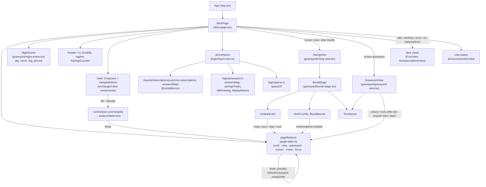
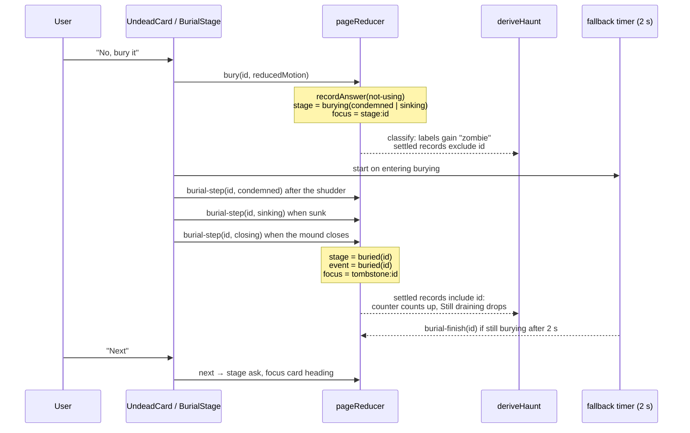
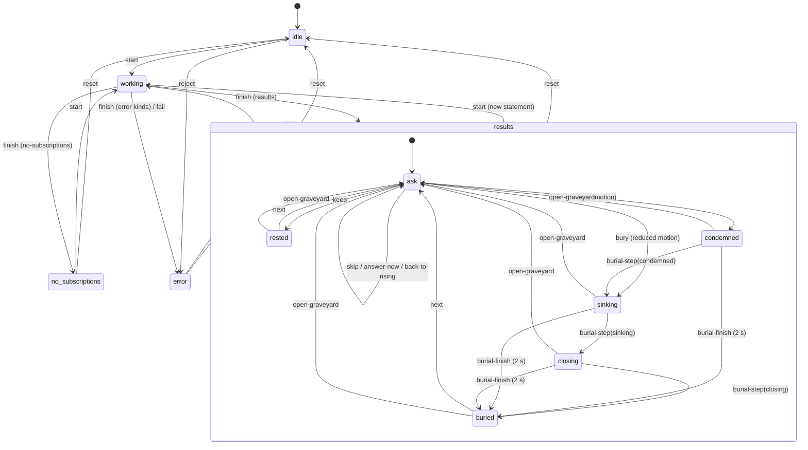

# Design Document: graveyard-ui

## Overview

`graveyard-ui` turns the plain vertical-slice page into the haunted Zombills flow. The Page keeps its drop area, Samples, file checks, Analyzer and every error state. What changes is what happens after `"results"`: each Risen subscription rises as an undead card, one at a time, biggest yearly cost first. The user answers "Still using this?". "Yes, let it rest" keeps it; "No, bury it" records `"not-using"`, re-classifies so the card gains the `zombie` label, plays the Spike's burial and leaves a tombstone. The savings counter in the header counts up, and the Rising summary ("Still draining … a year") goes down by the same amount. The Graveyard view lists the tombstones, the totals, the kept subscriptions, the unanswered ones and the ended ones, and lets the user change an answer for the current statement.

The art comes from the Spike in `apps/web/src/spike`. Its components move into `apps/web/src/slice/graveyard/`, take their data from props, and the Spike route, the hash router and the `spike` folder are deleted (Req 1.7, 1.8).

The design keeps the vertical slice's two layers:

1. **Pure logic** (`apps/web/src/slice/logic/`): two new modules, `graveyard.ts` (Answer records, the Answers map, refresh, Savings totals, Still-draining figures, Display names) and `queue.ts` (Rising order and the Queue), plus `haunt-view.ts`, which derives everything a render needs from the Page model. No React, DOM, storage, clock, randomness or logging. The existing purity lint block already covers this folder. All five PBTs live here.
2. **React view** (`apps/web/src/slice/`): the one `pageReducer` grows a Graveyard, a Rising model, a screen switch, a last-event field and a focus request. The moved Spike components render that state. The view owns the animation callbacks, the 2 s burial fallback timer and moving focus.

`packages/core` does not change. The Page calls `classifySubscriptions(outcome.subscriptions, answersMap)` from the public entry (Req 9.3).

### Design decisions

| Decision | Choice | Reason |
| --- | --- | --- |
| Where the Graveyard lives | In `PageModel`, next to `runId` and `view`, inside the existing `pageReducer` | Req 9.7: it must survive a new statement and "Start again" while the outcome is dropped. One reducer makes `finish` refresh the records and rebuild the Queue in the same step, so no render ever shows a Queue built from stale records (Req 2.8). `tech.md` forbids state libraries. |
| Rising model | `RisingModel = { order, stage }` stored inside the `results` view | It is meaningless without an outcome and must be dropped with it (vertical-slice Req 7.5). `order` is a permutation of all Risen ids; the Queue is `order` minus the ids with a Current record. "Skip for now" and "Answer now" only move one id in `order`, which makes Req 2.9 a direct consequence. |
| When the answer is recorded | In the reducer on the click, before any animation | Req 5.4. Leaving the Rising mid-burial cannot lose the answer. |
| When the counter and Still-draining figure move | Both read the **settled** Graveyard: all records except the one whose Burial sequence is still running | Req 5.5 (counter counts up when the tombstone has risen) and Req 1.6a (Still draining drops by exactly what the counter rises). The Answers map uses all records, so the card shows "Zombie" during the sink (Req 5.3). |
| Burial phases | Reducer stage `burying` with `phase: "condemned" \| "sinking" \| "closing"`, advanced by `onAnimationComplete` callbacks, plus one 2 s fallback timer that finishes the sequence | Same phase names as the Spike. Req 13.6: a background tab or a skipped animation cannot leave the buttons disabled. |
| Focus | The reducer sets `focus: { target, id, seq }`. Each element with a `data-focus` key focuses itself through `useFocusRequest(key)` when it mounts while `focus` names its key and that `seq` has not been handled yet; a `useEffect` in `SlicePage` focuses targets that are already mounted by looping over `[data-focus]` elements | Req 14.2 has eight focus rules that depend on the action, not on what is mounted. Keeping the intent in the model makes every rule a reducer unit test. Focusing on mount works however long an exit animation (`AnimatePresence mode="wait"`) delays the target. `seq` re-triggers focus when the same target is requested twice. It replaces the slice's `headingRef` and `focusDropZoneRef`. |
| Live region | `announcement(model, locale?)` in `logic/announce.ts` builds the text from the view plus `model.event` (the last haunt event) | Req 14.3. One `role="status"` node, as in the slice; the text is pure and unit-tested. |
| Classification | `classifySubscriptions(outcome.subscriptions, answersMap)` in `deriveHaunt`, memoised on `outcome` and `graveyard` | Req 9.3. `outcome.subscriptions` are already `ClassifiedSubscription`s (classified with no answers by the Analyzer); `classifyOne` spreads its input and overwrites `labels`, `priceRise` and `trial`, so passing them back in is safe and does not mutate them. |
| Gate during results | The drop area and Sample buttons stay mounted in every state, at one fixed position in the React tree: the Gate block is always the same keyed child of `main`, which is `flex flex-col`. Its visual place comes from CSS `order` (state content `order-1`, Gate `order-2`, the "Start again" row `order-3`), never from moving it in JSX. In `results` and on the Graveyard screen the Gate block adds the heading "Read another statement" | Vertical-slice Req 4.11 (a new statement replaces the current one) must keep holding (Req 1.2), but the card needs the stage to itself (Introduction, "one card at a time"). Because the Gate never remounts, focus stays on the Sample button the user clicked under "Read another statement" through `working` (Req 14.2). The `order` values match the DOM order in every state, so Tab order follows what is drawn. |
| Opening the Graveyard outside `results` | When the Graveyard has at least one record, `idle`, `no-subscriptions` and `error` show an "Open the graveyard" button under the Samples | Req 7.8 says "Back to the rising" shows only WHEN a statement has been analysed, so the Graveyard view must be reachable without one; Req 9.7 keeps the records after "Start again". Assumption: this is the entry point. It is never shown together with the Rising's own "Open the graveyard", so names stay unique (Req 14.1). The Graveyard view opened this way shows "Back to the start", which returns to the main screen of the current view. |
| Display-name ties | After the Glossary's `<merchant>, <amount> a <period>` form, one suffix pass runs over **all** final names (plain and long): any name that equals an earlier one gets ` (2)`, ` (3)` …, in Graveyard-then-Rising order, repeating until every name is distinct | Req 14.1 forbids two controls with the same accessible name. Two Apple subscriptions with the same amount and cadence but different currencies are already told apart by the currency symbol; this rule only catches cases the Glossary form cannot, including a merchant that is literally another item's long form. The rule is recorded in the requirements Glossary "Display name". |
| Motion values | One module `graveyard/motion.ts` exports every spring, tween and reduced-motion variant as plain objects and functions | Req 13.1, 13.2, 16.2. Component tests assert on these objects, as `fade-in.test.tsx` already does for `fadeInMotion`. |
| Tests and animation | Component test files set `MotionGlobalConfig.skipAnimations = true` (re-exported by `framer-motion` 14.14.0, checked in `node_modules`) so animations end at once and fire `onAnimationComplete`; one test turns it off to prove focus lands after a real exit animation, and the 2 s fallback is tested with a stubbed `BurialMound` and fake timers | Keeps the component suite fast and deterministic without mocking Framer Motion. |
| New dependencies | None | Framer Motion, React, Tailwind, Vitest, fast-check, Testing Library and Playwright already cover everything. |

---

## Architecture



The Pipeline path from a dropped file or Sample to `finish` is the vertical slice's, unchanged. The new work starts when `finish` carries a `"results"` outcome: the reducer refreshes the Graveyard against the new subscriptions (Req 9.5), builds the Rising order (Req 2.3), sets the stage to `ask`, switches to the main screen and asks for focus on the first card's heading. Every render then calls `deriveHaunt`, which classifies with the Answers map and computes the Queue, Display names, Savings totals and Still-draining figures. Components only read that result and dispatch actions.

### Answer and burial lifecycle



Reduced motion starts at `sinking` (no shudder) and skips the crumbs and the clods; every step is a 150 ms opacity change, so the same callbacks fire (Req 13.2, 13.3).

---

## Module layout

Paths are relative to `apps/web/`. New files are kebab-case (`structure.md`). The Page keeps its name `SlicePage` and its folder `src/slice/`, so the vertical-slice tests and imports keep working; the haunted components live in the Page's own component folder `src/slice/graveyard/` (Req 1.7).

### New and changed files

| File | Responsibility | Req |
| --- | --- | --- |
| `src/App.tsx` | Renders `<SlicePage />` only; no hash route | 1.8 |
| `src/slice/slice-page.tsx` | Adds the night scene, header, counter, screen switch, focus-request effect, burial fallback timer; moves the Gate below the content in `results` and on the Graveyard screen with CSS `order`, keeping it at one tree position; drops the spike link | 1, 2, 5.3, 13.6, 14.2 |
| `src/slice/page-state.ts` | `PageModel` gains `graveyard`, `screen`, `event`, `focus`; the `results` view gains `rising`; new actions | 2, 4, 5, 7, 8, 9.7 |
| `src/slice/no-subscriptions-view.tsx` | Heading becomes "No undead here."; the `h2` gets `data-focus="state-heading"` (through `useFocusRequest`) in place of the slice's ref | 1.5, 14.2 |
| `src/slice/error-view.tsx` | The `h2` gets `data-focus="state-heading"` in place of the slice's ref | 14.2 |
| `src/slice/drop-zone.tsx` | The drop area's `role="button"` div gets `data-focus="drop-zone"` in place of `focusDropZoneRef` | 14.2 |
| `src/slice/logic/graveyard.ts` | `AnswerRecord`, `Graveyard`, `answerRecordFor`, `recordAnswer`, `isCurrentRecord`, `answersMap`, `refreshGraveyard`, `settledGraveyard`, `savingsTotals`, `stillDraining`, `displayNames` | 1.6a, 5.2, 5.6, 6, 8, 9 |
| `src/slice/logic/queue.ts` | `risingOrder`, `queueOf`, `skipInOrder`, `answerNowInOrder` | 2.3, 2.4, 2.9, 7.4 |
| `src/slice/logic/haunt-view.ts` | `deriveHaunt(model)`: classified subscriptions, Risen and Ended lists, Queue, Display names, settled Savings totals, Still-draining figures | 1.6a, 2, 6, 7, 9.3 |
| `src/slice/logic/announce.ts` | `announcement(model, locale?)` replaces `announcement(view, locale?)`; adds the haunt sentences and the Still-draining sentence | 1.6a, 14.3 |
| `src/slice/logic/test-arbitraries.ts` | Adds `answerableSubscriptionArb`, `answerableListArb`, `answerRecordArb`, `graveyardActionArb` | 16.1 |
| `src/slice/graveyard/night-scene.tsx` | `NightScene`: the Spike's scene container, `--ground-h`, sky, `BackdropLayers`, `Ground`, `ForegroundFog`, vignette | 1.1, 13.4 |
| `src/slice/graveyard/rising-view.tsx` | `RisingView`: Rising summary, progress line, controls, `BurialStage`, "Every undead has an answer.", "No undead here." | 1.6, 2 |
| `src/slice/graveyard/burial-stage.tsx` | `BurialStage`: the Spike's clipped stage with card, crumbs, mound and tombstone; the stage container focus target | 5.3, 5.5 |
| `src/slice/graveyard/undead-card.tsx` | `UndeadCard` (moved, generalised) | 3, 4, 5.1 |
| `src/slice/graveyard/label-chip.tsx` | `LabelChip`: icon + word for the five labels | 3.3–3.5, 14.5 |
| `src/slice/graveyard/tombstone.tsx` | `Tombstone` (moved, generalised) | 5.6, 5.7, 6.1 |
| `src/slice/graveyard/savings-counter.tsx` | `SavingsCounter` (moved, one line per currency) | 6.2–6.4 |
| `src/slice/graveyard/burial-earth.tsx` | `SinkCrumbs`, `BurialMound` (moved, unchanged) | 5.3 |
| `src/slice/graveyard/graveyard-backdrop.tsx` | `BackdropLayers`, `ForegroundFog`, `Ground`, `SKY_BACKGROUND`, `GROUND_TOP` (moved, unchanged) | 1.1, 13.1, 13.4 |
| `src/slice/graveyard/icons.tsx` | `EyeOpenIcon`, `EyeClosedIcon`, `ShovelIcon` (moved) plus new `EmberIcon` and `HourglassIcon` | 3.3–3.5 |
| `src/slice/graveyard/graveyard-view.tsx` | `GraveyardView`: heading, totals, tombstones, Resting, Not answered yet, Already stopped | 7, 8 |
| `src/slice/graveyard/money-text.tsx` | `Money` and `TextLine` (the `.money` span and the `TextPart` renderer, moved out of `subscription-item.tsx`) | 3.2, 14.7 |
| `src/slice/graveyard/motion.ts` | Every motion value and reduced-motion variant | 13 |
| `src/slice/graveyard/use-burial-fallback.ts` | `useBurialFallback(stage, dispatch)` | 13.6 |
| `src/slice/graveyard/use-focus-request.ts` | `FocusRequestContext`, `useFocusRequest(key)`: focus on mount or on a new request, once per `seq` | 14.2 |
| `src/slice/graveyard/test-fixtures.ts` | Hand-built `ClassifiedSubscription`s for tests (trial trap, possessed + trial trap, guessed Amazon Prime, two Apple subscriptions); imported only by tests | 16.1, 16.2 |
| `src/contrast.test.ts` | New pairs, including the stone face | 3.10, 14.6 |
| `src/static-checks.test.ts` | Node test: `index.css` has no `@keyframes`; no file under `src` imports a path matching `spike\|routing` | 1.7, 13.1 |
| `src/slice/graveyard/test-a11y.ts` | Test helper `expectUniqueButtonNames(container)`: every visible button's accessible name is distinct; imported only by tests | 14.1 |
| `eslint.config.js` | Deletes the `apps/web/src/spike/**` exemption block | 1.7 |
| `e2e/demo-path.spec.ts` | New demo path | 16.4 |
| `.kiro/specs/vertical-slice/requirements.md` | The notes of Req 15.3 (documentation only; needs its own task) | 15.3 |

### Deleted files

| File | Why |
| --- | --- |
| `src/slice/results-view.tsx` | Replaced by the statement summary in `RisingView` (Req 1.6) |
| `src/slice/subscription-item.tsx`, `src/slice/subscription-item.test.tsx` | The plain list is gone (Req 1.6); its label-line and price-history rendering moves into `UndeadCard`, and its tests move to `undead-card.test.tsx` |
| `src/routing/use-hash-route.ts`, `src/routing/use-hash-route.test.ts`, `src/routing/spike-view.tsx` | One view; `#spike` retired (Req 1.8, 16.3) |
| `src/spike/` (whole folder) | Req 1.7; see below |

### What becomes of each Spike file

| Spike file | Becomes | Changes |
| --- | --- | --- |
| `BurialSpike.tsx` | Deleted | Its scene container (`SCENE_STYLE` with `--ground-h: clamp(7rem, 24svh, 15rem)` and `SKY_BACKGROUND`, `VIGNETTE`) moves to `night-scene.tsx`. Its stage layout (stage clipped at `bottom: var(--ground-h)`, card at `-bottom-3`, tombstone at `-bottom-7`, mound at `bottom: calc(var(--ground-h) - 22px)`, crumbs only while `sinking` and not reduced) moves to `burial-stage.tsx`. Its phase machine moves to the reducer's `RisingStage`. Its header layout (h1 left, counter right) moves to `SlicePage`. The Replay button and its local `announcement` are dropped. |
| `spike-data.ts` | Deleted | `SUBSCRIPTION` and `YEARLY_CENTS` become props from a `ClassifiedSubscription` or `AnswerRecord`. `formatCents` (which divides by 100 and is fixed to `en-US`/`USD`) is replaced by `formatMoney(cents, currency)` (`money.md`). |
| `undead-card.tsx` | `slice/graveyard/undead-card.tsx` | Keeps `CardPhase`, `MOTION_VARIANTS`, `REDUCED_VARIANTS`, `VARIANT_FOR_PHASE`, `swayFor`, the zombie grave-light overlay, `BUTTON_BASE`, the 22.5 rem fog surface and its shadow. The variants move to `motion.ts`. `article` becomes `section aria-labelledby` (Req 3.1); `h2` becomes `h3` (the Page's `h2`s are state headings). `StateLabel` becomes `LabelChip`. The comment on the yearly figure ("--blood on --fog is 4.3:1") is corrected to 4.53:1. Adds data labels, sentences, price history, "Seen since", the guessed text, "Skip for now", `data-focus` keys. `KeptNote` takes the amount, cadence and `cadenceAssumed` and focuses itself on mount through `useFocusRequest("outcome:<id>")` instead of its own unconditional `focus()`. |
| `tombstone.tsx` | `slice/graveyard/tombstone.tsx` | Keeps `StoneArt`, `Flourish`, `STONE`, `SLAB`, `BEVEL`, the `-rotate-[1.2deg]` lean and the `.engraved` text. Takes a record, its Display name, `size: "stage" \| "list"` and `entering`. "since March" is dropped (the record holds no dates). Adds the unknown-saving text, the cancel line and, in the list size, the "Unbury" slot. The mount `focus()` is replaced by `useFocusRequest("tombstone:<id>")`. |
| `savings-counter.tsx` | `slice/graveyard/savings-counter.tsx` | Keeps the motion-value count, `Math.round`, the jump-down rule, the 7ch tabular box, the moss glow and the reduced-motion keyed fade. Becomes one `CounterLine` per currency; `formatCents` → `formatMoney`; the tween delay drops from 0.35 s to 0 because the count now starts when the tombstone has risen. |
| `burial-earth.tsx` | `slice/graveyard/burial-earth.tsx` | Unchanged. |
| `graveyard-backdrop.tsx` | `slice/graveyard/graveyard-backdrop.tsx` | Unchanged; the layers stay positioned as in the Spike. `NightScene` wraps them in a `fixed inset-0` element, which stands in for the Spike's `h-svh` scene box, so the page can scroll over them. `fogCleared` is fed from the settled Graveyard (Req 13.4). |
| `spike-icons.tsx` | `slice/graveyard/icons.tsx` | Keeps `Icon`, `EyeOpenIcon`, `EyeClosedIcon`, `ShovelIcon`; drops `ReplayIcon`; adds `EmberIcon` (possessed) and `HourglassIcon` (trial trap), drawn in the same 24-unit, 1.75-stroke style. |

After the move nothing under `src/` imports `spike/`, `routing/` or `spike-data`; `src/static-checks.test.ts` asserts it (Req 1.7). `index.css` needs no change: every colour is already a token.

---

## Components and interfaces

### Graveyard logic (`logic/graveyard.ts`)

```ts
import type { Cadence, Subscription, UsageAnswer } from "@zombills/core";
import type { CurrencyTotal } from "./totals";

/** Glossary "Answer record". Holds no transaction, date, price history, description or evidence. */
export interface AnswerRecord {
  readonly id: string;
  readonly merchant: string;
  readonly currency: string;
  readonly cadence: Cadence;
  readonly currentAmountCents: number;
  readonly answer: UsageAnswer;
  readonly cadenceAssumed: boolean;
  /** yearlyCostCents; null when cadenceAssumed (saving unknown, Req 5.6) */
  readonly yearlySavingCents: number | null;
}

/** At most one record per id, in the order the answers were first given (Req 9.2). */
export type Graveyard = readonly AnswerRecord[];

export const EMPTY_GRAVEYARD: Graveyard = [];

/** The record a subscription gets for an answer (Req 4.2, 5.2, 5.6). */
export function answerRecordFor(subscription: Subscription, answer: UsageAnswer): AnswerRecord;

/** Replace the record with this id in place, or append one (Req 9.2). Used for record and change. */
export function recordAnswer(
  graveyard: Graveyard,
  subscription: Subscription,
  answer: UsageAnswer,
): Graveyard;

/** The id is the id of a subscription in `subscriptions` (Glossary "Current record"). */
export function isCurrentRecord(record: AnswerRecord, currentIds: ReadonlySet<string>): boolean;

/** id → answer for Current records only (Req 9.4). */
export function answersMap(
  graveyard: Graveyard,
  subscriptions: readonly Subscription[],
): ReadonlyMap<string, UsageAnswer>;

/**
 * Req 9.5: refresh every Current record from its subscription; remove a Current record whose
 * subscription is now guessed while the record has cadenceAssumed false; keep Earlier records.
 */
export function refreshGraveyard(graveyard: Graveyard, subscriptions: readonly Subscription[]): Graveyard;

/** The Graveyard without the record whose Burial sequence is running (Req 5.5, 1.6a). */
export function settledGraveyard(graveyard: Graveyard, buryingId: string | null): Graveyard;

/**
 * Req 6.2, 6.3, 6.5, 6.7: one entry per currency with a Tombstone whose yearlySavingCents is not
 * null, in code-unit order of currency. @throws RangeError when a running sum is not a safe integer.
 */
export function savingsTotals(graveyard: Graveyard): CurrencyTotal[];

/**
 * One Still-draining entry per currency of `subscriptions`, in code-unit order of currency (the
 * order of `totals`, with currencies that have no Currency total merged in) (Req 1.6a).
 */
export interface StillDraining {
  currency: string;
  /** Currency total minus Counted savings, clamped at 0; null when the currency has no Currency total */
  remainingCents: number | null;
  /** The vertical-slice "not included" note follows this line; always true when remainingCents is null */
  hasExcluded: boolean;
}

export function stillDraining(
  totals: readonly CurrencyTotal[],
  graveyard: Graveyard,
  subscriptions: readonly Subscription[],
): StillDraining[];

/** Something that has a Display name: a subscription or a record. */
export type Nameable = Pick<Subscription, "id" | "merchant" | "currency" | "cadence" | "currentAmountCents">;

/**
 * Glossary "Display name" plus the tie rule: id → name for every item. Items with the same id are
 * one item (a Current record and its subscription). Long form when another item shares the merchant;
 * then one suffix pass over all final names: a name equal to an earlier one gets " (2)", " (3)" …,
 * in input order, skipping any suffixed name already taken.
 */
export function displayNames(items: readonly Nameable[], locale?: string): ReadonlyMap<string, string>;
```

Rules inside the module:

- `answerRecordFor` copies `id`, `merchant`, `currency`, `cadence`, `currentAmountCents`, sets `cadenceAssumed = subscription.evidence.cadenceAssumed` and `yearlySavingCents = cadenceAssumed ? null : subscription.yearlyCostCents`. It reads nothing else, so no charge, date or description reaches the record. The detector already guarantees `yearlyCostCents = currentAmountCents × Cadence factor` (subscription-detector Req 6.2), which is what PBT P4 checks.
- `recordAnswer` builds a new array with `map` when the id exists and `[...graveyard, record]` otherwise. Recording the same answer twice gives a deeply equal Graveyard; "Unbury" then "Bury after all" builds the same record from the same subscription, so it is deeply equal to the buried one (Req 9.8).
- `answersMap` builds the set of current ids once and returns a `new Map` of `[id, answer]` for records in that set.
- `refreshGraveyard` maps each record: if its id is not current, it is returned unchanged (the same object). If the subscription is guessed and the record has `cadenceAssumed: false`, the record is dropped. Otherwise it becomes `answerRecordFor(subscription, record.answer)`. Order is kept.
- `savingsTotals` adds one Tombstone at a time and throws `RangeError` as soon as a sum is not a safe integer, like `currencyTotals`. Every `yearlySavingCents` is non-negative, so the first unsafe step is caught (Req 6.6).
- `stillDraining` sums, per currency, `yearlySavingCents` of the Current records with `answer: "not-using"` whose subscription `isCounted` (Req 1.6a), and returns `max(0, total − savings)`. `hasExcluded` is true when the currency has any subscription that is not Counted, the same test `groupForDisplay` uses. A currency whose subscriptions are all not Counted (only Ended or guessed ones) gets an entry with `remainingCents: null` and `hasExcluded: true`, so the note still shows alone for it, as vertical-slice Req 5.7 requires. Clamping never triggers for Pipeline output (each Counted saving is part of its currency's total); it guards hand-built input.
- `displayNames` uses `formatMoney` and the period words `week`, `month`, `year`. Comparisons are on the raw `merchant` string, so "Netflix" and "netflix" are two names, as the detector already keeps them.

### Queue (`logic/queue.ts`)

```ts
import type { StatementInfo, Subscription } from "@zombills/core";
import type { Graveyard } from "./graveyard";

/** Req 2.3: Risen ids grouped by StatementInfo.currencies, then the vertical-slice display order. */
export function risingOrder(
  subscriptions: readonly Subscription[],
  statement: StatementInfo,
): string[];

/** The Queue: ids of `order` with no Current record, in `order` order (Req 2.9). */
export function queueOf(order: readonly string[], graveyard: Graveyard): string[];

/** "Skip for now": move `id` to the end of `order`; unchanged when id is absent (Req 2.4). */
export function skipInOrder(order: readonly string[], id: string): string[];

/** "Answer now": move `id` to the front of `order`; unchanged when id is absent (Req 7.4). */
export function answerNowInOrder(order: readonly string[], id: string): string[];
```

`risingOrder` filters `status === "active"` and reuses `groupForDisplay(subscriptions, [], statement.currencies)` from `totals.ts`, flattening the groups, so the order rule has one implementation. `order` holds every Risen id, answered or not; `queueOf` filters by "has a record with this id", which for ids in `order` is the same as "has a Current record". Because skip and answer-now move one id within the full order, the relative order of the other Queue members never changes, and an id that loses its record (Req 9.5 removal) reappears at its own position.

### Derived view (`logic/haunt-view.ts`)

```ts
import type { ClassifiedSubscription, StatementInfo } from "@zombills/core";
import type { PageModel } from "../page-state";
import type { AnswerRecord, StillDraining } from "./graveyard";
import type { CurrencyTotal } from "./totals";

export interface HauntView {
  /** null outside the results view */
  statement: StatementInfo | null;
  classified: readonly ClassifiedSubscription[];        // same order as outcome.subscriptions
  byId: ReadonlyMap<string, ClassifiedSubscription>;
  risen: readonly ClassifiedSubscription[];             // in Rising order
  ended: readonly ClassifiedSubscription[];             // Ended subscriptions with no Current record
  queue: readonly string[];
  answeredCount: number;                                // Risen with a Current record
  names: ReadonlyMap<string, string>;
  currentIds: ReadonlySet<string>;
  tombstones: readonly AnswerRecord[];                  // Graveyard order
  kept: readonly AnswerRecord[];                        // Graveyard order
  /** From the settled Graveyard */
  savings: readonly CurrencyTotal[];
  stillDraining: readonly StillDraining[];
  fogCleared: boolean;
  /** Currency for the "$0.00" counter line, or null (Req 6.2) */
  counterFallbackCurrency: string | null;
}

export function deriveHaunt(model: PageModel, locale?: string): HauntView;
```

`deriveHaunt` is the only caller of `classifySubscriptions` in the view. `SlicePage` wraps it in `useMemo` keyed on `model.view`, `model.graveyard` and the burying id. `counterFallbackCurrency` is `statement.currencies[0]` for a `results` or `no-subscriptions` view and `null` otherwise. `names` is built from the Graveyard records followed by the Risen subscriptions (Glossary: Risen subscriptions and Answer records).

### Page state (`page-state.ts`)

```ts
import type { UsageAnswer } from "@zombills/core";
import type { Graveyard } from "./logic/graveyard";

export type BurialPhase = "condemned" | "sinking" | "closing";

export type RisingStage =
  /** The Queue head's card asks "Still using this?"; "Every undead has an answer." when the Queue is empty */
  | { kind: "ask" }
  /** "Kept. It rests." on the card, "Next" shown */
  | { kind: "rested"; id: string }
  /** Burial sequence running; buttons aria-disabled */
  | { kind: "burying"; id: string; phase: BurialPhase }
  /** Tombstone risen, "Next" shown */
  | { kind: "buried"; id: string };

export interface RisingModel {
  /** Every Risen id, in Rising order as changed by skip and answer-now */
  order: readonly string[];
  stage: RisingStage;
}

export type PageView =
  | { kind: "idle" }
  | { kind: "working"; sourceName: string }
  | { kind: "results"; sourceName: string; outcome: ResultsOutcome; rising: RisingModel }
  | { kind: "no-subscriptions"; sourceName: string; outcome: NoSubscriptionsOutcome }
  | { kind: "error"; sourceName: string | null; error: PageError };

export type Screen = "main" | "graveyard";

/** The last haunt event, for the live region (Req 14.3). */
export type HauntEvent =
  | { kind: "card"; id: string; first: boolean }   // first: entering results
  | { kind: "all-answered" }
  | { kind: "kept"; id: string }
  | { kind: "buried"; id: string }
  | { kind: "unburied"; id: string };

export type FocusTarget =
  | "state-heading"      // error / no-subscriptions heading, "No undead here." in the Rising
  | "drop-zone"
  | "card-heading"
  | "outcome"            // "Kept. It rests."
  | "stage"              // "Burying <name>"
  | "tombstone"          // on the stage or in the Graveyard list
  | "all-answered"       // "Every undead has an answer."
  | "graveyard-heading"
  | "resting-item";

export interface FocusRequest {
  target: FocusTarget;
  /** Subscription or record id for card-heading, outcome, stage, tombstone, resting-item */
  id: string | null;
  /** Increases on every request, so the same target can be focused again */
  seq: number;
}

export interface PageModel {
  runId: number;
  view: PageView;
  /** Survives start, finish, reset; lost on reload (Req 9.7) */
  graveyard: Graveyard;
  screen: Screen;
  event: HauntEvent | null;
  focus: FocusRequest | null;
}

export type PageAction =
  // vertical slice, unchanged in shape
  | { type: "start"; runId: number; sourceName: string }
  | { type: "finish"; runId: number; outcome: AnalysisOutcome }
  | { type: "fail"; runId: number; error: PageError }
  | { type: "reject"; sourceName: string | null; error: PageError }
  | { type: "reset" }
  // Rising
  | { type: "keep"; id: string }
  | { type: "bury"; id: string; reducedMotion: boolean }
  | { type: "burial-step"; id: string; from: BurialPhase }
  | { type: "burial-finish"; id: string }
  | { type: "skip"; id: string }
  | { type: "next" }
  // screens
  | { type: "open-graveyard" }
  | { type: "back-to-rising" }
  | { type: "back-to-start" }
  // Graveyard view
  | { type: "answer-now"; id: string }
  | { type: "unbury"; id: string }
  | { type: "bury-after-all"; id: string };

export const INITIAL_PAGE_MODEL: PageModel = {
  runId: 0,
  view: { kind: "idle" },
  graveyard: EMPTY_GRAVEYARD,
  screen: "main",
  event: null,
  focus: null,
};

export function pageReducer(model: PageModel, action: PageAction): PageModel;
```

The reducer stays pure. Every action that names an `id` is ignored unless the id passes the guard in the table below, so a stale click (for example from a card that is fading out) cannot record anything. The Graveyard is never changed by `start`, `fail`, `reject`, `reset`, `open-graveyard`, `back-to-rising` or `back-to-start`.

### Page and burial state machine



`screen` lives only in React state and is never written to the URL (Req 1.9). It is orthogonal: `open-graveyard` sets it to `"graveyard"` from any view; `back-to-rising`, `back-to-start`, `answer-now`, `start` and `reset` set it to `"main"`. In `results` the Rising shows only on the main screen.

Transition table for the new and changed actions. "Head" is `queueOf(rising.order, graveyard)[0]`; "sub(id)" is the subscription with that id in the current outcome.

| Action | Guard (else unchanged) | Graveyard | View / stage | screen | event | focus |
| --- | --- | --- | --- | --- | --- | --- |
| `finish` with `"results"` | `working`, same `runId` | `refreshGraveyard(graveyard, subs)` | `results`, `order = risingOrder(…)`, stage `ask` | `main` | `card(head, first: true)`; `all-answered` when Risen exist but the Queue is empty; `null` when no Risen | `card-heading:head`; `all-answered` when the Queue is empty; `state-heading` when no Risen |
| `finish` other kinds, `fail`, `reject` | as in the slice | unchanged | as in the slice | `main` | `null` | `state-heading` |
| `start` | not `working` | unchanged | `working` | `main` | `null` | unchanged |
| `reset` | `results`, `no-subscriptions`, `error` | unchanged | `idle` | `main` | `null` | `drop-zone` |
| `keep(id)` | `results`, screen `main`, stage `ask`, `id === head` | `recordAnswer(sub(id), "still-using")` | stage `rested(id)` | — | `kept(id)` | `outcome:id` |
| `bury(id, reduced)` | same as `keep` | `recordAnswer(sub(id), "not-using")` | stage `burying(id, reduced ? "sinking" : "condemned")` | — | unchanged | `stage:id` |
| `burial-step(id, from)` | stage `burying(id, from)` | — | `condemned → sinking → closing → buried(id)` | — | `buried(id)` on reaching `buried` | `tombstone:id` on reaching `buried` |
| `burial-finish(id)` | stage `burying(id, *)` | — | `buried(id)` | — | `buried(id)` | `tombstone:id` |
| `skip(id)` | stage `ask`, `id === head`, Queue length > 1 | — | `order = skipInOrder(order, id)` | — | `card(newHead)` | `card-heading:newHead` |
| `next` | stage `rested` or `buried`, Queue not empty | — | stage `ask` | — | `card(head)` | `card-heading:head` |
| `open-graveyard` | screen `main` | — | in `results`: stage `ask` | `graveyard` | `null` | `graveyard-heading` |
| `back-to-rising` | screen `graveyard`, view `results` | — | stage `ask` | `main` | `card(head)`; `all-answered` when the Queue is empty; `null` when no Risen | `card-heading:head`; `all-answered` when the Queue is empty; `state-heading` when no Risen |
| `back-to-start` | screen `graveyard`, view not `results` | — | — | `main` | `null` | `drop-zone` in `idle`; `state-heading` in `no-subscriptions` and `error` |
| `answer-now(id)` | screen `graveyard`, `id` in the Queue | — | `order = answerNowInOrder(order, id)`, stage `ask` | `main` | `card(id)` | `card-heading:id` |
| `unbury(id)` | screen `graveyard`, Current record `id` with `not-using` | `recordAnswer(sub(id), "still-using")` | — | — | `unburied(id)` | `resting-item:id` |
| `bury-after-all(id)` | screen `graveyard`, Current record `id` with `still-using` | `recordAnswer(sub(id), "not-using")` | — | — | `buried(id)` | `tombstone:id` |

Notes:

- "Next" when the Queue is empty is rendered as "Visit the graveyard" and dispatches `open-graveyard` (Req 2.5). The "all answered" state (Req 2.7) is stage `ask` with an empty Queue; `next` is never needed to reach it because the Rising renders it whenever the Queue is empty and no burial runs.
- `bury-after-all` runs no stage sequence: the item is not on a stage. The Graveyard view shows the new tombstone with the tombstone-rise spring (`entering` when `event` is `buried(id)` and the screen is `graveyard`), and the counter counts up because the record is settled at once (Req 8.3).
- `open-graveyard` during a burial sets stage `ask`; the record stays (Req 5.4) and becomes settled, so the counter counts up on the Graveyard screen.
- The id guards on `keep`, `bury`, `skip`, `burial-step` and `burial-finish` make the reducer ignore late animation callbacks from a card that was replaced (StrictMode, a new statement, `open-graveyard`).

### Page shell (`slice-page.tsx`)

```ts
export function SlicePage(): JSX.Element;
```

`runAnalysis`, `onFiles`, `onChooseSample` and the window drop guard are unchanged. New pieces:

- `const reduceMotion = useReducedMotion() ?? false;` read once and passed down, as in the Spike.
- `const haunt = useMemo(() => deriveHaunt(model), [model.view, model.graveyard])`. The burying id is part of `model.view.rising.stage`, so `model.view` covers it.
- Focus on mount: `SlicePage` keeps `handledSeq` in a ref and provides `{ focus: model.focus, claim(seq) }` through one small `FocusRequestContext` (`graveyard/use-focus-request.ts`). `useFocusRequest(key)` returns a ref callback that, on mount, focuses the element when `focus` names `key` and `claim(seq)` returns true (the seq is newer than `handledSeq`, which it then becomes). The hook also sets `data-focus={key}` on the element. An element that mounts after a 150 ms exit (for example `KeptNote` under `AnimatePresence mode="wait"`) still claims the request, and a later remount of the same element cannot steal focus again because the seq is already handled.
- Already-mounted targets: an effect keyed on `model.focus?.seq` builds `key = target` or `` `${target}:${id}` `` and loops over `mainRef.current.querySelectorAll<HTMLElement>("[data-focus]")`, comparing `el.dataset.focus === key`. No selector is built from the id, so ids with spaces, `:`, `/` or `*` need no escaping and `CSS.escape` (which jsdom may not provide) is not used. On a match it calls `claim(seq)` and then `el.focus({ preventScroll: false })`; with no match it does nothing and the mount path takes over. Every focus target is a `tabIndex={-1}` element (or the drop area, which is focusable), so the slice's `[tabindex="-1"]:focus` rule hides the ring for programmatic focus.
- `useBurialFallback(stage, dispatch)` (below).
- `dispatch` is passed to children through props; the focus request is the only value passed through context.

Layout inside `<NightScene fogCleared={haunt.fogCleared} reduceMotion={reduceMotion}>`:

1. `header` on a `bg-fog/95 rounded-2xl` panel: `h1` "Zombills" (`font-display`), `p` "Your bank statement is haunted.", and on the right `SavingsCounter` (Req 1.1, 6.2, 14.6).
2. `main` (`max-w-[640px] mx-auto px-4 flex flex-col gap-6`), with a `--fog` surface panel (`bg-fog/95 rounded-2xl p-6`) for every text block that sits over the scene (Req 1.4, 14.6). `main` always renders the same three children in the same JSX order: the state content (`order-1`), the Gate block (`order-2`, key `gate`, `DropZone` + `SampleButtons` + "Open the graveyard" when shown) and the controls row (`order-3`). The Gate never moves in the tree, so it never remounts:
   - `idle`: state content is the slice sentence; the Gate block adds "Open the graveyard" when the Graveyard is not empty.
   - `working`: state content is `Reading <name>…`; the Gate is disabled with `aria-disabled="true"` and handlers that do nothing, never the HTML `disabled` attribute, so the clicked Sample button keeps focus.
   - `error`, `no-subscriptions`: state content is the slice view (with "No undead here." as the no-subscriptions heading); the Gate block adds "Open the graveyard" when the Graveyard is not empty.
   - `results` on `main`: state content is `RisingView`; the Gate block has the `h2` "Read another statement"; the controls row has "Start again".
   - any view on `graveyard`: state content is `GraveyardView`; the Gate block has "Read another statement"; the controls row has "Start again" when the view is `results`, `no-subscriptions` or `error`.
3. The live region `<p role="status" className="sr-only">{announcement(model)}</p>` outside the state content.

The spike footer link is removed (Req 1.8).

### Night scene (`graveyard/night-scene.tsx`)

```ts
export interface NightSceneProps {
  fogCleared: boolean;
  reduceMotion: boolean;
  children: React.ReactNode;
}
export function NightScene(props: NightSceneProps): JSX.Element;
```

A `div` with `relative isolate min-h-svh text-bone` and the Spike's `SCENE_STYLE` (`--ground-h`, `SKY_BACKGROUND`). Behind the content: `BackdropLayers` and, fixed to the viewport bottom, `Ground` and `ForegroundFog`; then the Spike `VIGNETTE`. All of them are `aria-hidden` and `pointer-events-none` (Req 14.4). Unlike the Spike, the scene is not `h-svh overflow-clip`: the page scrolls, and the backdrop is `fixed inset-0` so the fog never moves over text as the page scrolls (Req 13.1). The fog layers keep their Spike loops (40 s, 28 s, 22 s) and the 0.45 / 1 opacity switch.

### Rising (`graveyard/rising-view.tsx`)

```ts
export interface RisingViewProps {
  sourceName: string;
  outcome: ResultsOutcome;
  rising: RisingModel;
  haunt: HauntView;
  reduceMotion: boolean;
  dispatch: React.Dispatch<PageAction>;
}
export function RisingView(props: RisingViewProps): JSX.Element;
```

Top to bottom:

1. `h2` "Recurring charges found" (kept from the slice; not a focus target any more), then the slice summary line and Assumed-value notes (Req 1.6), built by the same code that `results-view.tsx` had, moved into a `StatementSummary` function component in this file.
2. Rising summary: per `haunt.stillDraining` entry with a `remainingCents`, `p` "Still draining <span class="money text-blood text-2xl font-semibold">$1,355.64</span> a year", followed by "Ended subscriptions and guessed ones are not included in the total." when `hasExcluded`. An entry with `remainingCents: null` shows only the note, prefixed with its code: "EUR: Ended subscriptions and guessed ones are not included in the total." (Req 1.6a, vertical-slice Req 5.7).
3. Toolbar: progress line `p` "`<answered>` of `<risen>` answered" and the "Open the graveyard" button (Req 2.1, 2.6).
4. Stage, one of:
   - No Risen subscription: `h3` "No undead here." (`data-focus="state-heading"`), "Every recurring charge found has already stopped.", and the `EndedList` (Req 2.2).
   - Stage `ask` and an empty Queue: `p` "Every undead has an answer." (`data-focus="all-answered"`) and the "Visit the graveyard" button (Req 2.7).
   - Otherwise `BurialStage` for the stage's id (the Queue head for `ask`).
5. Below the stage, when the stage is `rested` or `buried`: "Next", or "Visit the graveyard" when the Queue is empty (Req 2.5). While `burying` the same button is shown with `aria-disabled="true"` and its click does nothing (Req 5.3).

### Burial stage (`graveyard/burial-stage.tsx`)

```ts
export interface BurialStageProps {
  subscription: ClassifiedSubscription;
  record: AnswerRecord | null;         // the Current record, for the tombstone
  displayName: string;
  stage: RisingStage;                  // never "ask" with an empty Queue
  canSkip: boolean;                    // Queue length > 1
  reduceMotion: boolean;
  dispatch: React.Dispatch<PageAction>;
}
export function BurialStage(props: BurialStageProps): JSX.Element;
```

The outer element is the stage container: `div` with `tabIndex={-1}`, `data-focus="stage:<id>"`, `role="group"` and, while `burying`, `aria-label="Burying <Display name>"`. It stays mounted for the whole sequence and is keyed by subscription id, so a new card remounts it (Req 5.3). Inside, the Spike stage: a box of `height: clamp(30rem, 70svh, 40rem)` with its own `--ground-h` band, the card clipped at the ground line, `Ground` for this box, `SinkCrumbs` while `sinking` and not reduced, `BurialMound` while `closing` or `buried`, and `Tombstone size="stage"` once `buried` (Req 5.3). The stage's own ground band is what the card sinks through; the page-level `Ground` stays at the viewport bottom as scenery.

Card phase mapping: `ask` → `"undead"`, `rested` → `"resting"`, `burying` `condemned` → `"condemned"`, `sinking` → `"sinking"`; `closing` and `buried` unmount the card, as the Spike does. Callbacks: `onCondemned` → `burial-step(id, "condemned")`, `onSunk` → `burial-step(id, "sinking")`, `BurialMound.onClosed` → `burial-step(id, "closing")`.

### Undead card (`graveyard/undead-card.tsx`)

```ts
export type CardPhase = "undead" | "resting" | "condemned" | "sinking";

export interface UndeadCardProps {
  subscription: ClassifiedSubscription;
  displayName: string;
  phase: CardPhase;
  canSkip: boolean;
  reduceMotion: boolean;
  onRest(): void;
  onBury(): void;
  onSkip(): void;
  onCondemned(): void;
  onSunk(): void;
}
export function UndeadCard(props: UndeadCardProps): JSX.Element;
```

Kept from the Spike: the two motion layers (travel variants and sway), the fog surface `w-[min(22.5rem,calc(100vw-2rem))] rounded-2xl border-bone/10 bg-fog px-6 pb-8 pt-6` and its two shadows, the moss grave-light overlay (opacity 1 unless `resting`), the yearly figure's `--blood` → `--bone` colour change when resting, `BUTTON_BASE`, the moss "No, bury it" button and the outlined "Yes, let it rest" button, `whileTap` only when deciding and not reduced, the `KeptNote` fade.

Content, as text (Req 3.2–3.8):

| Row | Content |
| --- | --- |
| Labels | `LabelChip` state ("Undead" / "Zombie" / "Resting") and the cadence word from `CADENCE_LABELS` |
| Heading | `h3` with the Display name, `data-focus="card-heading:<id>"`, `tabIndex={-1}`, `font-display text-5xl` (`text-4xl` below 360 px, `break-words`) |
| Data labels | `LabelChip kind="possessed"` then the price-rise `TextLine`; `LabelChip kind="trial-trap"` then the trial `TextLine`; possessed first (Req 3.5) |
| Money | `<Money>` current amount `/<period>`; yearly cost in `--blood`, `text-2xl font-semibold`, followed by "a year"; for a guessed subscription "Guessed from a single charge" and "about <yearly> a year (estimate)" |
| Seen since | "Seen since <date>" or "Seen since at least <date>" from `charges[0].date` and `evidence.startedInStatement`; `evidence.firstChargeDate` when `charges` is empty (hand-built test input only, since the detector never reports a Series without charges) |
| Price history | `ol aria-label="Price history"`, `<date>: <amount>` per entry, when `priceHistory.length > 1` |
| Question | "Still using this?", then the two buttons, then "Skip for now" (text button) when `canSkip` |
| Outcome (resting) | `KeptNote`: "Kept. It rests." (`data-focus="outcome:<id>"`) and "It goes on charging <amount> a <period>." or "It goes on charging <amount> (how often is a guess)." |

The state chip reads `labels.includes("zombie")` from the classified subscription for "Zombie" (Req 3.3); "Resting" comes from the `resting` phase; otherwise "Undead". While `condemned` or `sinking` the buttons and "Skip for now" keep rendering with `aria-disabled="true"` and ignore clicks (Req 5.3). The Display name is the heading, so the `section` has the same accessible name as the heading (Req 3.1). No logo or image (Req 3.9).

### Label chip (`graveyard/label-chip.tsx`)

```ts
export type LabelKind = "undead" | "zombie" | "resting" | "possessed" | "trial-trap";
export function LabelChip(props: { kind: LabelKind; reduceMotion: boolean }): JSX.Element;
```

| Kind | Word | Icon | Classes |
| --- | --- | --- | --- |
| `undead` | Undead | `EyeOpenIcon` | `border-moss/40 bg-moss/10 text-moss` (Spike) |
| `zombie` | Zombie | `ShovelIcon` | `border-moss bg-moss text-night` (Spike) |
| `resting` | Resting | `EyeClosedIcon` | `border-bone/20 bg-bone/5 text-bone` (Spike used `text-bone/80`; full `bone` keeps the pair in the contrast test simple) |
| `possessed` | Possessed | `EmberIcon` | `border-ember/50 bg-ember/10 text-ember` |
| `trial-trap` | Trial trap | `HourglassIcon` | `border-spectre/50 bg-spectre/10 text-spectre` |

The state chip keeps the Spike's `AnimatePresence mode="wait"` swap (opacity and a 4 px `y` offset, 0 px when reduced). The data chips are static.

### Tombstone (`graveyard/tombstone.tsx`)

```ts
export interface TombstoneProps {
  record: AnswerRecord;               // answer "not-using"
  displayName: string;
  size: "stage" | "list";
  /** Rise with the tombstone spring on mount; false renders in place */
  entering: boolean;
  reduceMotion: boolean;
  /** Rendered under the stone in the list size: the "Unbury" button, or nothing */
  action?: React.ReactNode;
}
export function Tombstone(props: TombstoneProps): JSX.Element;
```

A `section` with `aria-labelledby` on "Here lies <Display name>.", `tabIndex={-1}` and `data-focus="tombstone:<id>"`. Text (Req 6.1, 5.6, 5.7): "Here lies" / "<Display name>." (`text-[2.75rem]` on the stage, `text-2xl` in the list, `break-words`), "Fed on you every <period>.", "Saves" + `<Money>` in `--moss` + "/year." or "Saving unknown: guessed from one charge", and "Cancel it with the provider to stop the charges." The stone art keeps its 3:4 aspect, `w-[min(18.75rem,calc(100vw-3rem))]` on the stage and `w-[min(12rem,40vw)]` in the list. Because the epitaph now has two more lines than the Spike's, the text box starts at `top-[12%]` and the cancel line sits on the plinth under the arch in `text-xs`, still inside the slab.

### Savings counter (`graveyard/savings-counter.tsx`)

```ts
export interface SavingsCounterProps {
  totals: readonly CurrencyTotal[];        // haunt.savings, code-unit order
  fallbackCurrency: string | null;         // shown as formatMoney(0, c) when totals is empty
  reduceMotion: boolean;
}
export function SavingsCounter(props: SavingsCounterProps): JSX.Element | null;

function CounterLine(props: { cents: number; initialCents: number; currency: string; reduceMotion: boolean }): JSX.Element;
```

Returns `null` when `totals` is empty and `fallbackCurrency` is `null` (Req 6.2). Otherwise a `div role="group" aria-label="Saved per year"` with the Spike's "Saved per year" caption and one `CounterLine` per entry, keyed by currency. `CounterLine` is the Spike counter: `useMotionValue(initialCents)` where `SavingsCounter` passes `cents` for lines present when `SavingsCounter` first mounts and 0 for lines added later (so a remount of the whole counter never recounts, but a new currency does count up), `useTransform(value, v => formatMoney(Math.round(v), currency))`, and an effect that animates up with `COUNTER_TWEEN` or sets the value at once when `cents` drops or motion is reduced (Req 6.4). The figure is `aria-hidden`; a sibling `sr-only` span holds `formatMoney(cents, currency)`. The box width grows from the Spike's `w-[7ch]` to `min-w-[7ch]` so long totals and other currencies fit.

A new currency line (for example the first USD burial replacing the `€0.00` fallback line) mounts its motion value at 0 and counts up to its value with `COUNTER_TWEEN`, or shows the value at once under reduced motion. Only a line that already existed when the component first mounted starts at its value.

### Graveyard view (`graveyard/graveyard-view.tsx`)

```ts
export interface GraveyardViewProps {
  haunt: HauntView;
  /** true when the view is "results": shows Back to the rising, Answer now; otherwise Back to the start */
  hasStatement: boolean;
  /** id of the tombstone that should rise (event buried(id) on this screen) */
  enteringId: string | null;
  reduceMotion: boolean;
  dispatch: React.Dispatch<PageAction>;
}
export function GraveyardView(props: GraveyardViewProps): JSX.Element;
```

Top to bottom (Req 7):

1. `h2` "Your graveyard", `tabIndex={-1}`, `data-focus="graveyard-heading"` (Req 7.9).
2. One `p` per `haunt.savings` entry: "You buried <Money> a year." (Req 7.1). When there is no Tombstone: "Nothing buried yet." in place of the totals and the stones (Req 7.6).
3. `ul` of `li > Tombstone size="list"`, in Graveyard order, in a grid (`grid-cols-2` above 640 px, one column below). Current records get `action = <button>Unbury</button>` with `aria-label="Unbury <Display name>"` (Req 7.2, 14.1).
4. `h3` "Resting" and a plain `ul`: "<Display name> · <Cadence> · <amount> · <yearly> a year" per Kept record (`li` with `tabIndex={-1}` and `data-focus="resting-item:<id>"`), and for Current records a "Bury after all" button named "Bury after all <Display name>" (Req 7.3). A guessed Kept record shows "about <yearly> a year (estimate)".
5. When `hasStatement`: `h3` "Not answered yet" with the Queue as a `ul`: Display name, yearly cost, and "Answer now" named "Answer now <Display name>" (Req 7.4).
6. When `hasStatement` and `haunt.ended` is not empty: `h3` "Already stopped" and the `EndedList`: "<Display name> · last charged <date>" (Req 7.5).
7. "Back to the rising" when `hasStatement` (Req 7.8). Otherwise "Back to the start", which dispatches `back-to-start` and returns to the main screen of the current view (`idle`, `no-subscriptions` or `error`). The two names differ and never show together (Req 14.1).

Sections 4 to 6 are left out when empty. No section animates except the entering tombstone (Req 7.3).

### Motion values (`graveyard/motion.ts`)

```ts
export const CARD_RISE_SPRING = { type: "spring", stiffness: 120, damping: 14, delay: 0.3 } as const;
export const CARD_SETTLE_SPRING = { type: "spring", stiffness: 90, damping: 18 } as const;
export const SHUDDER = { duration: 0.45, ease: "easeInOut" } as const;
export const SINK_EASE = [0.55, 0, 1, 0.45] as const;            // ease-in
export const SINK = { duration: 0.6, ease: SINK_EASE } as const;
export const TOMBSTONE_RISE_SPRING = { type: "spring", stiffness: 80, damping: 12, delay: 0.05 } as const;
export const COUNTER_TWEEN = { duration: 0.8, ease: [0.16, 1, 0.3, 1] } as const;
export const REDUCED_FADE = { duration: 0.15 } as const;
export const BURIAL_FALLBACK_MS = 2000;

export const CARD_VARIANTS: Variants;            // Spike MOTION_VARIANTS
export const CARD_REDUCED_VARIANTS: Variants;    // Spike REDUCED_VARIANTS, opacity only
export function cardVariants(reduced: boolean): Variants;
export function tombstoneMotion(reduced: boolean): Pick<MotionProps, "initial" | "animate" | "transition">;
export function moundMotion(reduced: boolean, side: "left" | "right"): Pick<MotionProps, "initial" | "animate" | "transition">;
export function counterFade(reduced: boolean): Pick<MotionProps, "initial" | "animate" | "transition">;
export function fogFade(reduced: boolean, fogCleared: boolean): Pick<MotionProps, "animate" | "transition">;
```

Each `…(true)` returns objects whose animated keys are only `opacity` and whose `duration` is at most 0.15 (Req 13.2). The moved components import these instead of their local copies. Nothing animates colour in a loop or flashes, and the Page plays no sound (Req 13.5); the only colour transitions are the one-off 0.9 s `--blood` → `--bone` change and the grave-light fade when a card comes to rest. The sway (`rotate`) and the fog drift (`x`) already return `{ duration: 0 }` and a fixed value under reduced motion in the Spike; `swayFor` and `FogBand` keep that.

### Burial fallback (`graveyard/use-burial-fallback.ts`)

```ts
export function useBurialFallback(
  stage: RisingStage | null,
  dispatch: React.Dispatch<PageAction>,
): void;
```

An effect keyed on the burying id (`stage?.kind === "burying" ? stage.id : null`) starts one `setTimeout(BURIAL_FALLBACK_MS)` that dispatches `burial-finish(id)`, and clears it on cleanup. The reducer ignores it when the sequence already ended (Req 13.6). The timer is keyed on the id, not the phase, so the whole sequence has one 2 s budget.

### Live region (`logic/announce.ts`)

```ts
export function announcement(model: PageModel, locale?: string): string;
export function cardSentence(subscription: ClassifiedSubscription, name: string, locale?: string): string;
```

| View / event | Text |
| --- | --- |
| `idle`, `working`, `error` | as in the slice |
| `no-subscriptions` | as in the slice: "No recurring charges found." |
| `results`, event `card(id, first: true)` | "Found 4 recurring charges." + Still-draining sentences + card sentence |
| `results`, event `card(id, first: false)` | card sentence |
| `results` with no Risen | "Found 2 recurring charges." + Still-draining sentences + "No undead here." |
| event `all-answered` | "Every undead has an answer." |
| event `kept(id)` | "<name> rests. Kept." |
| event `buried(id)` | "<name> is buried. Saves <saving> a year. Saved per year: <totals>." or "<name> is buried. Saving unknown: guessed from one charge." + Still-draining sentences |
| event `unburied(id)` | "<name> is unburied and rests." + Still-draining sentences |
| screen `graveyard` with event `null` | "Your graveyard." |

- Card sentence: "<name>. <Cadence>, <amount>. <yearly> a year. Still using this?" then each label sentence (`partsToText(priceRiseParts(…))`, `partsToText(trialParts(…))`), each ending with ".". For a guessed subscription "<yearly> a year" becomes "about <yearly> a year (estimate)".
- Still-draining sentence: "Still draining <amount> a year." per `stillDraining` entry with a `remainingCents`, replacing the slice's "Yearly total in <code>: …" (Req 1.6a). An entry with `remainingCents: null` adds nothing to the live region, as in the slice.
- `<totals>`: the settled Savings totals joined with ", " in code-unit order.

Example (`us-signed.csv`, en-US), after burying Netflix: "Netflix is buried. Saves $215.88 a year. Saved per year: $215.88. Still draining $1,139.76 a year." (Req 14.3).

### Look and layout

- Colours come only from the seven tokens; Tailwind classes `text-ember`, `text-spectre`, `text-blood`, `text-moss` exist through the `@theme inline` mapping in `index.css`. No hex values in components.
- Text over the scene always sits on a `bg-fog` or `bg-fog/95` panel, the card surface or the stone face. The header (`h1`, tagline, counter caption and figures) sits on its own `bg-fog/95 rounded-2xl` panel, like the `main` text blocks, because the sky also holds the bone moon glow and the `Moon` disc (`--bone`, about 176 px wide at `left 70%, top 17%`), which the header would overlap at 375×667. On that panel `bone on fog` and `moss on fog` bound the header contrast.
- Single column at ≤ 640 px: the card width is `min(22.5rem, 100vw − 2rem)`, the stone `min(18.75rem, 100vw − 3rem)`; the header wraps the counter under the title below 400 px; the Graveyard grid drops to one column. At 320 px nothing is wider than `100vw − 2rem` (Req 3.10, 7.10, 14.7).
- Spacing uses Tailwind steps of 8 px (`gap-2`, `gap-4`, `gap-6`, `p-6`, `py-8`); the Spike's `mt-2`, `mt-4`, `mt-6` already follow it. Money is always `<Money>` (Inter, tabular figures).

---

## Data models

Nothing is written to `localStorage`, `sessionStorage`, IndexedDB, the Cache API, cookies or the URL (Req 9.7, 15.2). Everything below lives in memory.

| Model | Owner | Lifetime | Holds statement data? |
| --- | --- | --- | --- |
| Statement bytes and text | `runAnalysis` locals | One call (unchanged) | Yes, briefly |
| `AnalysisOutcome` | `results` / `no-subscriptions` view | Until "Start again" or a new statement (unchanged) | Yes |
| `RisingModel` (`order`, `stage`) | `results` view | Same as the outcome | Only ids |
| `Graveyard` (`AnswerRecord[]`) | `PageModel.graveyard` | The page session: survives "Start again" and new statements, lost on reload | Merchant name, currency, cadence, current amount, answer, guessed flag, yearly saving; no dates, charges, descriptions or evidence |
| `screen`, `event`, `focus` | `PageModel` | Page session | Only ids |
| `HauntView` | `useMemo` in `SlicePage` | One render | Derived; references the outcome's objects |

`AnswerRecord` fields and their source:

| Field | Source | Notes |
| --- | --- | --- |
| `id` | `Subscription.id` | Key; at most one record per id |
| `merchant` | `Subscription.merchant` | Display name base |
| `currency` | `Subscription.currency` | ISO 4217; totals never mix currencies (`money.md`) |
| `cadence` | `Subscription.cadence` | Possibly guessed |
| `currentAmountCents` | `Subscription.currentAmountCents` | Integer minor units |
| `answer` | The user | `"still-using"` or `"not-using"` |
| `cadenceAssumed` | `Subscription.evidence.cadenceAssumed` | Refreshed on each new outcome |
| `yearlySavingCents` | `Subscription.yearlyCostCents`, or `null` when guessed | Kept for Kept records too, so changing the answer needs no recomputation |

Money stays integer minor units end to end. The only conversions to text are `formatMoney` calls; the counter tween is rounded with `Math.round` before formatting (Req 6.4). The money lint rules now apply to every moved Spike file, because the `src/spike/**` exemption is deleted with the folder.

---

## Correctness properties

Each property is a fast-check test with the default 100 runs, in a `.property.test.ts` file next to its source (Req 16.1). Inputs are deep-frozen with a small `deepFreeze` helper in `test-arbitraries.ts`, so any mutation throws in strict mode.

| ID | Property | File | Validates |
| --- | --- | --- | --- |
| P1 | Queue: for any `answerableListArb` (distinct ids, mixed `status`), any Graveyard drawn over those ids and some foreign ids, and any sequence of `skip(id)` and `answer-now(id)` actions applied to `order = risingOrder(…)`: `queueOf(order, graveyard)` holds exactly the Risen ids with no Current record, each once; after `skipInOrder` the Queue equals the previous Queue with that id moved to the end; after `answerNowInOrder` it equals the previous Queue with that id moved to the front; ids not in the Queue leave it unchanged; with no actions the Queue is `risingOrder` filtered, and `risingOrder` equals the flattened `groupForDisplay` order of the active subscriptions | `queue.property.test.ts` | 2.3, 2.4, 2.9, 7.4 |
| P2 | Still draining: for any `answerableListArb`, its `currencyTotals`, and any sequence of `bury`, `keep` and `unbury` actions on its subscriptions applied with `recordAnswer`: for every currency with a Currency total, `remainingCents + countedSavings = totalCents`, where `countedSavings` is the `BigInt` reference sum of the Counted `not-using` Current records' savings; `remainingCents` is a non-negative safe integer; every other currency of the list has exactly one entry, with `remainingCents: null` and `hasExcluded: true`; and `bury` then `unbury` of a Counted subscription leaves every `remainingCents` unchanged | `graveyard.property.test.ts` | 1.6a, 1.6b |
| P3 | Savings totals: for any Graveyard of up to 1,000 `answerRecordArb` values over at least three currencies, with `yearlySavingCents` a safe integer in `[0, 999_999_9900 × 52]` or `null` and both answers: one entry per currency with a `not-using` record whose saving is not `null`; each `totalCents` equals the `BigInt` sum of those savings; Kept records and `null` savings add nothing; no entry includes another currency's amount; entries are in code-unit order of currency. Sums that pass `Number.MAX_SAFE_INTEGER` throw `RangeError` instead, checked against the `BigInt` sum | `graveyard.property.test.ts` | 6.2, 6.3, 6.6, 6.7 |
| P4 | Answers: for any `answerableListArb`, any starting Graveyard and any sequence of `record(id, answer)`, `unbury(id)`, `bury-after-all(id)` and `refresh(newList)` actions (where `newList` re-draws the guessed flag, amounts and statuses of some of the same ids, drops some and adds others): at most one record per id; the last answer given for an id is its answer (unless a refresh removed it); recording the same answer twice equals recording it once; any action on one id leaves every other record deep-equal to before (Req 8.5); `unbury` then `bury-after-all` on a Current record restores a record deeply equal to the buried one; `answersMap` keys are exactly the Current record ids and its values their answers; `yearlySavingCents === null` exactly when `cadenceAssumed`, and otherwise equals `currentAmountCents × factor(cadence)` (52, 12, 1); after a refresh no record with `cadenceAssumed: false` names a guessed subscription, every such subscription that is Risen is in `queueOf(risingOrder(newList), graveyard)`, and Earlier records are the same objects as before; the frozen inputs are unchanged | `graveyard.property.test.ts` | 8.5, 9.1, 9.2, 9.4, 9.5, 9.8 |
| P5 | Classifier agreement: for any `subscriptionListArb` and any action sequence as in P4, `classifySubscriptions(list, answersMap(graveyard, list))` gives a subscription `labels` containing `"zombie"` exactly when its `status` is `"active"` and it has a Current record with `answer: "not-using"` | `graveyard.property.test.ts` | 9.3, 9.9 |
| P6 | Display names: for any list of `Nameable` items (merchants drawn from a small set so collisions are common, plus duplicate ids), `displayNames` returns one name per distinct id; names are pairwise distinct (merchants include strings that look like another item's long or suffixed form); an item whose merchant is unique among the distinct ids and equal to no other final name gets exactly its merchant; every other name starts with `<merchant>, ` | `graveyard.property.test.ts` | Glossary "Display name", 14.1 |
| P7 | Reducer: the vertical-slice P15 property (one view; `start`/`reject` ignored while `working`; `finish`/`fail` only for the matching `runId`; `reset` to `idle`) still holds with the new actions mixed in; in addition, the Graveyard is unchanged by `start`, `fail`, `reject`, `reset`, `open-graveyard`, `back-to-rising` and `back-to-start`; `rising` is present exactly when the view is `results`; every `id`-guarded action whose guard fails returns the same model object | `page-state.property.test.ts` | 2.8, 5.4, 9.7 |

P6 and P7 go beyond the five PBTs Req 16.1 lists; P6 pins the uniqueness that Req 14.1 needs, and P7 extends an existing property test that the reducer change would otherwise leave half-covering.

Generators added to `logic/test-arbitraries.ts`:

- `answerableSubscriptionArb`: like `subscriptionArb`, but draws `currentAmountCents` in `[0, 999_999_9900]` and sets `yearlyCostCents = currentAmountCents × factor(cadence)` (the existing `subscriptionArb` sets both to the same value, which breaks P4's saving rule); `charges` stays `[]`, since no graveyard or queue function reads it.
- `answerableListArb(max)`: unique ids, at least two currencies when long enough, merchants from a small set.
- `answerRecordArb`: records with currencies from `CURRENCIES` plus `"CHF"` and `"SEK"` (at least three codes), `yearlySavingCents` from `fc.oneof(fc.constant(null), small values, fc.integer({ min: 0, max: MAX_YEARLY_COST_CENTS }))`.
- `graveyardActionArb(ids)`: `record`, `unbury`, `bury-after-all`, `skip`, `answer-now` and `refresh` actions over a given id pool.
- `deepFreeze<T>(value: T): T`.

---

## Error handling

| Case | Where | Behaviour |
| --- | --- | --- |
| Animation callback never fires (background tab, interrupted animation, skipped by the browser) | `useBurialFallback` | `burial-finish` after 2 s; the tombstone shows and the buttons come back (Req 13.6) |
| Late callback from a replaced card (`burial-step` for another id or phase) | Reducer guard | Ignored |
| Click on an `aria-disabled` button during the burial | Component (`onClick` checks the phase) and reducer guard (`keep`/`bury`/`skip` need stage `ask`; `next` needs `rested`/`buried`) | Ignored (Req 5.3) |
| New statement, "Start again" or "Open the graveyard" during the burial | Reducer | The record stays; the stage resets or the view is replaced; the record becomes settled, so the counter counts up on the next screen (Req 5.4) |
| A Current record's subscription is guessed in the new outcome but was not when answered | `refreshGraveyard` | Record removed; the subscription rises again (Req 9.5) |
| An answered id is missing from a new outcome (Apple price change gives a new id) | `refreshGraveyard`, `deriveHaunt` | The record stays as an Earlier record (tombstone counts, no controls); the new id rises again |
| Savings total not a safe integer | `savingsTotals` | Throws `RangeError`. Unreachable with Pipeline output (each saving ≤ `999_999_9900 × 52` and the 1 MiB file limit bounds the count). Not caught: like `formatMoney`, a bug fails loudly in tests instead of showing a wrong total |
| Focus target not mounted yet | `useFocusRequest` | The target focuses itself when it mounts, as long as no newer request has been made; until then focus stays where it is (never on a removed element, because the request names only elements of the new state) |
| Two shown items with the same Display name even in long form, or a plain name equal to another item's long or suffixed name | `displayNames` | ` (2)`, ` (3)` suffix pass over all final names (Req 14.1, Glossary "Display name") |
| `answer-now`, `unbury`, `bury-after-all` for an id that is not eligible (stale list after a new statement) | Reducer guard | Ignored |
| Render error | none | As in the slice, no error boundary; there is still no logging or remote reporting (Req 15.1) |

No path logs, stores or sends anything (Req 15.1, 15.2). The new modules make no network call and touch no storage API; the purity lint block covers `logic/graveyard.ts`, `logic/queue.ts` and `logic/haunt-view.ts` by path.

---

## Testing strategy

Tools are unchanged: Vitest 5 and fast-check 4 for unit and property tests in the `node` environment; Testing Library with jsdom (`// @vitest-environment jsdom`) and `userEvent` for component tests; Playwright for the one E2E test. Tests import the Pipeline only from `@zombills/core`. Component test files set `MotionGlobalConfig.skipAnimations = true` in `beforeAll` and reset it in `afterAll`, so springs and tweens end at once and `onAnimationComplete` fires. The only test with animations on is the keep-focus test in `graveyard-flow.motion.test.tsx`; the 2 s fallback is tested with a stubbed `BurialMound` and with `renderHook`, not by racing real animations. Expected money text in component tests is built with `formatMoney(…)` in the default locale, as in the slice; the exact `en-US` strings are pinned in logic unit tests and in the E2E test.

### Unit tests (logic)

| File | Cases | Validates |
| --- | --- | --- |
| `logic/graveyard.test.ts` | Req 5.8 table: bury Netflix → record `{ id: "sub:USD:monthly:*:netflix", answer: "not-using", cadenceAssumed: false, yearlySavingCents: 21588, … }` and USD `21588`; then Spotify → `34776`; then the hand-built guessed Amazon Prime (`13900`, guessed `"monthly"`, `yearlyCostCents` `166800`) → `cadenceAssumed: true`, `yearlySavingCents: null`, totals still `34776`. Req 6.8: no Tombstones → `[]`; Netflix USD `21588` then UK Netflix GBP `15588` → `[GBP 15588, USD 21588]`. Req 8.6: bury Netflix and Spotify, unbury Netflix → `13188`, Netflix record `still-using` in the same position. Req 6.6: two Tombstones of `Number.MAX_SAFE_INTEGER` throw `RangeError`. Still draining for `us-signed.csv`: `135564`, then `113976` after Netflix, `135564` after unbury; a guessed burial subtracts nothing. Refresh: Current record refreshed, Earlier record kept by identity, record removed when the subscription turned guessed. Display names: two Apple subscriptions with merchant "Apple payment (merchant not shown)" at `99` and `299` monthly → "Apple payment (merchant not shown), $0.99 a month" and "…, $2.99 a month"; a unique merchant keeps its plain name; equal long forms get " (2)"; two `A` items at `$1.00` monthly plus a third item whose merchant is literally "A, $1.00 a month (2)" give three distinct names. The record built from a `us-signed.csv` subscription has exactly the eight `AnswerRecord` keys | 5.8, 6.6, 6.8, 8.6, 9.5, Glossary |
| `logic/queue.test.ts` | `risingOrder` for `us-signed.csv`: Adobe Creative Cloud, Riverside Gym Membership, Netflix, Spotify; ended ids left out; currencies in `StatementInfo.currencies` order; skip and answer-now examples; unknown ids leave the order unchanged | 2.3, 2.4, 7.4 |
| `logic/announce.test.ts` (changed) | Rewritten for `announcement(model)`: the slice cases now build a `PageModel`; the results case expects "Found 4 recurring charges. Still draining $1,355.64 a year. Adobe Creative Cloud. Monthly, $54.99. $659.88 a year. Still using this?"; the keep, bury (Req 14.3 example), guessed bury, unbury and all-answered sentences; Netflix's card sentence ends with the price-rise sentence; two currencies give two Still-draining sentences | 1.6a, 14.3 |
| `page-state.test.ts` (changed) | Existing rows keep their assertions on `runId` and `view`; expectations that compare whole models add the new fields. New rows: every row of the transition table above, including each guard's "unchanged" case; `reset` and a second `finish` keep the Graveyard; `finish` refreshes it; a `burial-step` with the wrong phase or id is ignored; `burial-finish` after `buried` is ignored; `open-graveyard` mid-burial keeps the record and sets stage `ask`; focus requests carry increasing `seq`; `finish` with Risen subscriptions that are all answered (choose "US bank, signed amounts" again after answering all 4) gives event `all-answered` and focus `all-answered`, never `card(undefined)`; `back-to-rising` with no Risen focuses `state-heading` | 2, 4, 5, 7, 8, 9.7, 14.2 |
| `graveyard/motion.test.ts` | Every `…(true)` result animates only `opacity` with `duration ≤ 0.15`; `…(false)` uses the spring and tween values of Req 13.1 (`120/14`, `0.6 s` ease-in, `80/12`, `0.8 s`); `fogFade(_, true)` animates opacity to `0.45`, `fogFade(_, false)` to `1`; `BURIAL_FALLBACK_MS === 2000`; nothing flashes: no exported value animates a colour or opacity with `repeat`, and the only repeating loops are the sway `rotate` and the fog `x` drift | 13.1, 13.2, 13.4, 13.5, 13.6 |
| `src/static-checks.test.ts` | Reads `src/index.css` and asserts no `@keyframes`; globs `src/**/*.{ts,tsx}` and asserts no import specifier matches `/spike\|routing/` | 1.7, 13.1 |

### Component tests

`slice-page.test.tsx` keeps the vertical-slice state tests; the new haunted flow goes into `graveyard-flow.test.tsx` (rendering `<App />`), and the single components get their own files.

| File / case | Assertion | Validates |
| --- | --- | --- |
| `graveyard-flow`: first card | After "US bank, signed amounts": "Still draining $… a year" with `formatMoney(135564)`; the card region named "Adobe Creative Cloud" with "Monthly", `formatMoney(5499)`, `formatMoney(65988)` "a year", "Still using this?"; "0 of 4 answered"; focus on the card heading; the "Undead" chip | 1.6a, 2.1, 3.2, 3.3, 14.2 |
| `graveyard-flow`: keep | "Yes, let it rest" → "Kept. It rests.", "It goes on charging $54.99 a month.", "Resting" chip, "1 of 4 answered", counter text `formatMoney(0)`, focus on the outcome, live region "Adobe Creative Cloud rests. Kept." | 4.3–4.5, 14.3 |
| `graveyard-flow`: Netflix card | After keeping Adobe and the gym ("Next" between): "Possessed" chip and the price-rise sentence; the Adobe, gym and Spotify cards (Spotify reached by "Skip for now" or after Netflix) contain no "Price went up" text (classifier Req 9.9) | 3.4 |
| `graveyard-flow`: bury | On Netflix, "No, bury it": the "Zombie" chip, `document.activeElement` is the group named "Burying Netflix" with the answer buttons `aria-disabled`; then the region "Here lies Netflix." with "Fed on you every month." and "Saves $215.88/year." (via `formatMoney`), the counter's `sr-only` text `formatMoney(21588)`, "Still draining" with `formatMoney(113976)`, the live region text of Req 14.3, focus on the tombstone, and "Next" | 5.2–5.5, 5.7, 6.1, 6.4, 14.3 |
| `graveyard-flow`: burial fallback | `vi.mock("./graveyard/burial-earth", …)` replaces `BurialMound` with a stub that never calls `onClosed`; bury Netflix, `vi.advanceTimersByTime(2000)` with fake timers → tombstone shown, "Next" enabled. Without the fallback the test would hang in `closing`, so it proves the timer did the work | 13.6 |
| `graveyard/use-burial-fallback.test.ts` | `renderHook` with fake timers and a spy `dispatch`: a `burying(id)` stage dispatches `burial-finish(id)` once at 2,000 ms and not at 1,999 ms; a phase change within the same id does not restart the timer; a stage change to `buried` or another id before 2 s clears it | 13.6 |
| `graveyard-flow.motion.test.tsx`: keep focus with real animation | Own file with `skipAnimations` left off: press Enter on "Yes, let it rest", then `await waitFor(…)` until `document.activeElement` is "Kept. It rests." (never `body` once the note has mounted) | 4.3, 14.2 |
| `graveyard-flow`: Gate keeps focus | On the Rising, click "UK bank, …" under "Read another statement" → while `working`, `document.activeElement` is still that button (the Gate did not remount); after `finish`, focus is on the first card heading | 1.2, 14.2 |
| `graveyard-flow`: skip and next | "Skip for now" on Adobe → Gym card, Adobe last in "Not answered yet"; on the last card "Skip for now" is absent; after the last answer "Next" reads "Visit the graveyard" while "Open the graveyard" is a separate button; "Every undead has an answer." after returning | 2.4, 2.5, 2.7 |
| `graveyard-flow`: guessed | Drop the CSV of the slice's "Guessed-only group" test: keep the guessed Netflix → "It goes on charging €12.99 (how often is a guess)."; in a second run bury it → "Saving unknown: guessed from one charge", counter unchanged | 4.3, 5.6 |
| `graveyard-flow`: Graveyard view | After burying Netflix and Spotify and keeping Adobe: "Open the graveyard" → focus on "Your graveyard", "You buried $347.76 a year." (`formatMoney(34776)`), two tombstones in order, "Resting" with Adobe and "Bury after all Adobe Creative Cloud", "Not answered yet" with "Answer now Riverside Gym Membership"; "Answer now" returns to the Rising with the gym card focused; on a fresh render with no answers, "Nothing buried yet."; after "Start again", "Open the graveyard" from `idle` shows "Back to the start" and no "Back to the rising", and clicking it returns to the idle screen with focus on the drop area | 7.1–7.4, 7.6, 7.9 |
| `graveyard-flow`: Already stopped | The slice's "Ended" CSV: "No undead here.", "Every recurring charge found has already stopped.", and an "Already stopped" item for the gym ending in "· last charged 5 Mar 2026" | 2.2, 7.5 |
| `graveyard-flow`: change answers | Unbury Netflix → total `formatMoney(13188)`, Netflix under "Resting" with "Bury after all Netflix", focus on that item, live region "Netflix is unburied and rests. …"; "Bury after all Netflix" → back to `34776`, focus on its tombstone | 8.1, 8.3–8.6 |
| `graveyard-flow`: no storage | `vi.spyOn(Storage.prototype, …)` on `getItem`, `setItem`, `removeItem`, `clear` through the whole flow → never called; `document.cookie === ""`; `location.hash` unchanged; choosing the US Sample again after burying Netflix keeps the "Here lies Netflix." tombstone in the Graveyard and Netflix never becomes the card | 2.8, 9.7, 15.2 |
| `graveyard-flow`: reduced motion | Own file (`graveyard-flow.reduced.test.tsx`) with `vi.mock("framer-motion", …)` making `useReducedMotion` return `true` (via `vi.importActual`): the burial skips "condemned" (`bury` dispatched with `reducedMotion: true` reaches the tombstone), the tombstone text and announcement appear, focus lands on it | 13.2, 13.3 |
| `graveyard-flow`: unique names and Tab order | `expectUniqueButtonNames` runs after every step of the keep, bury, skip, Graveyard-view and change-answer cases. One case tabs from the top on the first card: "Open the graveyard", the card's two answer buttons, "Skip for now", then the drop area and the four Samples under "Read another statement", then "Start again" (DOM order matches the drawn order) | 14.1 |
| `graveyard-flow`: scene is decorative | Every `svg` and every backdrop layer under the night scene has `aria-hidden="true"`; no `img` | 14.4 |
| `slice-page.test.tsx`: fog panels | In `working` the "Reading …" line, and in `error` the state heading, sit inside an element with the `bg-fog/95` panel class | 1.4 |
| `graveyard-flow`: Display names | Two hand-built Apple subscriptions in a CSV-free render of `GraveyardView` → "Unbury Apple payment (merchant not shown), $0.99 a month" and the $2.99 one; no two buttons share a name | 14.1 |
| `undead-card.test.tsx` (new; takes over `subscription-item.test.tsx`'s label cases) | With `test-fixtures.ts` subscriptions: possessed sentence; trial-trap chip "Trial trap" and `Intro price ended on 10 Feb 2026 ($1.00 on 10 Jan 2026, then $14.99)`; both labels with possessed first; price-history list; "Seen since at least 2 Jan 2026"; guessed text; every money figure in a `.money` span; no `img` element; buttons `aria-disabled` in `condemned` | 3.2–3.9, 5.3 |
| `tombstone.test.tsx` | Region name "Here lies Netflix."; "Saves" figure; unknown-saving text; the cancel line; no text containing "cancelled" | 5.6, 5.7, 6.1 |
| `savings-counter.test.tsx` | Nothing rendered with no totals and no fallback; `formatMoney(0, "USD")` with the fallback; two lines in `GBP`, `USD` order; figure `aria-hidden`, `sr-only` value; a decrease sets the new value at once; a USD line added after a `€0.00` fallback line starts at 0 and reaches its value (with `skipAnimations`, the end value is checked) | 6.2, 6.4, 6.8 |
| `app.test.tsx` (rewritten) | `location.hash = "#spike"` before render → the Page's `h1` "Zombills" and the drop area; no link to `#spike` anywhere | 1.8, 16.3 |

### Existing tests that change, and why

| Test | Change | Why |
| --- | --- | --- |
| `routing/use-hash-route.test.ts` | Deleted | The hash router is removed (Req 1.8, 16.3) |
| `app.test.tsx` (both cases) | Replaced by the one `#spike` → Page test above | Req 16.3 |
| `slice/subscription-item.test.tsx` | Deleted; its label-line, order, `.money` and "no zombie text" cases move to `undead-card.test.tsx` (the last one becomes "the Zombie chip comes from `labels`") | `SubscriptionItem` is removed (Req 1.6) |
| `slice-page.test.tsx` "Idle" | Drops the spike link assertion; adds the tagline "Your bank statement is haunted." | Req 1.1, 1.8 |
| `slice-page.test.tsx` "Keyboard" | Tab order ends after the four Samples (no spike link) | Req 1.8 |
| `slice-page.test.tsx` "Results from a Sample" | Keeps the summary, dates, money-class and Assumed-value checks; the list-order check becomes the Rising order seen through "Skip for now" (or `risingOrder` in `queue.test.ts`); the Spotify and Netflix item checks move to the card; the classifier Req 9.9 check ("no 'Price went up' text in any other list item") becomes the per-card check in `graveyard-flow`: Netflix card; "Yearly total (USD)" becomes "Still draining … a year"; focus moves from the results heading to the card heading; the live-region text becomes the new results sentence | Req 1.6, 1.6a, 14.2, 14.3 |
| `slice-page.test.tsx` "No subscriptions" | Heading becomes "No undead here."; text and live region unchanged | Req 1.5 |
| `slice-page.test.tsx` "Replace result" | The `h3` "GBP"/"USD" group headings no longer exist; asserts the summary line and the first card's currency instead | Req 1.6 |
| `slice-page.test.tsx` "Windows-1252 file" | The snapshot reads the summary line, the Rising summary and the first card's text instead of the GBP list section | Req 1.6 |
| `slice-page.test.tsx` "Guessed-only group" | Expects "Still draining $360.00 a year" (only USD has a Currency total, via `formatMoney(36000)`), no EUR "Still draining" line but the note alone "EUR: Ended subscriptions and guessed ones are not included in the total.", and "Guessed from a single charge" on the guessed Netflix card, which rises first (EUR comes before USD in `StatementInfo.currencies`) | Req 1.6a, 2.3, 3.7 |
| `slice-page.test.tsx` "Ended" | Expects the "No undead here." Rising state and the "Already stopped" item instead of "Ended · last charged" in a list; the currency has no Currency total, so no "Still draining" line, but its not-included note shows alone (vertical-slice Req 5.7, 10.3) | Req 2.2, 7.5, 1.6a |
| `slice-page.test.tsx` "Start again", "Working", every error case, "Skipped rows", "Assumed value", "Drag-over text", "Drop outside" | Unchanged. `chooseSample` still waits for the `h2` "Recurring charges found", which the Rising keeps | Req 1.2 |
| `page-state.test.ts`, `page-state.property.test.ts` | Model literals gain the new fields; P15 becomes P7 | New model fields |
| `logic/announce.test.ts` | Rewritten for `announcement(model)` | Req 1.6a, 14.3 |
| `fade-in.test.tsx` | Unchanged; `FadeIn` still wraps the slice state views | — |
| `contrast.test.ts` | New pairs (below) | Req 3.10, 14.6 |

### Contrast pairs (`contrast.test.ts`)

Ratios computed from the `index.css` hex values with the existing WCAG formula:

| Text | Background | Ratio | Threshold |
| --- | --- | --- | --- |
| `--moss` | `--fog` | 9.58 | 4.5 |
| `--ember` | `--fog` | 7.40 | 4.5 |
| `--spectre` | `--fog` | 6.79 | 4.5 |
| `--blood` | `--fog` | 4.53 | 3.0 (large text only, Req 3.10) |
| `--night` | `--moss` (Zombie chip, "No, bury it") | 11.30 | 4.5 |
| `--bone` | `--night` (darkest sky; no text sits on it now that the header has a panel) | 15.60 | 4.5 |
| `--bone`, `--moss` | stone face (`#3e424a` after the OKLab mix) | 8.14, 5.90 | 4.5 |

The stone face is `color-mix(in oklab, var(--fog) 80%, var(--bone))`, the lightest stop of the Spike's gradient. The test adds a small `mixOklab(a, b, t)` helper (sRGB → linear → OKLab, mix, back) so it checks the colour the browser draws. A chip's background is its colour at 10 % over `--fog`, so the test also checks each chip's text on `mixOklab(fog, chipColour, 0.1)`. Text written with an opacity utility (`text-bone/70`, `text-bone/90`) is checked as `mixOklab(background, bone, alpha)`.

### E2E test (`e2e/demo-path.spec.ts`)

Steps 1–3 (console and error collection, load, CSP tag) and 7–8 (request and `dist` checks) are unchanged. Steps 4–6 become (Req 16.4):

1. Click "US bank, signed amounts"; expect the Rising summary `page.locator("main p", { hasText: /^Still draining \$1,355\.64 a year$/ })` to be visible (scoped to `main`, so the live region's longer text never makes a second match in strict mode).
2. Expect the card region "Adobe Creative Cloud"; click "Yes, let it rest"; click "Next". Same for "Riverside Gym Membership".
3. Expect the card region "Netflix" to contain "Price went up from $15.49 (2 Jan 2026) to $17.99 (+$30.00 a year)"; click "No, bury it".
4. Expect the region "Here lies Netflix." with "Saves $215.88/year." (Playwright waits through the real animation, at most the 2 s fallback); expect the counter group "Saved per year" to contain "$215.88"; expect `page.locator("main p", { hasText: /^Still draining \$1,139\.76 a year$/ })`; expect `page.getByRole("status")` to contain "Netflix is buried. Saves $215.88 a year."
5. Click "Open the graveyard"; expect "You buried $215.88 a year."
6. Expect `localStorage.length`, `sessionStorage.length` to be `0`, `document.cookie` empty, `location.href` unchanged, `context.cookies()` empty.
7. Click "Start again"; expect the drop area to be focused.
8. Narrow screen: `page.setViewportSize({ width: 320, height: 640 })`, choose the US Sample again, and on the Rising and then on the Graveyard view expect `document.documentElement.scrollWidth <= 320` (Req 3.10, 7.10, 14.7).

Any request that breaks Req 15.1 or any console output fails the test, as before.

### Static checks

- `npm run lint`: the deleted `src/spike/**` block means the money rules now cover the moved art; `formatCents` is gone, so nothing divides by 100. The purity block covers the three new logic modules by path.
- `npm run typecheck`, `npm run build`, `npm test` and `npm run test:e2e --workspace @zombills/web` pass (Req 16.5).
- The `privacy-guard` hook and `no-network` scans pass with no new exception (Req 15.4).
