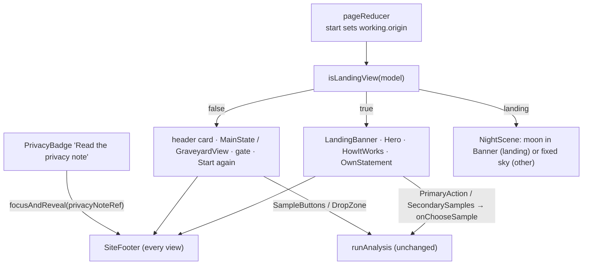

# Design Document: landing-polish

## Overview

`landing-polish` replaces the `idle` panel of `SlicePage` with a Landing view: a Hero on the bare night scene (title, tagline, Hero line, original inline SVG Hero art), one `--moss` Primary action that analyses the US Sample, three text-style Secondary samples, a Privacy badge, the Return notes, How it works, the Own-statement section, and a Footer that appears in every Page state. The moon stops hiding behind the header: on the Landing view it is drawn inside the Banner, in a space the Banner keeps free, so it scrolls with the document. On Non-landing views it stays fixed to the viewport but moves into the empty band to the right of the 640 px column, and is not drawn below 1024 px.

The design keeps the two layers of the earlier specs:

1. **Pure logic** (`apps/web/src/slice/logic/`, `page-state.ts`): the `working` view gains `origin`, a pure `isLandingView(model)` decides the layout, `landing-text.ts` holds every new sentence, `memory-text.ts` splits `IDLE_SENTENCE`, and `scene-alphas.ts` holds the backdrop alphas the contrast test reads.
2. **React view** (`apps/web/src/slice/`): a new `landing/` folder with one component per Landing part, a `SiteFooter`, and small changes to `SlicePage`, `NightScene` and `graveyard-backdrop.tsx`.

`packages/core` does not change. No new dependency, no file under `public/`, no change to `CSP_POLICY`, `netlify.toml` or the Netlify headers (Req 11.2, 11.3). Phase B (the Landing effects: Req 9, 13.6, the motion part of 13.5) is described in "Motion (R9)" and comes after Phase A in the task order. *(Amended 2026-11-17: user asked for a cooler landing.)* Phase A ships the Hero art as a still picture; Phase B adds CSS motion whose end state is that same picture.

### Design decisions

| Decision | Choice | Reason |
| --- | --- | --- |
| Where the Landing moon lives | A child of the Banner (`header`), absolutely positioned against the Banner's top-right corner. The Banner reserves the space with `padding-right` and `min-height` computed from one custom property `--moon-d` (the disc diameter) | Req 2.2 and review 1 #1. Content boxes and the disc then sit in the same document flow, so the check is scroll-invariant by construction. The clearance is two inequalities about padding and height (see "Moon geometry"), not a search for a free spot |
| Non-landing moon | The same `Moon` component in the fixed backdrop, centred in the band right of the 640 px column (`left: calc(75% + 160px)`, `top: 17%`), size `min(112px, 20% − 120px)`, and `display: none` below 1024 px | Req 2.3 lets it stay fixed and jump. The band right of the column holds no content at any scroll position, so a fixed moon there never passes behind a card. Below 1024 px the band is too narrow (< 192 px) to hold a 48 px disc and its halo clear of the column |
| Glow and halo | The sky glow moves out of `SKY_BACKGROUND` into a `div[data-moon-glow]` inside the moon wrapper. The halo stays the `circle r="100"` of the moon SVG, now with `data-moon-halo` | Req 2.5 and review 1 #3. Both are centred on the wrapper, so they move with the disc at every size |
| Which layout to render | `isLandingView(model)` in `page-state.ts`: `screen === "main"` and (`view.kind === "idle"` or `view.kind === "working" && view.origin === "landing"`) | Glossary "Landing view". A pure function the reducer tests can cover, used once by `SlicePage` |
| `working` origin | `PageView` `working` becomes `{ kind: "working"; sourceName: string; origin: "landing" \| "other" }`. `start` sets `"landing"` exactly when `view.kind === "idle" && screen === "main"` | Review 1 #7, Req 13.10. A run started from the Graveyard view while `idle` is `"other"`, so the gate layout stays |
| Footer focus | `SlicePage` owns `privacyNoteRef`. The badge button calls `focusAndReveal(privacyNoteRef.current)` directly | Review 1 #10, Req 7.2. The `[data-focus]` effect searches only `main`; a focus request in the model would also add a `FocusTarget` the reducer never needs |
| Badge-to-note link | A `button`, not `<a href="#…">` | Req 7.2: the URL must not change (graveyard-ui Req 1.9) |
| Two-column Hero | Only the `main` part of the Hero becomes a grid at `lg` (1024 px). Grid rows `auto 1fr`: the Hero line in row 1, a wrapper with the Primary action and everything after it in row 2, the Hero art in column 2 spanning both rows | Req 1.1, 3.6, review 1 #8. DOM order stays Hero line, Hero art, Primary action. The `1fr` row takes any extra height when the art is taller, so no gap opens between left-column items. No landmark uses `display: contents` |
| Savings counter on the Landing view | Stays in the Banner, after the tagline, at every width, on its own small `bg-fog/95` card. The card classes go into `SavingsCounter` through a new `className` prop on its group `div`, so the card exists only when the counter has lines | Req 1.1 makes "top right" optional. Keeping it out of the top-right corner leaves that corner to the moon. Its `text-bone/70` label at 0.6875 rem needs a card to pass 4.5:1 (6.92:1 on the card, below 4.5:1 on the bare scene). On a first visit the counter renders `null`, so no empty card shows (design review 1 #4) |
| Footer surface | `bg-night/80` card | Req 8.6. Bone on the bare scene at its lightest is 4.68:1, a thin margin, and the Footer sits over the ground and foreground fog when scrolled to the end. On the card it is 13.25:1 |
| Primary action hover | Phase A: underline of the first line plus the still candle structure in `--moss`: the drop shadow, a 5 px `--night` band at 70 %, then a `0 0 14px 4px` `--moss` glow at 35 %, applied on `:hover` and `:focus-visible`, with no transition and no transform. Phase B swaps the `--moss` glow for the `--ember` candle glow of "Motion (R9)" | Req 4.4 asks for more than colour. A transform would be position motion, which `spooky-design.md` bans under reduced motion. The `--night` band puts the focus ring and the fill boundary on a dark colour in Phase A too, so Phase A does not depend on Phase B (design review 1 #1) |
| Focus on the bare scene | The controls on the bare night scene, the Secondary samples and "Read the privacy note", take `BARE_FOCUS`: `focus-visible:shadow-[0_0_0_5px_color-mix(in_srgb,var(--night)_70%,transparent),0_0_6px_2px_color-mix(in_srgb,var(--moss)_35%,transparent)]`, which overrides the global `:focus-visible` glow (utilities beat `@layer base`) | Design review 1 #2. The global glow reaches 18 px and lies under the ring and under the next control's text. This glow reaches 8 px from the border box; the nearest other text is at least 12 px away (the badge and Secondary-samples row gaps grow to `gap-x-3`, and the Secondary list gets `gap-x-1`, for that). Controls on a Card ("Open the graveyard", the drop area, the file button, the Footer links) keep the global rule |
| Backdrop fog on the Landing view | `NightScene` passes `fogStill = reduceMotion \|\| landing` to the fog bands, so on the Landing view they rest in place (the `reduceMotion` pose). They still drift on Non-landing views, which the 5 s rule does not cover | Design review 1 #7. The Landing view then has no automatic motion after 4.5 s, so the 5 s rule and the WCAG 2.2.2 claim hold on the page judges see first |
| Motion technique (Phase B) | CSS `@keyframes` and transitions in one bundled file, `slice/landing/landing-motion.css`; no SMIL; no Framer Motion | User decision 2026-11-17 (Req 9.6). It overrides the "all motion through Framer Motion" line of `tech.md` for these effects only. One file keeps the static checks simple, and no SMIL means every animation shows up in `getComputedStyle` and `document.getAnimations()` for the tests |
| Primary action name in jsdom | `<span class="block">Summon the undead</span>{" "}<span class="block">with a sample US bank statement</span>` | Req 4.1, review 1 #11. The literal space keeps the accessible name exact where block display is not applied |
| Step numbers | `<ol role="list" class="list-none">` with a visible `<span>` number before each `h3` | Req 6.2. `role="list"` keeps the list in Safari's accessibility tree when markers are removed; the number is outside the `h3`, so the heading names stay exact (Req 1.2) |
| Scene alphas | `logic/scene-alphas.ts` exports `SKY_GLOW_ALPHA = 0.09` and `FOG_DENSITIES = [0.13, 0.11, 0.08]`; `graveyard-backdrop.tsx` uses them | Req 10.2: the contrast test computes from the alphas the design uses, without importing a React module into a node test |
| Absolute-URL check | Static check: every `https?://` in non-test source under `apps/web/src` is one of the two GitHub URLs or `http://www.w3.org/2000/svg` | Req 11.4 |
| New dependencies | None | Tailwind, Framer Motion (unused here) and React cover everything |

---
## Architecture

### Component tree, Landing view

```
SlicePage (slice-page.tsx)                       landing = isLandingView(model)
└─ NightScene landing={true}                     backdrop draws no moon
   └─ div.relative.isolate.overflow-clip         content wrapper (clips the moon glow)
      ├─ LandingBanner (landing/landing-banner.tsx)   <header>
      │  ├─ Moon placement="landing"            aria-hidden, -z-10, data-moon-glow / -halo / -disc
      │  ├─ h1 "Zombills"
      │  ├─ p tagline
      │  └─ SavingsCounter className=card          card only when it has lines
      ├─ main (ref=mainRef)
      │  ├─ Hero (landing/hero.tsx)                 grid at lg
      │  │  ├─ p Hero line                          row 1, col 1
      │  │  ├─ HeroArt (landing/hero-art.tsx)       aria-hidden svg, data-hero-art, col 2 rows 1–2
      │  │  └─ div (row 2, col 1)
      │  │     ├─ PrimaryAction (landing/primary-action.tsx)
      │  │     ├─ WorkingLine                       only while working, origin "landing"
      │  │     ├─ SecondarySamples (landing/secondary-samples.tsx)
      │  │     ├─ PrivacyBadge (landing/privacy-badge.tsx) → onReadNote
      │  │     └─ ReturnNotes (landing/return-notes.tsx)   when present
      │  ├─ HowItWorks (landing/how-it-works.tsx)   section, h2, ol of 3
      │  └─ OwnStatement (landing/own-statement.tsx) section, h2, Tip, DropZone
      ├─ SiteFooter (site-footer.tsx) noteRef=privacyNoteRef   <footer>
      └─ p[role=status].sr-only                     Live region, unchanged
```

### Component tree, Non-landing views

```
SlicePage
└─ NightScene landing={false}                    backdrop draws Moon placement="sky"
   └─ div.relative.isolate.overflow-clip
      ├─ header (today's fog card, max-w-[640px])
      ├─ main (today's, max-w-[640px])
      │  ├─ MainState / GraveyardView            unchanged
      │  ├─ gate (DropZone, SampleButtons with 4 buttons, Open the graveyard)  unchanged
      │  └─ Start again                          unchanged
      ├─ SiteFooter (max-w-[640px])
      └─ Live region
```

`MainState` loses its `idle` case body: it returns `null` for `idle` (the Landing components render it) and keeps `working` for `origin: "other"`. The Landing `working` line is rendered by `Hero`, so `MainState` returns `null` for `working` with `origin: "landing"` too. Both `null` cases are unreachable in practice, because `SlicePage` renders `MainState` only when `landing` is false; they keep the `switch` exhaustive.



---
## Module layout

### New files

| File | Contents |
| --- | --- |
| `slice/logic/landing-text.ts` | `HERO_LINE`, `PRIMARY_ACTION_LINES` (`["Summon the undead", "with a sample US bank statement"]`), `PRIMARY_ACTION_NAME` (the two joined by one space), `OTHER_SAMPLES_LABEL` ("Other samples:"), `OTHER_SAMPLES_LIST_NAME` ("Other sample statements"), `PRIVACY_BADGE_TEXT`, `READ_PRIVACY_NOTE`, `HOW_IT_WORKS_HEADING`, `HOW_IT_WORKS_STEPS` (the Req 6.1 table), `OWN_STATEMENT_HEADING`, `BUILT_WITH_KIRO`, `REPO_LINK`, `REAPER_LINK` (`{ text, href }`), `REAPER_DESCRIPTION`, `US_SAMPLE_FILE_NAME` |
| `slice/logic/landing-text.test.ts` | Every constant equals the requirement text; `PRIMARY_ACTION_NAME` is the join; no banned word ("private", "secure", "encrypted", "anonymous") in the badge; no exclamation mark anywhere |
| `slice/logic/scene-alphas.ts` | `SKY_GLOW_ALPHA`, `FOG_DENSITIES`, `FOCUS_GLOW_ALPHA`, `FOCUS_BAND_ALPHA` |
| `slice/landing/bare-focus.ts` | `BARE_FOCUS`, the focus class string for controls on the bare scene |
| `slice/landing/landing-banner.tsx` | `LandingBanner` |
| `slice/landing/hero.tsx` | `Hero` (Hero line, art, Primary action, working line, Secondary samples, badge, Return notes) |
| `slice/landing/hero-art.tsx` | `HeroArt` |
| `slice/landing/primary-action.tsx` | `PrimaryAction` |
| `slice/landing/secondary-samples.tsx` | `SecondarySamples` |
| `slice/landing/privacy-badge.tsx` | `PrivacyBadge` |
| `slice/landing/return-notes.tsx` | `ReturnNotes` (moves the restored line, load note and "Open the graveyard" out of `MainState` and the gate) |
| `slice/landing/how-it-works.tsx` | `HowItWorks` |
| `slice/landing/own-statement.tsx` | `OwnStatement` |
| `slice/site-footer.tsx` | `SiteFooter` |
| `slice/landing-page.test.tsx` | The component tests of Req 13.1 and 13.4 |
| `e2e/landing.spec.ts` | The Playwright layout tests of Req 2.7, 3.7, 3.8, 3.10, 4.3, 10.6 and the request check of Req 13.8 |
| `e2e/content-boxes.ts` | `collectContentBoxes`, `moonGeometry`, `circleHitsRect`, `rectDistance` helpers for the layout test |
| `slice/landing/landing-motion.css` | Phase B: every keyframes, base and hover rule of "Motion (R9)" |
| `slice/landing/use-landing-motion.ts` | Phase B: `useLandingMotion` |
| `slice/landing/landing-motion.test.tsx` | Phase B: the once-per-load test |
| `e2e/landing-motion.spec.ts` | Phase B: timing, reduced-motion and end-state tests, by computed style, with no screenshot baselines |

### Changed files

| File | Change |
| --- | --- |
| `slice/page-state.ts` | `working.origin`; `start` sets it; `isLandingView` exported |
| `slice/logic/memory-text.ts` | `IDLE_SENTENCE` replaced by `PRIVACY_NOTE` and `STATEMENT_TIP` (Req 8.7) |
| `slice/slice-page.tsx` | Chooses the layout with `isLandingView`; renders the Landing components or today's layout; `SiteFooter` in both; `privacyNoteRef`; `MainState` `idle` case removed; `loadNoteText` moves to `return-notes.tsx` |
| `slice/graveyard/night-scene.tsx` | Prop `landing: boolean`; content wrapper gains `isolate overflow-clip`; passes `moon={!landing}` to `BackdropLayers` and `fogStill={reduceMotion \|\| landing}` to `BackdropLayers` and `ForegroundFog` |
| `slice/graveyard/graveyard-backdrop.tsx` | `SKY_BACKGROUND` loses its glow layer; `Moon` exported with a `placement` prop and the glow `div`; `BackdropLayers` gains `moon: boolean`; both layer components gain `fogStill: boolean`, which `FogBand` uses in place of `reduceMotion` for its drift (the fog-clear fade still reads `reduceMotion`); fog densities read from `scene-alphas.ts`; `data-backdrop-fog` on each fog band |
| `slice/graveyard/savings-counter.tsx` | Optional `className` on the group `div`; `[overflow-wrap:anywhere]` on the figure |
| `contrast.test.ts` | The Landing pairs (below) |
| `static-checks.test.ts` | The absolute-URL check (Req 11.4) |
| Test files listed under "Existing tests that change" | Locators and expectations as listed |

---
## Components and interfaces

### Page model (`page-state.ts`, changed; finding 7)

```ts
export type WorkingOrigin = "landing" | "other";

export type PageView =
  | { kind: "idle" }
  | { kind: "working"; sourceName: string; origin: WorkingOrigin }
  | /* results, no-subscriptions, error: unchanged */;

/** Glossary "Landing view". */
export function isLandingView(model: Pick<PageModel, "view" | "screen">): boolean {
  if (model.screen !== "main") return false;
  return model.view.kind === "idle" || (model.view.kind === "working" && model.view.origin === "landing");
}
```

`start` becomes:

```ts
case "start":
  if (view.kind === "working") return model;
  return {
    ...model,
    runId: action.runId,
    view: {
      kind: "working",
      sourceName: action.sourceName,
      origin: view.kind === "idle" && model.screen === "main" ? "landing" : "other",
    },
    screen: "main",
    event: null,
  };
```

The origin is read before `screen` is reset to `"main"`, so a Sample chosen from the Graveyard view's gate while `idle` gives `"other"`. No other action reads or writes `origin`; `finish` and `fail` replace the whole view as today. `PageAction` does not change, so `runAnalysis` and every dispatch site stay as they are. `haunt-view.ts` and `announce.ts` switch on `view.kind` only and need no change; their tests that build a `working` view by hand gain the field (see "Existing tests that change").

The Landing view never sets `screen: "graveyard"` by itself: "Open the graveyard" dispatches `open-graveyard` as today, which makes `isLandingView` false.

### Text (`logic/landing-text.ts`, new; `logic/memory-text.ts`, changed)

`memory-text.ts`:

```ts
export const PRIVACY_NOTE =
  "Your statement stays on this device and is never uploaded. Nothing is kept after you close this page unless you choose to remember your graveyard.";
export const STATEMENT_TIP = "A statement covering 2 to 3 months gives the best results.";
```

`IDLE_SENTENCE` is removed (Req 8.7), so any leftover import fails the typecheck instead of passing silently. The doc comment at the top of the file changes "the idle panel" to "the Landing view".

`landing-text.ts` holds every new string of Req 3.2, 4.1, 5.1, 6.1, 7.1 and 8.1 as constants, so components and tests share one source. `HOW_IT_WORKS_STEPS` is `readonly { heading: string; text: string }[]` in Req 6.1 order. `REPO_LINK` and `REAPER_LINK` hold the two absolute URLs; they are the only absolute URLs in non-test source (Req 11.4).

### Moon (`graveyard/graveyard-backdrop.tsx`, changed)

```ts
export type MoonPlacement = "landing" | "sky";
export function Moon({ placement }: { placement: MoonPlacement }): JSX.Element;
```

`Moon` renders one wrapper `div` (`aria-hidden="true"`, `pointer-events-none`, absolutely positioned, square) with two children, both centred on the wrapper:

1. `div[data-moon-glow]`: `absolute left-1/2 top-1/2 h-[56rem] w-[72rem] -translate-x-1/2 -translate-y-1/2`, background `radial-gradient(closest-side, ${mix("bone", SKY_GLOW_ALPHA * 100)}, transparent 70%)`. The box is 72 × 56 rem, so `closest-side` gives the 36 × 28 rem ellipse of today's first `SKY_BACKGROUND` layer.
2. Today's moon `svg` (viewBox `-100 -100 200 200`, `size-full`), unchanged in look (Req 2.6), with `data-moon-halo` on `<circle r="100">` and `data-moon-disc` on `<circle r="40">`. The halo radius is 100 = 2.5 × the disc radius 40, so the SVG box is exactly the halo's box and is 2.5 × the disc diameter.

The wrapper's class and style depend on `placement`:

| Placement | Class | Style |
| --- | --- | --- |
| `landing` | `pointer-events-none absolute -z-10` | `width: calc(var(--moon-d) * 2.5)`, `height` the same, `right: calc(var(--moon-d) * -0.75)`, `top: calc(12px - var(--moon-d) * 0.75)` |
| `sky` | `pointer-events-none absolute hidden aspect-square -translate-x-1/2 -translate-y-1/2 lg:block` | `left: calc(75% + 160px)`, `top: 17%`, `width: calc(2.5 * min(112px, 20% - 120px))` |

`SKY_BACKGROUND` keeps only the linear gradient. `BackdropLayers` gains `moon: boolean` and renders `<Moon placement="sky" />` only when it is true. The fog bands read `FOG_DENSITIES[0..2]` instead of literals, so the values stay 0.13, 0.11 and 0.08.

### Night scene (`graveyard/night-scene.tsx`, changed)

```ts
export interface NightSceneProps { fogCleared: boolean; reduceMotion: boolean; landing: boolean; children: ReactNode }
```

It passes `moon={!landing}` to `BackdropLayers`, and `fogStill={reduceMotion || landing}` to `BackdropLayers` and `ForegroundFog`. On the Landing view the fog bands therefore sit at the first point of their loop, as they do under reduced motion today, and `data-backdrop-fog` marks them for the tests. The content wrapper changes from `relative` to `relative isolate overflow-clip`:

- `isolate` makes it a stacking context, so the Landing moon's `-z-10` paints above the scene background and the fixed layers, and below every in-flow box in the content.
- `overflow-clip` clips the 72 rem glow at the page edges without creating a scroll container, so the glow never adds sideways scroll (Req 10.6).

The fixed vignette stays below the content wrapper, so the Landing moon is not darkened by it. At the top-right corner the vignette was about 30 % `--night` over the old fixed moon. This is the one visible change to the moon's look, and it makes the moon slightly brighter. Req 2.6 allows it (amended by design review 1 #10). The disc gradient, maria and halo are unchanged.

### Landing components (`slice/landing/`, new)

| Component | Props | Renders |
| --- | --- | --- |
| `LandingBanner` | `haunt`, `reduceMotion` | `<header>` with the Landing moon, `h1`, tagline, and `SavingsCounter` with the counter card classes as its `className` |
| `Hero` | `working: boolean`, `workingSourceName: string \| null`, `onChooseSample(sample)`, `onReadNote()`, `returnNotes: ReturnNotesProps \| null` | The Hero grid of "Layout" |
| `HeroArt` | none | The still SVG of "Hero art" |
| `PrimaryAction` | `disabled`, `onActivate()` | The `--moss` button |
| `SecondarySamples` | `disabled`, `onChoose(sample)` | "Other samples:" and the `ul` of three buttons, `SAMPLES` without `US_SAMPLE_FILE_NAME`, in `SAMPLES` order |
| `PrivacyBadge` | `onReadNote()` | One `p` with the claim and the button |
| `ReturnNotes` | `restored: string \| null`, `loadNote: LoadNote \| null`, `showOpen: boolean`, `onOpen()` | A card with the restored line, the load note and "Open the graveyard", each only when present. Returns `null` when all three are absent |
| `HowItWorks` | none | `section` with `h2` and the `ol` |
| `OwnStatement` | `disabled`, `onFiles(files)` | `section` with `h2`, the Tip and today's `DropZone`, unchanged |

`PrimaryAction.onActivate` calls `onChooseSample(usSample)`, where `usSample = SAMPLES.find((s) => s.fileName === US_SAMPLE_FILE_NAME)`. `hero.tsx` looks it up at module level and throws at import if it is missing, so a renamed Sample fails every test at once instead of disabling the button. The source name is therefore the Sample's `label`, "US bank, signed amounts" (Req 4.2).

The disabled pattern of graveyard-ui Req 14.2 is reused as is: `aria-disabled={disabled ? true : undefined}`, `aria-disabled:opacity-60`, and handlers that return early. Focus stays where it is.

### Footer (`slice/site-footer.tsx`, new)

```ts
export interface SiteFooterProps { noteRef: Ref<HTMLParagraphElement>; wide: boolean }
```

`wide` selects the Landing column (`max-w-[1184px]`) or today's 640 px column. Content, in order (Req 8.1):

1. `<p ref={noteRef} tabIndex={-1}>{PRIVACY_NOTE}</p>`
2. `<p>{BUILT_WITH_KIRO}</p>`
3. `<ul>` with two `li`. Each holds `<a href target="_blank" rel="noopener noreferrer" aria-describedby={newTabId}>{text}</a>`. The second `li` adds ` ` and `<span>{REAPER_DESCRIPTION}</span>` after its link.
4. `<span id={newTabId} className="sr-only">{NEW_TAB_TEXT}</span>`, the cancel-helper pattern. `NEW_TAB_TEXT` is imported from `logic/cancel-text.ts`.

There is no `aria-label` on the links, so each name is exactly its visible text (Req 8.3). There are no images, icons or logos (Req 8.4, 11.7).

### Page shell (`slice-page.tsx`, changed)

```tsx
const landing = isLandingView(model);
const privacyNoteRef = useRef<HTMLParagraphElement>(null);
const onReadNote = useCallback(() => {
  if (privacyNoteRef.current !== null) focusAndReveal(privacyNoteRef.current);
}, []);
```

When `landing` is true, `SlicePage` renders `LandingBanner`, then `<main ref={mainRef}>` with `Hero`, `HowItWorks` and `OwnStatement`, then `SiteFooter wide`. Otherwise it renders today's header, `main` and Start-again markup, then `SiteFooter wide={false}`. The Live region, the window drag guards, the focus effect and `runAnalysis` do not change.

`showOpenGraveyard` keeps its definition. On the Landing view it feeds `ReturnNotes.showOpen`. On Non-landing views (`error`, `no-subscriptions`) it stays in the gate as today. The restored line and load note keep their conditions from today's `idle` case: the line shows when `memory.restored && graveyard.length > 0`, and the note when `memory.loadNote !== null`.

`mainRef` stays on whichever `main` is mounted. Only one `main` is ever mounted, so the `[data-focus]` effect still finds `drop-zone` after "Start again" and "Back to the start" (Req 1.8): the drop area keeps `data-focus="drop-zone"` inside `OwnStatement`, which is inside `main`.

### Focus handling: badge to footer (Req 7.2, 10.9)

1. The user activates "Read the privacy note" (click, Enter or Space; it is a native `button type="button"`).
2. `onReadNote` calls `focusAndReveal(privacyNoteRef.current)`. That function focuses with `preventScroll: true`, then calls `scrollIntoView({ behavior: reduced ? "auto" : "smooth", block: "nearest" })`, reading `prefers-reduced-motion` itself. No other code is needed for the reduced-motion case.
3. The note has `tabindex="-1"`, so it takes focus without becoming a tab stop. The `[tabindex="-1"]:focus` rule in `index.css` draws no ring, the same as the state headings that get programmatic focus today. The scroll is the visible feedback. A screen reader reads the paragraph on focus.
4. Nothing is dispatched. The model, the URL and the Live region do not change, so `announcement(model)` stays `""` (Req 10.9).
5. The next Tab from the note goes to "Zombills on GitHub", the next focusable element in DOM order. Shift+Tab goes back to the file button. This is the natural order and needs no code.

The ref never points at an unmounted node: `SiteFooter` is rendered in every state and the badge exists only while the Footer does. The `null` guard is there only for the type.

---
## Layout

Breakpoints are Tailwind's defaults: `sm` 640, `md` 768, `lg` 1024, `2xl` 1536 px. All lengths are CSS px at the default 16 px root size. Text widths below were measured in Chromium with the bundled fonts: "Zombills" is 173 px at 48 px, 217 px at 60 px, 260 px at 72 px and 289 px at 80 px IM Fell English. The tagline is 307 px at 24 px and 359 px at 28 px. The Hero line is 498 px at 16 px Inter. "Summon the undead" is 177 px at 20 px Inter semibold. The badge line is 356 px at 14 px.

### The Landing column

Every Landing part (Banner, `main`, Footer) sits in `mx-auto w-full max-w-[1184px] px-4 sm:px-8`, so the content box is at most 1184 − 64 = 1120 px wide (Req 1.7). Non-landing views keep `max-w-[640px] px-4` for the header and `main`, and the Footer uses the same column there.

| Viewport | Content box x | Content width | `--moon-d` (disc) | Halo radius R | Hero columns | Steps |
| --- | --- | --- | --- | --- | --- | --- |
| 320 × 568 | 16–304 | 288 | 48 | 60 | 1 | 1 column |
| 768 × 1024 | 32–736 | 704 | 64 | 80 | 1 | 3 columns |
| 1280 × 720 | 80–1200 | 1120 | 96 | 120 | 2 (`1fr` + 22 rem) | 3 columns |
| 1920 × 1080 | 400–1520 | 1120 | 112 | 140 | 2 (`1fr` + 26 rem) | 3 columns |

`--moon-d` is set on the Banner: `[--moon-d:48px] sm:[--moon-d:64px] lg:[--moon-d:96px] 2xl:[--moon-d:112px]`. Today's moon disc is 112 px at 1280 px wide, so large screens keep about the size they have now, and 320 px gets the 48 px minimum of Req 2.4.

### Moon geometry: why the Landing moon clears every Content box

Let D be `--moon-d`, R = 1.25 D the halo radius, and `right` the right edge of the Banner's border box. The Banner `header` fills the column's content box, so `right` is the column's content edge. The page top padding sits on the column `div` around the Banner, so the Banner's top edge is at y = 16 (below 640 px) or 32. The Banner (`relative`) has:

- `padding-right: calc(var(--moon-d) * 1.75 + 4px)`, so P = 1.75 D + 4
- `min-height: calc(var(--moon-d) * 1.75 + 16px)`, so M = 1.75 D + 16
- no background, border or shadow, so the Banner is not itself a Card

The moon wrapper (`placement="landing"`) is 2.5 D square, with `right: −0.75 D` and `top: 12 px − 0.75 D`. Its centre, which is the disc centre, is therefore at x = `right` − 0.5 D and y = Banner top + 12 + 0.5 D.

1. **Inside the viewport (Req 2.1).** The disc spans x from `right` − D to `right`, and `right` is at most the viewport width − 16. The disc top is Banner top + 12, and the Banner top is the page's `pt-4` / `sm:pt-8`, so the top is at y = 28 or 44, never negative.
2. **Banner text and cards (Req 2.1, 2.9).** Everything in the Banner (the `h1`, the tagline and the counter card) is laid out in its content box, which ends P before `right`. So every glyph rectangle and card in it has its right edge at most `right` − P. The horizontal distance to the disc centre is at least P − 0.5 D = 1.25 D + 4 = R + 4. That clears the disc (radius 0.5 D) and the halo radius R.
3. **Everything after the Banner (Req 2.1, 2.9, 3.10).** `main` and the Footer start at or below the Banner's bottom edge, which is at least Banner top + M. The vertical distance from the disc centre is at least M − 12 − 0.5 D = 1.25 D + 4 = R + 4. This holds for every Content box in the document, including the Hero art, at any scroll position.
4. **Nothing before the Banner.** The only element before the Banner is the scene wrapper. The Live region comes after the Footer and is `sr-only`, so it is excluded.
5. **Scroll invariance (Req 2.2).** The wrapper is positioned inside the Banner, in the document flow, so the disc and every Content box move together. One check in document coordinates covers every scroll position.
6. **States (Req 2.7).** The Return notes, the `working` line and the load note are all inside `main`, so case 3 covers them. They push content down and never up into the Banner.
7. **The `h1` never overflows the reserve.** At 320 px the Banner text width is 288 − 88 = 200 px, and "Zombills" at 48 px is 173 px wide. At 640 px it is 576 − 116 = 460 px for 217 px. At 1024 px it is 960 − 172 = 788 px for 260 px. As a guard for larger text sizes, the `h1` has `min-w-0 [overflow-wrap:anywhere]`, so at 200 % root size it wraps inside the padding box and does not spill into the reserve or scroll sideways (Req 10.6).

The 4 px in P and M is the measuring tolerance. The layout test uses 0.5 px, so a sub-pixel rounding cannot fail it.

| Viewport | Disc centre (x, y), document | P | Banner text width | M | Banner height (content) |
| --- | --- | --- | --- | --- | --- |
| 320 × 568 | (280, 52) | 88 | 200 | 100 | about 201 |
| 768 × 1024 | (704, 76) | 116 | 588 | 128 | about 197 |
| 1280 × 720 | (1152, 92) | 172 | 948 | 184 | about 210 |
| 1920 × 1080 | (1464, 100) | 200 | 920 | 212 | about 224 |

At every size the content is taller than M, so `min-height` is a guard, not the usual height. If a future Banner were shorter, `min-height` would keep the clearance.

### Moon geometry on Non-landing views (Req 2.3)

The `sky` moon is fixed to the viewport, centred at x = 0.75 W + 160 (the middle of the band between the 640 px column's right edge, W / 2 + 320, and the viewport edge), at y = 17 % of the viewport height. Its disc is D = min(112, 0.2 W − 120).

- Content right of centre stops at W / 2 + 320 − 16 (the `px-4` of the header wrapper and `main`), so the horizontal distance from the disc centre is (W / 2 − 320) / 2 + 16 = 0.25 W − 144.
- The halo radius is 1.25 D ≤ 0.25 W − 150, so the gap is at least 6 px at every width from 1024 px.
- At 1280 px, D = 112, the disc centre is at x = 1120, and the gap to the column is 176 − 140 = 36 px. At 1920 px, D = 112, the centre is at x = 1600 and the gap is 336 − 140 = 196 px.
- No content lies right of the column at any height, so the fixed moon never meets a Content box at any scroll position. That is stronger than Req 2.3 asks.
- Below 1024 px the moon is `display: none`, so on Non-landing views at 320 px there is no disc to intersect anything (Req 2.3, amended by design review 1 #10, allows the moon not to be drawn below 1024 px on Non-landing views; Req 2.4 applies only when part of the disc is visible).

### Above the Fold (Req 3.7, 3.8)

| Element (stacked, 1 column) | 320 × 568: top–bottom | 390 × 844: top–bottom |
| --- | --- | --- |
| Page top padding | 0–16 | 0–16 |
| `h1` (48 px × 1.1) | 16–69 | 16–69 |
| Tagline (2 lines × 30) | 77–137 | 77–137 |
| Savings counter card | 145–217 | 145–217 |
| `main` `pt-6` | 217–241 | 217–241 |
| Hero line (at most 3 lines × 24) | 241–313 | 241–289 (2 lines) |
| Hero art (`h-24`, 96) | 329–425 | 305–401 |
| Primary action (73) | 441–514 | 417–490 |
| Secondary samples (wraps) | below the Fold | 506–638 |
| Privacy badge (2 lines) | below the Fold | 654–718 |

At 320 × 568 the Primary action ends 54 px above the Fold. At 390 × 844 the whole Hero ends 126 px above it. At 1280 × 720 the Banner ends at 242, `main` starts at 274, the left column (Hero line 28, Primary action 73, Secondary samples up to 2 rows of 44, badge 44, gaps) ends at about 563, and the 264 px Hero art ends at 538. All of that is above 720. Req 3.8 also holds at 360 × 640 and 375 × 667, which are taller than 320 × 568 with a column at least 40 px wider. The layout test is the arbiter. These numbers show the design has room, not that the test can be skipped.

### Tailwind classes

`index.css` gets no new rule. Every class below uses only the seven colour utilities. `BARE_FOCUS` is a class-string constant in `landing/bare-focus.ts` (see "Focus on the bare scene" in the design decisions).

| Element | Classes |
| --- | --- |
| Landing column (Banner, `main`, Footer) | `mx-auto w-full max-w-[1184px] px-4 sm:px-8` |
| Banner column `div` | column classes plus `pt-4 sm:pt-8` |
| Banner `header` | `relative flex flex-col items-start gap-2 [--moon-d:48px] sm:[--moon-d:64px] lg:[--moon-d:96px] 2xl:[--moon-d:112px] pr-[calc(var(--moon-d)*1.75+4px)] min-h-[calc(var(--moon-d)*1.75+16px)]`. There is no `pt` on the `header` itself: the moon's `top` is measured from the header's padding box, so the 12 px offset is from the Banner's top edge |
| `h1` | `min-w-0 font-display text-[3rem] leading-[1.1] [overflow-wrap:anywhere] sm:text-[3.75rem] lg:text-[4.5rem] 2xl:text-[5rem]` |
| Tagline `p` | `font-display text-[1.5rem] leading-tight sm:text-[1.75rem] 2xl:text-[2rem]` |
| Counter card | `SavingsCounter className="max-w-full rounded-xl bg-fog/95 px-4 py-2"`, applied to its group `div` (new optional prop). Its figure `span` gains `[overflow-wrap:anywhere]`, so a long amount wraps inside the card instead of overflowing into the moon reserve (design review 1 #11). Nothing else in the counter changes |
| Landing `main` | column classes plus `flex flex-col gap-12 pb-12 pt-6 sm:pt-8` |
| Hero | `flex flex-col gap-4 lg:grid lg:grid-cols-[minmax(0,1fr)_22rem] lg:grid-rows-[auto_1fr] lg:gap-x-12 lg:gap-y-6 2xl:grid-cols-[minmax(0,1fr)_26rem]` |
| Hero line `p` | `max-w-[40rem] text-base leading-6 sm:text-lg sm:leading-7 lg:col-start-1 lg:row-start-1` |
| Hero art `svg` | `h-24 w-32 self-start sm:h-32 sm:w-[10.5rem] lg:col-start-2 lg:row-span-2 lg:row-start-1 lg:h-[16.5rem] lg:w-[22rem] 2xl:h-[19.5rem] 2xl:w-[26rem]` |
| Hero action wrapper | `flex flex-col items-start gap-4 lg:col-start-1 lg:row-start-2` |
| Primary action | `group flex min-h-14 w-full min-w-11 flex-col items-center justify-center rounded-2xl bg-moss px-6 py-3 text-center text-night shadow-[0_4px_0_0_color-mix(in_oklab,var(--moss)_40%,var(--night))] hover:shadow-[0_4px_0_0_color-mix(in_oklab,var(--moss)_40%,var(--night)),0_0_0_5px_color-mix(in_srgb,var(--night)_70%,transparent),0_0_14px_4px_color-mix(in_srgb,var(--moss)_35%,transparent)] focus-visible:shadow-[0_4px_0_0_color-mix(in_oklab,var(--moss)_40%,var(--night)),0_0_0_5px_color-mix(in_srgb,var(--night)_70%,transparent),0_0_14px_4px_color-mix(in_srgb,var(--moss)_35%,transparent)] aria-disabled:opacity-60 sm:w-auto`. The glow reaches 4 + 14 = 18 px past the border box |
| Its first line | `block text-xl font-semibold leading-tight group-hover:underline group-focus-visible:underline` |
| Its second line | `block text-base leading-6` |
| Landing working line | `rounded-2xl bg-fog/95 px-4 py-3` with `<p>Reading {sourceName}…</p>`, inside `FadeIn` |
| Secondary samples row | `flex flex-wrap items-center gap-x-3 text-sm` |
| "Other samples:" | `span` with `py-3` |
| Secondary list `ul` | `flex flex-wrap gap-x-1` (with each button's `px-2`, text sits 12 px from a neighbour's border box) with `aria-label={OTHER_SAMPLES_LIST_NAME}` |
| Secondary button | `inline-flex min-h-11 min-w-11 items-center px-2 text-sm text-bone underline underline-offset-4 aria-disabled:opacity-60` plus `BARE_FOCUS` |
| Privacy badge `p` | `flex flex-wrap items-center gap-x-3 gap-y-2 rounded-2xl border border-moss/60 py-0 pl-3 pr-0 text-sm sm:pl-4 sm:pr-1` |
| "Read the privacy note" | `inline-flex min-h-11 min-w-11 items-center px-2 text-sm text-bone underline underline-offset-4` plus `BARE_FOCUS` |
| Return notes card | `flex flex-col items-start gap-3 rounded-2xl bg-fog/95 p-4`; "Open the graveyard" keeps today's `rounded border border-bone bg-fog px-4 py-2 text-bone` |
| How it works `section` | `flex flex-col gap-6` with `aria-labelledby` on its `h2` |
| Its `h2` | `font-display text-3xl` (on the bare scene) |
| Steps `ol` | `grid list-none gap-4 md:grid-cols-3`, `role="list"` |
| Step `li` | `flex flex-col gap-2 rounded-2xl bg-fog/95 p-6` |
| Step number | `flex size-8 items-center justify-center rounded-full border border-moss font-semibold text-moss` |
| Step `h3` | `text-lg font-bold` |
| Own-statement `section` | `flex flex-col gap-4 rounded-2xl bg-fog/95 p-4 sm:p-6` |
| Its `h2` | `text-xl font-bold` |
| Footer outer | column classes (Landing) or `mx-auto max-w-[640px] px-4` (Non-landing), plus `pb-8` |
| Footer card | `flex flex-col gap-3 rounded-2xl bg-night/80 p-6 text-sm` |
| Footer links | `inline-flex min-h-11 items-center text-bone underline underline-offset-4` |
| Footer `ul` | `flex flex-col gap-1` |

The Primary action is the only element with `bg-moss` on the Landing view. The drop area's drag-over state changes its *border* to `--moss` and never its fill, so Req 4.3 holds while dragging.

The drop area is unchanged at `py-10` plus one 24 px line plus a 4 px border, which is 108 px tall, within the 128 px of Req 5.5.

### Hero art (`landing/hero-art.tsx`)

One `svg`, `viewBox="0 0 160 120"`, `aria-hidden="true"`, `focusable="false"`, `data-hero-art`. Ids come from `useId()` (`${id}-glow`, `${id}-stone`). From back to front:

1. **Glow.** An ellipse at (80, 62), radius 74 × 56, filled with a radial gradient from `--bone` at stop-opacity 0.18 to 0 at offset 1. This is the "glow at rest" (Req 3.9). The ellipse lies inside the viewBox, so the glow lies inside the SVG's border box (Req 3.10).
2. **Mound.** A path along the bottom (y 104–120), fill `mix("fog", 58, "night")`, the `GROUND_TOP` colour.
3. **Tombstone.** A round-topped slab, x 52–108 and y 52–108, whose top is a semicircle of radius 28 centred at (80, 80), fill `mix("bone", 20, "fog")` (the stone face of today's tombstones), with a 1.5 px `mix("bone", 14)` edge. It has two short horizontal grooves for an epitaph, stroke `mix("night", 60)`, and no text.
4. **Ghost.** A sheet shape rising from behind the stone: a rounded head at (80, 30), radius 18, flowing down to a wavy hem at y ≈ 62 that tucks behind the stone's top. It is filled `mix("bone", 88)` and has two oval eyes, fill `var(--night)`. Its final pose is "risen above the tombstone" (Req 3.9).

There is no `<image>`, `<foreignObject>`, `<text>` or `href`, and the only `url()` values are `#` fragment references to the art's own ids (Req 3.4). In Phase A there is no motion. Phase B adds groups and wisps to this SVG ("Motion (R9)"); the end state draws the same picture plus the resting fog.

---
## Colours and contrast (Req 10.2, 10.3)

Only the seven tokens are used, directly or through Tailwind's `/alpha` and `color-mix()`. No hex value is added outside `index.css`.

**The lightest bare scene.** Text on the bare night scene is checked against the lightest colour that can be behind it, called S below:

- Start from the lightest sky colour, which is `--fog`. The gradient runs `--night` → `mix(fog 65 %, night)` → `--fog`.
- Add the sky glow at its centre (`--bone` at `SKY_GLOW_ALPHA` 0.09).
- Add all three fog bands at full density (`--bone` at 0.13, 0.11 and 0.08), stacked, as if one wisp of each overlapped at that point.

Each layer is composited in sRGB, the way the browser blends an alpha fill, using the `over` helper in `contrast.test.ts`. The result is S = `#646567`, about 35 % bone coverage.

Excluded, with reasons:

- The moon halo, kept away from text by Req 2.9.
- The Hero art glow, which is inside the art's box and kept away from text by Req 3.10.
- The vignette, which only darkens.
- The ground and hills, whose base colours (`mix(fog 58, night)` and `mix(fog 72, night)`) plus the 7 % ground pool are darker than `--fog` plus the 9 % glow.
- Stars and the fence's 0.75 to 1.4 px moonlight lines: single marks under 2 px. On the Landing view stars (up to 1.8 px, opacity up to 0.85) do sit behind bare-scene glyphs, which the old header card hid. This is an accepted deviation from Req 10.2, recorded there (amended by design review 1 #12): a mark that small is texture, not the background of a line of text.

| Text or part | Colour | Background | Ratio | Needs |
| --- | --- | --- | --- | --- |
| `h1`, tagline, Hero line, How it works `h2`, "Other samples:", Secondary samples, badge text, "Read the privacy note" | `--bone` | S, bare scene | 4.68 | 4.5 |
| Step text, step `h3`, Own-statement text, working line, Return notes | `--bone` | `--fog` at 95 % over S (`#1e232e`) | 12.63 | 4.5 |
| Step numbers, counter figure | `--moss` | `--fog` at 95 % over S | 9.15 | 4.5 |
| Counter label (`text-bone/70`, 0.6875 rem) | `--bone` at 70 % over the card | `--fog` at 95 % over S | 6.92 | 4.5 |
| Footer text and links | `--bone` | `--night` at 80 % over S (`#1d1f23`) | 13.25 | 4.5 |
| Primary action text | `--night` | `--moss` | 11.30 | 4.5 |
| Primary action fill against the scene (its boundary) | `--moss` | S | 3.39 | 3 |
| Focus ring on the bare scene and on the Primary action (`BARE_FOCUS` or the Phase A shadow) | `--moss` | S, then `--moss` glow at its full 0.35, then `--night` band at 0.7 (`#2a3330`) | 7.56 | 3 |
| Text next to a focused bare-scene control | `--bone` | S (the 8 px glow ends before text at 12 px or more) | 4.68 | 4.5 |
| Focus ring on a card | `--moss` | `--fog` | 9.58 | 3 |
| Drop area dashed border | `--bone` | `--fog` | 13.22 | 3 |

The Primary action's `aria-disabled` state (`opacity-60`) is exempt as an inactive control (WCAG 1.4.3), as the gate buttons are today.

`contrast.test.ts` gains a `describe("landing contrast (landing-polish R10.2)")`. It builds S from `tokenHex` and the exported `SKY_GLOW_ALPHA` and `FOG_DENSITIES` with the existing `over` helper. It asserts `S === "#646567"`, so a changed alpha shows up as a changed constant and not as a silently easier test. It then asserts every row above with `toBeGreaterThanOrEqual(4.5)` or `3`. The Card rows use `over(S, fog, 0.95)` and `over(S, night, 0.8)`. The focus-ring row composites the glow at its full alpha at the ring position, `over(over(S, moss, 0.35), night, 0.7)`, with the alphas exported as `FOCUS_GLOW_ALPHA = 0.35` and `FOCUS_BAND_ALPHA = 0.7` from `scene-alphas.ts`; a static check finds `var(--moss)_35%` and `var(--night)_70%` in `bare-focus.ts` and in the Primary action's classes. The existing pairs stay unchanged.

---
## The moon layout test (`e2e/landing.spec.ts`, `e2e/content-boxes.ts`)

Every box check runs with `page.emulateMedia({ reducedMotion: "reduce" })`, after `await page.evaluate(() => document.fonts.ready)` and `window.scrollTo(0, 0)`.

### Helpers (`e2e/content-boxes.ts`)

```ts
export interface DocRect { x0: number; y0: number; x1: number; y1: number; kind: "text" | "card" | "control" | "art"; label: string }
export interface MoonGeometry { count: number; shown: boolean; cx: number; cy: number; r: number; halo: { cx: number; cy: number }; glow: { cx: number; cy: number } }

export function collectContentBoxes(page: Page): Promise<DocRect[]>;
export function moonGeometry(page: Page): Promise<MoonGeometry>;
export function circleHitsRect(cx: number, cy: number, r: number, rect: DocRect): boolean;
export function distanceToRect(cx: number, cy: number, rect: DocRect): number;
export function inViewport(rect: DocRect, scrollY: number, width: number, height: number): boolean;
```

`collectContentBoxes` runs one `page.evaluate` over `header`, `main` and `footer` and returns document coordinates (`getBoundingClientRect()` plus `scrollX` / `scrollY`):

- **Excluded** (`excluded(el)`): any element with an ancestor-or-self `[aria-hidden="true"]`, or an ancestor-or-self whose computed `clip-path` is `inset(50%)` or whose `clip` is `rect(0px, 0px, 0px, 0px)` (Tailwind 4 `sr-only` and the classic form). Rectangles with zero width or height are dropped.
- **Text:** a `TreeWalker` with `NodeFilter.SHOW_TEXT` visits every text node whose `textContent.trim()` is not empty and whose parent is not excluded. For each, a `Range` over the node gives `getClientRects()`, one rectangle per line fragment. `label` is the first 40 characters of the text.
- **Cards:** every non-excluded element whose computed `background-color` has alpha ≥ 0.5. The alpha is parsed from the `rgba(…)`, `color(srgb … / a)` or `oklab(… / a)` form; with no alpha the colour is opaque unless it is `rgba(0, 0, 0, 0)`. This finds the `bg-fog/95` cards (0.95), the Footer card (0.8), the counter card and the Primary action. `label` is the tag plus the first 40 characters of `innerText`.
- **Controls:** `button, a[href], input:not([type="file"]), select, textarea, [role="button"], [tabindex="0"]`, not excluded.
- **Hero art:** `[data-hero-art]`, included although it is `aria-hidden`, as the Glossary asks.

`moonGeometry` reads all `[data-moon-disc]` elements. It returns their `count`, whether the single disc has a non-zero box (`shown`), its centre and radius in document coordinates, and the box centres of `[data-moon-halo]` and `[data-moon-glow]`.

`circleHitsRect` is the exact disc-against-rectangle test: the distance from the centre to the nearest point of the rectangle is less than `r − 0.5`. `distanceToRect` is that distance.

### Landing checks: 14 viewports × 3 states

For each size in the Viewport set and each state, one Playwright test named `landing moon ${w}x${h} ${state}`:

| State | Setup |
| --- | --- |
| `empty` | `page.goto("/")` |
| `restored` | `page.addInitScript` writes `zombills.graveyard.v1` = `{"version":1,"records":[<Netflix buried record>,{"id":"bad"}]}` before `goto`. The test waits for "Your graveyard from this device is back: 1 buried, 0 resting.", "1 saved answer could not be read and was left out." and the button "Open the graveyard" |
| `working` | `page.clock.install({ time: new Date("2026-01-01T00:00:00Z") })` before `goto`, then fonts, then `page.clock.pauseAt(await page.evaluate(() => Date.now() + 500))`, so the pause is relative to the current fake time and cannot fall behind a slow load (design review 1 #14). The test clicks the Primary action and waits for "Reading US bank, signed amounts…" inside `main`. The paused clock holds `requestAnimationFrame`, so `runAnalysis` waits at `nextFrame()` and the page stays `working` (origin `"landing"`). After measuring, `page.clock.resume()`, and the test waits for "Recurring charges found" to prove the run was real |

Each test asserts:

1. `count === 1` and `shown`: exactly one moon on the Landing view, so the backdrop moon is not also drawn.
2. `2r ≥ 48 − 0.5` (Req 2.4).
3. The disc lies wholly inside `[0, innerWidth] × [0, innerHeight]` at scroll 0 (Req 2.1).
4. For every Content box: `!circleHitsRect(disc)`. The message is `${w}x${h} ${state}: disc hits ${kind} "${label}" at x ${x0}–${x1}, y ${y0}–${y1}` (Req 2.1, 2.2, 2.7).
5. For every `text` box: `distanceToRect ≥ 2.5 r − 0.5`, with the same message form saying "halo" (Req 2.9).
6. The `halo` and `glow` centres are each within 1 px of the disc centre (Req 2.5).
7. The `[data-hero-art]` box overlaps no `text` box (Req 3.10).
8. The Fold (Req 3.8): the `h1`, the tagline and the Primary action each have `y1 ≤ innerHeight`, and the Hero art is at least 96 px tall. For the eight sizes of Req 3.7, the Hero line, the Privacy badge and the Hero art also end above the Fold. The `empty` state only runs these.
9. `--moss` fill (Req 4.3, `empty` state only): among every control, exactly one has a computed `background-color` equal to `--moss`, and it is the Primary action. The value of `--moss` is read from `getComputedStyle(document.documentElement)` and turned into `rgb(…)` form.
10. Glow clearances (Req 10.2, 10.3, `empty` state only; design review 1 #1, #2): every text Content box outside the Primary action is at least 18 px from its border box, and every text Content box outside a Secondary sample or "Read the privacy note" is at least 8 px from that control's border box.
11. Computed styles and boxes (`empty` state only; design review 1 #16):
    - R3.1: the `h1` computed `font-size` is at least 48 px below 640 px and at least 72 px from 1024 px; the tagline is at least 24 px; both use IM Fell English.
    - R5.2: each Secondary sample has a transparent `background-color`, `border-width` 0, `text-decoration-line` `underline` and a `font-size` of at least 14 px.
    - R5.5: the drop area is at most 128 px tall.
    - R6.3: from 768 px the three step `li` share one `y0` and have equal widths within 1 px; below 640 px each starts below the previous one.
    - R7.3: at every size of the Viewport set from 640 px wide, the badge `p` is at most 46 px tall (one 44 px row of text and button); below 640 px at most 90 px (two rows). A separate test runs the one-line check at 640 × 800, 1024 × 768 and 1280 × 720 (the 1024 px margin is about 7 px with `gap-x-3`).
    - R8.5: every Footer text node has a computed `font-size` of at least 14 px.
    - R10.4: for each control, after `focus()` with `:focus-visible` (Tab), `document.elementFromPoint` at its centre and at the four corners of its ring (2–4 px outside the border box) returns the control, a descendant, or an element that is not a Card, the Hero art or a backdrop layer.

Because the moon is document-anchored, check 4 is done once, against every box in the document. No scroll position is sampled (Req 2.7).

### Non-landing checks: 3 viewports × 5 states

For 320 × 568, 1280 × 720 and 1920 × 1080, one test per state, named `non-landing moon ${w}x${h} ${state}`:

| State | Setup |
| --- | --- |
| `results` | Activate the Primary action, wait for "Recurring charges found" |
| `graveyard` | The `restored` setup, then "Open the graveyard", wait for the heading "Your graveyard" |
| `error` | `setInputFiles` on `input[type="file"]` with `{ name: "notes.txt", mimeType: "text/plain", buffer: "hello" }`, wait for "This file is not a CSV statement." |
| `no-subscriptions` | `setInputFiles` with `{ name: "one.csv", mimeType: "text/csv", buffer: "Date,Description,Amount\n2026-01-03,CORNER BAKERY,-4.50\n2026-01-09,HARDWARE DEPOT,-23.10\n2026-01-20,BOOK NOOK,-12.00\n" }` (the file `slice-page.test.tsx` already uses for this state), wait for "No undead here." |
| `working-other` | The `results` setup with the clock installed and running, then `pauseAt` relative to the current fake time as in `working`, then click "UK bank, debit and credit columns" in the gate, and wait for "Reading UK bank, debit and credit columns…" |

Each asserts `count === 1`. Below 1024 px wide it asserts `shown === false` (the `sky` moon is not drawn), which pins the design choice. Otherwise it asserts:

- the disc is at least 48 px across;
- `!circleHitsRect` for every Content box where `inViewport` is true;
- `distanceToRect ≥ 2.5 r − 0.5` for every such text box;
- the halo and glow centres are within 1 px of the disc centre (Req 2.3, 2.5, 2.9).

The `results` state uses reduced motion, so the undead card does not sway and its box is still.

### Other layout tests in `landing.spec.ts`

- **Req 10.6.** At 320 × 568, and at 390 × 844 with `document.documentElement.style.fontSize = "200%"` set before the first paint (`addInitScript`), the test asserts:
  - `scrollWidth ≤ innerWidth`;
  - every text node's range rectangles lie inside its nearest block ancestor with `overflow` other than `visible`, or inside the viewport width when there is none (no clipping);
  - after `scrollIntoViewIfNeeded()`, the Primary action box is inside the viewport.
- **Long counter amounts (design review 1 #11).** At 320 × 568 and 1280 × 720, a restored Graveyard whose buried records total KWD 1,234.500, USD 9,999.99 and JPY 1,234,567 per year: the Landing moon checks 1 to 5 pass, and `scrollWidth ≤ innerWidth`.
- **Req 10.5 and 5.2.** At 390 × 844, every Secondary sample, "Read the privacy note", both Footer links, the Primary action, the drop area and the file button are at least 44 × 44 px.
- **Req 13.8 lives in `demo-path.spec.ts`**, see below.

Test count: 42 Landing tests, 15 Non-landing tests and 6 others. Each loads the page once. The Landing tests share one `describe` with `test.describe.configure({ mode: "parallel" })`.

---
## Testing strategy

### Unit tests (logic)

| File | Cases | Validates |
| --- | --- | --- |
| `logic/landing-text.test.ts` | Each constant equals its requirement text exactly; `PRIMARY_ACTION_NAME === PRIMARY_ACTION_LINES.join(" ")`; `HOW_IT_WORKS_STEPS` equals the Req 6.1 table; no exported string contains `!`; `PRIVACY_BADGE_TEXT` contains none of "private", "secure", "encrypted", "anonymous"; `REPO_LINK.href` and `REAPER_LINK.href` are the two URLs of Req 8.1 | 3.2, 4.1, 6.1, 6.4, 7.4, 8.1 |
| `logic/memory-text.test.ts` | `PRIVACY_NOTE` and `STATEMENT_TIP` exactly, and `` `${PRIVACY_NOTE} ${STATEMENT_TIP}` `` equals the graveyard-memory Req 1.6 sentence, kept as a literal in the test | 8.7 |
| `page-state.test.ts` | `start` sets `origin` per source model (table below); `isLandingView` for every view kind × screen | 13.10 |
| `page-state.property.test.ts` | P7 gains: when `start` applies, `model.view.origin` equals `before.view.kind === "idle" && before.screen === "main" ? "landing" : "other"`; and `isLandingView(model)` implies `model.screen === "main"` and `model.view.kind` is `idle` or `working` | 13.10 |

`start` origin cases in `page-state.test.ts`:

| Before | `origin` after `start` |
| --- | --- |
| `idle`, `main` (also `INITIAL_PAGE_MODEL`) | `"landing"` |
| `results`, `main` | `"other"` |
| `no-subscriptions`, `main` | `"other"` |
| `error`, `main` | `"other"` |
| `idle`, `graveyard` (restored Graveyard, no statement) | `"other"` |
| `results`, `graveyard` | `"other"` |
| `error`, `graveyard` | `"other"` |

### Component tests (`slice/landing-page.test.tsx`, new; jsdom)

Each renders `<App />` (or `<App store initialStore />` for a restored Graveyard) and checks one Req 13.1 or 13.4 item:

- **Outline.** `getAllByRole("heading")` mapped to `[level, name]` equals exactly `[[1, "Zombills"], [2, "How it works"], [3, "Find the undead"], [3, "Count what they cost"], [3, "Bury them"], [2, "Or read your own statement"]]`. `queryByRole("heading", { name: "Or try a sample statement" })` is `null` (Req 1.2).
- **Landmarks.** Exactly one each of `banner`, `main` and `contentinfo`. The Live region is outside all three (Req 1.3).
- **DOM order.** `compareDocumentPosition` chain: the `h1`, tagline, counter group, Hero line, `[data-hero-art]`, Primary action, the "Other sample statements" list, badge, How it works `h2`, Own-statement `h2`, drop area, Footer (Req 1.1).
- **Primary action.**
  - `getByRole("button", { name: PRIMARY_ACTION_NAME })` is found.
  - It has no `aria-label`.
  - Activating it shows "Reading US bank, signed amounts…" in `main` and in the Live region. While working, it, the three Secondary samples, the drop area and "Choose a file" have `aria-disabled="true"`, and a second click starts nothing.
  - It then shows "Recurring charges found" with today's summary text containing "US bank, signed amounts" (Req 4.1, 4.2, 4.5, 4.6).
- **No US label on the Landing view.** `queryByRole("button", { name: "US bank, signed amounts" })` is `null` (Req 13.1).
- **Secondary samples.** The buttons of `getByRole("list", { name: "Other sample statements" })`, by name, equal exactly `["UK bank, debit and credit columns", "EU bank, semicolons", "Statement with a header block"]`. Each, in a fresh render, leads to "Reading <label>…" (Req 5.1, 5.3).
- **Badge.**
  - The text "Your statement never leaves your device." is in `main`.
  - Activating "Read the privacy note" makes `document.activeElement` the `p` whose text is `PRIVACY_NOTE` inside `contentinfo`, with `tabindex="-1"`.
  - `location.href` is unchanged and the Live region stays `""` (Req 7.1, 7.2, 10.9).
- **How it works.** The `ol` has three `li`. Each `li`'s text equals exactly `` `${n}${heading}${text}` `` for the Req 6.1 rows. The section contains no `button`, `a` or `[tabindex]` (Req 6.1, 6.2, 6.5).
- **Own statement.** The section's children in order are the `h2`, the `p` with `STATEMENT_TIP`, and the drop area with `data-focus="drop-zone"`. The file input has `accept=".csv,text/csv"` (Req 5.4).
- **Footer.**
  - The texts are in order: `PRIVACY_NOTE`, "Built with Kiro.", then the link "Zombills on GitHub" with `href` `https://github.com/zaxcoraider/zombills`, then the link "The Reaper on GitHub" with `href` `https://github.com/zaxcoraider/zombills-reaper`, then `REAPER_DESCRIPTION`.
  - Each link has `target="_blank"` and `rel="noopener noreferrer"`, and its `aria-describedby` points at an element whose text is `NEW_TAB_TEXT`. Its accessible name is exactly its visible text.
  - `STATEMENT_TIP` is not inside the Footer (Req 8.1–8.3).
- **Tab order.** Using `userEvent.tab()` from `document.body`, the focus sequence by accessible name equals exactly `[PRIMARY_ACTION_NAME, UK, EU, preamble, "Read the privacy note", "Drop area: choose or drop a CSV statement", "Choose a file", "Zombills on GitHub", "The Reaper on GitHub"]`. With a restored Graveyard, "Open the graveyard" is inserted right after "Read the privacy note" (Req 10.1).
- **Return notes.** With a restored Graveyard that has a bad record, the restored line, `droppedNote(1)` and "Open the graveyard" are in `main`, after the badge, in that order. "Open the graveyard" shows the heading "Your graveyard" (Req 1.5).
- **Working on the Landing view.** After the Primary action, the `working` line follows the Primary action in DOM order, inside an element with class `bg-fog/95`. The `h1`, Hero line and Primary action are still rendered (Req 4.5).
- **Non-landing views (Req 13.4).** For `results` (Primary action), `no-subscriptions` (the three-row file), `error` (a `.txt` file), the Graveyard view (restored, "Open the graveyard") and `working` with origin `"other"` (choose UK from the results gate, checked before the run ends), the test asserts:
  - `contentinfo` contains `PRIVACY_NOTE`;
  - there is no Primary action, no element with the Hero line text, no `[data-hero-art]`, no badge text and no "How it works" heading;
  - the gate shows the `h2` "Or try a sample statement" and four buttons named by the four `SAMPLES` labels, in order;
  - "Read another statement" is shown exactly where it is today (`results` and the Graveyard view);
  - `main`'s class contains `max-w-[640px]` (Req 1.7).
- **Start again.** From `results`, "Start again" shows the Landing view (Primary action present) and focuses the drop area (Req 1.8).

### Existing tests that change, and why

Each row changes how a control is found or replaces an expectation this spec makes false with an exact new one. No assertion is removed or widened.

| Test | Old | New | Why |
| --- | --- | --- | --- |
| `slice-page.test.tsx` imports | `IDLE_SENTENCE` | `PRIVACY_NOTE`, `STATEMENT_TIP`; also `PRIMARY_ACTION_NAME` from `logic/landing-text` | Req 8.7 |
| `slice-page.test.tsx` "shows the heading, tagline, privacy sentence, inputs and samples" (renamed "… privacy note, tip, inputs, Primary action and samples") line 62 | `main` class contains `max-w-[640px]` | On the Landing view, `main` class contains `max-w-[1184px]`. The 640 px check moves to every Non-landing view in `landing-page.test.tsx` (above) | Req 1.7, 13.2 |
| same, line 63 | `getByText(IDLE_SENTENCE)` | `expect(screen.getAllByText(PRIVACY_NOTE)).toHaveLength(1)` and `expect(screen.getAllByText(STATEMENT_TIP)).toHaveLength(1)` | Req 13.2 |
| same, lines 68–70 | `for (const sample of SAMPLES) getByRole("button", { name: sample.label })` | `getByRole("button", { name: PRIMARY_ACTION_NAME })`; the names of the buttons in the list "Other sample statements" equal exactly `SAMPLES.slice(1).map((s) => s.label)`; `SAMPLES[0].fileName === "us-signed.csv"`; `queryByRole("button", { name: SAMPLES[0].label })` is `null`. Line 71 `expect(SAMPLES).toHaveLength(4)` stays | Req 13.2 |
| same, line 74 | `expect(screen.queryByRole("link")).toBeNull()` | `getAllByRole("link")` has length 2. Each `closest("footer")` is not `null`. Names are `["Zombills on GitHub", "The Reaper on GitHub"]` and `href`s the two URLs, in that order | Req 13.2 |
| `slice-page.test.tsx` lines 142, 206, 268, 300, 319, 627 | `chooseSample(US_LABEL)` | `summon()`: click `{ name: PRIMARY_ACTION_NAME }`, then await "Recurring charges found". Every later assertion, including the ones that read `US_LABEL` as the source name (lines 163, 164, 184, 212, 320, 327, 677), stays | Req 13.3 |
| `slice-page.test.tsx` lines 160, 675 | `fireEvent.click(getByRole("button", { name: US_LABEL }))` | `{ name: PRIMARY_ACTION_NAME }` | Req 13.3 |
| `slice-page.test.tsx` "SlicePage: Working" (the loop over `SAMPLES` after the `Choose a file` check, around line 182) | For each of the four `SAMPLES`, `getByRole("button", { name: sample.label })` is `aria-disabled="true"` and has no `disabled` attribute | On the Landing-origin working view, four controls are `aria-disabled="true"` with no `disabled` attribute: the Primary action (`PRIMARY_ACTION_NAME`) and the three Secondary samples (`SAMPLES.slice(1)`, by label). `queryByRole("button", { name: US_LABEL })` is `null`. Every other assertion in the test stays. Decision of task 4 (the old loop looks for a US Sample button the Landing view no longer has) | Req 1.6, 13.3 |
| `slice-page.test.tsx` "SlicePage: Keyboard" tab-order test (renamed "tabs through the Primary action, the three Secondary samples, the privacy note, drop area, Choose a file and the two Footer links") | Tab visits, in order, the drop area, "Choose a file" and the four Sample labels | Tab visits exactly, in order: `PRIMARY_ACTION_NAME`, the three `SAMPLES.slice(1)` labels, "Read the privacy note", the drop area, "Choose a file", "Zombills on GitHub", "The Reaper on GitHub" (Req 10.1, empty Graveyard). The name check (`aria-label` or text) is unchanged. Decision of task 4 | Req 10.1, 13.2 |
| `slice-page.test.tsx` line 323 (UK from the results gate), line 581 (UK from the Landing view, now a Secondary sample with the same name) | | Unchanged | Same name, or a Non-landing gate |
| `graveyard-memory-flow.test.tsx` line 29 import | `IDLE_SENTENCE` | `PRIVACY_NOTE`, `STATEMENT_TIP` | Req 8.7 |
| same, lines 238 and 447 | `getByText(IDLE_SENTENCE)` | `getAllByText(PRIVACY_NOTE)` and `getAllByText(STATEMENT_TIP)`, each `toHaveLength(1)` | Req 13.2 |
| same, helper `chooseSample` (line 200) | `{ name: US_LABEL }` | `{ name: PRIMARY_ACTION_NAME }`. All 11 call sites (lines 240, 258, 279, 331, 382, 401, 424, 449, 460, 497, 548) start on the Landing view: line 331 runs after "Back to the start" from the `idle` Graveyard view, which is the Landing view again | Req 13.3 |
| `graveyard-flow.test.tsx` lines 107, 128, 148, 175, 209, 230, 311, 379, 421, 431, 472, 513, 535, 561, 599, 668 | `chooseSample(US_LABEL)` | `summon()`, a new helper next to `chooseSample` | Req 13.3 |
| `graveyard-flow.test.tsx` line 517 | `chooseSample(US_LABEL)` | Unchanged: it runs from the `results` gate, which keeps four Sample buttons | Req 1.6, 13.3 |
| `graveyard-flow.motion.test.tsx` line 18, `graveyard-flow.reduced.test.tsx` line 31, `graveyard/test-share.ts` line 24 | `{ name: "US bank, signed amounts" }` / `{ name: US_LABEL }` | `{ name: PRIMARY_ACTION_NAME }` | Req 13.3 |
| `logic/memory-text.test.ts` line 38 | `IDLE_SENTENCE` equals the sentence | See "Unit tests" | Req 8.7 |
| `page-state.test.ts` line 59 `WORKING` fixture, lines 251–255 and 351 `working` fixtures | `{ kind: "working", sourceName: "a.csv" }` | Add `origin: "landing"` | Type change |
| `page-state.test.ts` line 93 | `next.view` equals `{ kind: "working", sourceName: "b.csv" }` for every `NOT_WORKING` model | Equals `{ kind: "working", sourceName: "b.csv", origin }` with `origin` `"landing"` for `IDLE` and `"other"` for the other three | Req 13.10 |
| `page-state.test.ts` line 108 | `{ kind: "working", sourceName: "a.csv" }` | Adds `origin: "landing"` (`INITIAL_PAGE_MODEL` is `idle`, `main`) | Req 13.10 |
| `logic/announce.test.ts` line 66 | `withView({ kind: "working", sourceName: "march.csv" })` | Adds `origin: "landing"`; the expected sentence is unchanged | Type change |
| `graveyard/night-scene.test.tsx` every render | `<NightScene fogCleared reduceMotion>` | Adds `landing={false}`. Two new cases: `landing={false}` renders exactly one `[data-moon-disc]`, `landing={true}` renders none | Req 2.2, 2.3 |
| `e2e/layout.spec.ts` lines 89, 114, 175 | `{ name: "US bank, signed amounts" }` | `{ name: "Summon the undead with a sample US bank statement" }` | Req 13.3 |
| `e2e/demo-path.spec.ts` lines 71, 159, 223 | `{ name: "US bank, signed amounts" }` | `{ name: "Summon the undead with a sample US bank statement" }`. Line 159 runs after "Start again", on the Landing view | Req 13.3 |
| `e2e/demo-path.spec.ts` step 2 | The request listener is attached after `load` | That listener stays as it is. A second array `landingRequests` is filled by a listener attached before `page.goto`. Just before step 4, the test asserts every entry with step 10's exact predicate: same origin, method `GET`, `search === ""`, `postData() === null`, and a path that is `/` or a file that exists in `dist` with an allowed extension (the existing `listFiles(DIST)` and `ALLOWED_EXTENSIONS`). This includes no request to `github.com` (design review 1 #13) | Req 11.1, 13.8 |

Expected to pass unchanged: `haunt-view.test.ts` (its views are built with the narrower `HauntInput` type), `graveyard-view.test.tsx` and `rising-view.test.tsx` (they reach `working` through the reducer), every share-card, cancel-helper and memory-panel suite, `csp-plugin.test.ts`, `netlify-config.test.ts`, `storage-lint.test.ts`, the existing `static-checks.test.ts` cases, and every `@zombills/core` test.

### Static checks (`static-checks.test.ts`)

New case "the only absolute URLs in source are the two GitHub links (landing-polish R11.4)":

- It scans every non-test `.ts`, `.tsx` and `.css` file under `apps/web/src` (`.css` added by design review 1 #13, so `landing-motion.css` and `index.css` are covered). Test files are matched with the existing pattern, and `test-*.ts` helpers are skipped too.
- It looks for `/\bhttps?:\/\/[^\s"'`)]+/g`.
- It expects the set of matches, minus `http://www.w3.org/2000/svg`, to equal exactly `{ "https://github.com/zaxcoraider/zombills", "https://github.com/zaxcoraider/zombills-reaper" }`, both found in `logic/landing-text.ts`.

A second case feeds the scanner a fixture string with a third URL and expects it to be reported, so the check cannot pass vacuously.

---
## Notes to add to earlier specs (Req 12.2)

Each note is appended to the named criterion in its existing style, "(Changed by landing-polish: …)":

| Spec and criterion | Note |
| --- | --- |
| vertical-slice R2.2 | On the Landing view the US Sample is offered by the Primary action "Summon the undead with a sample US bank statement" and the other three Samples as Secondary samples; the Non-landing gate keeps four Sample buttons. |
| vertical-slice R4.1 | On the Landing view, `idle` shows the Primary action, three Secondary samples, the Tip in the Own-statement section and the Privacy note in the Footer, not four Sample buttons and one sentence. |
| graveyard-ui R1.1 | The `h1` and tagline stay in every Page state; on the Landing view they sit in the Hero on the night scene, not on a Card. |
| graveyard-ui R1.3 | The `idle` content is the Landing view; the sentence is split into the Privacy note in the Footer and the Tip in the Own-statement section. |
| graveyard-ui R1.4 | On the Landing view the `working` line "Reading <source name>…" sits directly after the Primary action, on a `--fog` surface. |
| graveyard-ui R1.10 (table, Gate row) | The `idle` default is the Landing view (Hero, How it works, Own-statement section). |
| graveyard-memory R1.6 | The sentence is shown as the Privacy note (Footer, every state) plus the Tip (Own-statement section), word for word; `IDLE_SENTENCE` is replaced by `PRIVACY_NOTE` and `STATEMENT_TIP`. |
| graveyard-memory R1.7, R4.3, R4.5, R4.10 | The restored line, the load notes and "Open the graveyard" are the Return notes in the Hero, directly after the Privacy badge, not in the `idle` panel. |
| graveyard-memory R9.2 | Load notes are not announced because they are in the Hero, which is read in order. |
| graveyard-memory R9.6 | Wherever this says the `idle` panel, read the Hero's Return notes. |

The notes are added in task 5. Their text is checked by reading, not by a test.

---
## Requirements coverage

| Requirement | Where |
| --- | --- |
| R1 | Component tree; Layout; `isLandingView`; component tests (outline, landmarks, order, Non-landing, Start again) |
| R2 | Moon placement and geometry; moon layout test |
| R3 | Layout, Tailwind classes, Hero art; Fold and art checks in `landing.spec.ts` |
| R4 | `PrimaryAction`; component tests; `--moss` check |
| R5 | `SecondarySamples`, `OwnStatement`; component tests; target-size check. R5.6 is unchanged code (window drag guards) and is covered by the existing test |
| R6 | `HowItWorks`, `landing-text.ts`; component and text tests |
| R7 | `PrivacyBadge`, focus handling; component tests |
| R8 | `SiteFooter`, `memory-text.ts`; component and text tests. R8.8 is the manual step in task 5 |
| R9 | "Motion (R9)"; motion tests in `e2e/landing-motion.spec.ts`; `landing-motion.test.tsx`; static and contrast checks |
| R10 | Contrast table and test; tab-order test; Req 10.6 and 10.5 layout tests; `aria-hidden` art (R10.8) |
| R11 | No dependency or `public/` file; CSP untouched; URL static check; demo-path request check |
| R12 | "Existing tests that change"; "Notes to add to earlier specs" |
| R13 | "Testing strategy"; R13.6 and the motion part of R13.5 in "Motion (R9)" |

---
## Motion (R9)

*(Amended 2026-11-17: user asked for a cooler landing. Phase B is no longer deferred.)*

Phase B adds five effects on top of Phase A. Every rule is in `slice/landing/landing-motion.css`, imported once by `hero.tsx`. Vite bundles it into the app's CSS file, so `style-src 'self'` covers it and `CSP_POLICY` does not change (Req 11.2). Nothing is fetched, and no script drives a frame.

### Principles

- **The base style is the end state.** Every effect element's normal style (no animation) is its final, still pose. Keyframes animate *from* a start pose *to* that base style. So "no animation" and "animation ended" draw the same picture.
- **All motion sits inside `@media (prefers-reduced-motion: no-preference)`.** Under `reduce` no `animation`, `transition` or lean rule applies, so the page shows the end state from the first paint (Req 9.4). No `!important` override is needed.
- **Automatic animations need `[data-motion="play"]`.** The attribute comes from `useLandingMotion()` (below), so a return to the Landing view shows the still state (Req 9.5).
- **Only `transform`, `opacity`, `text-shadow` and `box-shadow` animate** (Req 9.6). SVG groups use `transform-box: fill-box` so `transform-origin` is relative to the shape, and CSS `px` equals SVG user units.

### Play once per load (`landing/use-landing-motion.ts`, new)

```ts
let played = false;
export type LandingMotion = "play" | "still";
export function useLandingMotion(): LandingMotion {
  const [motion] = useState<LandingMotion>(() => (played ? "still" : "play"));
  useEffect(() => { played = true; }, []);
  return motion;
}
```

There is no test-only export (design review 1 #18). `landing-motion.test.tsx` calls `vi.resetModules()` in `beforeEach` and then imports `App` dynamically, so each case gets a fresh `played` flag.

`LandingBanner` and `Hero` each call it. They mount in the same commit, so both read `played === false` before either effect runs, and both get `"play"`. The Landing view stays mounted from `idle` to `working` (origin `"landing"`), so nothing replays during a run. After "Start again" or "Back to the start" they mount again and get `"still"`. Each value is written to `data-motion` on the `h1`, the Hero art `svg` and the landing Moon wrapper.

### SVG structure

Hero art (`hero-art.tsx`), back to front. New parts are marked **B**:

```
svg[data-hero-art][data-motion] .zb-art
├─ ellipse.zb-hero-glow                 glow (Phase A shape)
├─ path  mound                           (Phase A)
├─ g[clip-path=url(#${id}-ground)]       B: clip = the mound band, y 96–120, x 0–160
│  ├─ ellipse.zb-fog-a  cx 54 cy 108 rx 40 ry 6, fill --bone, opacity 0.10
│  └─ ellipse.zb-fog-b  cx 112 cy 113 rx 34 ry 5, fill --bone, opacity 0.07
├─ g.zb-ghost-lean                       B: hover/focus lean (transition)
│  └─ g.zb-ghost-rise                    B: rise + float (animations)
│     └─ ghost path + eyes               (Phase A shape)
└─ tombstone group                       (Phase A), drawn over the ghost
```

The ghost is drawn before the tombstone, so at its start pose (44 px lower) it is hidden behind the stone and needs no opacity change. At that pose the head circle is centred at (80, 74) with radius 18, which lies inside the stone's arch circle (centre (80, 80), radius 28) because 6 + 18 ≤ 28, and the hem is at y ≈ 106, above the stone's bottom edge at 108 (design review 1 #9). The ghost's width stays within the stone's x 52–108. The lean and the rise sit on separate groups, so the transition and the animations never compete for one `transform`. The fog wisps are drawn before the stone and clipped to the mound band, so at every frame they stay inside the art's box (Req 3.10, 9.7).

Landing moon (`Moon placement="landing"` only; the `sky` moon gets no bat):

```
div[data-motion] (moon wrapper)
└─ svg (viewBox -100 -100 200 200)
   ├─ circle[data-moon-halo]  r 100
   ├─ circle[data-moon-disc]  r 40, maria
   └─ g.zb-bat                B: after the disc, so it crosses in front
      └─ path.zb-bat-wings    a 24 × 10 bat silhouette, fill --night
```

The bat's whole path stays within x and y ±100, the halo box, which Req 2.9 already keeps clear of text. It is inside the `aria-hidden` wrapper, so it is not a Content box and the moon checks still pass during the crossing.

The `h1` and the Primary action get no new elements: they take the classes `zb-title` and `zb-primary`.

### Keyframes

All times from load. "End" is delay + duration × count. The fill mode is `backwards` unless stated, so the start pose shows during the delay, and the base style takes over at the end.

| Keyframes | Element | Animates | Duration | Delay | Count | Timing | End |
| --- | --- | --- | --- | --- | --- | --- | --- |
| `zb-ghost-rise` | `.zb-ghost-rise` | `translateY(44px)` → `0` | 1.2 s | 0.2 s | 1 | `cubic-bezier(0.34, 1.56, 0.64, 1)` (overshoot, like the zombie spring) | 1.4 s |
| `zb-ghost-float` | `.zb-ghost-rise` (second animation) | `0` → `translateY(-3px)` → `0` (stops 0 / 50 / 100 %) | 1.4 s | 1.4 s | 2 | `ease-in-out`, fill `none` so it does not hold the rise's start pose during its delay | 4.2 s |
| `zb-hero-glow` | `.zb-hero-glow` | `opacity` 0 → 1 | 1.2 s | 0.2 s | 1 | `ease-out` | 1.4 s |
| `zb-fog-a` | `.zb-fog-a` | `translateX(-28px)` → `0` | 4.5 s | 0 s | 1 | `ease-out` | 4.5 s |
| `zb-fog-b` | `.zb-fog-b` | `translateX(24px)` → `0` | 4.2 s | 0.3 s | 1 | `ease-out` | 4.5 s |
| `zb-title-glow` | `h1.zb-title` | `text-shadow` glow alpha 0 → 1.5 % (50 %) → 1 % (62 %) → 1.5 % (74 %, 100 %): one dip. Every stop lists all three shadows of the base style, the two `--night` rims unchanged; only the bone alpha differs (design review 1 #15) | 3 s | 0.3 s | 1 | `ease-in-out` | 3.3 s |
| `zb-bat-cross` | `.zb-bat` | `translate(-90px, -30px)` opacity 1 → `translate(0, -8px)` (50 %) → `translate(70px, 4px)` opacity 1 (85 %) → `translate(90px, 8px)` opacity 0 (100 %) | 2.4 s | 0.6 s | 1 | `linear`, fill `both` | 3.0 s |
| `zb-bat-flap` | `.zb-bat-wings` | `scaleY(1)` → `scaleY(0.4)` → `scaleY(1)` | 0.3 s | 0.6 s | 8 | `ease-in-out` | 3.0 s |
| `zb-candle` | `.zb-primary` while hovered or `:focus-visible` | ember glow alpha 35 % → 24 % (50 %) → 35 % | 0.8 s | 0 s | 2 | `ease-in-out`, fill `none` | 1.6 s after hover or focus starts |

The latest automatic end is 4.5 s (Req 9.2). Every count is finite, and no rule uses `infinite`.

The flash rule (Req 9.3) applies to `zb-hero-glow`, `zb-title-glow`, `zb-bat-cross` and `zb-candle`, the only rules that change `opacity`, `text-shadow` or `box-shadow`. Their closest stops are 1.2 s, 360 ms, 360 ms and 400 ms apart, all at least 334 ms. The candle's 0 % and 100 % stops are equal, so the two iterations join without a jump. Neither glow changes a large area by 10 % of relative luminance, so none of them is a WCAG flash; the 334 ms rule is a stricter bound we can test.

### Base (end-state) styles

| Element | Base style |
| --- | --- |
| `.zb-ghost-rise`, `.zb-ghost-lean`, fog wisps | no transform |
| `.zb-hero-glow` | opacity 1 (the gradient's 0.18 rest stop) |
| `h1.zb-title` | `text-shadow: 0 0 2px var(--night), 0 0 2px var(--night), 0 0 10px color-mix(in srgb, var(--bone) 1.5%, transparent)`, and `pb-4` |
| `.zb-bat` | `opacity: 0` (gone) |
| `.zb-primary:is(:hover, :focus-visible):not([aria-disabled="true"])` | `box-shadow:` the Phase A drop shadow, then `0 0 0 5px color-mix(in srgb, var(--night) 70%, transparent)`, then `0 0 14px 4px color-mix(in srgb, var(--ember) 35%, transparent)`. This is the still candle glow; it applies with or without reduced motion |

The title's two `--night` shadows are listed first, so they paint over the bone glow next to each glyph. The contrast check gives them no credit (see below), which is why the glow is only 1.5 %: a faint halo, the price of keeping the `h1` at 4.5:1 on the lightest scene. The `pb-4` on the `h1` keeps its 10 px glow off the tagline's glyphs (checked below). It adds 16 px to the Banner, so at 320 × 568 the Primary action now ends 38 px above the Fold instead of 54 px.

The candle's `--night` band covers the 2 px offset and 2 px width of the focus ring and sits right against the `--moss` fill, so both the ring and the fill boundary meet `--night`, not the warm glow. The ember part reaches at most 4 + 14 = 18 px past the button.

### Hover and focus (under `no-preference` only)

```css
.zb-ghost-lean { transition: transform 300ms ease-out; }
.zb-hero:has(.zb-primary:is(:hover, :focus-visible):not([aria-disabled="true"])) .zb-ghost-lean {
  transform: translate(0, 5px) rotate(-4deg);          /* one column: the button is below the art */
}
@media (min-width: 1024px) {
  .zb-hero:has(…same…) .zb-ghost-lean { transform: translate(-6px, 3px) rotate(-6deg); } /* button is to the left */
}
.zb-primary:is(:hover, :focus-visible):not([aria-disabled="true"]) { animation: zb-candle 0.8s ease-in-out 2; }
```

`.zb-hero` is the Hero's root `div`; the Hero art comes before the Primary action in DOM order, so the rule needs `:has()` on their common parent. `transform-origin` of the lean group is the ghost's hem (`50% 100%`), so it leans from where it leaves the grave. While the Page is `working`, the button is `aria-disabled`, so neither rule matches (Req 9.8). The Phase A `hover:` and `focus-visible:` shadow classes are removed from the Primary action; the drop shadow class stays, and the still candle base style above takes over with the same structure in `--ember`.

### Reduced motion

`landing-motion.css` holds no motion rule outside `@media (prefers-reduced-motion: no-preference)`. Under `reduce`:

- the ghost, glow and fog show their base style (end state); the bat has opacity 0;
- the title shows its rest glow with no flicker;
- hover and focus show the still candle glow at once (no `transition` on `box-shadow`), and the ghost does not lean.

### Contrast of the effects (Req 9.7)

The effect alphas live in `logic/scene-alphas.ts` next to the scene alphas: `TITLE_GLOW_ALPHA = 0.015`, `CANDLE_GLOW_ALPHA = 0.35`, `CANDLE_BAND_ALPHA = 0.7`. A static check asserts that `landing-motion.css` contains the matching `var(--bone) 1.5%`, `var(--ember) 35%` and `var(--night) 70%`, so the CSS and the test cannot drift apart.

| Pair | Foreground | Background (brightest value) | Ratio | Needs |
| --- | --- | --- | --- | --- |
| `h1` glyph, anywhere in its glow (counters included) | `--bone` | S, then bone at the full 0.015, no rim credit (`#666769`) | 4.54 | 4.5 |
| Focus ring over the candle | `--moss` | S, then ember at 0.35, then night at 0.7 (`#352d29`) | 7.84 | 3 |
| Primary action fill boundary over the candle | `--moss` | the same | 7.84 | 3 |

The `h1` pair gives the `--night` rims no credit, because from about 3 px off a glyph, and inside letter counters, there is glow and almost no rim (design review 1 #3). Colours are computed with 8-bit rounding per layer, as a browser composites them, which the `over` helper in `contrast.test.ts` does. With that rounding 0.02 gives `#676869` at 4.48 and fails, 0.03 gives 4.42, and 0.015 gives 4.54, so 0.015 is the largest of these that meets 4.5 (task 10 decision, below the 0.02 of design review 1 #3). For comparison, without the dark band the ring over the ember glow would be 2.40:1, which is why the band exists.

Other text is kept out of the glows by geometry, checked in the layout test at every size in the Viewport set with reduced motion emulated:

- every text Content box outside the Primary action is at least 18 px from its border box (the candle's reach, the same as the Phase A glow, already checked in Phase A by check 10 of the Landing checks);
- every text Content box outside the `h1` is at least 10 px from each `h1` glyph rectangle (the title glow's blur).

### Tests (Req 13.5, 13.6)

| Test | File | What it checks |
| --- | --- | --- |
| Finite and within 5 s | `e2e/landing-motion.spec.ts` | At 1280 × 720, no reduced motion, right after `goto`: for every element, the computed `animation-name` / `-duration` / `-delay` / `-iteration-count` lists, zipped; fails on `infinite` or delay + duration × count > 5 s. Then `document.getAnimations()`: every animation (CSS or Web Animations API, so a Framer Motion animation handed to WAAPI is caught too) has a finite `getComputedTiming().endTime` ≤ 5000. Then the backdrop fog: each `[data-backdrop-fog]` element's computed `transform` is the same at load and 1 s later, so no rAF-driven drift runs on the Landing view (design review 1 #7). Repeated with the Primary action hovered and with it focused by Tab |
| Reduced-motion still state | same file | With `reducedMotion: "reduce"`: no `CSSAnimation` or `CSSTransition` in `document.getAnimations()` at load, on hover and on focus; `.zb-ghost-rise` and `.zb-ghost-lean` have computed `transform` `none`; `.zb-bat` has `opacity` `0`; the candle `box-shadow` is present on hover |
| End state equals still state | same file | No pixel baselines (design review 1 #5, #6): the test compares computed styles, so it does not depend on the platform's font rendering and needs no committed snapshot. For each effect element (`.zb-ghost-rise`, `.zb-ghost-lean`, `.zb-hero-glow`, `.zb-fog-a`, `.zb-fog-b`, `h1.zb-title`, `.zb-bat`, `.zb-bat-wings`, `.zb-primary`) it reads computed `transform`, `opacity`, `text-shadow` and `box-shadow`. **Still:** a load with `reduce`. **End:** a load without it, after the wait of "Moon at rest" below; the values equal the still ones exactly. **Start:** a load without `reduce`, after `document.fonts.ready`, with every `CSSAnimation` paused and `currentTime = 0`; `.zb-ghost-rise` has `translateY(44px)` (`matrix(1, 0, 0, 1, 0, 44)`), `.zb-bat` has `opacity` 1 and `.zb-hero-glow` `opacity` 0, all different from the still values. The backdrop fog is still on the Landing view, so nothing needs masking |
| Moon at rest without reduced motion | `e2e/landing.spec.ts` | The Landing moon and Hero art checks once at 1280 × 720 without reduced motion, after all automatic motion has ended (Req 13.5). There is no fixed wait (design review 1 #14): `expect.poll(() => page.evaluate(() => document.getAnimations().every((a) => a.playState === "finished")), { timeout: 5500 })`. With the backdrop fog still on the Landing view, every animation there is finite, so `finished` is the only end state |
| Glow clearances | `e2e/landing.spec.ts` | The 10 px title-glow rule above. The 18 px rule is check 10 of the Landing checks, which already runs from Phase A |
| Once per load | `slice/landing/landing-motion.test.tsx` (jsdom) | `vi.resetModules()` and a dynamic `import` of `App` in `beforeEach`. First Landing view: `h1`, `[data-hero-art]` and the landing moon wrapper have `data-motion="play"`; the Primary action starts "Reading US bank, signed amounts…" at once. After the outcome and "Start again": all three are `"still"` |
| Static | `static-checks.test.ts` | `@keyframes` only in `slice/landing/landing-motion.css` (the `index.css` check stays as it is); in that file no `infinite`, every `animation` declaration within 5 s, the 334 ms stop rule for rules that change `opacity`, `text-shadow` or `box-shadow`, every motion rule inside the `no-preference` media query, and the alpha strings above; no `requestAnimationFrame` or `setInterval` under `slice/landing/` |
| Contrast | `contrast.test.ts` | The three effect pairs above |

jsdom does not apply imported CSS, so timing is checked in Chromium (computed styles) and statically (the CSS text), not in jsdom.

---
## Task order

`tasks.md` follows this order. Each task ends with its own tests, `npm test`, `npm run typecheck` and `npm run lint` passing for `@zombills/web`. Tasks 2, 3b, 4, 6b and 7 also run `npm run test:e2e --workspace @zombills/web`. No task boundary leaves a test suite red: task 3b moves every locator that the layout switch makes stale, jsdom and e2e alike (design review 1 #8). Tasks 6a to 7 are Phase B and start only after task 5.

1. **Model and text.**
   - `working.origin`, the `start` change and `isLandingView` in `page-state.ts`.
   - The `page-state.test.ts`, `page-state.property.test.ts` and `announce.test.ts` changes, and the origin table.
   - `landing-text.ts` with its test.
   - `PRIVACY_NOTE` and `STATEMENT_TIP` added to `memory-text.ts`, with their test. `IDLE_SENTENCE` stays until task 3b, so nothing that imports it breaks yet.
   - `scene-alphas.ts`.
2. **Moon and scene.**
   - `Moon` with `placement`, the glow `div` and the `data-moon-*` attributes.
   - `SKY_BACKGROUND` without the glow, `BackdropLayers` `moon`, `fogStill` and `data-backdrop-fog` on the fog bands, and `NightScene` `landing` with `isolate overflow-clip`.
   - `SlicePage` passes `landing={false}` for now, so every view uses the `sky` moon and the fog drifts as today. That is already an improvement at 1280 px: the moon leaves the header card.
   - The `night-scene.test.tsx` changes, plus a case that `landing={true}` passes `fogStill`.
   - `e2e/content-boxes.ts`, and the Non-landing part of `e2e/landing.spec.ts`. Its setups start the US Sample through one helper, `startUsSample(page)`, which clicks "US bank, signed amounts" in this task.
3a. **Footer and text split (additive).**
   - `SiteFooter` on every current view, with `privacyNoteRef` in `SlicePage`.
   - The idle panel shows `PRIVACY_NOTE` and `STATEMENT_TIP` in place of `IDLE_SENTENCE`; the Footer shows the Privacy note, so the idle panel shows only the Tip. The `IDLE_SENTENCE` assertions in `slice-page.test.tsx` and `graveyard-memory-flow.test.tsx` move to the "Existing tests that change" rows now, and the `queryByRole("link")` row too.
   - The URL static check (with `.css`).
   - Nothing else changes, so no other test breaks.
3b. **Landing view and every locator.**
   - `LandingBanner` (with `<Moon placement="landing" />`, the reserve and the counter `className`), `Hero`, `HeroArt`, `PrimaryAction`, `SecondarySamples`, `PrivacyBadge` (with `BARE_FOCUS`), `ReturnNotes`, `HowItWorks` and `OwnStatement`; `bare-focus.ts`; the `SavingsCounter` `className` and overflow change.
   - The `SlicePage` layout switch with `isLandingView` and `landing={landing}` for `NightScene`.
   - `IDLE_SENTENCE` removed.
   - Every remaining row of "Existing tests that change", jsdom and e2e: `slice-page.test.tsx`, `graveyard-memory-flow.test.tsx`, `graveyard-flow.test.tsx`, the motion and reduced tests, `test-share.ts`, `memory-text.test.ts`, the three-line `layout.spec.ts` and `demo-path.spec.ts` locator edits, and `startUsSample` clicking the Primary action. They break the moment the layout switches, so they land in the same task.
3c. **Landing tests.**
   - `landing-page.test.tsx`, including "no `bg-fog/95` element in the `banner` on a first visit" (design review 1 #4).
   - The Landing contrast pairs in `contrast.test.ts`, including the focus-ring pair over its own glow, and the `bare-focus.ts` alpha static check.
4. **Browser tests.**
   - The Landing part of `landing.spec.ts`: three states × 14 sizes with checks 1 to 11 (the Fold, the `--moss` check, the 18 px and 8 px glow clearances, the computed-style and box assertions), the long counter test, Req 10.5 and Req 10.6.
   - The `landingRequests` check in `demo-path.spec.ts`.
   - Run the whole web suite and every Playwright test.
5. **Earlier specs and release check.**
   - The notes of "Notes to add to earlier specs".
   - The full check: `npm test`, `npm run typecheck`, `npm run lint` and `npm run build` at the root, then `npm run test:e2e --workspace @zombills/web`.
   - The manual step of Req 8.8: open `https://github.com/zaxcoraider/zombills-reaper` signed out and confirm it loads. If it does not, the task is blocked and the link is not shipped.
6a. **Steering exception (Phase B, first).** In `.kiro/steering/spooky-design.md`, after "All animation uses **Framer Motion**. No raw CSS `@keyframes` for interactive or state-driven motion.", add one line: "Exception: the Landing effects of landing-polish Requirement 9.6 use CSS `@keyframes` and transitions in `apps/web/src/slice/landing/landing-motion.css` only." Add the same one-line exception to the Animation row and the "Animation →" bullet of `.kiro/steering/tech.md`. This lands before any keyframes, so no later agent with the steering docs loaded flags or undoes Phase B (design review 1 #17).
6b. **Landing effects.**
   - `landing-motion.css` with every keyframes, base and hover rule of "Motion (R9)", imported by `hero.tsx`.
   - `use-landing-motion.ts`; `data-motion` on the `h1`, the Hero art and the landing Moon wrapper.
   - The new Hero art groups (fog clip and wisps, lean and rise groups), the bat in the landing moon, `zb-title` with `pb-4` on the `h1`, `zb-primary` on the Primary action (the Phase A hover and focus shadow classes removed).
   - `landing-motion.test.tsx`.
6c. **Motion checks.**
   - The effect alphas in `scene-alphas.ts` and the effect contrast pairs.
   - The static CSS checks: `@keyframes` only in `landing-motion.css`, no `infinite`, the 5 s bound per `animation` declaration, the 334 ms stop rule, every motion rule inside the `no-preference` media query, the alpha strings, and no `requestAnimationFrame` or `setInterval` under `slice/landing/`.
7. **Motion browser tests (Phase B).**
   - `e2e/landing-motion.spec.ts`: finite and within 5 s (at load, hovered, focused, and the still backdrop fog), the reduced-motion still state, and the end-state comparison by computed style. No screenshot baselines are committed.
   - In `landing.spec.ts`: the run without reduced motion after `expect.poll` and the 10 px title-glow clearance.
   - The full check of task 5 again.
