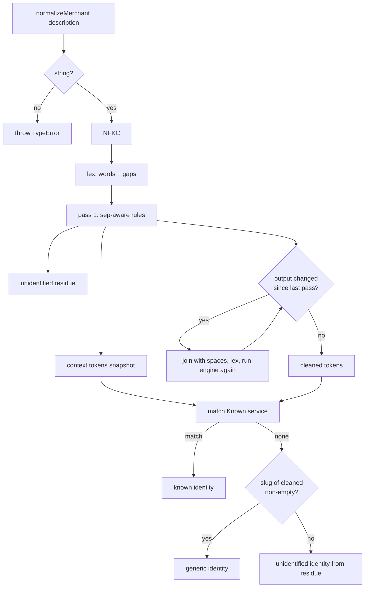

# Design Document: merchant-normalizer

## Overview

`merchant-normalizer` turns a raw bank-statement description into a `MerchantIdentity`: a grouping `key`, a `displayName`, a `source` (`known`, `generic` or `unidentified`), a `serviceId` and the payment `processor`. It lives in `packages/core/src/normalize` and is exported from `@zombills/core`. Like the parser, it is synchronous and pure: no network, no DOM, no clock, no randomness, no logging, no runtime dependencies.

One call works in four stages:

1. **Lex.** NFKC-normalize the input and split it into words and gaps in one left-to-right scan. Each word carries its raw text (for display) and its Folded text (for matching).
2. **Clean.** Remove noise with rules that look at the folded words and at the gaps between them. Pass 1 runs on the lexed input; later passes run on the space-joined output of the previous pass until it stops changing (Req 3.11).
3. **Match.** Look for a Known service in two token lists: the *context* list (pass 1, after prefixes, masked card numbers, processor, dates, phones and domains) and the *cleaned* list (Req 4.5–4.7).
4. **Build.** Produce the `known`, `generic` or `unidentified` identity (Req 1, 5, 6).

`normalizeTransactions` maps `normalizeMerchant` over a `Transaction[]` (Req 8).

### Design decisions

| Decision | Choice | Reason |
| --- | --- | --- |
| Work on tokens, not on one big regex | A hand-written lexer, then rules over a token array | Rules like "first remaining token", "trailing token" and "`*` after `PAYPAL`" are positional. Token rules are linear and cannot backtrack catastrophically (Req 9.10). |
| Two text forms per token | `raw` (NFKC, for display) and `folded` (for matching and keys) | Folding can change string length (`ß` → `ss`), so positions in a folded whole string would not map back to the original letters needed for display (Req 2.4). Folding each token on its own keeps the two aligned. |
| NFKC before lexing | `description.normalize("NFKC")` | Fullwidth and compatibility characters (`＊`, `ＮＥＴＦＬＩＸ`, `fi`) become their plain forms, so separators and names are recognised whatever the bank's encoding. See Design review decision 1. |
| Fixed point by construction | Repeat the cleaning engine on its own space-joined output until the output is unchanged | Req 3.11 asks that re-cleaning a Cleaned name changes nothing. Iterating makes that true by construction instead of by careful rule ordering. Pass 1 does almost all the work; later passes only catch order effects (for example a domain label that turns out to be a card prefix). |
| Gaps carry meaning in pass 1 only | `*`, `/`, `#`, `(`, `)`, `+` are visible to pass-1 rules; later passes see single spaces | Processor forms need the `*` (Req 3.4), dates need the `/` (Req 3.5), store numbers need the `#` (Req 3.9). A Cleaned name has only spaces, so these rules cannot fire when it is cleaned again, which keeps the fixed point. |
| ASCII digits for numeric noise | Dates, phones, references and store numbers look for `[0-9]` only | NFKC already turns fullwidth digits into ASCII. Other scripts' digits stay part of the name; no requirement asks for them to count as noise. |
| Immutable data | `KNOWN_SERVICES`, every service and every variant are deep-frozen; the variant index is built once at module load and never written again | The cancel helper and the UI receive the same objects; freezing stops a consumer from changing results for later calls (Req 10.4). A read-only index is not mutable state. |
| Locale | Only `toUpperCase()`, `toLowerCase()`, `normalize()` and `u`-flag regexes; no `Intl`, no `toLocale*` | Req 2.5. |
| Errors | `TypeError` for a non-string `description`; nothing else throws; no blanket `try/catch` | Req 1.9. A blanket catch would hide bugs that property P1 is there to find. |
| Module format | Same as the parser: ES modules under `module: NodeNext`, `.js` on every relative import | The Reaper loads `dist/index.js` from plain Node. |

---

## Architecture



### Cleaning engine: rule order inside one pass

Every pass runs these steps in this order. Steps marked *pass 1 only* need gap characters that only exist in the original text. The order is fixed, so the same input always produces the same output (Req 9.3). Store numbers run before reference numbers, so `STORE 1234` is removed as a pair; if the reference step ran first it would remove `1234` alone and leave `STORE` behind.

| # | Step | Where | Requirement |
| --- | --- | --- | --- |
| 1 | Masked card numbers and `CARD [ENDING\|NO] dddd` phrases | anywhere | 3.3 |
| 2 | Dates (slash forms need the `/` gap: *pass 1 only*; dot, dash, ISO and month forms work in every pass) | anywhere | 3.5 |
| 3 | Leading loop: card/POS/debit prefixes; the processor form if none has been recorded yet (*pass 1 for `*` forms*); further leading Amazon Marketplace forms | start | 3.2, 3.4 |
| 4 | Phone numbers | anywhere | 3.6 |
| 5 | URLs and domains, with paths (*pass 1 only* for `://` and `/path`) | anywhere; first token replaced by its label | 3.7 |
| — | *Snapshot the context tokens (pass 1 only)* | | 4.5 |
| 6 | Store numbers: `#ddd` (*pass 1 only*), `STORE ddd`, `NO ddd`, `NR ddd` | anywhere | 3.9 |
| 7 | Reference numbers | anywhere | 3.8 |
| 8 | Trailing loop: digits-only token, location code | end | 3.9, 3.10 |

The residue for unidentified keys (Req 6.2) is built from the pass-1 lexemes using only the removals made by steps 1–3 for prefixes, masked card numbers and dates.

The engine repeats until the joined output of a pass equals its input. Each pass that changes anything makes the string shorter, so the loop ends. Pass 1 handles realistic descriptions completely, and pass 2 confirms nothing changed. The adversarial inputs in Req 9.10 include nested cases that need more passes; see Performance.

---

## Module layout

All paths are relative to `packages/core/src/normalize/`. File names are kebab-case and constants are `SCREAMING_SNAKE_CASE` (`structure.md`).

| File | Responsibility | Exported from package root? |
| --- | --- | --- |
| `index.ts` | Public barrel | yes (via `packages/core/src/index.ts`) |
| `types.ts` | Public types | yes |
| `internal-types.ts` | `Lexeme`, `Token`, `CleanResult`, `RemovalReason` | no |
| `fold.ts` | `fold`, `FOLD_LETTER_MAP` | no |
| `lex.ts` | `lex`, `joinTokens` | no |
| `noise-lists.ts` | `CARD_PREFIXES`, `PROCESSOR_FORMS`, `PROCESSOR_NAMES`, `MONTHS`, `TLDS`, `US_STATE_CODES`, `CA_PROVINCE_CODES`, `ISO_COUNTRY_CODES`, `LOCATION_CODES` | no |
| `token-list.ts` | Token array helpers: removal with gap merging, cursor-based leading and trailing loops | no |
| `rule-card-numbers.ts` | Step 1 | no |
| `rule-dates.ts` | Step 2 | no |
| `rule-prefixes.ts` | Step 3 (prefixes and processor forms) | no |
| `rule-phones.ts` | Step 4 | no |
| `rule-domains.ts` | Step 5 | no |
| `rule-references.ts` | Steps 6 and 7 | no |
| `rule-trailing.ts` | Step 8 | no |
| `clean.ts` | `cleanDescription`: runs the passes, takes the context snapshot, builds the residue | no |
| `known-services.ts` | `KNOWN_SERVICES`, `getKnownService` | yes |
| `match-known.ts` | Variant index and `matchKnownService` | no |
| `display.ts` | `titleCase`, `slugify` | no |
| `unidentified.ts` | `unidentifiedKey`, `unidentifiedDisplayName` | no |
| `normalize-merchant.ts` | `normalizeMerchant` | yes |
| `normalize-transactions.ts` | `normalizeTransactions` | yes |
| `test-arbitraries.ts` | fast-check generators (noise, names, unidentified descriptions) | no; excluded from build |
| `test-known-service-fixtures.ts` | One or more realistic raw descriptions per Known service (Req 4.10) | no; excluded from build |
| `*.test.ts`, `*.property.test.ts` | Co-located tests | no; excluded from build |
| `no-network.test.ts`, `node-env.test.ts` | Req 10 checks | no |

`packages/core/src/index.ts` gains `export * from "./normalize/index.js";`. `types.ts` imports `Transaction` from `../parse/types.js` and does not re-export it, so there is no duplicate export. The build `tsconfig` already excludes `**/*.test.ts`, `**/*.property.test.ts` and `**/test-*.ts`.

---

## Public types (`types.ts`)

```ts
import type { Transaction } from "../parse/types.js";

export type MerchantSource = "known" | "generic" | "unidentified";

export type ProcessorId =
  | "paypal" | "square" | "shopify" | "amazon-marketplace"
  | "google" | "apple" | "sumup" | "zettle" | "toast";

export type ServiceCategory =
  | "video-streaming" | "music-audio" | "software" | "cloud-storage"
  | "news-reading" | "fitness-wellness" | "food-delivery" | "gaming";

export interface ServiceVariant {
  /** Folded, single-space-separated tokens, e.g. "disney+", "microsoft 365" */
  readonly text: string;
  readonly match: "contains" | "exact";
}

export interface KnownService {
  /** Stable kebab-case id shared with the cancel helper, e.g. "disney-plus" */
  readonly serviceId: string;
  readonly displayName: string;
  readonly category: ServiceCategory;
  readonly variants: readonly ServiceVariant[];
}

export interface MerchantIdentity {
  /** Grouping key: serviceId | "merchant:<slug>" | "unidentified:<processor|none>:<residue>" */
  key: string;
  displayName: string;
  source: MerchantSource;
  /** Non-null exactly when source is "known" */
  serviceId: string | null;
  processor: ProcessorId | null;
}

export interface NormalizedTransaction extends Transaction {
  merchant: MerchantIdentity;
}
```

## Internal types (`internal-types.ts`)

```ts
/** Output of the lexer. Words and gaps alternate; either may come first. */
export type Lexeme =
  | { kind: "word"; raw: string; folded: string }
  | { kind: "gap"; raw: string; folded: string };

/** A word as the rules see it. */
export interface Token {
  raw: string;
  folded: string;
  /** Folded text of every gap between the previous remaining token and this one (merged on removal) */
  gapBefore: string;
  /** Index range of the lexemes this token came from (pass 1); null in later passes */
  span: { first: number; last: number } | null;
}

export type RemovalReason =
  | "card-number" | "date" | "prefix" | "processor" | "phone" | "domain"
  | "reference" | "store-number" | "trailing";

export interface CleanResult {
  /** Tokens of the Cleaned name */
  cleaned: readonly Token[];
  /** Folded tokens after steps 1–5 of pass 1 (Req 4.5) */
  context: readonly string[];
  processor: ProcessorId | null;
  /** Unidentified residue (glossary); "" when nothing is left */
  residue: string;
  /** Number of passes run, for tests and diagnostics */
  passes: number;
}
```

## Function signatures

```ts
// normalize-merchant.ts
export function normalizeMerchant(description: string): MerchantIdentity;

// normalize-transactions.ts
export function normalizeTransactions(transactions: readonly Transaction[]): NormalizedTransaction[];

// known-services.ts
export const KNOWN_SERVICES: readonly KnownService[];
export function getKnownService(serviceId: string): KnownService | undefined;

// fold.ts
export function fold(text: string): string;

// lex.ts
export function lex(nfkcText: string): Lexeme[];
export function joinTokens(tokens: readonly Token[], form: "raw" | "folded"): string; // single spaces

// clean.ts
export function cleanDescription(description: string): CleanResult;

// match-known.ts
export function matchKnownService(
  context: readonly string[],
  cleaned: readonly string[],
): KnownService | null;

// display.ts
export function titleCase(rawToken: string): string;
export function slugify(foldedText: string): string;

// unidentified.ts
export function unidentifiedKey(processor: ProcessorId | null, residue: string): string;
export function unidentifiedDisplayName(processor: ProcessorId | null): string;
```

---

## Component design

### Folding (`fold.ts`)

`fold(text)`, exactly as in the glossary:

1. Case round trip: `.toLowerCase().toUpperCase().toLowerCase()`. This turns `ẞ`, `ß` and `SS` into `ss` and turns iota subscripts into real iotas in every case form, so `s`, `s.toUpperCase()` and `s.toLowerCase()` reach the same text before any decomposition.
2. `.normalize("NFKD")`.
3. Remove `\p{M}` characters.
4. Replace each character found in `FOLD_LETTER_MAP` (`ø→o`, `æ→ae`, `œ→oe`, `ł→l`, `đ→d`, `ð→d`, `þ→th` and the upper-case forms `Ø Æ Œ Ł Đ Ð Þ`).
5. A final `.toLowerCase()`.

Folding is applied per token and per gap, never to the whole description.

### Lexer (`lex.ts`)

Input is the NFKC-normalized description. One scan, one character of lookahead, no regex over the whole string.

- **Word characters:** `\p{L}`, `\p{N}`, `\p{M}`.
- **Connectors:** `&`, `'`, `’` (U+2019), `-`, `.` belong to a word when the previous character is a word character and the next one is a letter or digit (Req 3.1). `+` belongs to a word when the previous character is a word character and either the next one is a letter or digit or the `+` follows a letter (`DISNEY+`, `APPLE TV+`). `’` is not in Req 3.1's lists; treating it like `'` keeps `JOE’S` one word. Slugs are the same either way.
- **Gaps:** every maximal run of other characters. That covers all of Req 3.1's separators plus whitespace, `#`, `@`, `$`, emoji, control characters and lone surrogates, so nothing ever throws or gets lost.
- Each lexeme stores `raw` and `folded = fold(raw)`.

Examples: `APPLE.COM/BILL` → word `apple.com`, gap `/`, word `bill`. `****1234` → gap `****`, word `1234`. `(800) 123` → gap `(`, word `800`, gap `) `, word `123`. `03.01.` → word `03.01`, gap `.`.

`joinTokens` joins tokens with one space. Lexing a joined string gives back the same tokens with `" "` gaps, which is what makes the pass loop well defined.

### Token list helpers (`token-list.ts`)

Rules never splice arrays in a loop. Each rule makes one linear pass that builds a new array, or moves a cursor over the start or end. Removing a token appends its `gapBefore` to the next remaining token's `gapBefore`, so after `PAYPAL 12/03 *X` loses the date, `X` still has `*` in front of it. The token list is `{ tokens, trailingGap }`: `trailingGap` is the gap after the last word, and the gaps of removed trailing tokens are merged into it, so the PayPal rule can test "token is last and its trailing gap contains `*`". Each removal is logged with its `RemovalReason` and lexeme `span`; the residue builder needs this.

### Step 1: masked card numbers (`rule-card-numbers.ts`)

Removed anywhere (Req 3.3):

- A word matching `^x{2,}[0-9]{4}$` (folded).
- A word matching `^[0-9]{4}$` whose `gapBefore` ends in two or more `*`.
- The sequences `card dddd`, `card ending dddd`, `card no dddd`, where `dddd` is a word of exactly 4 digits.

### Step 2: dates (`rule-dates.ts`)

Removed anywhere (Req 3.5). A date is removed only if at least one reading has day 1–31 and month 1–12.

| Form | Shape | Readings |
| --- | --- | --- |
| ISO | word `^[0-9]{4}-[0-9]{1,2}-[0-9]{1,2}$` | yyyy-mm-dd |
| Dot | word `^[0-9]{1,2}\.[0-9]{1,2}(\.([0-9]{2}\|[0-9]{4}))?$` | dd.mm |
| Dash | word `^[0-9]{1,2}-[0-9]{1,2}$` | dd-mm |
| Slash (pass 1) | words `d`, `m` (1–2 digits each) with gap exactly `/`, optionally followed by gap `/` and a 2- or 4-digit word | dd/mm or mm/dd |
| Month, joined | word `^[0-9]{1,2}(jan\|feb\|…\|dec)$` or `^(jan\|…\|dec)[0-9]{1,2}$` | day only |
| Month, spaced | words `d` + `mon`, or `mon` + `d`, with a whitespace-only gap | day only |

The slash form tries the 3-part shape before the 2-part shape. The two spaced month forms use a stack: when the top of the output stack and the current token form a date, the top is popped and both are dropped. Nested inputs like `12 12 JAN JAN` therefore clear in one pass.

### Step 3: leading loop (`rule-prefixes.ts`)

A cursor walks from the start. On each turn, the first rule that applies wins, and the loop stops when none applies:

1. **Card prefix.** The longest entry of `CARD_PREFIXES` (Req 3.2, stored as folded token sequences, longest first) that matches the leading tokens.
2. **Processor form, when none has been recorded yet.** The forms of Req 3.4:

   | Form | Matches when | ProcessorId |
   | --- | --- | --- |
   | `paypal`, `pp` | the next token's `gapBefore` contains `*` (or the token is last and its trailing gap contains `*`) | `paypal` |
   | `sq` / `sp` / `google` / `sumup` / `iz` / `tst` | same `*` condition | `square` / `shopify` / `google` / `sumup` / `zettle` / `toast` |
   | `zettle` | the next gap contains `_` and `*` | `zettle` |
   | `apple.com` + `bill` | the gap between them is exactly `/` | `apple` |
   | `amzn mktp`, `amazon mktplace` | always. A following 2-letter token is consumed too if it is an ISO 3166-1 code **and** it is followed by a gap with `*`, is the last token, or is followed by a reference number | `amazon-marketplace` |

   The `*` forms can only match in pass 1. The extra condition on the Amazon country code keeps `AMZN MKTP PS PLUS` from losing the `PS` of `PS PLUS`.
3. **Further Amazon forms, once a processor is recorded.** A leading `amzn mktp` or `amazon mktplace` is removed again but not recorded. This covers `SQ *AMZN MKTP FOO`. Without it, the Cleaned name `AMZN MKTP FOO` would lose `AMZN MKTP` when cleaned again, breaking the fixed point. See Design review decision 2.

Because masked card numbers and dates are already gone (steps 1–2), a prefix or processor form that was behind them is now leading (Req 3.2 last sentence, Req 3.4). The recorded processor is kept across passes; the first one found wins.

### Step 4: phone numbers (`rule-phones.ts`)

A **digit group** is a word made of ASCII digits with optional single `-` or `.` between digit runs, checked with a character loop rather than a regex. Removed anywhere (Req 3.6):

1. **Single word:** a digit group with 7–15 digits (`866-579-7172`, `1-800-123-4567`, `8665797172`).
2. **Marked run:** a digit group whose `gapBefore` ends in `+` or `(`, followed to the right by pure-digit words. A word joins the run only if its gap is one space, or, for the second group after a `(`, `)` or `) `. The run is removed if it holds 7–15 digits in total (`+44 20 7946 0958`, `(800) 123 4567`).
3. **Unmarked spaced run:** a window of three pure-digit words of 3, 3 and 4 digits with single-space gaps, optionally preceded by a word `1` (`866 579 7172`, `1 866 579 7172`).

Unmarked spaced runs are limited to the North American shape so that a preceding short number is never absorbed. Under a looser rule, `MICROSOFT 365 866 579 7172` would lose `365` and stop matching Microsoft 365. Other spaced shapes, such as `020 7946 0958`, still disappear: the 4-digit groups are reference numbers (step 7), and a leftover short group at the end is caught by the trailing loop. See Design review decision 3.

### Step 5: URLs and domains (`rule-domains.ts`)

- Pass 1: a word `http` or `https` whose next gap starts with `://` is removed.
- A leading `www.` is stripped from a word. `raw` and `folded` are cut at the same dot; folding never adds or removes `.`, so the labels stay aligned.
- **Domain test:** split the folded word on `.`. There must be at least 2 labels, each non-empty and made of `[a-z0-9-]`. The last label, or the last two, must be in `TLDS` (Req 3.7 list plus `ca`, `au`, `ch`, `at`, `se`, `ie`, `be`, `info`). The *name label* is the label just before the TLD.
- If the domain is the first remaining token, it is replaced by its name label (raw and folded). Otherwise it is removed.
- Pass 1: after a domain, each following token whose `gapBefore` is non-empty and has no whitespace is a path segment and is removed (`/bill`, `/helppay`). The first such gap must start with `/`.

After step 5, the folded tokens are copied as the **context** list (pass 1 only).

### Steps 6 and 7: store and reference numbers (`rule-references.ts`)

- **Store, step 6 (Req 3.9):** a pure-digit word whose `gapBefore` ends in `#` (pass 1); the pairs `store ddd`, `no ddd`, `nr ddd`, both tokens removed. This runs first so that `WALGREENS STORE 1234` and `FOO STORE 0412` lose `STORE` together with the number, even when the number has 4 or more digits.
- **Reference, step 7 (Req 3.8):** a folded word of 4 or more ASCII digits, or a word of 6 or more code points, all `\p{L}`/`\p{N}`, with at least 2 ASCII digits and at least 1 letter.

### Step 8: trailing loop (`rule-trailing.ts`)

A cursor walks back from the end:

- If the last token is all digits, remove it.
- Otherwise, if it is in `LOCATION_CODES` (US states and territories including DC, PR, GU, VI, AS, MP; the 13 Canadian province and territory codes; the 249 ISO 3166-1 alpha-2 codes; `usa`), remove it, unless it is the only token left and no processor has been recorded (Req 3.10).
- Otherwise stop.

### Pass loop and residue (`clean.ts`)

```
tokens  = tokensFrom(lex(NFKC(description)))
pass 1  = engine(tokens, { firstPass: true })   → context, removals, processor
loop:     next = engine(tokensFrom(lex(joinTokens(prev, "raw"))), { firstPass: false, processor })
          stop when joinTokens(next, "folded") === joinTokens(prev, "folded")
```

The loop compares folded text, and the raw tokens it re-lexes come from the previous pass, so display text and keys both stay stable.

**Unidentified residue (Req 6.2).** Start from the pass-1 lexemes. Drop every lexeme inside a span removed for `prefix`, `card-number` or `date`, together with the gap lexeme right after that span. Concatenate the folded text of what is left, collapse runs of whitespace (`\s` and `\p{Z}`) to one space, and trim. Dropping the gap after a removed span keeps `POS*12/03*APPLE.COM/BILL` and `APPLE.COM/BILL` apart only by what really differs. A date inserted between two space-separated words leaves exactly one space behind.

Examples:

| Raw | Residue |
| --- | --- |
| `DEBIT CARD PURCHASE 12/03 APPLE.COM/BILL 866-712-7753 CA` | `apple.com/bill 866-712-7753 ca` |
| `DEBIT CARD PURCHASE 01/04 APPLE.COM/BILL 866-712-7753 CA` | `apple.com/bill 866-712-7753 ca` |
| `POS XXXX1234 APPLE.COM/BILL 866-712-7753 CA` | `apple.com/bill 866-712-7753 ca` |
| `PAYPAL *1234567890` | `paypal *1234567890` |
| `POS 01/12` | `` (empty) |

### Known service matching (`match-known.ts`)

At module load, two read-only indexes are built from `KNOWN_SERVICES`:

- `containsByFirstToken: Map<string, Entry[]>`, keyed on the first token of each `contains` variant.
- `exactByText: Map<string, Entry>`, keyed on the whole text of each `exact` variant.

Each `Entry` holds the variant's token array, its character length, the service index and the variant index.

`matchKnownService(context, cleaned)`:

1. For every position in `context`, and then in `cleaned`, look up entries by the token there and check whether the rest of the variant's tokens follow (Req 4.5).
2. Look up `cleaned.join(" ")` in `exactByText` (Req 4.6).
3. Among all hits, pick the one with the longest `text`, then the lowest service index, then the lowest variant index (Req 4.7).

Cost is O(tokens × entries sharing a first token). In practice that is about 2 entries per first token.

### Building the identity (`normalize-merchant.ts`, `display.ts`, `unidentified.ts`)

```
if typeof description !== "string": throw TypeError
r = cleanDescription(description)
s = matchKnownService(r.context, folded(r.cleaned))
if s:     { key: s.serviceId, displayName: s.displayName, source: "known", serviceId: s.serviceId, processor }
slug = slugify(joinTokens(r.cleaned, "folded"))
if slug:  { key: "merchant:" + slug, displayName: display(r.cleaned), source: "generic", serviceId: null, processor }
else:     { key: unidentifiedKey(processor, r.residue), displayName: unidentifiedDisplayName(processor),
            source: "unidentified", serviceId: null, processor }
```

- `slugify`: replace each run of `[^\p{L}\p{N}]` with `-` (one linear `u`-flag regex, no nested quantifiers) and trim leading and trailing `-` (Req 5.2).
- **Generic display name:** `titleCase` each raw token, join with single spaces, then `normalize("NFC")` (Req 2.4, 5.3). The raw tokens are already NFKC from the input step, and NFC of NFKC text stays NFKC. In `titleCase`, a letter is *initial* if it is the first letter or digit of the token or comes right after `-`. Initial letters are upper-cased and other letters lower-cased, with one exception: when `toUpperCase()` turns one code point into several (`ß` → `SS`), the character is left unchanged. Without that exception, `ßtrasse` would title-case to `SStrasse` and then to `Sstrasse`, breaking idempotence (Req 9.5).
- `unidentifiedKey`: `"unidentified:" + (processor ?? "none") + ":" + (residue || "-")` (Req 6.2).
- `unidentifiedDisplayName`: `PROCESSOR_NAMES[processor] + " payment (merchant not shown)"`, or `"Unknown merchant"` (Req 6.4).

**Why idempotence holds (Req 9.5).** For a `known` result, the display name maps back to its service by the list invariant P8 (Req 4.11). For a `generic` result with display name `d`: lexing `d` gives the cleaned tokens with only their case changed. Folding ignores case, so every rule sees the same folded tokens. The Cleaned name is a fixed point, so nothing is removed, and the context and cleaned lists of `d` both equal the original cleaned list. That list already failed to match any variant, so `d` is generic again with the same slug. `titleCase` is idempotent, so the display name is the same too.

### `normalizeTransactions` (`normalize-transactions.ts`)

```ts
const memo = new Map<string, MerchantIdentity>(); // local to the call, not module state
return transactions.map((t) => {
  let m = memo.get(t.description);
  if (m === undefined) { m = normalizeMerchant(t.description); memo.set(t.description, m); }
  return { date: t.date, description: t.description, amountCents: t.amountCents, currency: t.currency, merchant: { ...m } };
});
```

- Same length and order; new objects; the input is never written to (Req 8.2, 8.3).
- `amountCents` is copied as is and never read for any decision (Req 8.4, 6.5).
- Each element gets its own copy of the identity, so a consumer that mutates one transaction's `merchant` cannot change another.
- The memo lives only for one call (Req 10.4). A monthly statement repeats descriptions, so this saves real work without changing results.

---

## Known service data (`known-services.ts`)

Each variant is written in the canonical token form the matcher compares against: folded, single-spaced, exactly what `joinTokens(lex(text), "folded")` returns. For `contains` variants this is the context form, so `microsoft 365` keeps its `365` even though full cleaning would remove a trailing number (see Design review decision 4). `c` = contains, `e` = exact. The display name's folded form is always one of the variants (Req 4.4).

| serviceId | Variants |
| --- | --- |
| `netflix` | `netflix` c, `netflix com` c |
| `disney-plus` | `disney+` c, `disney plus` c, `disneyplus` c |
| `hulu` | `hulu` c, `hulu plus` c |
| `max` | `max` e, `hbo max` c, `hbomax` c |
| `paramount-plus` | `paramount+` c, `paramount plus` c, `paramountplus` c |
| `peacock` | `peacock` e, `peacocktv` c, `peacock tv` c, `peacock premium` c |
| `apple-tv-plus` | `apple tv+` c, `apple tv plus` c, `appletv+` c |
| `youtube-premium` | `youtube premium` c, `youtubepremium` c |
| `amazon-prime` | `amazon prime` c, `amzn prime` c, `amazon prime membership` c |
| `crunchyroll` | `crunchyroll` c, `crunchyroll premium` c |
| `dazn` | `dazn` c, `dazn limited` c |
| `espn-plus` | `espn+` c, `espn plus` c, `espnplus` c |
| `discovery-plus` | `discovery+` c, `discovery plus` c, `discoveryplus` c |
| `sling-tv` | `sling tv` c, `slingtv` c, `sling` e |
| `spotify` | `spotify` c, `spotify usa` c, `spotify ab` c |
| `apple-music` | `apple music` c, `applemusic` c |
| `amazon-music` | `amazon music unlimited` c, `amazon music` c, `amzn music` c |
| `youtube-music` | `youtube music` c, `youtubemusic` c |
| `tidal` | `tidal` e, `tidal music` c |
| `deezer` | `deezer` c, `deezer premium` c |
| `audible` | `audible` c, `audible inc` c |
| `siriusxm` | `siriusxm` c, `sirius xm` c, `sirius radio` c |
| `pandora` | `pandora` e, `pandora music` c, `pandora media` c |
| `microsoft-365` | `microsoft 365` c, `msft 365` c, `office 365` c, `microsoft office` c |
| `adobe` | `adobe creative cloud` c, `adobe` c |
| `1password` | `1password` c, `agilebits` c |
| `nordvpn` | `nordvpn` c, `nord vpn` c |
| `expressvpn` | `expressvpn` c, `express vpn` c |
| `canva` | `canva` c, `canva pro` c |
| `chatgpt-plus` | `chatgpt plus` c, `chatgpt` c, `openai chatgpt` c |
| `duolingo` | `duolingo` c, `duolingo plus` c |
| `grammarly` | `grammarly` c, `grammarly premium` c |
| `linkedin-premium` | `linkedin premium` c, `linkedin pre` c |
| `icloud` | `icloud+` c, `icloud` c, `icloud storage` c |
| `google-one` | `google one` c, `google storage` c, `googleone` c |
| `dropbox` | `dropbox` c, `dropbox plus` c |
| `new-york-times` | `the new york times` c, `new york times` c, `nytimes` c, `ny times` c |
| `washington-post` | `the washington post` c, `washington post` c, `washingtonpost` c |
| `wall-street-journal` | `the wall street journal` c, `wall street journal` c, `wsj` c |
| `the-economist` | `the economist` c, `economist` c |
| `the-guardian` | `the guardian` c, `guardian news` c, `guardian media` c |
| `medium` | `medium` e, `medium monthly` c |
| `kindle-unlimited` | `kindle unlimited` c, `kindle unltd` c, `kindleunlimited` c |
| `peloton` | `peloton` c, `peloton interactive` c |
| `strava` | `strava` c, `strava inc` c |
| `classpass` | `classpass` c, `class pass` c |
| `headspace` | `headspace` c, `headspace inc` c |
| `calm` | `calm` e, `calm app` c |
| `planet-fitness` | `planet fitness` c, `planet fit` c, `planetfitness` c |
| `doordash-dashpass` | `dashpass` c, `doordash dashpass` c |
| `uber-one` | `uber one` c, `uberone` c |
| `grubhub-plus` | `grubhub+` c, `grubhub plus` c, `grubhubplus` c |
| `instacart-plus` | `instacart+` c, `instacart plus` c, `instacart express` c |
| `deliveroo-plus` | `deliveroo plus` c, `deliverooplus` c |
| `hellofresh` | `hellofresh` c, `hello fresh` c |
| `xbox-game-pass` | `xbox game pass` c, `xbox gamepass` c, `game pass` c |
| `playstation-plus` | `playstation plus` c, `ps plus` c, `playstationplus` c |
| `nintendo-switch-online` | `nintendo switch online` c, `nintendo sw online` c, `switch online` c |
| `ea-play` | `ea play` c, `eaplay` c |

These tokens are deliberately **not** variants, following Req 4.8: `microsoft`, `msft`, `xbox`, `playstation`, `playstation network`, `ps`, `sony`, `nintendo`, `electronic arts`, `ea`, `kindle`, `kindle svcs`, `uber`, `uber eats`, `doordash`, `amazon`, `amzn`, `prime video`, `apple`, `google`, `youtube`, `streaming`, `premium`, `musik`.

`prime video` is left out because Amazon prints `Prime Video*…` for rentals and channel add-ons as well as membership (Req 4.8, Design review decision 5).

Checks on the data, run as unit tests in `known-services.test.ts`:

- 59 services; every `serviceId` is unique and matches `^[a-z0-9]+(-[a-z0-9]+)*$`; the ids and display names equal the Req 4.2 table.
- Every variant text equals its own canonical token form, and no two services share a variant text.
- Every service has at least two variants, one of them equal to the folded display name.
- No variant token is a card prefix, a month abbreviation or a 1–2 digit number. Those tokens would be removed in steps 1–3 before contains matching ever saw them.
- `exact` is used for `max`, `calm`, `medium`, `peacock`, `tidal`, `pandora`, `sling`.
- `getKnownService` returns the frozen object for each id and `undefined` for unknown ids.

---

## Error handling

| Case | Behaviour |
| --- | --- |
| `description` is not a string | `throw new TypeError("normalizeMerchant: description must be a string")` (Req 1.9) |
| Empty, whitespace-only, emoji-only, control characters, lone surrogates | Lexer yields no words or only words that fold to nothing → `unidentified`, `key` `unidentified:none:<residue or ->` |
| `normalizeTransactions` element with a non-string description | The `TypeError` from `normalizeMerchant` propagates; this is a type contract violation |

No other code path throws. `String.prototype.normalize` and the case functions accept lone surrogates. All regexes run on a single token and use the `u` flag.

---

## Privacy and environment

- `src/normalize` imports only `../parse/types.js` (types only, erased at build). No third-party packages.
- No `console.*`. Merchant names never leave the function's return value.
- `KNOWN_SERVICES` is a TypeScript literal in the bundle; nothing is fetched (Req 10.1).
- `no-network.test.ts` checks every non-test `.ts` file under `src/normalize` with the same syntax-tree scan as `src/parse/no-network.test.ts`, failing on `fetch`, `XMLHttpRequest`, `sendBeacon`, `WebSocket`, `document`, `window`, `navigator` and `localStorage`, and naming the file, line and identifier (Req 10.5). If the parser's scanner is local to its test file, it moves to a shared test-only helper `src/test-no-network-scan.ts` used by both tests.
- The existing ESLint `no-restricted-globals` rules already cover `packages/core`. `localStorage` is added to them.
- `node-env.test.ts` imports `@zombills/core` under Vitest's Node environment and calls both functions (Req 10.3).
- No mutable module-level state (Req 10.4). Module-level values are frozen constants and the read-only variant index.

---

## Performance

Every rule is one linear pass or a cursor loop, and every regex runs on a single token with no nested or overlapping quantifiers. One pass is O(n) in the input length. The pass loop runs until nothing changes. Realistic descriptions need 2 passes: one that cleans and one that confirms.

An adversarial input can force more passes only by nesting rules that unlock each other, for example a phone that becomes contiguous once a date between its groups is removed, and whose removal then makes another date contiguous. Each such pass shrinks the string, so the worst case is O(n²) over the token count. Even for 10,000 characters that is far below the 250 ms bound. The adversarial corpus in Req 9.10 includes such a nested case, so a change that makes it much slower fails the timing test.

---

## Testing strategy

Tools are Vitest and fast-check, with co-located tests (`tech.md`, `structure.md`). Property tests use fast-check's default 100 runs.

### Generators (`test-arbitraries.ts`)

- `noiseArb`: optional card prefix (Req 3.2 list); optional processor form rendered as banks print it (`PAYPAL *`, `PP*`, `SQ *`, `SP *`, `AMZN Mktp US*`, `AMAZON MKTPLACE `, `GOOGLE *`, `APPLE.COM/BILL `, `SUMUP *`, `IZ *`, `ZETTLE_*`, `TST*`); 0–4 suffix items. The suffix items are phones in every shape step 4 removes, reference numbers (filtered against variant tokens), dates in every Req 3.5 form with valid values, store numbers (`#0412`, `STORE 12`, `NO 7`, `NR 3`), masked card numbers (`XXXX1234`, `****1234`, `CARD ENDING 1234`), domain tokens (`AMZN.COM/BILL`, `HELP.MAX.COM`) and location codes. Random ASCII letter case, and random runs of spaces and `*` between parts (never inside a variant or name).
- `genericNameArb`: 1–4 words of 3–12 letters from ASCII and Latin-1 letters, excluding every word in `noise-lists.ts`, every processor token and every Known variant token, and rejecting names that match a variant (Req 5.6).
- `unidentifiedArb`: a processor form or nothing, followed by reference numbers and phone numbers, with prefixes, masked card numbers and dates inserted as whole space-separated tokens at the start or end.
- `adversarialCorpus`: fixed 10,000-character strings: `"1"` × 10,000; `"*"` × 10,000; `"12/"` repeated; `"01."` repeated; `"1-"` repeated; `"(1) "` repeated; `"POS "` repeated; `"PAYPAL *"` repeated; `"AMZN MKTP "` repeated; `"a."` repeated plus `"com"`; nested phone/date alternations; and the same strings with random case.

### Correctness properties

| ID | Property | File | Validates |
| --- | --- | --- | --- |
| P1 | Never throws: for any string (`fc.string`, `fc.fullUnicodeString`, lone surrogates, control characters, lengths up to 10,000), `normalizeMerchant` returns an identity | `normalize-merchant.property.test.ts` | 1.9, 9.1 |
| P2 | Output shape: `key` and `displayName` non-empty; `source` valid; `serviceId` non-null exactly for `known`; key prefixes as in Req 1.7; `known` keys contain no `:` | `normalize-merchant.property.test.ts` | 1.2–1.7, 9.2 |
| P3 | Deterministic: two calls return deeply equal results, for `normalizeMerchant` and `normalizeTransactions` | `normalize-merchant.property.test.ts` | 9.3 |
| P4 | Case-insensitive: `s`, `s.toUpperCase()`, `s.toLowerCase()` give equal `key`, `source`, `serviceId`, `processor` | `normalize-merchant.property.test.ts` | 2.5, 9.7 |
| P5 | Idempotent: for `known` and `generic` results, normalizing `displayName` gives the same `key`, `source`, `serviceId`, `displayName`. Run on arbitrary strings and on `noiseArb` × variants and names | `normalize-merchant.property.test.ts` | 9.5 |
| P6 | Cleanup fixed point: `cleanDescription(joinTokens(cleaned, "raw")).cleaned` equals `cleaned` | `clean.property.test.ts` | 3.11, 9.6 |
| P7 | Known noise-insensitivity: every service × every variant × `noiseArb` gives that `serviceId` | `match-known.property.test.ts` | 9.4 |
| P8 | List invariant: every variant text and every display name maps to its own service | `known-services.property.test.ts` | 4.11 |
| P9 | Generic noise-insensitivity: `genericNameArb` × `noiseArb` gives `generic` and the bare name's key | `normalize-merchant.property.test.ts` | 5.4, 5.6, 9.8 |
| P10 | Unidentified keys: residues equal ⇔ keys equal (for equal processors); inserting or changing prefixes, masked card numbers or dates does not change the key; `PAYPAL *r1` and `PAYPAL *r2` differ for distinct references | `unidentified.property.test.ts` | 6.2, 6.3, 9.9 |
| P11 | Pass-through: for any `Transaction[]`, output length and order match, money and date fields equal the input, the input equals its pre-call `structuredClone`, and every element is a new object | `normalize-transactions.property.test.ts` | 8.2–8.4, 8.6 |
| P12 | Generic keys never merge different names: two `genericNameArb` names whose folded letter-and-digit sequences differ get different keys | `normalize-merchant.property.test.ts` | 5.5 |
| P13 | Bounded time: every `adversarialCorpus` entry and 100 random 10,000-character strings each finish in under 250 ms, measured with `performance.now()` after one warm-up call | `performance.test.ts` | 9.10 |

### Example-based unit tests

| File | Cases | Validates |
| --- | --- | --- |
| `fold.test.ts` | `Café`, `STRAßE`, `Ørsted`, `Æble`, `Łódź`, Cyrillic unchanged except case | 2.1–2.3, glossary Folding |
| `lex.test.ts` | Each connector rule: `AT&T`, `MCDONALD'S`, `JOE’S`, `DISNEY+`, `APPLE TV+`, `7-ELEVEN`, `A--B`, `****1234`, `(800) 123`, `03.01.`; fullwidth input | 3.1 |
| `rule-*.test.ts` | One table per rule, with positive and negative cases from Req 3: e.g. `GOOGLE STORAGE` and `SQUARESPACE` are not processors; `1PASSWORD`, `MP3`, `B2B` kept; `TANKSTELLE AM RING` keeps `AM`; `FOO AM DE` → `FOO`; `BP`, `BP 0412` → `BP`; `31/13` kept; `AMZN MKTP PS PLUS` keeps `PS` | 3.2–3.10 |
| `normalize-merchant.test.ts` | Every row of Req 3.12; Req 2.2 accent and case examples; `ЯНДЕКС ПЛЮС`; non-string input throws `TypeError` | 1, 2, 3.12 |
| `match-known.test.ts` | Every row of the Req 4.8 tables (Uber, Amazon, Xbox, PlayStation, Nintendo, EA, Kindle); `MAX MUSTERMANN`, `CALM WATERS SPA` generic; `AMAZON PRIME VIDEO` vs `AMAZON MUSIC`; longest-variant tie-break; `APPLE.COM/BILL` and `GOOGLE *` alone unidentified | 4.5–4.9 |
| `known-services.test.ts` | Data checks listed above; every entry in `test-known-service-fixtures.ts` maps to its service | 4.1–4.4, 4.10 |
| `unidentified.test.ts` | Every row of the Req 6.3 table; Req 6.1 examples; `POS 01/12` → `unidentified:none:-`; display names for each processor | 6.1–6.5 |
| `eu-sample.test.ts` | Parse `samples/eu-semicolon.csv` with `parseStatement`, normalize, compare with the Req 7.1 table, exactly 7 distinct keys, no `known`; `SEPA-LASTSCHRIFT SPOTIFY AB`, `KARTENZAHLUNG 03.01. NETFLIX`; `RÜCKERSTATTUNG` = `RUCKERSTATTUNG` ≠ `RUECKERSTATTUNG` | 7.1–7.5 |
| `normalize-transactions.test.ts` | Empty array; debit, credit and zero rows; frozen input does not throw | 8.1–8.5 |
| `no-network.test.ts`, `node-env.test.ts` | As in Privacy | 10.1–10.5 |

### Fixture tests

Every CSV in `samples/` is parsed and normalized, and the distinct keys with their display names are snapshotted. A change to a rule or to the service list then shows up as a reviewed snapshot diff.

---

## Design review decisions

All seven decisions were accepted in design review, and the amendments are applied to `requirements.md`.

1. **Accepted: NFKC instead of NFC for display (Req 2.4 amended).** The input is NFKC-normalized before lexing, so generic display names are NFKC: accents are kept, and compatibility characters are mapped (`ＣＡＦＥ` → `Cafe`, `fi` → `fi`).
2. **Accepted: one processor recorded, a second Amazon Marketplace form removed (Req 3.4 amended).** Only one processor is ever recorded. A starless Amazon form left at the start after the recorded one is removed as noise, because otherwise the Cleaned name would not be a fixed point (Req 3.11).
3. **Accepted: unmarked space-separated phones are NANP-shaped only (Req 3.6 clarified).** Single-word phones (`-`, `.` or no separator), `+`- and `(`-marked runs, and spaced `ddd ddd dddd` with an optional leading `1` are recognised. Other spaced shapes are removed indirectly through reference numbers and the trailing loop. A looser rule would swallow a preceding number such as the `365` in `MICROSOFT 365 866 579 7172`.
4. **Accepted: "cleaned form" for variants (Req 4.4 clarified).** For `contains` variants it is the context text (Req 4.5), so `microsoft 365` keeps `365`. For `exact` variants it is the Cleaned name.
5. **Accepted: `prime video` is not an `amazon-prime` variant (Req 4.8 table and out-of-scope list amended).** Amazon uses it for rentals and channel add-ons as well as membership.
6. **Accepted: residue gaps (Req 6.2 clarified).** A removed prefix, masked card number or date takes the gap right after it out of the residue. Without this, `…/BILL*12/03*CA` and `…/BILL*CA` would differ by a doubled `*`.
7. **Accepted: `normalizeTransactions` copies the four `Transaction` fields explicitly (Req 8.2 clarified)** and does not spread the input. Extra properties on a caller's objects are not carried over, so the output matches `NormalizedTransaction` exactly.
