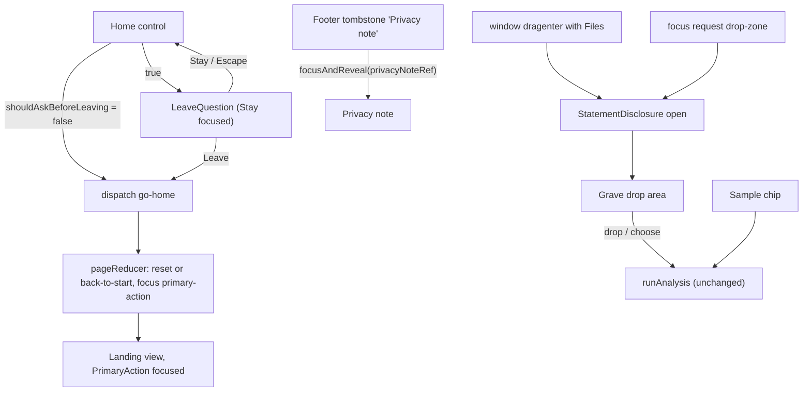

# Design Document: pro-polish

## Overview

`pro-polish` brings the Non-landing views and the site chrome up to the finish of the Landing view. It adds a Compact header whose `h1` holds the Home control, a Footer graveyard of four tombstone links on the scene's earth, a Statement panel drawn as an open grave, Share preview tags and image, the Landing scene band on Non-landing views, four Button variants, the Wide layout, the Email disclosure in "Seal the grave", a calmer Graveyard view, and small polish on the Rising (muted footnote, Progress dots, a finite card sway).

The design keeps the two layers of the earlier specs:

1. **Pure logic** (`page-state.ts`, `apps/web/src/slice/logic/`): a `go-home` action and a `"primary-action"` focus target, `shouldAskBeforeLeaving`, `progressDots`, `isWideView`, one text module for the new sentences, and the design tokens as data the static and contrast tests read.
2. **React view** (`apps/web/src/slice/`): a new `chrome/` folder (header, footer, leave question), a new `statement/` folder (panel, grave drop area, chips, disclosure), `button-variants.ts`, and changes to `SlicePage`, `NightScene`, `BurialStage`, `UndeadCard`, `RisingView`, `CancelHelper`, `GraveyardView` and `MemoryPanel`.

`packages/core` does not change. No dependency is added to any `package.json`. `CSP_POLICY`, `injectCsp`, `netlify.toml` and the Netlify headers do not change (Req 4.5, 12.2). The only new public files are `og-image.svg` and `og-image.png` (Req 4.2).

**Source of the four signature moments.** The request for this design names a "Design direction" section of `brief.md`. The committed `brief.md` has no section by that name; it holds R1 to R11 and Constraints only. *(Assumption: the direction is the one given with the request: the rising, the burial with the counter count-up, the grave drop zone ghost and the footer graveyard peek, in the brief's look of night, moon, fog, tombstones, a cream ghost with two oval eyes and no mouth, and a moss-green glow.)* Each moment is specified in "Signature moments" from Req 2, 3, 5, 10 and the timings already in `graveyard/motion.ts`.

### Design decisions

| Decision | Choice | Reason |
| --- | --- | --- |
| Going home | One new `PageAction` `{ type: "go-home" }`. It returns `model` while `working` or on the Landing view. From `idle` on the Graveyard view it is the `back-to-start` result with the focus target replaced by `"primary-action"`; from every other view it is the `reset` result with the same replacement | Req 1.3, 1.11. Reusing the two transitions keeps the Graveyard, Memory and totals untouched by construction. "Start again" and "Back to the start" keep dispatching `reset` and `back-to-start` (Req 1.9) |
| Focus after going home | New `FocusTarget` `"primary-action"`. `PrimaryAction` carries `data-focus="primary-action"`, so the existing `[data-focus]` effect in `SlicePage` finds it inside `main` | Req 1.3. No ref is passed across views; the Landing `main` mounts in the same commit as the request |
| Leave question state | Component state in `SlicePage`: `leave: { open: boolean; seq: number }`. Opening bumps `seq`; an effect focuses "Stay" whenever `seq` changes. A second effect closes it when `model.view.kind` or `model.screen` changes (not on every new `view` object, since `burial-step` replaces `view` about every 0.5 s with no user input); when it closes while focus is inside it, focus moves to the Home control through `homeRef` | Req 1.4 to 1.6, graveyard-ui R14.2, design review 1 #6. It is view state, not Page state: it never changes what the reducer does and no test of the reducer needs it |
| Leave rule | `shouldAskBeforeLeaving(model) = model.view.kind === "results"`, exported from `page-state.ts` | Req 1.10, Decision "the leave question tells the truth" |
| Compact header surface | The header row has no surface. The Home control sits on the bare scene with `BARE_FOCUS`; the savings counter keeps its own small `bg-fog/95` card (the Landing pattern), rendered only when it has lines | The counter label (`text-bone/70`, 0.6875 rem) is 3.18:1 on the lightest scene S and 6.92:1 on the card. The Home control text is `--bone` on S at 4.68:1 |
| Counter size in the header | `SavingsCounter` gains `size: "full" \| "compact"` (default `"full"`). `"compact"` sets the figure to `text-title` (1.75 rem) and lays currency lines in a row from `sm` | Req 1.1: at most 88 px tall at 640 px with two lines (see "Layout") |
| Home control mark | `BrandMark` gains `size?: number`. With no `size` it keeps `size-14 sm:size-[4.5rem]`; the Home control passes `size={40}` | Req 1.2 (32 to 48 px), landing-nits Req 2.3 note |
| Scene on Non-landing views | `NightScene` uses `LANDING_SCENE_STYLE` and `LANDING_SKY_STYLE` on every view, draws no fixed ridge, fence or `Ground`, and keeps the fog still on every view. `SlicePage` renders `RidgeBand` in a full-bleed wrapper directly before `SiteFooter` on Non-landing views | Req 5.1 to 5.3. The fog-clear fade (`fogFade`) still runs, since it is a finite opacity change |
| Moon on Wide-layout views | `NightScene` gains `skyMoon: boolean`. `SlicePage` passes `!landing && !isWideView(model)` | Req 5.3 makes the Non-landing moon optional. The landing-polish moon sits right of a 640 px column (`left: calc(75% + 160px)`); the 1120 px Wide layout leaves no free band at 1024 to 1600 px, so a fixed moon would pass behind the summary panel. Below 1024 px the moon is not drawn on any Non-landing view already |
| Wide views | `isWideView(model) = !isLandingView(model) && (model.view.kind === "results" \|\| model.screen === "graveyard")`. Only these views widen at `lg` | Req 7.1, 7.2, 7.5 |
| Statement disclosure state | `SlicePage` holds `statementOpen`, reset to `false` whenever the key `` `${view.kind}:${screen}` `` changes | Req 3.7 "collapsed on first show of each view". A card answer changes `view` but not the key, so the disclosure does not snap shut mid-Rising |
| Focus while another statement is read | The gate cannot keep its DOM identity from `results` (inside `RisingView`) to `working` (a separate open panel), so focus is handed over by a request. `start` gains an optional `from?: { target: "sample-chip"; id: fileName } \| { target: "drop-zone" }`, set by the gate's chips and drop area (not by the Landing view). When the new view's `origin` is `"other"` and `from` is set, `start` issues `focusRequest(model, from.target, from.id)`; the existing `[data-focus]` effect lands it on the matching `aria-disabled` control of the working panel (each chip carries `data-focus={focusKey({ target: "sample-chip", id: fileName })}`, compared as a string as today). After `finish` the focus requests of today apply | graveyard-ui R14.2 (focus never left on a removed element), design review 1 #4. No new effect: one `FocusTarget` value and one optional action field |
| Drop-area focus while collapsed | The `[data-focus]` effect gains `statementOpen` as a dependency. When the request is `drop-zone` and the disclosure is shown and collapsed, it sets `statementOpen` and returns without claiming; the next run finds the now visible drop area and claims | Req 3.8. A `hidden` element cannot take focus, so the request must wait one commit. No reducer path issues a `drop-zone` request while the disclosure is shown today (`reset` and `back-to-start` both lead to the Landing view, and the `start` request of "Focus while another statement is read" lands on `working`, where the panel is open), so the rule guards future requests. Because no user path reaches it, the decision is a pure function, `disclosureFocusStep(target, shown, open): "open" | "claim"` in `statement/statement-disclosure.tsx`, which the effect calls; `statement.test.tsx` tests it directly for `drop-zone` collapsed (`"open"`), `drop-zone` open (`"claim"`) and other targets (`"claim"`) (design review 1 #22) |
| Grave and peek tweens | `GRAVE_GHOST_RISE`, `GRAVE_GHOST_RETURN`, `STONE_LIFT`, `PEEK_GHOST_RISE` and `STONE_REST` are tweens of 0.2 to 0.3 s that are not in the `spooky-design.md` motion table, which R3.6 points to | The table's springs settle after 400 ms (the rise spring 120 / 14 in about 0.57 s), past the 400 ms of R3.6 and the 300 ms of R2.8; the table has no entry for hover or drag feedback. A deliberate deviation (design review 1 #21) |
| Window drag opens the disclosure | A `dragenter` listener on `window` in `SlicePage` opens the disclosure when `event.dataTransfer?.types` includes `"Files"`, the disclosure is shown and collapsed, and the Page is not `working`. It never moves focus | Req 3.8, vertical-slice Req 4.11 |
| Drop handlers | `DropZone` moves `onDragEnter`, `onDragLeave`, `onDragOver`, `onDrop` and the depth counter to its wrapper `div[data-grave-drop]`. `role="button"`, the name, `data-focus` and the key handlers stay on the inner element | Req 3.3, 3.5, 3.13. Drag events from the "Choose a file" button bubble to the wrapper, so the depth count holds across it |
| Resting text without hover | `useHoverNone()` (`statement/use-hover-none.ts`) reads `matchMedia("(hover: none)")` and listens for changes; with no `matchMedia` (jsdom) it returns `false` | Req 3.14. jsdom keeps today's text, so existing drop-area tests need no change |
| Button variants | A class map, not a component: `buttonVariant(variant, opts)` in `slice/button-variants.ts` returns `{ className, "data-variant" }` to spread on a `button` or `a` | Req 6.1 allows either. A class map leaves every element native, so `ref`, `aria-*`, `type` and Framer Motion `motion.button` keep working without prop forwarding |
| Disabled look | No `opacity-60` on variants. Each variant has an `aria-disabled:` colour set that keeps text at 4.5:1 or more (table in "Colours and contrast") | Req 6.2 asks for 4.5:1 also when `aria-disabled`. An opacity blends text and fill toward the scene, so its ratio depends on what is behind the control; fixed colours give one ratio the contrast test can assert |
| Card answer block | `UndeadCard` renders the answer pair and "Skip for now" only while `phase === "undead"`; "No, bury it" carries `data-variant="primary"` | Req 6.3: no moss control stays on screen in `condemned` and `sinking` |
| "Next" in the Helper panel | `CancelHelper` gains `next?: ReactNode`, rendered as its last child. `RisingView` passes the "Next" / "Visit the graveyard" button there when the stage is `buried`, and below the Stage otherwise | Req 8.4. The Graveyard view passes nothing (Req 8.5) |
| Email disclosure | `CancelHelper` holds `emailOpen` state, `false` on mount. The panel is keyed by subscription id today, so each burial starts collapsed | Req 8.2 |
| Footer peek motion | Framer Motion `whileHover="peek"` and `whileFocus="peek"` on the tombstone control, with variants on its children (the Peek ghost, the stone face, the moss outline and the label); the control's own box never moves (see "Signature moments") | Req 2.8. Framer Motion ignores touch for `whileHover` and runs `whileFocus` only when the element matches `:focus-visible`, which is what Req 2.8 asks |
| Share preview text | The wordmark and tagline in `og-image.svg` are glyph outlines of the bundled IM Fell English, written once by a hand-run export spec that reads the `@fontsource/im-fell-english` WOFF file with `node:zlib` and the TrueType `cmap`, `loca`, `glyf` and `hmtx` tables | Req 4.3 asks for paths, not `<text>`, with no new dependency. WOFF 1 tables are zlib-compressed, which Node reads without a library; WOFF 2 would need a glyph-transform decoder |
| New dependencies | None | Framer Motion, Tailwind, React and Node built-ins cover everything |

---
## Architecture

### Component tree, Landing view (changes only)

```
SlicePage                                        landing = isLandingView(model)
└─ NightScene landing skyMoon={false}
   └─ div.relative.isolate.overflow-clip
      ├─ LandingBanner                           unchanged (h1 "Zombills", no control)
      ├─ main
      │  ├─ Hero
      │  │  └─ div (row 2)
      │  │     ├─ PrimaryAction data-focus="primary-action"   new attribute
      │  │     ├─ p FREE_LINE                    new, Req 11.1
      │  │     ├─ WorkingLine                    after FREE_LINE
      │  │     ├─ SecondarySamples               new labels (samples.ts)
      │  │     ├─ PrivacyBadge
      │  │     └─ ReturnNotes
      │  ├─ RidgeBand (full bleed)               unchanged
      │  ├─ HowItWorks                           unchanged
      │  └─ OwnStatement → StatementPanel place="landing"   h2 "Or use your own statement"
      ├─ SiteFooter (Footer graveyard)           replaces the text card
      └─ Live region                             unchanged
```

### Component tree, Non-landing views

```
SlicePage                                        wide = isWideView(model)
└─ NightScene landing={false} skyMoon={!wide}
   └─ div.relative.isolate.overflow-clip
      ├─ CompactHeader (chrome/compact-header.tsx)   <header>
      │  ├─ h1 > button HomeControl              BrandMark size 40 + "Zombills"
      │  └─ SavingsCounter size="compact"        own card, only with lines
      ├─ main
      │  ├─ LeaveQuestion (chrome/leave-question.tsx)   first child, only while open
      │  ├─ results, main screen:
      │  │  └─ RisingView statementSlot={…}      grid: summary · stage · statement
      │  │     ├─ summary panel                  "Recurring charges found", StatementSummary, ProgressLine
      │  │     ├─ BurialStage                    no visible box; Ground blends
      │  │     │  └─ CancelHelper next={…}       Email disclosure; "Next" last when buried
      │  │     └─ statementSlot = StatementDisclosure > StatementPanel place="gate" + Start again
      │  ├─ Graveyard view:
      │  │  ├─ GraveyardView                     tombstone grid on ground lines, Waiting chips, MemoryPanel
      │  │  └─ StatementDisclosure > StatementPanel + Start again (when shown)
      │  ├─ working (origin "other"):  working card; StatementPanel open (all aria-disabled)
      │  └─ error / no-subscriptions:  state card (Start again, then Open the graveyard when shown, inside); StatementPanel open
      ├─ div full-bleed > RidgeBand              Req 5.1, directly before the Footer
      ├─ SiteFooter (Footer graveyard)
      └─ Live region
```

`MainState` keeps its `switch`. Its `results` case passes the disclosure to `RisingView` as `statementSlot`, so on the main screen with `results` `SlicePage` renders no separate gate. For every other Non-landing view `SlicePage` renders the gate after the state content: the disclosure on the Graveyard view, the open panel on `working`, `error` and `no-subscriptions`. On `working` with origin `"other"` the panel is open because its controls must show `aria-disabled` there (graveyard-ui Req 14.2), and a run can start from the Graveyard view's gate with the disclosure open; the disclosure resets when the view key changes.



---
## Module layout

### New files

| File | Contents |
| --- | --- |
| `slice/logic/chrome-text.ts` | `HOME_CONTROL_NAME` ("Zombills, back to the start"), `LEAVE_QUESTION`, `STAY_TEXT`, `LEAVE_TEXT`, `FREE_LINE`, `STATEMENT_HINT`, `TRY_ANOTHER_STATEMENT`, `SAMPLE_LIST_NAME` ("Sample statements"), `TAP_TO_CHOOSE` ("Tap to choose a CSV statement"), `SITE_LINKS_NAME` ("Site links"), `PRIVACY_TOMBSTONE` ("Privacy note"), `WRITE_INSTEAD` ("Write to them instead"), `WHAT_IS_KEPT` ("What is kept?") |
| `slice/logic/chrome-text.test.ts` | Each constant equals its requirement text; no `!`; `LEAVE_QUESTION` contains none of "private", "secure", "encrypted", "anonymous" |
| `slice/logic/progress-dots.ts` | `progressDots(model)`, `PROGRESS_DOTS_MAX = 12` |
| `slice/logic/progress-dots.test.ts`, `progress-dots.property.test.ts` | Examples and P4 |
| `slice/logic/design-tokens.ts` | `TYPE_SCALE`, `RADIUS_SCALE` and the variant colour formulas as data, for `static-checks.test.ts` and `contrast.test.ts` (no React import) |
| `slice/button-variants.ts` | `ButtonVariant`, `buttonVariant(variant, opts)` |
| `slice/button-variants.test.ts` | Each variant's classes, `data-variant`, base size classes, no `opacity-` class |
| `slice/chrome/compact-header.tsx` | `CompactHeader`, `HomeControl` |
| `slice/chrome/leave-question.tsx` | `LeaveQuestion` |
| `slice/chrome/footer-tombstone.tsx` | `FooterTombstone`, `PeekGhost` |
| `slice/chrome/chrome.test.tsx` | Component tests of Req 1 and 2 |
| `slice/statement/statement-panel.tsx` | `StatementPanel` (heading, hint, Tip, Grave drop area, chips) |
| `slice/statement/grave-art.tsx` | `GravePit`, `RestingGhost` (inline SVG) |
| `slice/statement/sample-chips.tsx` | `SampleChips` |
| `slice/statement/statement-disclosure.tsx` | `StatementDisclosure` |
| `slice/statement/use-hover-none.ts` | `useHoverNone()` |
| `slice/statement/statement.test.tsx` | Component tests of Req 3 |
| `slice/graveyard/ground-line.tsx` | `GroundLine`: a 16 px decorative strip of grass and earth, used under tombstone rows and as the Footer's grass edge |
| `slice/page-state.leave.property.test.ts` | P1 and P2 |
| `slice/one-primary.test.tsx` | The Screen-state table of Req 6.5 and P3 |
| `slice/pro-polish-page.test.tsx` | Tab orders (Req 12.6), Live region silence (Req 12.10), heading outlines, Progress dots and footnote in the Page |
| `e2e/pro-polish.spec.ts` | Layout, motion and scene tests of Req 13.6 |
| `e2e/share-preview.spec.ts` | Req 4.7 |
| `e2e/og-image.export.spec.ts` | Hand-run export of `og-image.svg` text paths and `og-image.png`; skipped unless `ZB_EXPORT_OG=1` |
| `e2e/og-font-paths.ts` | WOFF 1 → glyph outline `d` strings, used only by the export spec |
| `public/og-image.svg`, `public/og-image.png` | The Share preview image |

### Changed files

| File | Change |
| --- | --- |
| `index.html` | The `meta` tags of Req 4.1, after the existing `title` (so `injectCsp` still puts CSP directly after `<meta charset>`) |
| `src/index.css` | The spacing, type and radius tokens in `:root` and `@theme` ("Design tokens") |
| `slice/page-state.ts` | `go-home` action; `"primary-action"` `FocusTarget`; `shouldAskBeforeLeaving`; `isWideView` |
| `slice/samples.ts` | New `label`s (Decision "Sample names change at the source"); `fileName` unchanged |
| `slice/slice-page.tsx` | `CompactHeader`, `LeaveQuestion`, gate placement, `statementOpen`, window `dragenter`, `RidgeBand` before the Footer, Wide `main` classes, `skyMoon`, `statementSlot` |
| `slice/site-footer.tsx` | The Footer graveyard |
| `slice/drop-zone.tsx` | Grave drawing, wrapper handlers, the button inside the box, `useHoverNone` text |
| `slice/sample-buttons.tsx` | Removed; `SampleChips` replaces it on Non-landing views (no other importer) |
| `slice/error-view.tsx`, `slice/no-subscriptions-view.tsx` | "Start again" primary, then "Open the graveyard" (secondary) when the Graveyard has records, inside the state Card (it moves here from today's gate, `showOpenGraveyard` in `slice-page.tsx`; design review 1 #7); footnote style in `NoSubscriptionsView` |
| `slice/landing/own-statement.tsx` | Renders `StatementPanel place="landing"` |
| `slice/landing/hero.tsx` | `FREE_LINE` after the Primary action |
| `slice/landing/primary-action.tsx` | `data-focus="primary-action"`, `data-variant="primary"` |
| `slice/landing/brand-mark.tsx` | Optional `size` prop |
| `slice/logic/landing-text.ts` | `OWN_STATEMENT_HEADING`, `REPO_LINK`, `REAPER_LINK`, `REAPER_DESCRIPTION`, `KIRO_LINK`; `BUILT_WITH_KIRO` becomes "Built with Kiro" (the tombstone text) |
| `slice/logic/memory-text.ts` | `STATEMENT_TIP` = "Tip: 2 to 3 months of transactions works best."; new `MEMORY_SHORT` |
| `slice/graveyard/night-scene.tsx` | `skyMoon` prop; Landing sky and still fog on every view; no fixed `Ground` |
| `slice/graveyard/graveyard-backdrop.tsx` | `Ground` blend (top fade and side mask, no `box-shadow`); `FogBand` drift branch and the `still` / `fogStill` props removed |
| `slice/graveyard/burial-stage.tsx` | No `rounded-2xl` edge; `CancelHelper next` |
| `slice/graveyard/undead-card.tsx` | Finite sway with hover and focus settle; answer block only while `undead`; `data-variant="primary"` |
| `slice/graveyard/rising-view.tsx` | Wide grid with `statementSlot`; Progress dots; "Next" placement; variants |
| `slice/graveyard/cancel-helper.tsx` | Email disclosure; `next` slot; `LINK_INTRO` no longer rendered; variants |
| `slice/graveyard/graveyard-view.tsx` | Tombstone grid with `GroundLine`; "How to cancel" (secondary) before "Unbury" (quiet danger) in each item; Waiting chips; per-section Cards; variants |
| `slice/graveyard/memory-panel.tsx` | Toggle, `MEMORY_SHORT`, "What is kept?" disclosure; variants |
| `slice/graveyard/share-panel.tsx` | Variants only (primary on the next step) |
| `slice/graveyard/savings-counter.tsx` | `size` prop |
| `contrast.test.ts`, `static-checks.test.ts` | New pairs and checks |
| `slice/logic/test-arbitraries.ts` | `pageModelArb` |
| Test files under "Existing tests that change" | As listed |

---
## Design tokens

One spacing scale, one type scale and one radius scale, plus the four Button variants. They live in `src/index.css` and, as plain data for the tests, in `logic/design-tokens.ts`. Colours stay the seven tokens of `spooky-design.md`; everything else is a `color-mix()` of them.

### Spacing scale (8 px grid)

`spooky-design.md` asks for the 8 px grid. Tailwind 4's `--spacing` stays `0.25rem`, so the scale is the even Tailwind steps. The CSS custom properties are for inline styles and SVG layout, where no utility applies.

| Token | Value | Tailwind step | Typical use |
| --- | --- | --- | --- |
| `--space-1` | 0.5 rem (8 px) | `2` | Gap inside a control, icon to text, dot gap |
| `--space-2` | 1 rem (16 px) | `4` | Control padding-x, gap between controls, Card padding on phones |
| `--space-3` | 1.5 rem (24 px) | `6` | Card padding from `sm`, gap between Cards |
| `--space-4` | 2 rem (32 px) | `8` | Page top padding, Footer top padding |
| `--space-5` | 2.5 rem (40 px) | `10` | Section gap inside `main` on Non-landing views |
| `--space-6` | 3 rem (48 px) | `12` | Section gap on the Landing view (`gap-12`, unchanged) |
| `--space-8` | 4 rem (64 px) | `16` | Space above the Footer graveyard |

The scale is the even Tailwind steps 0, 2, 4, 6, 8, 10, 12 and 16, and new markup in this design uses them; px values tied to motion (the ghost windows, the Peek ghost) are arbitrary `px` values. No static check enforces the scale: no requirement asks for one, and restyled files such as `burial-stage.tsx` keep classes outside it (`px-3`, `-mb-3`, `-mb-7`) that this spec does not need to touch (design review 1 #15).

### Type scale

Tailwind 4 makes a `text-*` utility from each `--text-*` token, with its line height from `--text-*--line-height`.

| Token | Size / line height | Face | Use |
| --- | --- | --- | --- |
| `--text-caption` | 0.8125 rem / 1.25 rem | Inter | The muted footnote below 640 px (Req 10.1 floor); the floor for any new text |
| `--text-small` | 0.875 rem / 1.25 rem | Inter | Buttons, Footer text, footnotes, Reaper description, Privacy note, Waiting chips |
| `--text-body` | 1 rem / 1.5 rem | Inter | Body text, hint, Tip, `FREE_LINE` |
| `--text-lead` | 1.25 rem / 1.75 rem | Inter 700 | `h2` on Cards ("Try another statement", "Seal the grave") |
| `--text-title` | 1.75 rem / 2 rem | IM Fell English | Home control wordmark, compact counter figure (Inter 600, tabular), "Kept. It rests." (unchanged size) |
| `--text-display` | 2.5 rem / 1 | IM Fell English | "Your graveyard", state headings |

All numbers keep `tabular-nums`. The Landing `h1` and tagline keep their landing-polish sizes (larger than this scale by design, Req 3.1 of landing-polish). The card's own sizes inside `UndeadCard` stay (Out of scope: the card's content).

### Radius scale

| Token | Value | Tailwind | Use |
| --- | --- | --- | --- |
| `--radius-small` | 0.5 rem | `rounded-small` | Bottom corners of stones and chips, Progress bar |
| `--radius-control` | 0.75 rem | `rounded-control` | Primary, secondary and danger buttons, Waiting chips, the toggle track's focus box |
| `--radius-card` | 1 rem | `rounded-card` | Cards, Helper panel, Leave question, the grave pit, the counter card |
| `--radius-stone` | 1.5 rem | `rounded-t-stone` | Tops of Footer tombstones and Sample chips |
| `--radius-pill` | 9999 px | `rounded-pill` | Progress dots, toggle track |

Every new or restyled element uses one of these. The static check finds no `rounded`, `rounded-sm`, `rounded-lg`, `rounded-xl` or `rounded-2xl` in the files this spec creates or restyles (they become `rounded-control` or `rounded-card`; `rounded-2xl` and `rounded-card` are both 1 rem, so Cards do not change size). `undead-card.tsx` is allow-listed: its card keeps `rounded-2xl` and `rounded-xl` (Out of scope: the card's content).

`index.css`:

```css
:root {
  --space-1: 0.5rem; --space-2: 1rem; --space-3: 1.5rem; --space-4: 2rem;
  --space-5: 2.5rem; --space-6: 3rem; --space-8: 4rem;
}
@theme {
  --text-caption: 0.8125rem; --text-caption--line-height: 1.25rem;
  --text-small: 0.875rem;    --text-small--line-height: 1.25rem;
  --text-body: 1rem;         --text-body--line-height: 1.5rem;
  --text-lead: 1.25rem;      --text-lead--line-height: 1.75rem;
  --text-title: 1.75rem;     --text-title--line-height: 2rem;
  --text-display: 2.5rem;    --text-display--line-height: 1;
  --radius-small: 0.5rem; --radius-control: 0.75rem; --radius-card: 1rem;
  --radius-stone: 1.5rem; --radius-pill: 9999px;
}
```

### Button variants (`slice/button-variants.ts`)

```ts
export type ButtonVariant = "primary" | "secondary" | "tertiary" | "danger" | "danger-quiet";
export interface VariantOptions { bare?: boolean; full?: boolean; inheritSize?: boolean }
export function buttonVariant(
  variant: ButtonVariant,
  opts?: VariantOptions,
): { className: string; "data-variant": "primary" | "secondary" | "tertiary" | "danger" };
```

`danger-quiet` reports `data-variant="danger"`; the quiet look is a class difference only. `bare: true` adds `BARE_FOCUS` (for controls on the bare scene); `full: true` adds `w-full`; `inheritSize: true` leaves `text-small` out of the base, for a button inside a heading, which then takes the heading's size (design review 1 #17).

| Part | Classes |
| --- | --- |
| Base (all) | `inline-flex min-h-11 min-w-11 items-center justify-center gap-2 px-4 py-2 text-small cursor-pointer aria-disabled:cursor-default select-none` |
| primary | `rounded-control bg-moss font-semibold text-night hover:bg-[color-mix(in_srgb,var(--moss)_88%,var(--bone))] aria-disabled:bg-[color-mix(in_srgb,var(--moss)_70%,var(--fog))] aria-disabled:hover:bg-[color-mix(in_srgb,var(--moss)_70%,var(--fog))]` |
| secondary | `rounded-control border border-bone/50 bg-transparent font-semibold text-bone hover:bg-bone/10 aria-disabled:border-bone/45 aria-disabled:text-bone/70 aria-disabled:hover:bg-transparent` |
| tertiary | `rounded-control font-semibold text-bone underline decoration-1 underline-offset-4 hover:decoration-2 aria-disabled:no-underline` |
| danger | `rounded-control border border-blood font-semibold text-[color-mix(in_srgb,var(--blood)_80%,var(--bone))] hover:bg-blood/10 aria-disabled:hover:bg-transparent` |
| danger-quiet | as danger, with `border-blood/85` and `font-normal` |

All variants share `rounded-control` (Req 6.2: one radius for primary, secondary and danger; tertiary has no fill or border, so its radius only shapes the focus ring), `px-4`, `min-h-11 min-w-11` and the global `:focus-visible` ring (or `BARE_FOCUS` with `bare`). No variant uses `opacity-*`, so the disabled look is the colour set above. Hover changes only colour, no transform, so it is the same with and without reduced motion.

Assignments follow the table of Req 6.5. The Primary action keeps its landing-polish classes and gains `data-variant="primary"`; "No, bury it" keeps its card classes and gains `data-variant="primary"` (Req 6.3). The exempt controls of Req 6.3 carry `data-exempt` with the exempt name (`card`, `primary-action`, `secondary-sample`, `sample-chip`, `footer-tombstone`, `home`, `drop-area`, `waiting-chip`), so the static check reads one attribute instead of a file list.

---
## Components and interfaces

### Page model (`page-state.ts`, changed)

```ts
export type FocusTarget = /* today's targets */ | "primary-action" | "sample-chip";

export type PageAction = /* today's actions */ | { type: "go-home" };
// `start` gains `from?: { target: "sample-chip"; id: string } | { target: "drop-zone" }` (Decision "Focus while another statement is read")

/** Req 1.10: the Home control asks first exactly when there are results to put away. */
export function shouldAskBeforeLeaving(model: Pick<PageModel, "view">): boolean {
  return model.view.kind === "results";
}

/** Req 7: the views that widen at lg. */
export function isWideView(model: Pick<PageModel, "view" | "screen">): boolean {
  if (isLandingView(model)) return false;
  return model.view.kind === "results" || model.screen === "graveyard";
}
```

`go-home` in `pageReducer`:

```ts
case "go-home": {
  if (view.kind === "working" || isLandingView(model)) return model;
  const home =
    view.kind === "idle"
      ? pageReducer(model, { type: "back-to-start" })   // Graveyard view while idle
      : pageReducer(model, { type: "reset" });          // results (either screen), error, no-subscriptions
  return { ...home, focus: focusRequest(model, "primary-action") };
}
```

`back-to-start` from `idle` on the Graveyard view and `reset` from every other non-working view both give `view: idle`, `screen: "main"`, `event: null` and leave `graveyard` and `memory` as they are (P2). `focusRequest(model, …)` takes the next `seq` from the input model, as both inner transitions do, so the seq still rises by exactly one. `isWideView` with `working` gives `false` on the main screen (single column, Req 7.5) and `true` on the Graveyard screen only while not working: `start` always sets `screen: "main"`, so a `working` model is never on the Graveyard screen.

### Progress dots (`logic/progress-dots.ts`, new)

```ts
export const PROGRESS_DOTS_MAX = 12;
export interface ProgressDot { id: string; answered: boolean }
/** Req 10.2, 10.3. Null when the Rising has more than 12 risen subscriptions (the bar is shown). */
export function progressDots(model: PageModel): readonly ProgressDot[] | null;
export function progressCounts(model: PageModel): { answered: number; risen: number } | null;
```

Both return `null` unless `model.view.kind === "results"`. The original order is `risingOrder(outcome.subscriptions, outcome.statement)`, recomputed from the outcome (it is pure, and `rising.order` changes on Skip and Answer now). A dot is `answered` when the Graveyard holds a Current record for its id, the same test `deriveHaunt` uses for `answeredCount` (`currentIds`), so the filled count equals the number in "N of M answered". `RisingView` renders `progressCounts` as the bar when `progressDots` is `null`: a `rounded-pill` track of `bg-bone/20` and a `bg-moss` fill of width `answered / risen`, `aria-hidden`, 8 px tall, `w-24`.

### Text (`logic/chrome-text.ts`, new; `landing-text.ts`, `memory-text.ts`, `samples.ts`, changed)

| Constant | Text |
| --- | --- |
| `HOME_CONTROL_NAME` | Zombills, back to the start |
| `LEAVE_QUESTION` | Go back to the start? This statement's results are put away, and your answers are kept only until you close this page unless you remember your graveyard. |
| `STAY_TEXT`, `LEAVE_TEXT` | Stay · Leave |
| `FREE_LINE` | Free. No sign-up. No bank login. |
| `STATEMENT_HINT` | Most banks let you download your transactions as a CSV file. Look for Export or Download in online banking. |
| `TRY_ANOTHER_STATEMENT` | Try another statement |
| `OWN_STATEMENT_HEADING` (changed) | Or use your own statement |
| `SAMPLE_LIST_NAME` | Sample statements |
| `TAP_TO_CHOOSE` | Tap to choose a CSV statement |
| `SITE_LINKS_NAME` | Site links |
| `PRIVACY_TOMBSTONE` | Privacy note |
| `REPO_LINK` (changed) | `{ text: "Zombills on GitHub", href: "https://github.com/zaxcoraider/zombills" }` |
| `REAPER_LINK` (changed) | `{ text: "The Reaper", href: "https://github.com/zaxcoraider/zombills-reaper" }` |
| `REAPER_DESCRIPTION` (changed) | A Kiro Crew app that watches for new statements each month and drafts cancellation emails when you ask. |
| `KIRO_LINK` (new) | `{ text: "Built with Kiro", href: "https://kiro.dev" }` |
| `BUILT_WITH_KIRO` (changed) | Built with Kiro (equals `KIRO_LINK.text`, no full stop; kept so its importers read one name) |
| `STATEMENT_TIP` (changed) | Tip: 2 to 3 months of transactions works best. |
| `MEMORY_SHORT` (new) | Kept only in this browser, on this device. |
| `WRITE_INSTEAD` | Write to them instead |
| `WHAT_IS_KEPT` | What is kept? |

`samples.ts` labels change as in the requirements table. `US_SAMPLE_FILE_NAME` and every `fileName` stay.

### Compact header (`chrome/compact-header.tsx`, new)

```ts
export interface CompactHeaderProps {
  haunt: HauntView;
  reduceMotion: boolean;
  wide: boolean;
  homeDisabled: boolean;
  homeRef: Ref<HTMLButtonElement>;
  onHome: () => void;
}
```

Markup:

```tsx
<div className={`mx-auto w-full max-w-[640px] px-4 pt-4 ${wide ? "lg:max-w-[1184px] lg:px-8" : ""}`}>
  <header className="flex flex-wrap items-center justify-between gap-x-4 gap-y-2 py-2">
    <h1 className="m-0">
      <button ref={homeRef} type="button" data-exempt="home" aria-label={HOME_CONTROL_NAME}
        aria-disabled={homeDisabled || undefined} onClick={homeDisabled ? undefined : onHome}
        className={`inline-flex min-h-11 items-center gap-2 rounded-control pr-2 font-display text-title text-bone ${BARE_FOCUS}`}>
        <BrandMark size={40} />Zombills
      </button>
    </h1>
    <SavingsCounter size="compact" className={COUNTER_CARD} … />
  </header>
</div>
```

`COUNTER_CARD` is the landing-polish counter card (`rounded-card bg-fog/95 px-4 py-2`). `flex-wrap` lets the counter wrap below the Home control under 360 px (Req 1.1). The button's text content is "Zombills"; `aria-label` makes the name `HOME_CONTROL_NAME`, which starts with the visible text (WCAG 2.5.3). The `h1` takes its name from the button. `onHome` in `SlicePage`:

```ts
function onHome() {
  if (shouldAskBeforeLeaving(model)) setLeave((l) => ({ open: true, seq: l.seq + 1 }));
  else dispatch({ type: "go-home" });
}
```

### Leave question (`chrome/leave-question.tsx`, new)

```ts
export interface LeaveQuestionProps { seq: number; onStay: () => void; onLeave: () => void }
```

A `div role="group" aria-labelledby={textId}` Card (`rounded-card bg-fog/95 p-4 sm:p-6`) holding `p#textId` with `LEAVE_QUESTION` and a row of two secondary buttons, "Stay" then "Leave". `useEffect(() => stayRef.current?.focus(), [seq])` puts focus on "Stay" on open and on every repeated Home activation (Req 1.4). `onKeyDown` on the group: Escape calls `onStay`. `onStay` closes and focuses the Home control through `homeRef`. `onLeave` dispatches `go-home`; the view change closes the question. It mirrors `ForgetControl`: no modal, no focus trap, no Live region text (Req 1.6).

### Footer graveyard (`site-footer.tsx`, changed; `chrome/footer-tombstone.tsx`, new)

```ts
export interface SiteFooterProps { noteRef: Ref<HTMLParagraphElement>; wide: boolean; reduceMotion: boolean; onReadNote: () => void }
export interface FooterTombstoneProps {
  label: string;
  reduceMotion: boolean;
  /** An `a` when set, else a `button` */
  href?: string;
  describedBy?: string;
  onActivate?: () => void;
}
```

DOM, in order (Req 2.1):

```
footer.relative.pt-8.pb-8 (column as today; wide → max-w-[1184px])
├─ div[data-footer-ground] aria-hidden      full-bleed earth, absolute, top: 8px, bottom: 0
├─ ul[aria-label="Site links"] .relative.grid.grid-cols-2.gap-4.sm:grid-cols-4
│  ├─ li > FooterTombstone href=REPO_LINK          describedBy=newTabId
│  ├─ li > FooterTombstone href=REAPER_LINK        describedBy=`${reaperDescId} ${newTabId}`
│  ├─ li > FooterTombstone (button) PRIVACY_TOMBSTONE  onActivate=onReadNote
│  └─ li > FooterTombstone href=KIRO_LINK          describedBy=newTabId
├─ p#reaperDescId.relative.mt-4.text-small        REAPER_DESCRIPTION, full width
├─ p(ref=noteRef, tabIndex=-1).relative.mt-2.text-small   PRIVACY_NOTE
└─ span#newTabId.sr-only                           NEW_TAB_TEXT
```

`onReadNote` is the existing `SlicePage` callback (`focusAndReveal(privacyNoteRef.current)`), so the badge and the tombstone share one path (Req 2.5). The Footer adds no heading. Links have no `aria-label`, so each name is its visible text (Req 2.4). The art is in "Signature moments: the footer graveyard peek".

### Statement panel (`statement/`, new; `drop-zone.tsx`, changed)

```ts
export type StatementPlace = "landing" | "gate";
export interface StatementPanelProps {
  place: StatementPlace;
  /** false inside the Statement disclosure, whose h2 is the heading */
  showHeading: boolean;
  disabled: boolean;
  reduceMotion: boolean;
  onFiles: (files: File[]) => void;
  onChooseSample: (sample: Sample) => void;
}
export interface StatementDisclosureProps { open: boolean; onToggle: () => void; children: ReactNode }
```

`StatementPanel` renders, in order (Req 3.1): the `h2` (`OWN_STATEMENT_HEADING` or `TRY_ANOTHER_STATEMENT`) when `showHeading`; `p` `STATEMENT_HINT`; `p` `STATEMENT_TIP`; `DropZone`; and, when `place === "gate"`, `SampleChips`. It is a `section` Card (`rounded-card bg-fog/95 p-4 sm:p-6`, `flex flex-col gap-4`). On the Landing view it is the `OwnStatement` section, which keeps its `aria-labelledby` on the `h2`.

`StatementDisclosure` renders:

```tsx
<section aria-labelledby={headingId} className="flex flex-col gap-4">
  <h2 id={headingId} className="text-lead font-bold">
    <button type="button" aria-expanded={open} aria-controls={bodyId} onClick={onToggle}
      {...buttonVariant("tertiary", { bare: true, inheritSize: true })}>
      {TRY_ANOTHER_STATEMENT}<ChevronIcon open={open} />
    </button>
  </h2>
  <div id={bodyId} hidden={!open} className="flex flex-col gap-4">{children}</div>
</section>
```

`children` is the panel with `showHeading={false}` and "Start again" (tertiary, `bare`). The chevron is an `aria-hidden` SVG that rotates 180° with no transition (state, not motion). The tertiary variant class is on the `button` with `inheritSize`, so the `h2`'s `text-lead` sets the size (1.25 rem). Focus stays on the button when toggled (Req 3.8).

`SampleChips`: `ul[aria-label="Sample statements"].flex.flex-wrap.gap-2` of `li > button[data-exempt="sample-chip"]`. Each chip is a CSS tombstone: `min-h-11 rounded-t-stone rounded-b-small border border-bone/50 bg-fog px-4 pb-2 pt-4 text-small font-semibold text-bone hover:border-moss`, with `aria-disabled` while `working` (Req 3.9). The shape is the element's own border box, so there is no SVG to hide.

`DropZone` keeps its props and adds `reduceMotion: boolean`. Its markup becomes:

```
div[data-grave-drop][data-dragging] .relative.pt-[48px]      ← drag handlers + depth counter (Req 3.5)
├─ div.ghost-window aria-hidden                         ← RestingGhost, see "Signature moments"
└─ div.grave .relative.min-h-32.w-full
   ├─ GravePit aria-hidden (svg, absolute inset-0)
   ├─ div[role=button][data-focus=drop-zone][data-exempt=drop-area]
   │     .relative.grid.min-h-32.place-items-center.rounded-card.px-4.pb-16.pt-6.text-center
   │  └─ span#textId                                     resting / drag-over / working text
   └─ button "Choose a file" (secondary) .absolute.bottom-4.left-1/2.-translate-x-1/2
input[type=file].sr-only                                 unchanged
```

The two controls are siblings in `div.grave`, so no control is nested in another (Req 3.5). The `role="button"` element fills the grave and is the drop target's focus and keyboard surface; the drag handlers on the wrapper make the drawn grave and the button one drop target (Req 3.13). The `-translate-x-1/2` on the button is static layout, not motion. The resting text is `useHoverNone() ? TAP_TO_CHOOSE : "Drop a CSV statement here"` (Req 3.14).

**Drop-area height (landing-polish R5.5).** The `role="button"` element stays at most 128 px tall at the default text size, so the existing bound in `e2e/landing.spec.ts:454-455` (`toBeLessThanOrEqual(128)`) holds unchanged: `min-h-32` (128 px) with content `pt-6` (24) + one text line (24) + `pb-16` (64) = 112 px, and "Choose a file" (44 px at `bottom-4`, 16 px) sits inside the `pb-16` room. The ghost window (`pt-[48px]` on the wrapper) is outside the `role="button"` box (design review 1 #3).

### Scene and Stage (`night-scene.tsx`, `graveyard-backdrop.tsx`, `burial-stage.tsx`, changed)

`NightSceneProps` gains `skyMoon: boolean`. The scene renders, on every view: `LANDING_SCENE_STYLE` on the root, `LANDING_SKY_STYLE` on the first fixed layer, `BackdropLayers` with `moon={skyMoon}`, `ridge={false}` and no fixed `Ground`, and `ForegroundFog`. The fog is still on every view (Req 5.3), so `FogBand` loses its drift branch (`repeat: Infinity`, now unreachable) and always draws the pose it uses under `still` today; the `still` and `fogStill` props are removed along the chain. The fog-clear fade (`fogFade`) is unchanged.

`BurialStage`'s outer box changes from `relative isolate overflow-clip rounded-2xl` to `relative isolate overflow-clip` with no background, border, radius or shadow. It keeps clipping at the ground line (Req 5.4). `Ground` changes:

- Its box is `height: calc(var(--ground-h) + 24px)`, still `bottom: 0`, so the ground line does not move and the extra 24 px lies above it.
- The earth `div` gets `pointer-events-none` and `-z-10`, so inside the Stage's isolated box it paints behind the sky and its card: the 24 px band sits behind the card's bottom padding and the tombstone base instead of tinting them, and never catches clicks (design review 1 #14). `GrassTufts` stays the later sibling it is today (already `pointer-events-none`), so the grass still overlaps the card's base. The burial layers stay after the sky, so the mound still closes over the ground line.
- Its last background layer is `linear-gradient(to bottom, transparent 0, ${GROUND_TOP} 24px, ${mix("fog", 30, "night")} calc(24px + 35%), var(--night) 100%)`. The moonlight pool layer stays first, centred at `50% 24px`.
- `box-shadow` is removed (the 1 px bone top line is the hard edge the brief objects to).
- `mask-image: linear-gradient(to right, transparent, var(--night) 24px, var(--night) calc(100% - 24px), transparent)` fades the side edges over 24 px. A mask reads only alpha, so any opaque token works; `--night` matches `RidgeBand`.

`GrassTufts` keeps `bottom: calc(var(--ground-h) - 6px)`. The fixed `Ground` is no longer drawn by `NightScene`, so these changes affect only the Stage.

### Rising and Wide layout (`rising-view.tsx`, changed)

`RisingViewProps` gains `statementSlot: ReactNode`. Root:

```tsx
<div className="grid gap-6 lg:grid-cols-[minmax(0,1fr)_minmax(20rem,22rem)] lg:gap-x-8
  lg:[grid-template-areas:'stage_summary''stage_statement']">
  <div className="flex flex-col gap-4 lg:sticky lg:top-4 lg:self-start lg:[grid-area:summary]">summary</div>
  <div className="lg:[grid-area:stage]">BurialStage and the below-stage "Next"</div>
  <div className="lg:[grid-area:statement]">{statementSlot}</div>
</div>
```

DOM order stays summary, stage, statement (Req 7.3). The summary panel is a Card holding "Recurring charges found", `StatementSummary` (with the footnote), "Still draining", the progress line, "Open the graveyard" (secondary) and the Memory line with "Memory settings" (secondary). `main` on wide views has `lg:max-w-[1184px] lg:px-8` (content width 1120 px). At 1024 px the left column is 1024 − 64 − 32 − 352 = 576 px, which holds the 22.5 rem (360 px) card and the Helper panel.

"Next" placement (Req 8.4):

| Stage | "Next" / "Visit the graveyard" |
| --- | --- |
| `ask` | not shown |
| `rested` | below the Stage, primary |
| `burying` | below the Stage, primary, `aria-disabled` |
| `buried` | inside the Helper panel as its last control, primary; not below the Stage |

### Seal the grave (`cancel-helper.tsx`, changed)

`CancelHelperProps` gains `next?: ReactNode`. For `help.kind === "link"` the order is: heading, `panelLine`, cancel link (secondary, button-styled), steps, app-store note and links, checked line, then the Email disclosure: a `button` (`aria-expanded`, `aria-controls`, `aria-label={withFor(WRITE_INSTEAD, displayName)}`, secondary) and a `div hidden={!emailOpen}` holding `BRACKETS_NOTE`, the email text, Copy, "Open in my email app" and `MAILTO_HINT`, each with today's names and notices. `LINK_INTRO` is no longer rendered; the constant stays exported for the cancel-helper text test. For `email-only` the email part shows open after `EMAIL_ONLY_INTRO`. `next` renders last, in a `div.mt-6`. The panel keeps its `section`, `aria-labelledby`, `helperPanelMotion` and the `bg-fog` Card, with `rounded-card`.

### Graveyard view and Memory (`graveyard-view.tsx`, `memory-panel.tsx`, changed)

- The single `bg-fog/95` panel splits into Cards: the heading and totals Card; the tombstone grid (no Card: tombstones stand on the scene, each row on its ground line); "Resting" and "Already stopped" Card; the Share panel Card; "Not answered yet" Card; the Memory Card; then a closing Card (`rounded-card bg-fog/95 p-4 sm:p-6`) holding "Back to the rising" / "Back to the start" (secondary), so no secondary control sits on the bare scene (design review 1 #2).
- Tombstone grid: `ul.grid.grid-cols-1.gap-x-4.gap-y-8.sm:grid-cols-2.lg:grid-cols-3.min-[1600px]:grid-cols-4`. Each `li` is `flex flex-col`: the `Tombstone` (list size), a `GroundLine` (`-mx-2`, so neighbouring segments meet across the 16 px gap and read as one line per row), then the actions row ("How to cancel" secondary, "Unbury" quiet danger) on its own plate, `div.flex.flex-wrap.gap-2.rounded-card.bg-fog/95.p-2`, so both controls sit on C. An open Helper panel stays a full-row `li` (`col-span-full`).
- Waiting chips: `ul.flex.flex-wrap.gap-2` of `button[data-exempt="waiting-chip"]` with `min-h-11 rounded-control border border-bone/50 bg-fog px-4 text-small`, visible text `` `${displayName} · ${yearlyText} a year` `` (with "about " and " (estimate)" as today), `aria-label={`Answer now ${visibleText}`}`.
- `MemoryPanel`: `h3` "Memory"; a `label` (`flex min-h-11 items-center gap-2`, the 44 px target of R12.5; the whole label toggles the checkbox, so it is the control's target, design review 1 #20) holding the checkbox and `MEMORY_LABEL`, the checkbox drawn as a switch (`appearance-none`, 44 × 24 px `rounded-pill` track, `--bone/45` border off, `--moss` fill on, a 16 px knob placed by `checked:` classes with no transition); `p#shortId` `MEMORY_SHORT`; the "What is kept?" disclosure (tertiary button, `aria-expanded`, `aria-controls`) and `p#hintId hidden={!open}` `MEMORY_HINT`; the notes; "Forget everything" (danger) and its confirmation ("Cancel" secondary, "Forget" danger). The checkbox keeps `type="checkbox"`, no `role="switch"`, `data-focus="memory-checkbox"`, its change handler, and `aria-describedby={`${shortId} ${hintId}`}` (Req 9.5).

### Undead card sway (`undead-card.tsx`, changed)

See "Signature moments: the rising". The answer block (`Yes, let it rest`, `No, bury it`, `Skip for now`) renders only while `phase === "undead"`.

### Share preview (`index.html`, `public/og-image.*`)

`index.html` gains, after `<title>`: `meta name="description"`, the `og:*` and `twitter:*` tags of Req 4.1, in that order. `injectCsp` inserts the CSP `meta` directly after `<meta charset>`, which stays before `<title>`, so the CSP tag precedes every new tag.

`og-image.svg` (`viewBox="0 0 1200 630"`, `width="1200" height="630"`), back to front, hex values of the tokens only:

1. `rect` sky, `linearGradient` `#0B0D12` → `#1A1F2B` (65 %) → `#1A1F2B`.
2. 40 star `circle`s, r 0.8 to 1.8, `#ECE6D6` at opacity 0.3 to 0.85, in the right two thirds.
3. Moon at (960, 150): halo `circle` r 150 with a `radialGradient` of `#ECE6D6` at stop-opacity 0.18 → 0; disc `circle` r 60 filled `#ECE6D6`, with three maria `ellipse`s of `#1A1F2B` at opacity 0.12.
4. Ridge: a `#0B0D12` `path` across the bottom 160 px, then the same path in `#1A1F2B` at `fill-opacity="0.58"` (the `GROUND_TOP` mix, built from token hex values and opacity instead of a new hex).
5. `ellipse` moss glow at (330, 430), rx 220, ry 150, `radialGradient` `#8FD694` 22 % → 0.
6. The Hero ghost and tombstone, scaled 3.2× from the Hero art (`transform="translate(74 202) scale(3.2)"`), the ghost drawn before the stone, risen to its end pose, with two oval eyes and no mouth.
7. Wordmark "Zombills" as glyph `path`s, `#ECE6D6`, cap height 120 px, left edge x 620, baseline y 380.
8. Tagline "Your bank statement is haunted." as glyph `path`s, `#ECE6D6` at 85 %, 44 px, left edge x 620, baseline y 450; it wraps to two lines if wider than 520 px.

No `<text>`, `<image>`, `<script>`, `<foreignObject>`, `href` or `url()` other than `url(#…)`.

The export spec (`e2e/og-image.export.spec.ts`, `test.skip(!process.env.ZB_EXPORT_OG)`):

1. `og-font-paths.ts` reads `node_modules/@fontsource/im-fell-english/files/im-fell-english-latin-400-normal.woff`, inflates each table with `zlib.inflateSync` when `compLength < origLength`, reads `head.unitsPerEm`, `cmap` format 4, `loca`, `glyf` (simple glyphs, quadratic contours with on- and off-curve points; composite glyphs resolved by offset) and `hmtx` advance widths, and returns one `d` string per line of text, laid out with advance widths only (no kerning).
2. The spec writes those paths into `public/og-image.svg` between `<!-- text:start -->` and `<!-- text:end -->`.
3. It opens a 1200 × 630 page with `deviceScaleFactor: 1`, sets the SVG as the content, and saves `page.screenshot({ type: "png" })` to `public/og-image.png`.

Both files are committed. The default e2e run skips the spec, so the root `npm test` and `npm run test:e2e` never write to `public/`.

---
## Signature moments

Four moments carry the theme. Each one does work under the theme rule, animates only `transform` and `opacity` through Framer Motion (Req 2.8, 3.6, 10.4; `tech.md`), has a reduced-motion form of opacity only at 150 ms or less, and finishes well inside 5 s. Times are from the moment's trigger. "Settles" for a spring is the 2 % settling time `4 / (ζ ω)` with mass 1, `ω = √stiffness` and `ζ = damping / (2 ω)`.

All values are exported from `graveyard/motion.ts`, next to today's, so the static and Vitest checks read numbers, not JSX.

```ts
export const CARD_SWAY = {
  rotate: [0, -0.9, 0.9, -0.6, 0.6, 0],
  transition: { duration: 3.2, delay: 1.2, ease: "easeInOut", repeat: 0 },
} as const;
export const CARD_SWAY_SETTLE = { duration: 0.15, ease: "easeOut" } as const;
export const GRAVE_GHOST_REST_Y = 32;
export const GRAVE_GHOST_RISE_Y = 8;
export const GRAVE_GHOST_RISE = { duration: 0.3, ease: [0.22, 1, 0.36, 1] } as const;
export const GRAVE_GHOST_RETURN = { duration: 0.25, ease: "easeIn" } as const;
export const GRAVE_GLOW_FADE = { duration: 0.2, ease: "easeOut" } as const;
export const STONE_LIFT_Y = -4;
export const PEEK_GHOST_Y = -12;
export const STONE_LIFT = { duration: 0.2, ease: "easeOut" } as const;
export const PEEK_GHOST_RISE = { duration: 0.25, delay: 0.05, ease: "easeOut" } as const;
export const STONE_REST = { duration: 0.2, ease: "easeIn" } as const;
```

### 1. The rising

**Work it does:** the card coming up out of the ground marks a recurring charge as undead and asks the question; its stopping still says "answer now".

**Structure** (`BurialStage` → `UndeadCard`, no new art):

```
div[data-burial-stage][role=group]              focus target "stage"
└─ div.relative.isolate.overflow-clip            no radius, background, border or shadow (Req 5.4)
   ├─ div.sky (min-height 39.5rem, overflow-clip) the ground line is its bottom edge
   │  └─ motion.div  rise layer                  y: "115%" → 0 (CARD_VARIANTS)
   │     └─ motion.div sway layer                rotate: CARD_SWAY, origin 50% 100%
   │        └─ section card                      bg-fog Card, moss grave-light overlay (opacity)
   ├─ Ground                                     earth band, -z-10, pointer-events-none; 24 px fade above the line, 24 px side mask
   ├─ svg GrassTufts (pattern)                   aria-hidden, pointer-events-none, at the ground line (sibling, as today)
   └─ (burial layers, moment 2)
```

**Timeline** (trigger: the card mounts in phase `undead`, on entering results, Next, Skip or Answer now):

| Time | Element | Property | From → to | Easing |
| --- | --- | --- | --- | --- |
| 0.3 s → about 0.9 s | rise layer | `transform: translateY` | 115 % → 0 | spring 120 / 14 (`CARD_RISE_SPRING`, delay 0.3 s; ζ 0.64, settles in about 0.57 s) |
| 0.3 s → 1.2 s | grave-light overlay | `opacity` | 1 (unchanged) | — |
| 1.2 s → 4.4 s | sway layer | `transform: rotate` | 0 → −0.9° → 0.9° → −0.6° → 0.6° → 0 | `easeInOut` per segment, `repeat: 0` |
| on hover, or `:focus-visible` on a control inside | sway layer | `transform: rotate` | current → 0 | `CARD_SWAY_SETTLE`, 150 ms |

The sway ends at 4.4 s, the rest pose, before the 5 s of WCAG 2.2.2 (Req 10.4). `delay + duration × (repeat + 1) = 1.2 + 3.2 × 1 = 4.4`. The sway starts after the rise has settled, so the two never fight over the card's position, and the amplitude decays, so the end reads as the card coming to rest rather than a cut.

**Hover and focus settle.** The sway layer has `onPointerEnter` (when `event.pointerType !== "touch"`) and `onFocus` (React's `onFocus` bubbles from the buttons inside). `onFocus` acts only when `event.target.matches("button:focus-visible")`, so the focus request that the reducer sends to the card heading (`tabIndex=-1`) each time a card is shown does not settle the sway (design review 1 #1). Either sets `stilled = true`, and from then on `animate={{ rotate: 0 }}` with `CARD_SWAY_SETTLE`. `stilled` never goes back to `false`; the card is keyed by subscription id, so the next card starts unstilled. This holds the card upright the moment the pointer arrives, so the answer buttons do not move under it.

**Phases after `undead`:** `condemned` animates the sway layer to 0 with `CARD_SWAY_SETTLE` while the rise layer shudders (unchanged `SHUDDER`); `sinking` keeps `rotate: −2.5°` with `SINK`; `resting` keeps its 60 / 12 spring to 0. The rise, shudder and sink are unchanged (Req 10.6).

**Reduced motion:** `CARD_REDUCED_VARIANTS` as today (opacity 0 → 1, 150 ms); the sway layer gets `rotate: 0`, `duration: 0` (Req 10.5).

### 2. The burial and the counter count-up

**Work it does:** the card sinking, the earth closing and the stone rising are the answer "bury it" made visible; the counter counting up is the saving added to the total; the stone is the proof.

**Structure** (unchanged components, new placement of "Next"):

```
BurialStage
├─ sky: UndeadCard (condemned → sinking), then Tombstone size="stage" (buried)
├─ Ground
├─ SinkCrumbs (motion.span earth bits: x, y, opacity)          sinking, not under reduced motion
├─ BurialMound halves (motion.div: scaleY, opacity)             closing and buried
└─ motion.div helper (helperPanelMotion) > CancelHelper next={Next}   buried
CompactHeader > SavingsCounter size="compact" > CounterLine motion.span (figure text)
```

**Timeline** (trigger: "No, bury it"; the times chain on `onAnimationComplete`, so they are nominal):

| Time | Phase | Element | Property | Values | Easing |
| --- | --- | --- | --- | --- | --- |
| 0 → 0.45 s | `condemned` | rise layer | `translateX` | 0, −5, 5, −4, 3, 0 px | `SHUDDER` easeInOut 0.45 s |
| 0 → 0.15 s | `condemned` | sway layer | `rotate` | → 0 | `CARD_SWAY_SETTLE` |
| 0.45 → 1.05 s | `sinking` | rise layer | `translateY` | 0 → 115 % (below the ground line, clipped) | `SINK` 0.6 s, cubic-bezier(0.55, 0, 1, 0.45) |
| 0.45 → 1.05 s | `sinking` | sway layer | `rotate` | → −2.5° | `SINK` |
| 0.49 → about 1.0 s | `sinking` | `SinkCrumbs` | `translate`, `opacity` | per crumb, delays 0.04 to 0.28 s | unchanged |
| 1.05 → 1.60 s | `closing` | mound halves | `scaleY`, `opacity` | keyframes at 0 / 0.75 / 1 | `moundMotion` 0.55 s easeOut; the right half's end dispatches `burial-step` |
| 1.60 → about 2.35 s | `buried` | stage tombstone | `translateY` | 105 % → 0 | spring 80 / 12, delay 0.05 s (ζ 0.67, settles in about 0.67 s) |
| 1.60 → 2.40 s | `buried` | counter figure | number in the text | old total → new total | `COUNTER_TWEEN` 0.8 s, cubic-bezier(0.16, 1, 0.3, 1) |
| 1.60 → 1.80 s | `buried` | Helper panel | `opacity`, `translateY` | 0, 6 px → 1, 0 | `helperPanelMotion` 0.2 s easeOut |

The whole moment ends by about 2.4 s; `BURIAL_FALLBACK_MS` (2 s) still forces `buried` if an animation event is lost. The count-up starts when the stage reaches `buried` because `deriveHaunt` leaves the burying record out of the totals until then (`settledGraveyard`), so the saving lands with the stone. The count-up writes digits into the figure's text; the box does not change size (`min-w-[7ch]`, `tabular-nums`), so nothing moves and no property other than the text changes. Focus goes to the stage tombstone as today; "Next" is the last control of the Helper panel (Req 8.4, 8.7).

**Reduced motion** (unchanged): the page skips `condemned`; the card fades out (150 ms); no crumbs; the mound and tombstone fade in (150 ms); the counter sets the new figure at once and fades it in (`counterFade`). The whole moment ends within about 0.5 s.

### 3. The grave drop zone ghost

**Work it does:** the open grave marks where a statement goes; the ghost rising out of it confirms that a file is over the drop target and will be read on release (Req 3.12). The text says the same ("Release to read this file"), so neither colour nor motion carries the state alone.

**Structure** (`statement/grave-art.tsx`, `drop-zone.tsx`):

```
div[data-grave-drop][data-dragging={dragging && !disabled}] .relative.pt-[48px]
├─ div.ghost-window aria-hidden .pointer-events-none.absolute.inset-x-0.top-0.flex.h-[48px].justify-center.overflow-clip
│  └─ motion.svg RestingGhost  width 40 height 56 viewBox "0 0 40 56"   y: 32 (rest) | 8 (drag-over)
│     ├─ path body  "M2 50 L2 20 A18 18 0 0 1 38 20 L38 50 Q33 45 29 50 Q24 55 20 50 Q16 45 11 50 Q6 55 2 50 Z"
│     │             fill var(--bone), opacity 0.92 (the Hero ghost, moved by −60, −12)
│     ├─ ellipse eye cx 13 cy 20 rx 3 ry 4.5 fill var(--night)
│     └─ ellipse eye cx 27 cy 20 rx 3 ry 4.5 fill var(--night)
└─ div.grave .relative.min-h-32.w-full
   ├─ div aria-hidden .pointer-events-none.absolute.inset-0.overflow-clip.rounded-card
   │  └─ svg GravePit .size-full viewBox "0 0 100 100" preserveAspectRatio "none"
   │     ├─ defs: linearGradient #pit (useId) var(--night) → mix(night 85 %, fog);
   │     │        radialGradient #glow (useId) var(--moss) at stop-opacity 0.14 → 0
   │     ├─ rect earth   0 0 100 100        fill GROUND_TOP
   │     ├─ rect pit     6 14 88 80         fill url(#pit)
   │     ├─ motion.rect pit glow  6 14 88 80  fill url(#glow), opacity 0 | 1
   │     ├─ rect outline 1 1 98 98          fill none, stroke color-mix(bone 50 %), 2 px, vector-effect non-scaling-stroke
   │     └─ motion.rect rim glow 1 1 98 98  fill none, stroke var(--moss), 3 px, non-scaling, opacity 0 | 1
   ├─ div[role=button] … span text          over the pit
   └─ button "Choose a file" (secondary)    over the pit, bottom centre
```

The ghost window's bottom edge is the grave's top edge. The window is 48 px, not `h-12`, so at 200 % text it keeps the size the 40 × 56 px ghost and its px offsets are drawn for (design review 1 #18). At rest the ghost's top 16 px show above the rim: the crown of the head and the top of both eyes, a ghost peeking out of its grave. At drag-over 40 px show. Its lower part is always clipped by the window, so it never covers the grave's text. The pit has no text in the SVG; the stretched viewBox affects only rectangles, and the ghost is a separate SVG at its own aspect ratio.

**Timeline** (trigger: `dragging` becomes true; and back):

| Trigger | Element | Property | From → to | Timing |
| --- | --- | --- | --- | --- |
| drag enters | ghost | `translateY` | 32 → 8 px (rises 24 px) | `GRAVE_GHOST_RISE` 0.3 s, cubic-bezier(0.22, 1, 0.36, 1) |
| drag enters | rim glow, pit glow | `opacity` | 0 → 1 | `GRAVE_GLOW_FADE` 0.2 s |
| drag leaves or drop | ghost | `translateY` | 8 → 32 px | `GRAVE_GHOST_RETURN` 0.25 s easeIn |
| drag leaves or drop | rim glow, pit glow | `opacity` | 1 → 0 | 0.2 s |

Every leg ends within 300 ms, inside the 400 ms of Req 3.6. Nothing moves without a drag, so there is no automatic motion. While `disabled` the ghost stays at rest and the glows stay off.

**Reduced motion:** the ghost stays at `y: 32`; only the two glows change, with `REDUCED_FADE` (opacity, 150 ms).

### 4. The footer graveyard peek

**Work it does:** each stone is a link; the lift and the ghost peeking out from behind it confirm which stone the pointer or focus is on (Req 2.14).

**Structure** (`chrome/footer-tombstone.tsx`):

```
li
└─ motion.a | motion.button [data-exempt=footer-tombstone] .relative.isolate.block.w-full.min-w-24.min-h-[5.5rem].pt-[16px].text-center
   │   initial="rest" whileHover="peek" whileFocus="peek"; BARE_FOCUS
   ├─ motion.span[data-peek-ghost] aria-hidden .absolute.left-1/2.top-[16px].z-0.-ml-[12px].h-[30px].w-[24px]   (not rendered under reduced motion)
   │  └─ svg viewBox "0 0 24 30" size-full: path "M0 30 L0 12 A12 12 0 0 1 24 12 L24 30 Z" fill var(--bone) 0.92;
   │     eyes: ellipse cx 8 / 16, cy 6.5, rx 2, ry 3, fill var(--night)   (eyes set high, so a small peek shows them)
   ├─ motion.span[data-stone-face] aria-hidden .absolute.inset-x-0.bottom-0.top-[16px].z-[1].rounded-t-stone.rounded-b-small.border.border-bone/50.bg-fog
   ├─ motion.span[data-stone-outline] aria-hidden .absolute.inset-x-0.bottom-0.top-[16px].z-[3].rounded-t-stone.rounded-b-small.border-2.border-moss   opacity 0 | 1
   └─ motion.span .relative.z-[2].block.px-2.pb-4.pt-6.text-small.font-semibold.text-bone.[overflow-wrap:anywhere]   the label (HTML text)
```

The ghost band, the ghost and its offsets are in px, not rem, because the ghost moves by px values: at 200 % text a rem band would double and the 8 px peek would no longer show the eyes (design review 1 #18). The label uses `px-2` and `[overflow-wrap:anywhere]`: at 390 × 844 with 200 % text a stone is about 171 px wide, and "Zombills" at 28 px semibold (about 130 px) does not fit inside `px-4` (32 px a side at 200 %) (design review 1 #13). The 12.9 size test covers the Footer at that size.

The control's own box has a 16 px band above the stone face (`pt-[16px]`, face at `top-[16px]`). The ghost rests at the face's top edge, behind the face, so it is hidden at rest; it peeks up into that band. Everything that moves stays inside the control's border box, so the focus ring, drawn outside that box, is never covered (Req 2.11), and the moving parts stay inside the footer (Req 2.8). The control itself never moves, so its hit area is steady.

**Variants:**

| Part | `rest` | `peek` | Transition to `peek` | Transition to `rest` |
| --- | --- | --- | --- | --- |
| stone face, label, moss outline | `y: 0` | `y: −4` | `STONE_LIFT` 0.2 s easeOut | `STONE_REST` 0.2 s easeIn |
| moss outline | `opacity: 0` | `opacity: 1` | 0.15 s | 0.15 s |
| Peek ghost | `y: 0` | `y: −12` (it rises 12 px; with the face lifted 4 px, its top 8 px show: crown and both eyes) | `PEEK_GHOST_RISE` 0.25 s after 0.05 s | `STONE_REST` |

The longest leg is 0.3 s (Req 2.8: at most 300 ms). The pose holds while hover or focus holds. Framer Motion's hover gesture ignores touch pointers and its focus gesture runs only on `:focus-visible`, so a tap leaves no lifted stone and a mouse click on a link does not show the focus pose.

**Ground strip** (`div[data-footer-ground]`): full bleed (`left-1/2 w-screen -translate-x-1/2`), from 8 px below the footer's top to its bottom, `aria-hidden`. Its background is `linear-gradient(to bottom, transparent 0, ${GROUND_TOP} 24px, ${mix("fog", 30, "night")} 60%, var(--night) 100%)` with a `GroundLine` grass edge at 24 px. With the footer's `pt-8`, the earth is opaque from the list's top edge, so every stone and its outline stand on `GROUND_TOP`, and the Reaper description and Privacy note sit on earth no lighter than `GROUND_TOP`. The ridge band directly above fades into this strip, so the scene runs from the fence into the earth.

**Reduced motion:** the variants for the face, label and outline have no `y`; the Peek ghost is not rendered; hover and focus fade in the moss outline in 150 ms (Req 2.9).

---
## Layout

Breakpoints are Tailwind's defaults (`sm` 640, `lg` 1024 px) plus `min-[1600px]` for the Graveyard grid. Lengths are CSS px at the 16 px root size.

### Columns

| View | Below 1024 px | From 1024 px |
| --- | --- | --- |
| Landing | landing-polish (`max-w-[1184px] px-4 sm:px-8`) | unchanged |
| `results`, main screen | `max-w-[640px] px-4`, one column: summary, Stage, Statement disclosure | `max-w-[1184px] px-8` (1120 px content); grid `minmax(0,1fr)` + `minmax(20rem,22rem)`, `gap-x-8` |
| Graveyard view | `max-w-[640px] px-4`; tombstones 1 column, 2 from 640 px | `max-w-[1184px] px-8`; 3 columns, 4 from 1600 px |
| `working`, `error`, `no-subscriptions` | `max-w-[640px] px-4` | unchanged (Req 7.5) |

The Compact header and the Footer take the same column as `main` in each view, so their edges line up.

### Compact header height (Req 1.1)

At 640 px with one or two currency lines: header `py-2` (16 px) + counter card `py-2` (16 px) + label line (0.6875 rem at line height 1.5, 16.5 px) + `mt-2` (8 px) + compact figure (1.75 rem, `leading-none`, 28 px) = 84.5 px, inside the 88 px limit. The Home control (44 px) is shorter than the card. From `sm` the currency lines sit side by side (`sm:flex-row sm:gap-4` on the lines' container), so a second currency adds width, not height. Below 360 px `flex-wrap` may drop the counter to a second row (allowed).

### Fold and small screens (Req 11.6, 12.9)

`FREE_LINE` is a child of the Hero's `gap-4` column with `mt-2`, so its text box starts 16 + 8 = 24 px below the Primary action, clear of the 18 px candle-glow distance that `checkFillAndGlow` in `e2e/landing.spec.ts:389-397` asserts (landing-polish R9.7) (design review 1 #5). The Primary action itself does not move: at 320 × 568 it still ends 38 px above the Fold (landing-polish measurement). What moves down is everything after it, by 16 (gap) + 8 (`mt-2`) + 24 (one body line) = 48 px: the Secondary samples and the Privacy badge. landing-polish Req 3.7 asks the badge to end above the Fold at its eight larger sizes. At 390 × 844 the landing-polish design measures the whole Hero ending 126 px above the Fold, so it ends 78 px above it with the new line. 414 × 896 is 24 px wider and 52 px taller, so its margin is at least as large. The existing Fold checks in `landing.spec.ts` stay the arbiter, unchanged. If one fails, the fix is to put `FREE_LINE` on the same row as the Secondary samples' label from `sm` (still before them in DOM order, still 24 px from the Primary action), not to shrink the Hero.

At 320 px the Footer grid is 2 × (320 − 32 − 16) / 2 = 136 px per stone; at 390 px 171 px (Req 2.7: at least 96 px). The Sample chips wrap. The Grave drop area is full width with a `min-h-32` (128 px) grave; "Choose a file" (about 130 px wide) fits inside at 256 px content width (320 − 32 page padding − 32 Card `p-4`).

---
## Colours and contrast (Req 2.11, 3.4, 6.4, 10.1, 12.4)

S is the landing-polish lightest bare scene (`#646567`). C is a `bg-fog/95` Card over S (`#1e232e`). G is `GROUND_TOP` (`#141721`). P is the lightest pit colour: `mix(night 85 %, fog)` plus the moss pit glow at its full 0.14 (`#1f2c28`). Composited with the `over` helper in `contrast.test.ts` (8-bit rounding per layer).

| Text or part | Foreground | Background | Ratio | Needs |
| --- | --- | --- | --- | --- |
| Home control, tertiary text (rest, hover, `aria-disabled`), `FREE_LINE` | `--bone` | S | 4.68 | 4.5 |
| Secondary text | `--bone` | C | 12.63 | 4.5 |
| Secondary text, hover | `--bone` | `--bone` 10 % over C | 9.58 | 4.5 |
| Secondary text, `aria-disabled` | `--bone` 70 % | C | 6.92 | 4.5 |
| Secondary outline | `--bone` 50 % over C | C | 4.25 | 3 |
| Secondary outline, `aria-disabled` | `--bone` 45 % over C | C | 3.71 | 3 |
| "Choose a file" text and outline in the pit | `--bone`; `--bone` 50 % | P | 11.63; 4.07 | 4.5; 3 |
| Primary text | `--night` | `--moss` | 11.30 | 4.5 |
| Primary text, hover | `--night` | `mix(moss 88 %, bone)` | 11.73 | 4.5 |
| Primary text, `aria-disabled` | `--night` | `mix(moss 70 %, fog)` (`#6c9f75`) | 6.34 | 4.5 |
| Primary fill boundary, `aria-disabled` | `#6c9f75` | C | 5.13 | 3 |
| Danger text | `mix(blood 80 %, bone)` (`#e27673`) | C | 5.30 | 4.5 |
| Danger text, hover | `#e27673` | `--blood` 10 % over C | 4.73 | 4.5 |
| Danger outline | `--blood` | C | 4.33 | 3 |
| Quiet danger outline | `--blood` 85 % over C | C | 3.48 | 3 |
| Graveyard actions plate (`bg-fog/95` over S = C): "How to cancel" text and outline; "Unbury" text and outline | `--bone`; `--bone` 50 %; `#e27673`; `--blood` 85 % | C | 12.63; 4.25; 5.30; 3.48 | 4.5; 3; 4.5; 3 |
| Closing Card: "Back to the rising" / "Back to the start" text and outline | `--bone`; `--bone` 50 % | C | 12.63; 4.25 | 4.5; 3 |
| Footer stone text | `--bone` | `--fog` | 13.22 | 4.5 |
| Footer stone outline | `--bone` 50 % over `--fog` | G | 4.71 | 3 |
| Footer moss outline (hover, focus) | `--moss` | G | 10.40 | 3 |
| Reaper description, Privacy note | `--bone` | G | 14.35 | 4.5 |
| Grave text | `--bone` | P | 11.63 | 4.5 |
| Grave outline | `--bone` 50 % over G | C | 3.93 | 3 |
| Grave rim glow | `--moss` | C | 9.15 | 3 |
| Sample chip and Waiting chip text | `--bone` | `--fog` | 13.22 | 4.5 |
| Chip outline | `--bone` 50 % over C | C | 4.25 | 3 |
| Muted footnote | `--bone` 80 % | C | 8.56 | 4.5 |
| Leave question, `MEMORY_SHORT`, hint | `--bone` | C | 12.63 | 4.5 |
| Progress dot, filled | `--moss` | C | 9.15 | 3 |
| Progress dot, outline | `--bone` 45 % over C | C | 3.71 | 3 |
| Progress bar fill | `--moss` | `--bone` 20 % over C | 5.17 | 3 |
| Toggle, off (track border) | `--bone` 45 % over C | C | 3.71 | 3 |
| Toggle, on (track fill) | `--moss` | C | 9.15 | 3 |
| Focus ring on the bare scene and on G (`BARE_FOCUS`) | `--moss` | landing-polish value | 7.56 | 3 |

Bone at 50 % is the lowest outline alpha that clears 3:1 on C with margin (45 % gives 3.71, 35 % gives 2.78). Danger text is a bone mix because plain `--blood` on C is 4.33:1, under 4.5. Secondary controls never sit on the bare scene: there their outline would be 1.54:1 against S. The static check of the one-primary test also asserts that no `data-variant="secondary"` or `"danger"` element is outside a Card, the grave or the Leave question, by checking for an ancestor with `bg-fog`, `bg-fog/95` or `data-grave-drop`.

`contrast.test.ts` gains `describe("pro-polish contrast (Req 12.4)")`, which builds C, G and P from `tokenHex`, asserts their hex values (`#1e232e`, `#141721`, `#1f2c28`) so a changed alpha shows as a changed constant, and asserts every row. The alphas come from `logic/design-tokens.ts` (`OUTLINE_ALPHA = 0.5`, `OUTLINE_DISABLED_ALPHA = 0.45`, `DANGER_TEXT_BLOOD = 0.8`, `DANGER_QUIET_ALPHA = 0.85`, `PRIMARY_DISABLED_MOSS = 0.7`, `PIT_GLOW_ALPHA = 0.14`, `FOOTNOTE_ALPHA = 0.8`); a static check finds the matching class strings in `button-variants.ts`, `grave-art.tsx` and the footnote.

---
## Testing strategy

Unit and component tests run in the root `npm test` (Vitest, jsdom). Property tests use fast-check with its default 100 runs in `.property.test.ts` files next to their source (Req 13.5). Browser tests run with `npm run test:e2e --workspace @zombills/web` against the built site; every box check waits for `document.fonts.ready` and emulates `prefers-reduced-motion: reduce` (Req 13.6). No screenshot baseline is committed (Req 13.8).

### Unit tests (logic)

| File | Cases | Validates |
| --- | --- | --- |
| `logic/chrome-text.test.ts` | Every constant of "Text" equals its requirement text exactly; no `!`; no banned word in `LEAVE_QUESTION` or `MEMORY_SHORT` | 1.4, 3.1, 3.14, 9.4, 9.6, 11.1 |
| `logic/landing-text.test.ts` (amended) | `OWN_STATEMENT_HEADING`, `REPO_LINK`, `REAPER_LINK`, `REAPER_DESCRIPTION`, `KIRO_LINK`, `BUILT_WITH_KIRO` exactly | 2.2, 2.3, 2.13, 11.5 |
| `logic/memory-text.test.ts` (amended) | `STATEMENT_TIP` and `MEMORY_SHORT` exactly; `PRIVACY_NOTE` unchanged | 3.2, 9.4 |
| `logic/progress-dots.test.ts` | `null` outside `results`; 3 risen, 1 answered → `[true, false, false]` in original order after a Skip; 13 risen → `null` and `progressCounts` `{ 13, answered }` | 10.2 |
| `page-state.test.ts` (extended) | `go-home` from each view kind × screen (table below); `shouldAskBeforeLeaving` and `isWideView` for each view kind × screen | 1.3, 1.10, 7.1, 7.5 |
| `button-variants.test.ts` | Each variant's class string contains the base classes, `rounded-control` (not tertiary-only), its colour classes and no `opacity-`; `data-variant` per variant, `danger-quiet` → `"danger"`; `bare` adds `BARE_FOCUS`; `inheritSize` drops `text-small` | 6.1, 6.2 |
| `graveyard/motion.test.ts` (extended) | `CARD_SWAY.transition.repeat` is a finite integer and `delay + duration × (repeat + 1) ≤ 5`; the last `rotate` keyframe is 0; the grave and stone transitions are each ≤ 0.4 s and ≤ 0.3 s including delay | 2.8, 3.6, 10.4, 10.7 |

`go-home` cases:

| Before | After |
| --- | --- |
| `idle`, `main` (Landing view) | unchanged model |
| `working` (both origins) | unchanged model |
| `idle`, `graveyard` | `idle`, `main`, focus `primary-action` |
| `results`, `main` and `graveyard` | `idle`, `main`, focus `primary-action`, Graveyard and Memory equal |
| `error`, `no-subscriptions`, each on `main` and `graveyard` | as above |

### Property tests

| File | Property |
| --- | --- |
| `page-state.leave.property.test.ts` | P1, P2 |
| `logic/progress-dots.property.test.ts` | P4 |
| `one-primary.test.tsx` (`describe` "Graveyard view rows", fast-check) | P3 for the Graveyard view rows, ≤ 20 records |

`pageModelArb` (`logic/test-arbitraries.ts`): `fc.chain` over a `ReadResult` (from the existing stored-record arbitraries), an outcome (`pageResultsOutcomeArb`, a no-subscriptions outcome or an error outcome), then an action list of length 0 to 30 drawn from `start` / `finish` / `fail` / `reject` with run ids 1 to 3, the answer actions with ids from that outcome, `next`, `skip`, `open-graveyard`, `back-to-rising`, `back-to-start`, `reset`, `answer-now`, `unbury`, `forget`, `set-memory` and `go-home`. It folds them through `pageReducer` from `initialPageModel`. A unit test in the same file takes `fc.sample(pageModelArb, 2000)` with a fixed seed and checks that every `view.kind` and both screens occur (Req 1.10).

### Component tests (jsdom)

| File | What it checks |
| --- | --- |
| `chrome/chrome.test.tsx` | Req 1: on `results`, `error`, `no-subscriptions` and the Graveyard view exactly one `h1`, whose only child control is a `button` named exactly `HOME_CONTROL_NAME` holding `[aria-hidden] svg` and the text "Zombills"; the Landing `h1` has no button. From `error` the Home control shows the Landing view and focuses the Primary action; the Graveyard has the same records. From `results`: the Leave question is `main`'s first child, its group name is `LEAVE_QUESTION`, "Stay" has focus; a second Home press keeps it open with focus on "Stay"; Escape and "Stay" close it and focus the Home control with the model unchanged; "Leave" goes home. While `working` the Home control is `aria-disabled` and keeps focus. "Start again" asks nothing. Req 2: the Footer list is named "Site links" with four items in order, texts, `href`, `target`, `rel`, `aria-describedby` texts (Reaper: description then `NEW_TAB_TEXT`), no heading, no `img`, the Privacy note once with `tabindex="-1"`, no "Built with Kiro." sentence; "Privacy note" focuses the note on the Landing view and on `results`, with `location.href` and the Live region unchanged |
| `statement/statement.test.tsx` | Req 3: panel order (heading, hint, Tip, drop area, chips) on both places; Landing `h2` "Or use your own statement" and no chips there; on `results` and the Graveyard view the disclosure `h2 > button` "Try another statement" is `aria-expanded="false"` and its `aria-controls` target is `hidden`, "Start again" inside it; toggling keeps focus on the button; on `error` and `no-subscriptions` the panel is open with no disclosure; `disclosureFocusStep` gives `"open"` for a `drop-zone` request on a collapsed disclosure and `"claim"` otherwise (no user path issues that request while the disclosure is shown); reading the UK chip from the open disclosure on `results` leaves focus on the UK chip of the working panel; a window `dragenter` with `types: ["Files"]` opens it without moving focus, and does nothing while `working`; chips: list "Sample statements", four buttons in `SAMPLES` order named by the new labels, each starts its Sample, `aria-disabled` while working; the drop area keeps role, name, `data-focus`, Enter, Space, the drag texts and `accept`; a drop on "Choose a file" is read, and `dragenter` on the wrapper then on the button keeps "Release to read this file"; with `matchMedia("(hover: none)")` stubbed to match, the resting text is `TAP_TO_CHOOSE` |
| `graveyard/cancel-helper.test.tsx` (extended) | Req 8: link-entry order; "Write to them instead for Netflix" collapsed with `hidden` content; opening it shows the email, Copy and mailto with today's names; email-only shows the email with no disclosure; `next` renders last; no `LINK_INTRO` text for link entries |
| `graveyard/graveyard-view.test.tsx`, `graveyard/memory-panel.test.tsx` (extended) | Req 9: per item "How to cancel" before "Unbury"; Waiting chip visible text and exact name `Answer now Riverside Gym Membership · …`; Memory order (h3, checkbox, `MEMORY_SHORT`, "What is kept?", notes, Forget); checkbox `aria-describedby` lists the short id then the hint id; the hint is in the DOM and `hidden` until opened |
| `graveyard/rising-view.test.tsx` (extended) | Req 8.4 "Next" placement per stage; Req 10.1 footnote text unchanged in a `p` with `text-caption sm:text-small` and `text-bone/80`; Req 10.2 dot count, filled count and order; the bar above 12 |
| `graveyard/undead-card.test.tsx` (extended) | Req 6.3: answer block only while `undead`; "No, bury it" has `data-variant="primary"`; Req 10.4: after `pointerenter`, or a focus on a button inside that matches `:focus-visible` (jsdom: `matches` stubbed on the button), the sway layer's `animate` prop is `{ rotate: 0 }` and stays so after `pointerleave` and blur; focus on the card heading leaves the sway running |
| `one-primary.test.tsx` | Req 6.5 and 6.7: each Screen-state row reached from the US Sample (`ask`, `rested`, `burying`, `buried`, all answered via a 1-subscription CSV, no undead via a CSV whose only subscription is `ended` (monthly charges 2026-01 to 2026-02, last transaction 2026-05; one-off charges would give `no-subscriptions` instead), `working` with a held frame, `error`, `no-subscriptions`, the Leave question, the Forget confirmation) counts `[data-variant="primary"]` and interactive elements (`button, a[href], [role=button], input`) whose `classList` contains `bg-moss`, so the filled Progress dots and the bar fill are not counted: 0 in "none" rows, 1 elsewhere; plus the Graveyard view rows as a property (P3), which renders `GraveyardView` alone with a `haunt` from `deriveHaunt` (not the whole Page) and sets an explicit per-test timeout of 30 s, keeping fast-check's default 100 runs |
| `pro-polish-page.test.tsx` | Req 12.6 tab orders by accessible name for `results` (`ask`), `results` (`buried`), the Graveyard view, `error` and the Landing view (list below); Req 12.10 the Live region text is the same before and after each new control is used; heading outlines of `results` and the Graveyard view |

Tab orders asserted in `pro-polish-page.test.tsx` (from `document.body`, Memory off, disclosure collapsed):

- `results`, `ask`: `HOME_CONTROL_NAME`, "Open the graveyard", "Yes, let it rest", "No, bury it", "Skip for now", "Try another statement", "Zombills on GitHub", "The Reaper", "Privacy note", "Built with Kiro".
- Same, disclosure open: after "Try another statement": the drop area, "Choose a file", the four Sample labels, "Start again", then the four stones.
- `error`: `HOME_CONTROL_NAME`, "Start again", the drop area, "Choose a file", the four Sample labels, then the four stones.
- `error` with a restored Graveyard, and `no-subscriptions` with a restored Graveyard: `HOME_CONTROL_NAME`, "Start again", "Open the graveyard", the drop area, "Choose a file", the four Sample labels, then the four stones.
- Landing (empty Graveyard): `PRIMARY_ACTION_NAME`, the three Secondary labels, "Read the privacy note", the drop area, "Choose a file", the four stones.

### Browser tests

| File | Test | Validates |
| --- | --- | --- |
| `e2e/pro-polish.spec.ts` | Footer grid: at 390 × 844 and 320 × 568 the four stones form 2 rows of 2 in order (by `y` then `x`); at 1280 × 800 one row; each stone ≥ 44 × 44 and ≥ 96 px wide at 390; `scrollWidth ≤ innerWidth` | 2.7, 2.10 |
| same | Peek, no reduced motion, 1280 × 800: hover "The Reaper" with the mouse, wait 400 ms, `[data-stone-face]` computed `transform` is `matrix(1, 0, 0, 1, 0, -4)` and `[data-peek-ghost]` is `matrix(1, 0, 0, 1, 0, -12)`; move away, wait 400 ms, both `none` or identity; Tab to it: the same peek values. After a touch tap (`page.touchscreen.tap`, `hasTouch` context) on the "Privacy note" tombstone (a `button`, so the tap opens no external page) its face and ghost stay identity | 2.8 |
| same | Peek, reduced motion: hover and focus leave `[data-stone-face]` at identity, `[data-peek-ghost]` absent, `[data-stone-outline]` opacity 1 after 200 ms | 2.9 |
| same | Focus ring not covered, no reduced motion: for each stone after Tab, in the `peek` pose (wait 400 ms), the `[data-peek-ghost]` and `[data-stone-face]` boxes lie inside the control's border box (± 0.5 px); and for points 2 px outside the middle of each edge of the control, `elementFromPoint` returns no element inside another tombstone (the ring is a box-shadow outside the border box, so the test checks what could cover it, not the ring's pixels) | 2.11 |
| same | Grave drag-over, no reduced motion: dispatch `dragenter` with a `DataTransfer` holding a file on `[data-grave-drop]`; after 400 ms the ghost's computed `transform` is `matrix(1, 0, 0, 1, 0, 8)` and the rim glow's opacity is 1; `dragleave`, after 400 ms back to `matrix(1, 0, 0, 1, 0, 32)` and 0. Reduced motion: the ghost stays at `matrix(1, 0, 0, 1, 0, 32)` and the glow reaches 1 | 3.6 |
| same | Scene scroll: `results` and the Graveyard view (restored Graveyard of 12 records so it scrolls) at 1280 × 800 and 390 × 844: scroll by `min(400, scrollHeight − innerHeight)` (asserted ≥ 100); `[data-ridge-band]` box moves by that amount ± 1 px; no fixed element with a ridge, fence or ground | 5.1, 5.2 |
| same | Fog at rest, no reduced motion, `results` and the Graveyard view: each `[data-backdrop-fog]` computed `transform` equal at t and t + 10 s (`page.clock` fast-forward) | 5.3 |
| same | Stage box: 1280 × 800 and 390 × 844, `ask` and `buried`: `[data-burial-stage] > div` has transparent `background-color`, `border-width` 0, `box-shadow` none; the Stage `Ground` has no `box-shadow` and its last gradient layer's first stop is `transparent` with the next stop ≥ 24 px further on | 5.4, 5.6 |
| same | Wide layout: 1280 × 800 and 1600 × 900, Stage box right edge < summary box left edge, no overlap; at 1280 × 800 a Graveyard of 3 buried records has 3 tombstones sharing the first row's `y` | 7.1, 7.2, 7.6 |
| same | Sway ends: 1280 × 800, no reduced motion; record `t0` when the first card heading has focus; with the mouse away from the card, at `t0 + 2.5 s` the sway layer's computed `transform` is not identity (the sway ran); at `t0 + 5.5 s` and `t0 + 6.0 s` the sway layer's computed `transform` is `none` or identity, and `document.getAnimations()` holds no running animation targeting it | 10.4, 10.7 |
| same | Sizes: 320 × 568 and 390 × 844 at 200 % root font, for the Landing view, `results`, the Graveyard view, `error` and `no-subscriptions`: `scrollWidth ≤ innerWidth`, and no text range outside its nearest clipping ancestor (the landing-polish helper in `content-boxes.ts`) | 12.9 |
| same | Header: at 640 × 800 with two currencies saved, header box ≤ 88 px tall; at 360 × 740 the Home control and counter share one `y` row | 1.1 |
| `e2e/share-preview.spec.ts` | `request.get("/")` text: each tag and value of Req 4.1 by attribute; the CSP `meta` is the element right after `<meta charset>` and before the first new tag; `request.get("/og-image.png")`: `content-type` `image/png`, body ≤ 300 KB, IHDR width 1200 and height 630 (bytes 16 to 23) | 4.1, 4.2, 4.7 |
| `e2e/demo-path.spec.ts` (extended) | The existing CSP, request, console and storage checks run unchanged while the test also uses the Home control (Leave, then back via the Primary action), opens and closes the Statement disclosure, and hovers and focuses each Footer tombstone without following its link | 12.1 |
| `e2e/layout.spec.ts` (amended) | The card-inside-Stage test also runs at 1280 × 800 and 1600 × 900; the Helper panel overflow test opens "Write to them instead" first | 7.6, 8.8 |

### Static checks (`static-checks.test.ts`)

- **Variants (Req 6.3).** Every `<button`, `<motion.button`, and every `<a` or `<motion.a` with a button-like class (`min-h-11` or `rounded-control`) in non-test `.tsx` under `apps/web/src/slice/**` has `data-variant`, or spreads an inline `{...buttonVariant(` call in its own opening tag, or has `data-exempt`. Spreading a variable that holds a `buttonVariant` result is reported, so every use is visible in the tag (design review 1 #24). The check reads text, not an AST. Fixture strings, one per form (`<button` with neither, `<motion.button` with neither, `{...v}`), are reported, so the check cannot pass vacuously.
- **Radius (design tokens).** In the files this spec creates or restyles (the list is a constant in the test, without `undead-card.tsx`), no `rounded`, `rounded-sm`, `rounded-lg`, `rounded-xl` or `rounded-2xl` remains. There is no spacing check (design review 1 #15).
- **URLs (Req 4.6).** The landing-polish URL check expects exactly `{ github.com/zaxcoraider/zombills, github.com/zaxcoraider/zombills-reaper, kiro.dev }` (with `https://`), all in `logic/landing-text.ts`.
- **Art (Req 12.3).** No `<text`, `<image`, `<foreignObject`, `href=` other than `#`, or hex colour in `grave-art.tsx`, `footer-tombstone.tsx`, `ground-line.tsx` and `site-footer.tsx`; every `id=` in them comes from `useId`.
- **Preview SVG (Req 4.3).** `public/og-image.svg` has no `<text`, `<script`, `<foreignObject`, `<image`, and every `href`/`url(` is a `#` fragment; it has `width="1200" height="630"`; every hex colour is one of the seven token values.
- **Motion (Req 12.7, 12.8).** No `Infinity` in non-test source under `slice/` (today's two uses, the card sway and the fog drift, are both removed); no `@keyframes` outside `landing-motion.css` (unchanged rule); no `requestAnimationFrame` or `setInterval` in the new folders.
- **Public files (Req 12.2).** `apps/web/public` holds exactly `favicon.svg`, `og-image.svg` and `og-image.png`.

### Existing tests that change, and why

Each row changes how a control is found (name, role, place), opens a disclosure before a query, or replaces an expectation this spec makes false with one that states the new truth exactly (Req 13.2). No assertion is removed, made optional or widened. Line numbers are those of the current files and are a guide; the task that makes the change re-checks them.

| Test | Old | New | Why |
| --- | --- | --- | --- |
| `slice-page.test.tsx` lines 28–29, `landing-page.test.tsx` lines 25–28, `graveyard-flow.test.tsx` lines 40–41, `landing/landing-motion.test.tsx` line 6 | `US_LABEL = "US bank, signed amounts"`, `UK_LABEL = "UK bank, debit and credit columns"`, `EU_LABEL = "EU bank, semicolons"`, `PREAMBLE_LABEL = "Statement with a header block"` | `"US bank statement"`, `"UK bank statement"`, `"European bank statement"`, `"Statement with extra top lines"`. Every assertion that reads these constants (source names in "Reading ……" and the statement summary) stays as written | Decision "Sample names change at the source", 13.3 |
| `e2e/landing.spec.ts` lines 206–208 | Secondary labels list with the old three names | The three new names, same order | 11.3 |
| `e2e/landing.spec.ts` line 249 | `getByText("Reading US bank, signed amounts…")` | `getByText("Reading US bank statement…")` | Decision "Sample names change at the source" |
| `e2e/landing.spec.ts` lines 99–101 (`working-other` setup) | Click "UK bank, debit and credit columns" in the gate; wait for "Reading UK bank, debit and credit columns…" | Click "Try another statement", then the chip "UK bank statement" in the list "Sample statements"; wait for "Reading UK bank statement…" | 3.7, 3.9 |
| `slice-page.test.tsx` "Replace result" (around line 344) | `getByRole("button", { name: UK_LABEL })` on `results` | Click "Try another statement" first; then `within(getByRole("list", { name: "Sample statements" })).getByRole("button", { name: UK_LABEL })`. Every later assertion stays | 3.7, 3.9 |
| `slice-page.test.tsx` line 327, `landing-page.test.tsx` line 615, `graveyard-flow.test.tsx` line 442, `e2e/demo-path.spec.ts` line 184, `graveyard/share-panel.test.tsx` line 293, `landing/landing-motion.test.tsx` line 51 | Click "Start again" on `results` or the Graveyard view | Click "Try another statement" first, then "Start again". The focus and content assertions after it stay | 3.7 |
| `slice-page.test.tsx` lines 93–99 | Exactly 2 links, the two GitHub ones | Exactly 3 links: `REPO_LINK`, `REAPER_LINK`, `KIRO_LINK`, each with its exact `href` | 2.2 (design review 1 #8) |
| `graveyard-flow.test.tsx` lines 233–260 "Gate keeps focus: does not remount the Gate while another statement is read" | The `UK_LABEL` button is the same element before and during `working`, and is `document.activeElement` | Click "Try another statement" first and the chip `UK_LABEL` in the list "Sample statements". During `working`: `document.activeElement` is the button named `UK_LABEL` in the list "Sample statements" of the open working panel, with `aria-disabled="true"`. The same-element assertion is replaced, since the panel now remounts by design (Decision "Focus while another statement is read"); renamed "Gate keeps focus on the same control while another statement is read" | graveyard-ui R14.2 note, design review 1 #4 |
| `slice-page.test.tsx` "Keyboard" (around line 362), `landing-page.test.tsx` tab-order test | Ends with "Zombills on GitHub", "The Reaper on GitHub" | Ends with "Zombills on GitHub", "The Reaper", "Privacy note", "Built with Kiro" | 2.2, 12.6 |
| `graveyard-flow.test.tsx` lines 545–555 (Rising tab order) | "Open the graveyard", the answer pair, "Skip for now", drop area, "Choose a file", four Sample labels, "Start again" | `HOME_CONTROL_NAME` first (its `aria-label`), then "Open the graveyard", the answer pair, "Skip for now", "Try another statement", then the four Footer tombstones. A second case opens the disclosure and asserts the full list of `pro-polish-page.test.tsx` | 3.7, 12.6 |
| `slice-page.test.tsx` line 263, `graveyard-view.test.tsx` lines 142, 165, `graveyard-flow.test.tsx` lines 416, 420 | `{ name: "Answer now Netflix" }`, `{ name: "Answer now Riverside Gym Membership" }` | The exact new name `` `Answer now ${visibleText}` ``, where the test builds `visibleText` from the fixture's Display name and its yearly cost through the same `Money` formatting the chip uses | 9.3 |
| `graveyard/memory-panel.test.tsx` line 87, `graveyard-memory-flow.test.tsx` lines 248, 308 | `getByText(MEMORY_HINT)` | Click "What is kept?" first, then `getByText(MEMORY_HINT)`; the exact text assertion stays. The `aria-describedby` check now expects the two ids (short, then hint) and reads both texts | 9.4, 9.5, 9.9 |
| `graveyard/memory-panel.test.tsx` line 145 | `texts` equals `[MEMORY_HINT, NEWER_NOTE, WRITE_FAILED_NOTE, leftOutNote(2)]` | Equals `[MEMORY_SHORT, MEMORY_HINT, NEWER_NOTE, WRITE_FAILED_NOTE, leftOutNote(2)]`, read with the same selector (which includes `hidden` paragraphs, as the hint stays in the DOM) | 9.4 |
| `graveyard/cancel-helper.test.tsx` line 137 helper, lines 238, 312 | Reads `[data-email-text]`, "Open in my email app for Netflix" and the tab order straight away for a link entry | Clicks "Write to them instead for Netflix" first. The tab-order list gains "Write to them instead for Netflix" before the email controls. No text, `href` or notice changes | 8.2, 8.8 |
| `graveyard/cancel-helper.test.tsx` line 220 | `getByText(LINK_INTRO)` is truthy for a link entry | `queryByText(LINK_INTRO)` is `null` for a link entry, and the Email disclosure button is the element after the checked line | 8.1 |
| `graveyard-flow.test.tsx` lines 655, 683 | `querySelector("[data-email-text]")` in the Graveyard Helper panel | Click "Write to them instead for <name>" in that panel first | 8.5, 8.8 |
| `e2e/demo-path.spec.ts` lines 142–146 | `panel.getByRole("link", { name: /^Open in my email app/ })` and `[data-email-text]` | Click `panel.getByRole("button", { name: "Write to them instead for Netflix" })` first; the two assertions stay | 8.8, cancel-helper 10.4 note |
| `e2e/layout.spec.ts` line 197 "Helper panel fits and clears the stone and mound …" | Measures the panel as shown | Clicks "Write to them instead for Netflix" before measuring, so the long email lines are measured | 8.8 |
| `e2e/layout.spec.ts` line 85 "each card is whole inside the stage and the viewport, also after Next and Skip" | Runs at its current sizes | Also runs at 1280 × 800 and 1600 × 900; its assertions are unchanged. After a burial, "Next" is found inside the region "Seal the grave: <name>" | 7.6, 8.4 |
| `e2e/landing.spec.ts` line 1213 "results view keeps the fixed fence and has no ridge band" | No `[data-ridge-band]`, a fixed fence | Renamed "results view has the ridge band in the flow and no fixed fence": exactly one `[data-ridge-band]` with computed `position` other than `fixed`, before the `footer` in DOM order; no fixed-position element contains the fence. Line 1217 "Read another statement" becomes the `h2` "Try another statement" | 5.1, 5.6, 3.1 |
| `e2e/landing.spec.ts` lines 107–160 "non-landing moon" | At ≥ 1024 px, `shown` and the geometry checks for every state | For `results` and `graveyard` (Wide-layout views) at ≥ 1024 px: `count === 1` and `shown === false`. `error`, `no-subscriptions` and `working-other` keep every check | Decision "Moon on Wide-layout views", 7.1 |
| `e2e/landing.spec.ts` lines 715, 736–750 "footer reaper description on its own line" | Link "The Reaper on GitHub"; description on its own line under the link | Link "The Reaper"; renamed "footer reaper description spans the row under the stones": the description `p` starts below every stone's bottom edge and its width is the list's width ± 1 px | 2.3 |
| `landing-page.test.tsx` line 150 (outline) | `[2, "Or read your own statement"]` | `[2, "Or use your own statement"]` | 11.5 |
| `landing-page.test.tsx` lines 419–448 (Footer) | "Built with Kiro." text; links "Zombills on GitHub", "The Reaper on GitHub" | No element with the text "Built with Kiro."; the four Footer tombstones of Req 2.2 with names, `href`s and descriptions as in `chrome.test.tsx`. `STATEMENT_TIP` is still not in the Footer (line 434 unchanged) | 2.2, 2.13 |
| `landing-page.test.tsx` lines 514–535 "Non-landing views keep today's layout" | Gate `h2` "Or try a sample statement" with four buttons; "Read another statement" on `results` and the Graveyard view; `main` has `max-w-[640px]` | Renamed "Non-landing views": the list "Sample statements" holds four buttons named by the new labels (after opening "Try another statement" where it is shown); no heading "Or try a sample statement"; the `h2` "Try another statement" on every Non-landing view; `main` has `max-w-[640px]`, and on `results` and the Graveyard view also `lg:max-w-[1184px]` | 3.1, 3.7, 3.11, 7.1 |
| `logic/landing-text.test.ts` lines 26–33 | `OWN_STATEMENT_HEADING` "Or read your own statement"; `BUILT_WITH_KIRO` "Built with Kiro."; Reaper text "The Reaper on GitHub" | "Or use your own statement"; "Built with Kiro"; "The Reaper"; plus `KIRO_LINK` | 2.13, 11.5 |
| `logic/memory-text.test.ts` lines 33–38 | `STATEMENT_TIP` old text, and the join equals the graveyard-memory Req 1.6 sentence | `STATEMENT_TIP` equals "Tip: 2 to 3 months of transactions works best."; `PRIVACY_NOTE` equals its text; the join assertion is replaced by those two exact assertions (the join is no longer true by design) | landing-polish 8.7 note, 13.1 |
| `graveyard/night-scene.test.tsx` lines 68–90 | `landing={false}` draws one moon disc; `landing` holds the fog still | Renders gain `skyMoon`. "draws exactly one moon disc when `skyMoon` is true", "draws no moon when `skyMoon` is false"; "holds the fog in its still pose on every view", run with `landing` true and false | 5.1, 5.3 |
| `graveyard/undead-card.test.tsx` cases that find "Yes, let it rest" / "No, bury it" during `condemned` or `sinking`, if any | Buttons present | Buttons absent; the same case checks they are present in `undead` | 6.3 |
| `graveyard/rising-view.test.tsx` cases that find "Next" below the Stage while `buried` | "Next" after the Stage | "Next" is the last control inside the region "Seal the grave: <name>" | 8.4 |

Expected to pass unchanged: every `@zombills/core` test, the `page-state` property tests other than the new file, `haunt-view.test.ts`, the share-card suites, `csp-plugin.test.ts`, `netlify-config.test.ts`, `storage-lint.test.ts`, `landing-motion.spec.ts`, `app.test.tsx` (it checks the Landing `h1`, which keeps the name "Zombills"), the Fold checks and the R8.5 Footer font check of `landing.spec.ts` (the font check now also covers the stone labels), and the Primary action locators in `demo-path.spec.ts` and `layout.spec.ts`.

---
## Notes to add to earlier specs (Req 13.1)

Each note is appended to the named criterion in its existing style, "(Changed by pro-polish: …)". The text below is the note's body.

| Spec and criterion | Note |
| --- | --- |
| landing-polish, Decision "the primary action keeps the Sample's source name" | Replaced by pro-polish Decision "Sample names change at the source"; the source name is now "US bank statement". |
| landing-polish R1.2 | The Own-statement `h2` is "Or use your own statement". |
| landing-polish R1.6, R5.7 | The Non-landing gate is the Statement panel with Sample chips under "Try another statement", collapsed behind the Statement disclosure on `results` and the Graveyard view. |
| landing-polish R1.7 | Non-landing `main` widens to 1120 px of content for `results` and the Graveyard view from 1024 px (Wide layout). |
| landing-polish R5.4, R8.2, R8.7 | The Tip is "Tip: 2 to 3 months of transactions works best."; `PRIVACY_NOTE` and `STATEMENT_TIP` joined no longer equal the graveyard-memory R1.6 sentence; the memory-text test asserts each text exactly. |
| landing-polish R8 | The Footer is the Footer graveyard of pro-polish R2. |
| landing-polish R10.1 | The tab order is that of pro-polish R12.6. |
| landing-polish R11.3, R11.4 | `og-image.svg` and `og-image.png` are added under `public`; the allowed absolute URLs in `apps/web/src` are the three Footer URLs. |
| landing-polish, Out of scope "Social preview tags" | Now covered by pro-polish R4. |
| landing-polish, Decision "automatic motion ends within 5 seconds" | The undead-card sway now also ends within 5 s (pro-polish R10.4), and the backdrop fog rests on every view. |
| landing-polish R4.5 | The `working` line sits after the line "Free. No sign-up. No bank login." |
| landing-polish R13.1 | No Landing button is named "US bank statement" (was "US bank, signed amounts"). |
| landing-polish R2.3 | On `results` and the Graveyard view the fixed moon is not drawn, because the Wide layout leaves no free band beside the column. |
| graveyard-ui R1.1 | On Non-landing views the `h1` holds the Home control and the tagline is not shown. |
| graveyard-ui R2.5, R5.5, R14.2 | In the `buried` stage "Next" sits inside the Helper panel. |
| graveyard-ui R14.2 | When another statement is read from the Statement panel of `results` or the Graveyard view, the panel remounts as the open working panel and focus moves to the same-named control there (a `sample-chip` or `drop-zone` focus request), so focus is never left on a removed element. |
| graveyard-ui R3 | The sway is finite (ends by 4.4 s) and settles on hover and focus; the answer block is shown only while the card is undead. |
| graveyard-ui R7 | Tombstones stand on ground lines in a wider grid; "Not answered yet" uses Waiting chips named "Answer now <Display name> · <yearly cost> a year". |
| graveyard-memory R1.1 | The Memory panel's content order is that of pro-polish R9.4. |
| graveyard-memory R1.1, R1.5 | The hint sits behind "What is kept?", stays in the DOM and still describes the checkbox, after `MEMORY_SHORT`. |
| graveyard-memory R1.6 | The sentence is shown as the Privacy note plus the Tip; the Tip's wording changed. |
| cancel-helper R7, R7.5 | For Cancel entries the email part is behind "Write to them instead" and starts collapsed; the "Or ask them in writing:" intro is removed. On the Rising, "Next" sits inside the Helper panel. |
| cancel-helper R8.1, R8.2 | The tab order passes the Email disclosure button, and on the Rising "Next" is the Helper panel's last control. |
| cancel-helper R10.4 | The demo-path mailto check opens "Write to them instead" before finding "Open in my email app". |
| cancel-helper R10.5 | The Helper panel overflow test opens "Write to them instead" before measuring. |
| vertical-slice R2.2 | The Sample labels are "US bank statement", "UK bank statement", "European bank statement" and "Statement with extra top lines". |
| vertical-slice R4.11 | On `results` and the Graveyard view, a window `dragenter` with Files opens the Statement disclosure so a new drop can replace the result. |
| landing-nits R2.3 | `BrandMark` takes a `size` prop; the Landing keeps `size-14 sm:size-[4.5rem]`; the Home control uses 40 px. |
| landing-nits R7.3, R8.3, R9.3 | On Non-landing views the fixed Hills, Fence, `Ground` and `GrassTufts` are no longer drawn; the ridge band sits in the flow before the Footer. |
| share-card R4.8 | The Share panel uses the Button variants of pro-polish R6. |

The notes are checked by reading, not by a test.

---
## Correctness properties

Properties P1 to P4 are fast-check properties (Req 13.5). P5 to P10 are invariants that example, static and browser tests check, listed so each has one named owner.

**P1. Leave rule (Req 1.10).** For every model `m` from `pageModelArb`: `shouldAskBeforeLeaving(m) === (m.view.kind === "results")`, it does not throw, and for any `m2` equal to `m` except in `screen`, `graveyard`, `memory`, `focus` or `event`, `shouldAskBeforeLeaving(m2) === shouldAskBeforeLeaving(m)`. (`page-state.leave.property.test.ts`)

**P2. Going home keeps the Graveyard (Req 1.11).** For every model `m` from `pageModelArb` that is not the Landing view and not `working`, `r = pageReducer(m, { type: "go-home" })` has `r.view` deep-equal to `{ kind: "idle" }`, `r.screen === "main"`, `r.focus?.target === "primary-action"`, `r.focus.seq === (m.focus?.seq ?? 0) + 1`, and `r.graveyard` and `r.memory` deep-equal to `m.graveyard` and `m.memory`. For the Landing view and for `working`, `r === m`. (`page-state.leave.property.test.ts`)

**P3. At most one primary (Req 6.5, 6.7).** For every Graveyard of at most 20 records from `pageGraveyardArb`, rendering `GraveyardView` with the `haunt` that `deriveHaunt` gives on the Graveyard view from `idle` and from `results` (the component alone, not the Page, with a 30 s test timeout), with the Share panel in each of its states that the test can reach without a canvas (before an image; with a stubbed image), the number of `[data-variant="primary"]` elements equals the number of interactive elements (`button, a[href], [role=button], input`) whose `classList` contains `bg-moss`, and both are 1 when the view has at least one buried record and 0 otherwise. The example rows of the same file cover the other Screen states. (`one-primary.test.tsx`)

**P4. Progress dots (Req 10.3).** For every model `m` from `pageModelArb` with `m.view.kind === "results"` and `M` risen subscriptions: `progressDots(m)` has length `M` when `M ≤ 12` and is `null` otherwise; its ids, in order, equal `risingOrder(outcome.subscriptions, outcome.statement)`; the number of `answered` entries equals `deriveHaunt(m).answeredCount`; and `progressCounts(m)` equals `{ answered: deriveHaunt(m).answeredCount, risen: M }`. (`logic/progress-dots.property.test.ts`)

**P5. One `h1` everywhere (Req 1.2).** Every Page state and screen has exactly one `h1`. On Non-landing views its accessible name is `HOME_CONTROL_NAME` and it contains exactly one interactive element, the Home control. (`chrome.test.tsx`, over the views it reaches)

**P6. Automatic motion ends within 5 s (Req 10.4, 12.8).** Every automatic motion this spec adds or changes is finite and ends within 5 s of its trigger: the sway at 4.4 s, the fog never moves. Motion driven by hover, focus or drag is finite and at most 0.3 s per leg. (`motion.test.ts`, the "Motion" static check, the sway and fog tests in `pro-polish.spec.ts`)

**P7. Transform and opacity only (Req 2.8, 3.6, 12.7).** The four signature moments animate only `transform` (`x`, `y`, `rotate`, `scaleY`) and `opacity`, plus the counter's text. Under reduced motion none of the new elements changes `transform`; only `opacity` changes, in at most 150 ms. (Static check over the `animate`, `variants` and `whileHover` objects of `undead-card.tsx`, `drop-zone.tsx`, `grave-art.tsx` and `footer-tombstone.tsx`: their keys are a subset of `x`, `y`, `rotate`, `scaleY`, `opacity`; the reduced-motion browser tests)

**P8. Nothing new leaves the page (Req 2.12, 4.5, 12.1, 12.2).** Using the Home control, the Leave question, the Statement disclosure and the Footer tombstones (without following a link) adds no request outside the same-origin `dist` set, no storage write, no cookie and no URL change. `og-image.png` and `og-image.svg` are never requested at runtime. (`demo-path.spec.ts`, unchanged checks over the extended path)

**P9. Contrast (Req 12.4).** Every pair in "Colours and contrast" meets its ratio, computed from the token hex values and the exported alphas. (`contrast.test.ts`)

**P10. Earlier behaviour holds (What stays, Req 13.2).** Every test listed under "Expected to pass unchanged" passes unchanged, and every amended test changes only a locator, opens a disclosure, or replaces a now-false expectation with an exact one. (Review of the diff against the "Existing tests that change" table)

---
## Requirements coverage

| Requirement | Where |
| --- | --- |
| R1 | "Page model" (`go-home`, `shouldAskBeforeLeaving`); "Compact header"; "Leave question"; "Compact header height"; `chrome.test.tsx`; P1, P2, P5 |
| R2 | "Footer graveyard"; "Signature moments: 4"; contrast rows; `chrome.test.tsx`; Footer tests in `pro-polish.spec.ts` |
| R3 | "Statement panel"; "Signature moments: 3"; decisions on disclosure state, focus and drag; `statement.test.tsx`; grave drag-over test |
| R4 | "Share preview"; export spec; `share-preview.spec.ts`; preview SVG static check |
| R5 | "Scene and Stage"; Decision "Moon on Wide-layout views"; scene scroll, fog and Stage box tests |
| R6 | "Design tokens: Button variants"; contrast rows; `button-variants.test.ts`; `one-primary.test.tsx`; variants static check; P3 |
| R7 | "Rising and Wide layout"; "Columns"; Wide layout tests; amended `layout.spec.ts` card test |
| R8 | "Seal the grave"; "Next" placement table; `cancel-helper.test.tsx`; amended overflow and demo-path tests |
| R9 | "Graveyard view and Memory"; `graveyard-view.test.tsx`, `memory-panel.test.tsx`; amendments |
| R10 | "Progress dots"; "Signature moments: 1"; footnote; `progress-dots` tests; sway tests; P4, P6 |
| R11 | `FREE_LINE`; new labels; "Fold and small screens"; landing tests and Fold checks |
| R12 | "Colours and contrast"; static checks; tab orders; Live region test; demo-path extension; size tests; P6 to P9 |
| R13 | "Existing tests that change"; "Notes to add to earlier specs"; "Testing strategy"; P10. R13.8 (screenshots) is a manual step before release |
