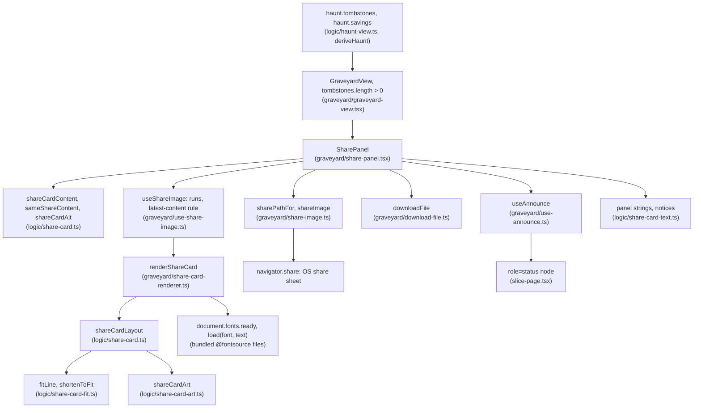

# Design Document: share-card

## Overview

`share-card` adds a `Share your graveyard` section to the Graveyard view. The user makes a 1080 × 1080 PNG of their graveyard, sees it as a Preview, and shares it through the operating system's share sheet or saves it as a file. It has three layers:

1. **Pure content and layout** (`apps/web/src/slice/logic/share-card*.ts`). `shareCardContent` turns `haunt.tombstones` and `haunt.savings` into the few facts the image may state; `shareCardLayout` turns those facts into a list of Draw operations, measuring text through an injected Measure function; `shareCardAlt` writes the Preview's alt text. The existing purity lint for `slice/logic/**` covers these files, so they cannot touch the DOM, storage, the clock or randomness (Req 6.1).
2. **Renderer** (`apps/web/src/slice/graveyard/share-card-renderer.ts`). Waits for the bundled fonts, executes the Draw operations on an off-document canvas, encodes the canvas once with `toBlob`, and returns the PNG as a `File` plus a `data:` URL read from the same Blob (Req 3).
3. **Share panel** (`apps/web/src/slice/graveyard/share-panel.tsx`, with `use-share-image.ts`, `share-image.ts` and `download-file.ts`). The button that makes the image, the Preview, and the `Share image` or `Save image` button (Req 4, 5, 7).

One use of the panel, for Share content `c = shareCardContent(haunt.tombstones, haunt.savings)`:

1. **Make.** The user activates `Make an image`. The button keeps focus and reads `Making the image…` with `aria-disabled="true"`. The panel calls `renderShareCard(c)`.
2. **Check.** When the render settles, the panel compares the content it started with to the current content with `sameShareContent`. If they differ, it drops the result and renders again for the current content (Req 4.6). Otherwise it stores the Image, decides the Share path or the Save path once for that file (Req 5.1), and announces `Image ready. <alt text>`.
3. **Share or save.** The main button calls `navigator.share({ files: [file], title })` synchronously in the click handler, or `downloadFile(file, "zombills-graveyard.png")`. Each outcome is announced through `useAnnounce()` (Req 5).
4. **Follow the graveyard.** While a Preview is shown, any change of the Share content (Unbury, `Bury after all`) starts a re-render. The old Preview stays visible with `aria-busy="true"` and the main button stays `aria-disabled` until the new Image matches the current content; then the panel announces `Image updated.` (Req 4.6).

The image states only the yearly total per currency (at most three lines, then `+N more`), the Buried count with the number of Guessed tombstones, `Zombills`, `Rest in peace` (the fixed epitaph of R11.6) and `zombills.netlify.app`. `shareCardContent` reads only `yearlySavingCents` from each Answer record and `currency` and `totalCents` from each Currency total (Req 1.5), so no service name, amount per service, cadence or date can reach the canvas.

The spec also changes the Playwright demo path and layout tests and adds contrast cases for the image's colour pairs (see "Existing tests that change, and why").

### Design decisions

| Decision | Choice | Reason |
| --- | --- | --- |
| Where the pure code lives | `logic/share-card.ts` holds the types, constants, `shareCardContent`, `shareCardLayout`, `shareCardAlt` and `sameShareContent`. Two helpers sit beside it: `share-card-fit.ts` (shrink and shorten, Req 2.5) and `share-card-art.ts` (the art's Draw operations, Req 2.3). Panel strings go in `share-card-text.ts`, like `cancel-text.ts` | Req 1.1, 2.1 and 2.8 name `share-card.ts` as the module that exports these functions. The fit loop and the art geometry are tested on their own, and splitting them out keeps `share-card.ts` short. Everything under `logic/` gets the purity lint with no config change. |
| Fixed line slots | Each text role has a fixed integer slot height at its start size. The text block is centred once in a fixed band on the tombstone, using the start sizes, not the fitted sizes | Req 2.6 asks that positions fit the largest content at start size. Because a fitted size is never above the start size, the fitted line box `[y − s, y + 0.3 s]` stays inside its slot, so no overlap check depends on the Measure function. Positions depend only on how many lines exist, which keeps the layout easy to test. |
| Shortening | A linear scan over code-point prefixes, from longest to shortest | Only `brand`, `more-currencies` and `address` can be shortened, and their texts are at most 20 code points long. A linear scan finds the longest fitting prefix for any Measure function. A binary search would need the Measure function to be monotonic, which Req 2.5 does not promise. |
| Deep equality | `sameShareContent(a, b)` compares the three fields of `ShareCardContent` directly | Content has one array of strings and two scalars. A field-by-field comparison is exact and cheap, and it is a pure function the panel tests can rely on. `JSON.stringify` would also work but hides what is compared. |
| Render state | A `useReducer` in `use-share-image.ts` with a run counter in a ref. A result is used only when its run is still the newest and its content equals the latest content | Req 4.6 rules out sharing a stale Image, both during the first render and after it. The counter drops results that arrive after unmount or after a newer run. A reducer keeps the transitions in one place where they can be read. |
| Opacity | `Paint.alpha` is applied with `ctx.globalAlpha`, which is reset to 1 after every operation. `vertical-gradient` stops always have `alpha: 1`. *(Amended by R11.2.)* `radial-gradient` stops carry their alpha in the stop colour `color-mix(in srgb, <resolved> <alpha × 100>%, transparent)`, because one fill cannot have a `globalAlpha` per stop | Req 3.4 and R11.2 forbid hex literals and parsing colour strings; `color-mix` wraps the resolved value without parsing it. The tokens resolve to the hex values in `index.css`, and the canvas does the mixing. |
| Stone shape and colour | The stone is one straight-line `path`: an arch of 32 segments on two straight sides. It is drawn three times: a `night` flank at alpha 0.6 offset by (−12, 6), the `fog` face at alpha 1, and a `bone` wash at alpha 0.12 | A rect plus a circle would paint the overlap twice at alpha 0.12 and 0.6, which leaves a band across the stone. One path paints each pixel once. This mirrors `tombstone.tsx`, whose face is `color-mix(fog, bone 10–20 %)` with a shadowed left flank. The face composites to about `#333740`. Bone text on it has a contrast of 9.6:1 and moss text 6.9:1, both checked in `contrast.test.ts`. |
| Fonts | `document.fonts.load(font, text)` for the three faces (four with the IM Fell italic face of R11.9), with each face's real texts plus `…` | Inter and IM Fell are split by `unicode-range`. Loading with the real text pulls every subset the line needs, so the canvas never measures in one font and draws in another (Req 3.2). |
| One encode | `canvas.toBlob` once; `FileReader.readAsDataURL` on that Blob gives the Preview URL | Req 3.5: the Preview shows the exact bytes that are shared or saved. |
| Download | `downloadFile` in `download-file.ts` is an optional panel prop. The default appends an `<a download>` to `document.body`, clicks it, removes it at once, and revokes the URL after 1 s | Req 5.6, 5.7. Appending the anchor makes the click work in every target browser, and removing it straight away leaves the DOM unchanged. Component tests pass a fake, so jsdom's unimplemented navigation never runs. |
| Share call | `share-image.ts` holds `sharePathFor` (the path decision) and `shareImage` (the call and its outcome). Both take the navigator as an argument | `navigator` is read in one place, in `graveyard/`, outside the pure layer. Tests can pass a plain object or stub `window.navigator`, without replacing the whole global. |
| Motion | The Preview reuses `helperPanelMotion(reduced)` from `motion.ts`: a 6 px rise and a 0.2 s fade, or under reduced motion an opacity fade of 0.15 s | Req 4.8 and 7.7 ask for exactly the motion the Helper panel already has. Reusing the function means no new numbers are added to `motion.ts`. |
| Button class | `share-panel.tsx` has its own `SHARE_BUTTON_CLASS`: the Graveyard view's class plus `min-h-11 aria-disabled:opacity-60` | The Graveyard view's `BUTTON_CLASS` gives a 40 px tall button, below the 44 px that Req 7.6 requires. `drop-zone.tsx` already uses `aria-disabled:opacity-60`. Importing the constant from `graveyard-view.tsx` would create an import cycle, because that file imports the panel. |
| New dependencies | None | Canvas 2D, `FileReader`, `URL.createObjectURL` and the Web Share API are all browser built-ins. Framer Motion, React, Tailwind, Vitest, fast-check, Testing Library and Playwright cover the rest (`tech.md`, Req 6.4). |
| CSP | `CSP_POLICY` is unchanged | See "CSP reasoning". |

---

## Architecture

Each box names the file that owns it.



Data flows one way: from the Graveyard to the Share content, then to the Draw operations, the canvas and the PNG. The panel never receives a Subscription, the statement or the Page model (Req 4.3). The only things that leave the page are the Image file, passed to `navigator.share` or to a download, and the same-origin font files that `document.fonts.load` may fetch from `dist` (Req 6.1).

---

## Module layout

File names are kebab-case; constants are `SCREAMING_SNAKE_CASE` (`structure.md`).

| File | Status | Responsibility | Req |
| --- | --- | --- | --- |
| `apps/web/src/slice/logic/share-card.ts` | new | Types (`ShareCardContent`, `MeasureFn`, `ColourToken`, `Paint`, `TextOp`, `ShapeOp`, `PathCommand`, `DrawOp`, `TextRole`); constants (`SHARE_IMAGE_SIZE`, `MAX_TOTAL_LINES`, `SHARE_SITE_NAME`, `SHARE_SITE_ADDRESS`, `SHARE_FILE_NAME`, `ROLE_STYLES`, `TEXT_LAYOUT`); `shareCardContent`, `shareCardLayout`, `shareCardAlt`, `sameShareContent`, `moreCurrenciesLine` | 1, 2.1, 2.2, 2.4, 2.6–2.8 |
| `apps/web/src/slice/logic/share-card-fit.ts` | new | `fontFor`, `fitLine`, `shortenToFit` (shrink loop and code-point shortening) | 2.5, 2.7 |
| `apps/web/src/slice/logic/share-card-art.ts` | new; changed by R11 | `TOMBSTONE_BOX`, `GROUND_TOP`, `STONE_WASH_ALPHA`, `GROUND_ALPHA`, `shareCardArt()`: sky, moon, stone and ground as `ShapeOp`s. R11 adds the stars (`mulberry32`, `STARS`), moon glow, bevel, crack, divider and grass, and their exported constants (see "Art polish (Req 11)") | 2.3, 11.2–11.7 |
| `apps/web/src/slice/logic/test-share-card-geometry.ts` | new (R11), test-only | `BLOCK_SHAPES`, `textBoxes(ops)`, `segmentRectDistance`, `discRectDistance`, `stoneInsideMargin`: the geometry checks shared by `share-card-art.test.ts`, `share-card.test.ts`, `share-card.property.test.ts` and `contrast.test.ts` | 11.13 |
| `eslint.config.js` | changed (R11) | The `slice/logic/**` purity block also restricts `crypto.getRandomValues` and `new Date` | 11.3 |
| `apps/web/src/slice/logic/share-card-text.ts` | new | Panel heading, intro, button labels, notices, `SHARE_TITLE`, `imageReadyNotice(alt)` | 4.2, 4.4, 4.6, 4.7, 5.2–5.6 |
| `apps/web/src/slice/graveyard/share-card-renderer.ts` | new | `renderShareCard`, `RenderDeps`, `RenderedShareCard`, `defaultResolveToken`, `facesToLoad`, `drawOp` | 3 |
| `apps/web/src/slice/graveyard/share-image.ts` | new | `sharePathFor(nav, file)`, `shareImage(nav, file, handlers)`, `isAbortError` | 5.1–5.5 |
| `apps/web/src/slice/graveyard/download-file.ts` | new | `downloadFile(file, name)`, `REVOKE_AFTER_MS` | 5.6, 5.7 |
| `apps/web/src/slice/graveyard/use-share-image.ts` | new | `useShareImage(content, onBeforeFail?)`: render runs, the latest-content rule, unmount safety | 4.4, 4.6, 4.7, 4.9 |
| `apps/web/src/slice/graveyard/share-panel.tsx` | new | `SharePanel`: the section, the Make button, the Preview, the main button, the failure line | 4, 5, 7 |
| `apps/web/src/slice/graveyard/graveyard-view.tsx` | changed | Renders `SharePanel` after the tombstone `ul`, inside the `tombstones.length > 0` branch | 1.7, 4.1 |
| `apps/web/src/contrast.test.ts` | changed | Contrast cases for the image's text and background pairs | `spooky-design.md` (WCAG AA) |
| `apps/web/e2e/demo-path.spec.ts` | changed | `addInitScript` that removes Web Share; the Step 7 image checks; the Step 10 exception only if it is needed | 6.5, 9.6 |
| `apps/web/e2e/layout.spec.ts` | changed | Share panel layout cases | 7.6, 9.7 |

New test files are listed in "Testing strategy". No change to `index.css`, `motion.ts`, `slice-page.tsx`, `use-announce.ts`, `csp-plugin.ts`, `main.tsx`, any `package.json`, or `@zombills/core`. `eslint.config.js` changes only for R11.3. The italic face that R11 uses is already imported in `main.tsx` (`@fontsource/im-fell-english/400-italic.css`).

The existing ESLint blocks already apply:

- `apps/web/src/**`: no `fetch`, `XMLHttpRequest`, `WebSocket` or `EventSource`, no `navigator.sendBeacon`, `no-console`, and no `/ 100` or `toFixed`. The layout never divides by 100: sizes are whole pixels and slot heights are integer constants.
- `apps/web/src/slice/logic/**`: no `document`, `window`, `navigator`, `localStorage`, `sessionStorage`, `indexedDB`, `caches`, `Date.now`, `performance.now` or `Math.random`. R11.3 adds `crypto.getRandomValues` (a `no-restricted-properties` entry plus the `no-restricted-syntax` selector `MemberExpression[property.name='getRandomValues']`) and `new Date` (a `no-restricted-syntax` selector `NewExpression[callee.name='Date']`). The `logic/share-card*.ts` files use none of them. The block has no `no-restricted-syntax` rule today, so the new entry does not drop an inherited one (flat config replaces rule options); the `/ 100` and `toFixed` selectors of the `apps/web/src/**` block are repeated in it, and `money.ts` keeps its `"off"` override, which comes later in the file.

`share-card-renderer.ts`, `share-image.ts` and `download-file.ts` use `document`, `navigator`, `URL` and `FileReader`, so they live in `graveyard/`, next to `use-copy-email.ts`, which uses `navigator.clipboard` there too.

---

## Types and public API

### `logic/share-card.ts`

The shapes of Req 1.1 and 2.1 are written exactly as the requirements give them. They are type aliases, not interfaces, because most are unions.

```ts
import type { AnswerRecord } from "./graveyard";
import type { CurrencyTotal } from "./totals";

export const SHARE_IMAGE_SIZE = 1080;
export const MAX_TOTAL_LINES = 3;
export const SHARE_SITE_NAME = "Zombills";
export const SHARE_SITE_ADDRESS = "zombills.netlify.app";
export const SHARE_FILE_NAME = "zombills-graveyard.png";

export type ShareCardContent = {
  readonly totalLines: readonly string[]; // "I buried $215.88 a year.", at most MAX_TOTAL_LINES
  readonly moreCurrencies: number;        // currencies not shown in totalLines, >= 0
  readonly countLine: string;             // Req 1.4
};

export type MeasureFn = (text: string, font: string) => number;
export type ColourToken = "night" | "fog" | "bone" | "moss";
export type Paint = { readonly token: ColourToken; readonly alpha: number }; // alpha in [0, 1]

export type TextRole = "brand" | "epitaph" | "total" | "more-currencies" | "count" | "address"; // "epitaph": R11.1

export type TextOp = {
  readonly kind: "text";
  readonly role: TextRole;
  readonly text: string;
  readonly x: number;        // centre, because align is "center"
  readonly y: number;        // alphabetic baseline
  readonly align: "center";
  readonly font: string;     // CSS font shorthand
  readonly sizePx: number;   // the px size inside `font`
  readonly maxWidth: number; // width of the Text box
  readonly fill: Paint;
};

export type PathCommand =
  | { readonly op: "move" | "line"; readonly x: number; readonly y: number }
  | { readonly op: "close" };

export type ShapeOp =
  | { readonly kind: "rect"; readonly x: number; readonly y: number; readonly w: number; readonly h: number; readonly fill: Paint }
  | {
      readonly kind: "vertical-gradient";
      readonly x: number; readonly y: number; readonly w: number; readonly h: number;
      readonly stops: readonly { readonly offset: number; readonly paint: Paint }[];
    }
  | { readonly kind: "circle"; readonly cx: number; readonly cy: number; readonly r: number; readonly fill: Paint }
  | { readonly kind: "path"; readonly commands: readonly PathCommand[]; readonly fill: Paint }
  // R11.1: fills the disc of radius r; offsets ascending in [0, 1]
  | {
      readonly kind: "radial-gradient";
      readonly cx: number; readonly cy: number; readonly r: number;
      readonly stops: readonly { readonly offset: number; readonly paint: Paint }[];
    }
  // R11.1: lineWidth > 0; straight lines only; drawn with round joins and caps
  | { readonly kind: "stroke-path"; readonly commands: readonly PathCommand[]; readonly stroke: Paint; readonly lineWidth: number };

export type DrawOp = TextOp | ShapeOp;

/** R11.6. The epitaph's source text. */
export const SHARE_EPITAPH = "Rest in peace";

/** Req 1. Reads only yearlySavingCents, currency and totalCents (Req 1.5). */
export function shareCardContent(
  tombstones: readonly AnswerRecord[],
  savings: readonly CurrencyTotal[],
  locale?: string,
): ShareCardContent;

/** Req 2. Art first, then text, top to bottom. Pure and total for any finite, non-negative measure. */
export function shareCardLayout(content: ShareCardContent, measure: MeasureFn): readonly DrawOp[];

/** Req 2.8. */
export function shareCardAlt(content: ShareCardContent): string;

/** Deep equality of two Share contents (Req 4.6). */
export function sameShareContent(a: ShareCardContent, b: ShareCardContent): boolean;

/** "+<n> more", the source text of the more-currencies line (Req 2.4). */
export function moreCurrenciesLine(moreCurrencies: number): string;
```

The `readonly` modifiers do not change the shapes of Req 1.1 and 2.1. They let the tests deep-freeze arguments and results with no casts. `ShapeOp` has one variant per line in the real file. It is folded here only to keep this listing short.

`ROLE_STYLES` and `TEXT_LAYOUT` (both exported, so that tests read the numbers instead of copying them) are listed under "Layout algorithm".

### `logic/share-card-fit.ts`

```ts
import type { MeasureFn, TextRole } from "./share-card";

export type RoleStyle = {
  readonly family: "display" | "sans";
  readonly weight: 400 | 500 | 600;
  /** R11.6: "italic" only for epitaph */
  readonly style: "normal" | "italic";
  readonly startPx: number;
  /** Lowest size the shrink loop reaches: 1 for total and count */
  readonly floorPx: number;
  /** false for total and count: never shortened (Req 2.5) */
  readonly shorten: boolean;
  readonly maxWidth: number;
};

export const DISPLAY_FAMILY = '"IM Fell English", Georgia, serif';             // --font-display
export const SANS_FAMILY = '"Inter", ui-sans-serif, system-ui, sans-serif';   // --font-sans
export const ELLIPSIS = "…";

/** e.g. `600 72px "Inter", ui-sans-serif, system-ui, sans-serif`, or `italic 400 40px "IM Fell English", Georgia, serif` */
export function fontFor(style: RoleStyle, sizePx: number): string;

export type FittedLine = { readonly text: string; readonly sizePx: number; readonly font: string };

/** Shrink, then (where allowed) shorten. Req 2.5 and 2.7. */
export function fitLine(source: string, style: RoleStyle, measure: MeasureFn): FittedLine;

/** Longest code-point prefix, trailing whitespace removed, plus "…", that fits; else "…". */
export function shortenToFit(source: string, font: string, maxWidth: number, measure: MeasureFn): string;
```

`share-card-fit.ts` imports only the types from `share-card.ts`, and `share-card.ts` imports the functions from `share-card-fit.ts`. Type-only imports are erased when the code is compiled, so this creates no runtime import cycle.

### `logic/share-card-art.ts`

```ts
import type { ShapeOp } from "./share-card";

/** Bounding box of the stone above the ground: x 150..930, y 220..900 (Req 2.6). */
export const TOMBSTONE_BOX: { readonly x: 150; readonly y: 220; readonly w: 780; readonly h: 680 };
/** y of the ground line. */
export const GROUND_TOP = 900;
/** Alphas that the contrast cases read (contrast.test.ts). */
export const STONE_WASH_ALPHA = 0.12;
export const GROUND_ALPHA = 0.75;

// R11 (values and reasons in "Art polish (Req 11)")
export const MOON: { readonly cx: 870; readonly cy: 290; readonly r: 52 };
export const GLOW_R = 108;
export const STAR_SEED = 0x1031;
export const STAR_COUNT = 44;
export const STARS: readonly { readonly x: number; readonly y: number; readonly r: number; readonly alpha: number }[];
export const BEVEL_INSET = 10;
export const BEVEL: readonly PathCommand[];
export const CRACK: readonly PathCommand[];
export const STROKE_WIDTH = 2;            // bevel and crack lineWidth
export const DIVIDER: { readonly x: 400; readonly y: 402; readonly w: 280; readonly h: 2 };
export const GRASS_TUFTS: readonly { readonly x: number; readonly h: number }[];
/** Brand line box at start size, rounded out; the stars keep 8 px from it (cross-checked against TEXT_LAYOUT in a test). */
export const BRAND_KEEP_OUT: { readonly x0: 96; readonly y0: 78; readonly x1: 984; readonly y1: 172 };

/** Exported for the test of the fixed sequence. */
export function mulberry32(seed: number): () => number;

/** The art, in drawing order. Does not depend on the content. */
export function shareCardArt(): readonly ShapeOp[];
```

### `logic/share-card-text.ts`

```ts
import { SHARE_FILE_NAME } from "./share-card";

export const SHARE_HEADING = "Share your graveyard";
export const SHARE_INTRO =
  "Make an image of your graveyard to share or save. It is made on this device and is not uploaded.";
export const MAKE_IMAGE = "Make an image";
export const MAKING_IMAGE = "Making the image…";
export const MAKE_IMAGE_AGAIN = "Make the image again";
export const SHARE_IMAGE = "Share image";
export const SAVE_IMAGE = "Save image";
export const SHARE_TITLE = "My Zombills graveyard";

export const IMAGE_UPDATED = "Image updated.";
export const RENDER_FAILED = "Could not make the image in this browser.";
export const IMAGE_SHARED = "Image shared.";
export const SHARE_FAILED = "Could not share the image. Download started instead.";
export const DOWNLOAD_STARTED = `Download started: ${SHARE_FILE_NAME}.`;
export const SAVE_FAILED = "Could not save the image in this browser."; // Req 5.6, 7.5

/** "Image ready. <alt text>" (Req 4.4). */
export function imageReadyNotice(alt: string): string;
```

### `graveyard/share-card-renderer.ts`

```ts
import type { ColourToken, DrawOp, ShareCardContent } from "../logic/share-card";

/** The context members the Renderer uses. CanvasRenderingContext2D satisfies it. */
export type CanvasContextLike = Pick<
  CanvasRenderingContext2D,
  | "font" | "textAlign" | "textBaseline" | "fillStyle" | "globalAlpha"
  | "measureText" | "fillText" | "fillRect" | "beginPath" | "moveTo" | "lineTo"
  | "closePath" | "arc" | "fill" | "createLinearGradient"
  | "stroke" | "strokeStyle" | "lineWidth" | "lineJoin" | "lineCap" | "createRadialGradient" // R11.1
>;

export interface CanvasLike {
  width: number;
  height: number;
  getContext(contextId: "2d"): CanvasContextLike | null;
  toBlob(callback: (blob: Blob | null) => void, type?: string): void;
}

/** document.fonts satisfies it. */
export interface FontLoader {
  readonly ready: Promise<unknown>;
  load(font: string, text?: string): Promise<unknown>;
}

export interface RenderDeps {
  /** Default: a new, detached <canvas> element */
  createCanvas?: () => CanvasLike;
  /** Default: document.fonts, or null when the API is missing */
  fonts?: FontLoader | null;
  /** Default: defaultResolveToken */
  resolveToken?: (token: ColourToken) => string;
}

export type RenderedShareCard = { readonly dataUrl: string; readonly file: File };

export function renderShareCard(content: ShareCardContent, deps?: RenderDeps): Promise<RenderedShareCard>;

/** getComputedStyle(document.documentElement).getPropertyValue("--" + token).trim() */
export function defaultResolveToken(token: ColourToken): string;

/** The faces of Req 3.2 and 11.9 (three or four), each with the font at its start size and the texts drawn in it. */
export function facesToLoad(content: ShareCardContent): readonly { font: string; text: string }[];

/** Executes one operation; resets globalAlpha to 1 afterwards. Exported for the path and gradient tests. */
export function drawOp(ctx: CanvasContextLike, op: DrawOp, resolveToken: (token: ColourToken) => string): void;
```

Test fakes implement `CanvasContextLike` with recording functions. Because the type is a `Pick` of the DOM type, `fillStyle` accepts `CanvasGradient | CanvasPattern`, so a fake gradient is cast once, with a comment: `{ addColorStop } as unknown as CanvasGradient`.

`HTMLCanvasElement` has overloaded `getContext` signatures, and TypeScript may refuse to assign it to `CanvasLike` directly. In that case the default factory wraps the element:

```ts
function createCanvasElement(): CanvasLike {
  const element = document.createElement("canvas");
  return {
    get width() { return element.width; },
    set width(value) { element.width = value; },
    get height() { return element.height; },
    set height(value) { element.height = value; },
    getContext: (id) => element.getContext(id),
    toBlob: (callback, type) => element.toBlob(callback, type),
  };
}
```

The element is never added to the document (Req 3.7).

### `graveyard/share-image.ts`

```ts
export type SharePath = "share" | "save";

/** At runtime, either member may be missing. */
export type ShareNavigator = Partial<Pick<Navigator, "share" | "canShare">>;

/** Req 5.1. Never throws. */
export function sharePathFor(nav: ShareNavigator | undefined, file: File): SharePath;

export interface ShareHandlers {
  shared(): void;
  /** Any rejection other than AbortError, or a synchronous throw. */
  failed(): void;
}

/** Req 5.2–5.5. Calls nav.share synchronously; never throws. */
export function shareImage(nav: ShareNavigator, file: File, handlers: ShareHandlers): void;

export function isAbortError(error: unknown): boolean;

/** navigator, or undefined where there is none. */
export function currentNavigator(): ShareNavigator | undefined;
```

### `graveyard/download-file.ts`

```ts
export const REVOKE_AFTER_MS = 1000;
/** Req 5.6, 5.7. Holds at most one live object URL. */
export function downloadFile(file: File, name: string): void;
```

### `graveyard/use-share-image.ts`

```ts
import type { ShareCardContent } from "../logic/share-card";
import type { SharePath } from "./share-image";

export type ReadyImage = {
  readonly content: ShareCardContent; // what the Image was made from
  readonly dataUrl: string;
  readonly file: File;
  readonly alt: string;               // shareCardAlt(content)
  readonly path: SharePath;           // decided once, when the Image is used (Req 5.1)
};

export interface ShareImageState {
  image: ReadyImage | null;
  /** The render that is running, if any */
  run: { content: ShareCardContent; trigger: "make" | "update" } | null;
  /** An Image has been made on this mount at least once (button text, Req 4.4, 4.7) */
  madeOnce: boolean;
  /** The last render rejected (Req 4.7) */
  failed: boolean;
}

export function useShareImage(
  content: ShareCardContent,
  /** Called just before a rejected run is dispatched (focus rescue, "Live region and focus") */
  onBeforeFail?: () => void,
): {
  state: ShareImageState;
  /** image !== null and sameShareContent(image.content, content) */
  current: boolean;
  /** Does nothing while a render runs */
  make(): void;
};
```

### `graveyard/share-panel.tsx`

```ts
import type { AnswerRecord } from "../logic/graveyard";
import type { CurrencyTotal } from "../logic/totals";

export interface SharePanelProps {
  tombstones: readonly AnswerRecord[]; // haunt.tombstones
  savings: readonly CurrencyTotal[];   // haunt.savings
  reduceMotion: boolean;
  /** Default: downloadFile from download-file.ts (Req 5.6) */
  downloadFile?: (file: File, name: string) => void;
}

export function SharePanel(props: SharePanelProps): JSX.Element;
```

`exactOptionalPropertyTypes` is on, so a caller either leaves out `downloadFile` and `RenderDeps` fields or passes a real value, never `undefined`. The panel's props hold the two arrays it needs and nothing else. In particular there is no `haunt` prop: Req 4.3 and 9.5 rule out the Subscription list and the Page model.

---

## Algorithms

### Share content (`shareCardContent`, Req 1)

```
shareCardContent(tombstones, savings, locale):
  shown        = savings.slice(0, MAX_TOTAL_LINES)
  totalLines   = shown.map(t => "I buried " + formatMoney(t.totalCents, t.currency, locale) + " a year.")
  moreCurrencies = savings.length - totalLines.length
  n    = tombstones.length
  g    = count of tombstones with yearlySavingCents === null
  noun = n === 1 ? "subscription" : "subscriptions"
  countLine =
    savings.length === 0 ? `I buried ${n} ${noun}. Saving unknown.`
    : g === 0            ? `${n} ${noun} buried.`
    :                      `${n} ${noun} buried, ${g} with saving unknown.`
  return { totalLines, moreCurrencies, countLine }
```

- The only field read on a record is `yearlySavingCents`, and on a total only `currency` and `totalCents` (Req 1.5). The property test of Req 10.3 replaces `merchant` and `serviceId` and checks that the result is unchanged. A unit test passes records whose other fields are getters that throw, which shows that they are never read.
- `${n}` of a safe integer gives ASCII digits with no grouping, whatever the locale (Req 1.4).
- `savings` is used in the order given, so the shown currencies are the first three in code-unit order, as on the Graveyard view (Req 1.2). Nothing is summed or rounded (Req 1.3). `formatMoney` gets the same arguments as `Money` in `money-text.tsx`, so each line states the same figure the view shows. The panel passes no locale, like `Money`.
- The function is total for every Graveyard the Page can hold. With `n = 0`, which the panel never renders (Req 1.7), it still returns `I buried 0 subscriptions. Saving unknown.`.

### Alt text (`shareCardAlt`, Req 2.8)

```
parts = ["Image of your Zombills graveyard.", ...totalLines]
if moreCurrencies === 1: parts.push("And 1 more currency.")
if moreCurrencies > 1:   parts.push(`And ${moreCurrencies} more currencies.`)
parts.push(countLine, SHARE_SITE_ADDRESS + ".")
return parts.join(" ")
```

### `sameShareContent`

```
a.moreCurrencies === b.moreCurrencies && a.countLine === b.countLine
  && a.totalLines.length === b.totalLines.length
  && a.totalLines.every((line, i) => line === b.totalLines[i])
```

### Role styles and fixed positions (`ROLE_STYLES`, `TEXT_LAYOUT`, Req 2.4, 2.6)

| Role | Family, weight | Start | Floor | Shorten | `maxWidth` | Fill | Slot height |
| --- | --- | --- | --- | --- | --- | --- | --- |
| `brand` | display 400 | 72 | 40 | yes | 888 | `bone` 1 | fixed baseline 150 |
| `epitaph` (R11.6) | display 400 italic | 40 | 28 | yes | 360 | `bone` 1 | fixed baseline 384 |
| `total` | sans 600 | 72 | 1 | no | 640 | `moss` 1 | 94 |
| `more-currencies` | sans 500 | 36 | 24 | yes | 640 | `bone` 1 | 47 |
| `count` | sans 500 | 40 | 1 | no | 640 | `bone` 1 | 52 |
| `address` | sans 500 | 36 | 24 | yes | 888 | `bone` 1 | fixed baseline 1004 |

```ts
export const TEXT_LAYOUT = {
  centreX: 540,
  brandBaseline: 150,
  epitaphBaseline: 384, // R11.6: line box 344..396 at start size
  addressBaseline: 1004,
  /** The band on the stone that holds the total, more-currencies and count lines */
  bandTop: 410,
  bandBottom: 860,
  lineGap: 16,
  /** Integer slot heights, each at least 1.3 × the role's start size */
  slotPx: { total: 94, "more-currencies": 47, count: 52 },
} as const;

export const ROLE_STYLES: Readonly<Record<TextRole, RoleStyle & { readonly fill: Paint }>>; // the table above
```

Every role except `epitaph` has `style: "normal"`. The epitaph's baseline is fixed like the brand's, so the block band and its centring are unchanged (see "Art polish (Req 11)" for why 384).

Each slot height is the smallest integer that is at least `1.3 × startPx`: 93.6 → 94, 46.8 → 47 and 52 → 52. Within a slot the baseline is at `slotTop + startPx`, so the line box at start size, `[y − s, y + 0.3 s]`, fits the slot. A fitted size `s' ≤ s` gives a box inside that one.

### Layout (`shareCardLayout`, Req 2)

```
shareCardLayout(content, measure):
  ops = [...shareCardArt()]                       // every shape first (Req 2.2)

  ops.push(textOp("brand", SHARE_SITE_NAME, TEXT_LAYOUT.brandBaseline))
  ops.push(textOp("epitaph", SHARE_EPITAPH, TEXT_LAYOUT.epitaphBaseline))   // R11.6, second Text operation

  block = [
    ...content.totalLines.map(line => ["total", line]),
    ...(content.moreCurrencies > 0 ? [["more-currencies", moreCurrenciesLine(content.moreCurrencies)]] : []),
    ["count", content.countLine],
  ]
  height = Σ slotPx[role] over block + lineGap × (block.length − 1)
  top    = bandTop + Math.floor((bandBottom − bandTop − height) / 2)
  for [role, text] of block:
    ops.push(textOp(role, text, top + ROLE_STYLES[role].startPx))
    top += slotPx[role] + lineGap

  ops.push(textOp("address", SHARE_SITE_ADDRESS, TEXT_LAYOUT.addressBaseline))
  return ops

textOp(role, source, y):
  style = ROLE_STYLES[role]
  { text, sizePx, font } = fitLine(source, style, measure)
  return { kind: "text", role, text, x: centreX, y, align: "center", font, sizePx,
           maxWidth: style.maxWidth, fill: style.fill }
```

- `moreCurrenciesLine(m)` is `"+" + m + " more"`. Slicing `savings` to three lines in `shareCardContent` keeps `content.totalLines.length` at most `MAX_TOTAL_LINES`. The layout still lays out whatever the content holds, and stays total for hand-built content with more lines. In that case the block can be taller than the band, and Req 2.6 then holds only for contents that `shareCardContent` can return. This is stated in the code comment and tested with a five-line content that does not throw.
- **The largest content fits** (Req 2.6): three totals, a more-currencies line and a count line give `height = 3 × 94 + 47 + 52 + 4 × 16 = 445 ≤ 450`. Then `top = 412`, the first box starts at y 412 and the last slot ends at y 857. Every block line box therefore lies in [412, 857], inside the band [410, 860] and inside `TOMBSTONE_BOX` (y 220..900, x 150..930, which holds the 640-wide box at x 220..860).
- **Inside the arch, not only the box.** The stone's arch is a circle of radius 390 centred at (540, 610). At y 412 its half-width is `√(390² − 198²) = 336 ≥ 320`, so every block line, even at full width, sits on the stone face.
- **Margins** (Req 2.6): the brand box is [78, 171.6] and the address box [968, 1014.8], both at least 48 px from the image edges (48 and 1032). The horizontal extents are 96..984 and 220..860. Brand and address do not touch the band.
- **Smallest content**: a count line alone gives `height = 52`, `top = 609` and baseline 649, in the middle of the stone.
- The layout calls `measure` only from `fitLine` and `shortenToFit` (Req 2.7). Positions do not depend on `measure`, so the no-overlap and margin properties hold for every Measure function. Only `measure(text, font) ≤ maxWidth` needs the condition of Req 2.5.

### Fit (`share-card-fit.ts`, Req 2.5, 2.7)

```
fontFor(style, size) = `${style.style === "italic" ? "italic " : ""}${style.weight} ${size}px ${style.family === "display" ? DISPLAY_FAMILY : SANS_FAMILY}`

fitLine(source, style, measure):
  for size = style.startPx down to style.floorPx:
    font = fontFor(style, size)
    if measure(source, font) <= style.maxWidth: return { text: source, sizePx: size, font }
  font = fontFor(style, style.floorPx)
  if not style.shorten:                              // total, count: whole line at 1 px, drawn anyway
    return { text: source, sizePx: style.floorPx, font }
  return { text: shortenToFit(source, font, style.maxWidth, measure), sizePx: style.floorPx, font }

shortenToFit(source, font, maxWidth, measure):
  points = Array.from(source)                        // code points; a lone surrogate is its own element
  for k = points.length − 1 down to 1:
    prefix = points.slice(0, k).join("").trimEnd()
    if prefix === "": continue                       // same as "…" alone, which comes last
    candidate = prefix + ELLIPSIS
    if measure(candidate, font) <= maxWidth: return candidate
  return ELLIPSIS                                    // not measured; drawn anyway (Req 2.5)
```

- `Array.from` splits by code point, so a prefix never ends inside a surrogate pair. `trimEnd` removes trailing whitespace, as Req 2.5 asks.
- `measure` sees only the source text at sizes from start to floor, and candidate prefixes plus `…` at the floor size, always in the role's family, weight and style (Req 2.7 as amended). The unit test wraps the Measure function, records every call, and checks each call against this list.
- With a measure that returns `NaN`, every comparison is false. The line then falls through to the last fallback, so the layout stays total.
- Cost: at most 72 measure calls per total line and 40 per count line, plus at most 20 prefixes for the short roles (13 sizes and 13 prefixes for `epitaph`). With 3 totals that is under 400 calls, each a `measureText`.

### Art (`share-card-art.ts`, Req 2.3)

*(Amended by R11.)* The table below is the Req 2.3 art. Requirement 11 replaces op 2 (the flat halo) with a `radial-gradient` and adds stars, bevel, crack, divider and grass; the full R11 list is in "Art polish (Req 11)". `STONE`, the moon disc, the stone's three fills and the ground ops keep the numbers given here.

The art is fixed: `shareCardArt()` returns the same frozen list every time, built once at module load.

| # | Op | Geometry | Paint | Echoes |
| --- | --- | --- | --- | --- |
| 1 | `vertical-gradient` | x 0, y 0, w 1080, h 1080; stops 0 `night`, 0.4 `night`, 1 `fog` (alpha 1) | | `SKY_BACKGROUND` in `graveyard-backdrop.tsx` (night at the top, fog low down) |
| 2 | `circle` | cx 870, cy 290, r 100 | `bone` 0.06 | moon halo |
| 3 | `circle` | cx 870, cy 290, r 52 | `bone` 0.9 | moon disc |
| 4 | `path` | `STONE` moved by (−12, +6) | `night` 0.6 | shadowed left flank, as `translate(-9 5)` in `tombstone.tsx` |
| 5 | `path` | `STONE` | `fog` 1 | stone face |
| 6 | `path` | `STONE` | `bone` 0.12 | the face's `color-mix(fog, bone)` |
| 7 | `rect` | x 0, y 900, w 1080, h 180 | `night` 0.75 | ground band (`Ground`) |
| 8 | `rect` | x 0, y 900, w 1080, h 2 | `bone` 0.14 | moonlit ground line (`boxShadow: inset 0 1px 0`) |

`STONE` is one straight-line path, built from integers:

```
STONE = [
  move(150, 900), line(150, 610),
  for i = 1 .. 32: θ = π + i × π / 32
    line(Math.round(540 + 390 × cos θ), Math.round(610 + 390 × sin θ)),   // arch, left to right over the top
  line(930, 900), close,
]
```

- The arch has 32 segments, about 38 px each, which looks round at 1080 px. The last arch point is (930, 610). The path's bounding box is exactly `TOMBSTONE_BOX`: x 150..930 and y 220..900. The top point, at i = 16, is (540, 220).
- **One path, not a rect and a circle.** With a rect and a circle, the wash at alpha 0.12 (op 6) and the flank at 0.6 (op 4) would paint twice where the two shapes overlap, and leave a visible band across the stone. One path paints every pixel once. Req 2.3 allows either form.
- The flank's lower edge reaches y 906 and is covered by the ground (op 7), so the stone stands in the earth like the page's tombstones.
- The moon at (870, 290) is clear of the brand line, which in IM Fell at 72 px is about 280 px wide around x 540, and of the stone, which at y 290 spans x 317..763 (half-width `√(390² − 320²) ≈ 223`). The halo (x 770..970, r 100) does overlap the stone by about 30 px: its centre is 459.7 px from the arch centre (540, 610), less than 390 + 100. That is harmless, because the halo is drawn before the stone and the stone covers it. The disc (r 52) clears the stone by about 18 px, so `share-card-art.test.ts` checks the disc only: centre distance − 390 ≥ 52 (review-design-1 #7).
- Composite colours, used by the contrast cases: the stone face is `fog` with 12 % `bone`, about `#333740`. On it, `bone` text reaches 9.6:1 and `moss` 6.9:1. The ground at y ≥ 900 is at least as dark as `fog` with 75 % `night`, where `bone` reaches 15.1:1. The brand line sits on the `night` part of the sky (15.6:1). All pass WCAG AA (`spooky-design.md`).
- No logo, blood or gore. *(Amended by R11.3.)* This design first left the stars out under the theme rule in `product.md`; Requirement 11 adds them for the shared image, which carries no state of its own. The stone still carries the meaning, because what is written on it is what was buried (Req 2.3).

---

## Renderer (`graveyard/share-card-renderer.ts`, Req 3)

```
renderShareCard(content, deps = {}):
  createCanvas = deps.createCanvas ?? createCanvasElement
  fonts        = deps.fonts !== undefined ? deps.fonts : defaultFonts()     // null: no font API
  resolveToken = deps.resolveToken ?? defaultResolveToken

  await loadFaces(fonts, content)                         // never rejects (Req 3.2)

  canvas = createCanvas()                                 // a throw rejects with "share-card: no canvas"
  try:                                                    // a throw here never passes the browser's message on (Req 3.6)
    canvas.width = SHARE_IMAGE_SIZE; canvas.height = SHARE_IMAGE_SIZE    // not scaled by devicePixelRatio
    ctx = canvas.getContext("2d")
  catch: throw new Error("share-card: no 2d context")
  if ctx === null: throw new Error("share-card: no 2d context")
  try:
    measure = (text, font) => { ctx.font = font; return ctx.measureText(text).width }
    for op of shareCardLayout(content, measure): drawOp(ctx, op, resolveToken)
  catch: throw new Error("share-card: drawing failed")

  blob    = await toPngBlob(canvas)                       // "share-card: no png"
  canvas.width = 0; canvas.height = 0                     // free the bitmap at once (Safari caps canvas memory)
  dataUrl = await readDataUrl(blob)                       // "share-card: could not read the png"
  file    = new File([blob], SHARE_FILE_NAME, { type: "image/png" })
  return { dataUrl, file }
```

`renderShareCard` is an `async` function, so every `throw` above becomes a rejection. Each message names only the step that failed and never includes a text from the content, because errors from the canvas are replaced and not wrapped (Req 3.6). Nothing is logged.

### Fonts

```
defaultFonts() = typeof document !== "undefined" && document.fonts ? document.fonts : null

facesToLoad(content):
  inter500 = [moreCurrencies > 0 ? moreCurrenciesLine(moreCurrencies) : null, countLine, SHARE_SITE_ADDRESS, ELLIPSIS]
  return [
    { font: fontFor(ROLE_STYLES.brand, 72), text: SHARE_SITE_NAME + " " + ELLIPSIS },     // IM Fell English 400
    { font: fontFor(ROLE_STYLES.epitaph, 40), text: SHARE_EPITAPH + " " + ELLIPSIS },     // IM Fell English italic 400 (R11.9)
    ...(totalLines.length > 0
        ? [{ font: fontFor(ROLE_STYLES.total, 72), text: totalLines.join(" ") }]        // Inter 600
        : []),
    { font: fontFor(ROLE_STYLES.count, 40), text: inter500.filter(Boolean).join(" ") }, // Inter 500
  ]

loadFaces(fonts, content):
  if fonts === null: return
  try: await fonts.ready
  catch: (ignored)
  await Promise.allSettled(facesToLoad(content).map(face => {
    try: return fonts.load(face.font, face.text)
    catch: return Promise.resolve()
  }))
```

- `load(font, text)` with the real texts loads every `unicode-range` subset those texts need (Req 3.2). In `@fontsource/inter` the `latin` file already covers `€`, `£`, `¥`, `…` and the no-break space that some locales put in money. Signs such as `₹` (U+20B9) or `₺` are in `latin-ext`, which is fetched only when a line contains one. The font shorthand names the self-hosted family first. Its fallbacks (`Georgia, serif` and `ui-sans-serif, system-ui, sans-serif`) are not `@font-face` families, so `load` fetches nothing for them.
- The italic face is always loaded, because every layout emits the `epitaph` line. Its font string is `italic 400 40px "IM Fell English", Georgia, serif`, which matches the `@font-face` rule with `font-style: italic` from `@fontsource/im-fell-english/400-italic.css`. `facesToLoad` therefore returns four faces, or three when `totalLines` is empty.
- The face for Inter 600 is skipped when there is no total line, because no Text operation then uses it. Req 3.2 asks for "each face the Text operations use".
- Font files come from the same origin as the page, through the `@fontsource` CSS that `main.tsx` already imports. They are files in `dist`, allowed by `font-src 'self'`.
- A missing `document.fonts`, a rejected `ready`, a rejected `load` or a synchronous throw from `load` all lead to drawing with whatever font the browser has, which is the fallback families of Req 2.4. Because `allSettled` waits for every load, one failed face does not stop the other faces from loading.

### Drawing (`drawOp`)

```
paint(p): ctx.fillStyle = resolveToken(p.token); ctx.globalAlpha = p.alpha

drawOp(ctx, op, resolveToken):
  try:
    switch op.kind:
      "text":
        ctx.font = op.font; ctx.textAlign = op.align; ctx.textBaseline = "alphabetic"; paint(op.fill)
        ctx.fillText(op.text, op.x, op.y)                       // exactly three arguments (Req 3.3)
      "rect":   paint(op.fill); ctx.fillRect(op.x, op.y, op.w, op.h)
      "vertical-gradient":
        g = ctx.createLinearGradient(op.x, op.y, op.x, op.y + op.h)
        for s of op.stops: g.addColorStop(s.offset, resolveToken(s.paint.token))
        ctx.fillStyle = g; ctx.globalAlpha = 1; ctx.fillRect(op.x, op.y, op.w, op.h)
      "circle": paint(op.fill); ctx.beginPath(); ctx.arc(op.cx, op.cy, op.r, 0, 2 * Math.PI); ctx.fill()
      "path":
        paint(op.fill); ctx.beginPath()
        for c of op.commands: c.op === "move" ? ctx.moveTo(c.x, c.y) : c.op === "line" ? ctx.lineTo(c.x, c.y) : ctx.closePath()
        ctx.fill()
      "radial-gradient":                                        // R11.2
        g = tryRadial(ctx, op, resolveToken)                    // null when the browser refuses it
        if g === null: break                                    // skip the glow only
        ctx.fillStyle = g; ctx.globalAlpha = 1
        ctx.beginPath(); ctx.arc(op.cx, op.cy, op.r, 0, 2 * Math.PI); ctx.fill()
      "stroke-path":                                            // R11.1
        ctx.strokeStyle = resolveToken(op.stroke.token); ctx.globalAlpha = op.stroke.alpha
        ctx.lineWidth = op.lineWidth; ctx.lineJoin = "round"; ctx.lineCap = "round"
        ctx.beginPath(); (same command loop as "path"); ctx.stroke()
  finally:
    ctx.globalAlpha = 1                                         // Req 3.4
```

- `tryRadial` (module-private) is:

  ```
  tryRadial(ctx, op, resolveToken):
    try:
      g = ctx.createRadialGradient(op.cx, op.cy, 0, op.cx, op.cy, op.r)
      for s of op.stops:
        g.addColorStop(s.offset, `color-mix(in srgb, ${resolveToken(s.paint.token)} ${s.paint.alpha * 100}%, transparent)`)
      return g
    catch: return null                                          // no log, no rethrow (R11.2)
  ```

  The `try` wraps only the gradient's construction, so a throwing `arc` or `fill` still rejects with "drawing failed" as before. The layout's glow alphas (0.2, 0.1, 0) give exact percentages (`20%`, `10%`, `0%`) under `alpha * 100`; `share-card-art.test.ts` checks that `alpha * 100` is an integer for every radial stop, so no string like `14.000000000000002%` is written. Every stop has the same colour and only the alpha changes, so interpolation (premultiplied or not) gives no grey fringe. A token that resolves to `""` makes `addColorStop` throw, which here skips the glow instead of rejecting; every other op still rejects for it as today.
- `lineJoin` and `lineCap` are `"round"` for every `stroke-path`, so the painted area is within `lineWidth / 2` of the path (R11.1). `lineWidth` and the join and cap are set on every stroke, so no state leaks between ops; `globalAlpha` is still reset in `finally`.
- `defaultResolveToken(token)` is `getComputedStyle(document.documentElement).getPropertyValue("--" + token).trim()`. The file has no hex literal, and no colour string is built or parsed (Req 3.4). The `vertical-gradient` ignores stop alphas: every stop the layout writes for it has `alpha: 1`, which `share-card.test.ts` checks. `radial-gradient` is the one place a stop alpha is used (above).
- The `switch` covers every `DrawOp` kind, and its `default` branch assigns `op` to `never`. A new kind would therefore fail type-checking, which supports the rule in Req 2.1 that no kind may be added.
- If a token resolves to `""` (no stylesheet), `fillStyle = ""` is ignored and `addColorStop` throws a `SyntaxError`. That error becomes "share-card: drawing failed", and the panel shows the failure line. In the app, `index.css` is always loaded.
- **Measure.** The Measure function sets `ctx.font` and then reads `measureText(text).width`. The layout runs once and draws only what it returned, so the widths it measured are the widths drawn (Req 3.3).

### Encoding

```
toPngBlob(canvas) = new Promise((resolve, reject) => {
  try: canvas.toBlob(blob => blob ? resolve(blob) : reject(new Error("share-card: no png")), "image/png")
  catch: reject(new Error("share-card: no png"))
})

readDataUrl(blob) = new Promise((resolve, reject) => {
  reader = new FileReader()
  reader.onload  = () => typeof reader.result === "string" ? resolve(reader.result) : reject(new Error("share-card: could not read the png"))
  reader.onerror = () => reject(new Error("share-card: could not read the png"))
  reader.readAsDataURL(blob)
})
```

`toBlob` is the only encode, and `toDataURL` is never called (Req 3.5). The Preview, the shared file and the saved file all come from one Blob. After `toBlob` the canvas is shrunk to 0 × 0, and nothing holds the canvas, the context or the content once the promise settles (Req 3.7). The returned `File` and `dataUrl` live only in the panel's React state.

---

## UI components (`apps/web`)

### Graveyard view (`graveyard/graveyard-view.tsx`)

Inside the `tombstones.length > 0` branch, straight after the tombstone `ul`:

```tsx
<SharePanel tombstones={tombstones} savings={savings} reduceMotion={reduceMotion} />
```

`tombstones` and `savings` are the names the view already destructures from `haunt`. The panel therefore appears after the tombstone list and before `Resting`, and only when a Tombstone exists. With no Tombstone the view still shows only "Nothing buried yet." (Req 1.7, 4.1). Nothing else in the view changes.

### Render runs (`graveyard/use-share-image.ts`, Req 4.4, 4.6, 4.7, 4.9)

```
reducer(state, action):
  "start" {content, trigger}: { ...state, run: { content, trigger }, failed: false }
  "done"  {image}:            { image, run: null, madeOnce: true, failed: false }
  "fail":                     { ...state, image: null, run: null, failed: true }

useShareImage(content, onBeforeFail?):
  [state, dispatch] = useReducer(reducer, { image: null, run: null, madeOnce: false, failed: false })
  announce  = useAnnounce()
  latest    = useRef(content)              // the current Share content
  latest.current = content                 // written during render, not in an effect (review-design-1 #3)
  runSeq    = useRef(0)                    // newest run; bumped on unmount

  begin(started, trigger):
    seq = ++runSeq.current
    dispatch({ type: "start", content: started, trigger })
    renderShareCard(started).then(
      result => {
        if seq !== runSeq.current: return                        // unmounted, or a newer run exists
        if !sameShareContent(started, latest.current):           // stale: render again (Req 4.6)
          begin(latest.current, trigger); return
        alt  = shareCardAlt(started)
        path = sharePathFor(currentNavigator(), result.file)     // once per Image (Req 5.1)
        dispatch({ type: "done", image: { content: started, ...result, alt, path } })
        announce(trigger === "make" ? imageReadyNotice(alt) : IMAGE_UPDATED)
      },
      () => {
        if seq !== runSeq.current: return
        onBeforeFail?.(); dispatch({ type: "fail" }); announce(RENDER_FAILED)   // Req 4.7
      })

  make(): if state.run === null: begin(latest.current, "make")

  useEffect(() => {                                              // follow the graveyard
    if state.run === null && state.image !== null && !sameShareContent(state.image.content, content):
      begin(content, "update")
  }, [content, state.run, state.image])

  useEffect(() => () => { runSeq.current += 1 }, [])            // drop late results after unmount

  current = state.image !== null && sameShareContent(state.image.content, content)
  return { state, current, make }
```

- **Every render obeys the latest-content rule, the first one included.** A result is used only when the content it was made from equals `latest.current`. Otherwise the hook starts a new run at once with the same trigger. A first render that went stale is therefore still a `make` run, and it ends with `Image ready. …` instead of `Image updated.` (Req 4.4, and the exception in Req 4.6 added by review-design-1 #4).
- **Following the graveyard.** While a Preview is shown and no run is active, the effect starts an `update` run whenever the content changes. While a run is active, the effect does nothing; the run checks `latest.current` when it settles. Content that changes and then changes back before the run ends is not stale, and the result is used.
- **`latest.current` is written during render.** The ref holds the content of the newest render, so a run that settles between a render and its effects (for example after the burial's animation-complete or 2 s fallback timer settles `savings`) already compares against the new content. If the write sat in the `useEffect`, React could run that effect after paint, and the old content would be accepted and announced as `Image ready. <old alt>` before `Image updated.`. The ref belongs to this hook and the write is not a state update, so it is safe during render. The `useEffect` only starts `update` runs.
- `content` is `useMemo(() => shareCardContent(tombstones, savings), [tombstones, savings])` in the panel. `deriveHaunt` builds new arrays on every model change, so the effect runs often. `sameShareContent` makes the effect start a run only when a fact on the image changes. For example, opening a `How to cancel` disclosure changes nothing on the image and starts nothing.
- **One run at a time.** `make` does nothing while a run is active, and the effect waits for the run to end. Each run gets a fresh sequence number, so a result can only belong to the newest run.
- **Unmount.** The cleanup bumps `runSeq`, so a render that settles after the panel unmounted writes no state and announces nothing. Leaving the Graveyard view, `Start again`, or an Unbury of the last Tombstone all drop the Preview, the `dataUrl` and the `File` with the component (Req 4.9). In development, `StrictMode` runs the cleanup once on mount. No run exists at that point, so bumping the counter does no harm.
- `renderShareCard` is imported directly. The component tests replace it with `vi.mock("./share-card-renderer")` (Req 9.3).

### Share panel (`graveyard/share-panel.tsx`, Req 4, 5, 7)

```tsx
const SHARE_BUTTON_CLASS =
  "min-h-11 rounded border border-bone bg-fog px-4 py-2 text-bone aria-disabled:opacity-60";

<section aria-labelledby={headingId} className="flex flex-col gap-3">
  <h3 id={headingId} className="text-lg font-bold">{SHARE_HEADING}</h3>
  <p>{SHARE_INTRO}</p>
  <div>
    <button type="button" className={SHARE_BUTTON_CLASS}
            aria-disabled={state.run !== null ? true : undefined} onClick={onMake}>
      {state.run !== null ? MAKING_IMAGE : state.madeOnce ? MAKE_IMAGE_AGAIN : MAKE_IMAGE}
    </button>
  </div>
  {state.image !== null ? (
    <div aria-busy={busy ? true : undefined} className="flex flex-col items-start gap-3">
      <motion.img key={state.image.dataUrl} src={state.image.dataUrl} alt={state.image.alt}
                  width={1080} height={1080} className="block h-auto w-full max-w-[27rem]"
                  {...helperPanelMotion(reduceMotion)} />
      <button type="button" className={SHARE_BUTTON_CLASS}
              aria-disabled={current ? undefined : true} onClick={onMain}>
        {state.image.path === "share" ? SHARE_IMAGE : SAVE_IMAGE}
      </button>
    </div>
  ) : null}
  {message !== null ? <p>{message}</p> : null}
</section>
```

- `busy = state.run !== null || !current`. The old Preview stays visible with `aria-busy="true"` until the new Image is ready (Req 4.6).
- The main button has `aria-disabled="true"` whenever the shown Image was not made from the current content. `onMain` checks `current` again and returns at once, so the button does nothing (Req 4.6, 7.2). The Make button is `aria-disabled` while any run is active, and `onMake` calls `make()`, which ignores clicks during a run (Req 4.4). Neither button uses the `disabled` attribute.
- `message` is `state.failed ? RENDER_FAILED : shareMessage`. `shareMessage` is local state for `SHARE_FAILED` and `SAVE_FAILED`. Both are cleared at the start of the next activation of either button, so a failure stays shown "until the next action in it" (Req 7.5). The line has no role. The same words go to the Live region through `announce`, so they are not read twice.
- The heading id comes from `useId`, and the section is a region named `Share your graveyard` (Req 4.1). Every button's accessible name is its visible text, with no `aria-label`. `Make an image`, `Making the image…`, `Make the image again`, `Share image` and `Save image` appear nowhere else on the Page (Req 7.3).
- The Preview is `width: 100%` up to `max-width: 27rem` (432 px), with `height: auto` and `width`/`height` attributes of 1080, so the browser reserves a square box before the image decodes (Req 4.5). Inside the Graveyard view's padding it fits at 320 px. The panel is inside the `max-w-[640px]` `main`.
- **Motion.** `key={dataUrl}` remounts the `motion.img` for each new Image, so an update fades the new Image in. `helperPanelMotion(reduced)` gives a 6 px rise with a 0.2 s fade, or under reduced motion an opacity-only fade of 0.15 s (Req 4.8, 7.7).
- **Wording.** All panel text is plain, and only the heading is themed (Req 4.8). Busy and failed states are given in words, not only by opacity (Req 7.8).

### Share and save flow (`share-image.ts`, `download-file.ts`, Req 5)

```
sharePathFor(nav, file):
  if nav === undefined or typeof nav.share !== "function" or typeof nav.canShare !== "function": return "save"
  try: return nav.canShare({ files: [file] }) === true ? "share" : "save"
  catch: return "save"

shareImage(nav, file, handlers):
  let pending
  try: pending = nav.share!({ files: [file], title: SHARE_TITLE })   // first statement in the click (Req 5.2)
  catch: handlers.failed(); return
  Promise.resolve(pending).then(handlers.shared,
                                error => isAbortError(error) ? undefined : handlers.failed())

isAbortError(error) = typeof error === "object" && error !== null && "name" in error && error.name === "AbortError"
```

In the panel:

```
onMain():
  if state.image === null or not current: return
  setShareMessage(null)
  file = state.image.file
  if state.image.path === "save":
    trySave(file, () => announce(DOWNLOAD_STARTED))                       // Req 5.6
    return
  shareImage(currentNavigator() ?? {}, file, {
    shared: () => { if mounted.current: announce(IMAGE_SHARED) },        // Req 5.3
    failed: () => {                                                      // Req 5.5
      if not mounted.current: return
      trySave(file, () => { setShareMessage(SHARE_FAILED); announce(SHARE_FAILED) })
    },
  })                                                                     // AbortError: nothing (Req 5.4)

trySave(file, then):
  try: downloadFile(file, SHARE_FILE_NAME)          // the prop, default from download-file.ts
  catch: setShareMessage(SAVE_FAILED); announce(SAVE_FAILED); return
  then()
```

- `nav.share` is called through the object, so `this` stays the navigator. If `share` has gone missing since the path was decided, the call throws a `TypeError` and the fallback download runs. The data holds `files` and `title` only (Req 5.2).
- Nothing is awaited between the click and `nav.share`. `onMain` is a plain function, and `shareImage` calls `share` before any promise exists, so the click's user activation is still there (Req 5.2).
- After an `AbortError`, nothing changes: no message, no announcement and no download, and focus stays on the button (Req 5.4).
- Each activation runs the same code, and each announcement goes through `useAnnounce()`. That function clears the region and writes in a later frame, so a repeated `Download started: zombills-graveyard.png.` is read again (Req 5.8).

`downloadFile` (default):

```
let liveUrl: string | null = null                    // module state: at most one live URL (Req 5.7)

downloadFile(file, name):
  if liveUrl !== null: URL.revokeObjectURL(liveUrl); liveUrl = null
  url = URL.createObjectURL(file); liveUrl = url
  anchor = document.createElement("a")
  anchor.href = url; anchor.download = name
  document.body.append(anchor)
  try: anchor.click()
  finally: anchor.remove()
  setTimeout(() => { URL.revokeObjectURL(url); if (liveUrl === url) liveUrl = null }, REVOKE_AFTER_MS)
```

The timer always revokes its own URL; only the `liveUrl = null` is inside the `if` (review-design-1 #2). Revoking a URL that a later call already revoked does no harm, and a first call's timer can no longer clear a second call's `liveUrl`.

The anchor is in the document only for the duration of `click()`. The URL lives for one second, long enough for the browser to start reading the Blob (Req 5.6). A second download within that second revokes the first URL before creating its own.

### Live region and focus (Req 5.8, 7.1, 7.5)

| Event | Announced through `useAnnounce()` | Visible line |
| --- | --- | --- |
| A `make` run is used | `Image ready. <alt text>` | none |
| An `update` run is used | `Image updated.` | none |
| A run rejects | `Could not make the image in this browser.` | same |
| `navigator.share` resolves | `Image shared.` | none |
| `navigator.share` rejects with `AbortError` | nothing | none |
| `navigator.share` fails otherwise | `Could not share the image. Download started instead.` | same |
| Save path download | `Download started: zombills-graveyard.png.` | none |
| `downloadFile` throws | `Could not save the image in this browser.` | same |

- `SlicePage`'s `notice` takes over the `role="status"` node until the haunt sentence changes, exactly as the Copy notice does. An Unbury changes the haunt sentence first. The panel's `Image updated.` comes after the re-render settles, so it is the last thing written and is not lost.
- **Focus never moves by itself.** Starting a run, settling a run, sharing and saving call no `focus()`. The Make button is always mounted, so a click on it keeps focus during `Making the image…` and after. The main button appears after the Make button in DOM order, and the Tab order is Make button, then main button (Req 7.1). The focus ring is the global `:focus-visible` rule in `index.css` (`--moss`).
- **One exception.** An `update` run that rejects removes the main button (Req 4.7). That button can have focus at that moment only if the user changed the graveyard and then tabbed back to it while the update ran. In that case the panel's `onBeforeFail` callback, called just before the `fail` dispatch, checks `document.activeElement === mainRef.current` and focuses the Make button. Otherwise focus would drop to `<body>`, against graveyard-ui Req 14.2. Req 7.1 names this exception.

---

## CSP reasoning (Req 6.3)

`CSP_POLICY` in `apps/web/csp-plugin.ts` stays exactly:

```
default-src 'none'; script-src 'self'; style-src 'self' 'unsafe-inline'; font-src 'self';
img-src 'self' data:; connect-src 'none'; base-uri 'none'; form-action 'none'
```

Each thing the feature does, and the directive that governs it:

| Action | Governed by | Allowed because |
| --- | --- | --- |
| Drawing on a detached canvas, `measureText`, `toBlob` | nothing (no fetch) | Canvas operations are not requests. The canvas draws no image, so it is never tainted, and `toBlob` does not throw a `SecurityError`. |
| `FileReader.readAsDataURL(blob)` | nothing | Reading a Blob already in memory is not a fetch. |
| `` (the Preview) | `img-src` | `data:` is listed. |
| `document.fonts.load(font, text)` | `font-src` | It fetches only the `@font-face` files that `@fontsource` CSS declares, which are hashed files in `dist` on the same origin (`'self'`). |
| `<a href="blob:…" download>` and `click()` | none of the fetch directives | Following a link is a navigation, which the browser turns into a download because of `download`. Navigations are not governed by `img-src`, `connect-src` or `default-src`. The `blob:` URL is never loaded by ``, `fetch` or a worker, so no directive needs `blob:`. |
| `navigator.share({ files, title })` | nothing | The page hands a `File` to the operating system. The page itself makes no request. |
| `style` from Framer Motion on `motion.img` | `style-src 'unsafe-inline'` | Already allowed, and already used by every motion element. |

Why a `data:` URL for the Preview and not a `blob:` URL: `img-src` lists `data:` but not `blob:`, so a `blob:` Preview would need a CSP change. `data:` also needs no revoking. The extra memory, about 1.33 × the PNG size as a string, lasts only while the Preview is shown.

`connect-src 'none'` stays the backstop: if a bug ever added a `fetch` or `XMLHttpRequest`, the browser would block it.

If a task finds that a target browser blocks the download or the Preview under this policy, it stops and records the finding. It does not edit `CSP_POLICY` (Req 6.3). `csp-plugin.test.ts` and the CSP check in Step 3 of `demo-path.spec.ts` are not edited.

---

## Privacy and environment (Req 6)

- **Nothing statement-shaped reaches the canvas.** `shareCardContent` reads `yearlySavingCents`, `currency` and `totalCents`, and the panel passes the renderer only its result (Req 1.5, 4.3). The property of Req 10.3 checks that the Text operations hold only content strings and fixed strings, and that replacing `merchant` and `serviceId` changes nothing.
- **No request.** `share-card*.ts`, `share-card-renderer.ts`, `share-image.ts`, `download-file.ts`, `use-share-image.ts` and `share-panel.tsx` call no `fetch`, `XMLHttpRequest`, `WebSocket`, `EventSource` or `sendBeacon`, and add no `<link>` or remote ``. The existing ESLint blocks enforce this. The `privacy-guard` hook and the core `no-network` scans do not cover `apps/web` and are unchanged (Req 6.5).
- **Nothing stored or logged.** The content, the alt text, the `dataUrl` and the `File` exist only in React state and in local variables of the renderer. Nothing is written to `localStorage`, `sessionStorage`, IndexedDB, the Cache API, cookies, the URL or the history, and nothing calls `console` (Req 6.2). The demo path's storage, cookie and URL check runs after the image is made and saved (Req 9.6).
- **The only exits** are the share sheet after the user picks a target, and a file download (Req 6.4). No third-party script, no SDK and no new package.
- **Errors.** Renderer errors name only a step. The panel shows fixed sentences and never `error.message`. No error object is logged or announced (Req 3.6, 4.7, 5.5).

### Error handling summary

| Failure | Where caught | Result |
| --- | --- | --- |
| `document.fonts` missing, `ready` or `load` rejects or throws | `loadFaces` | Drawn in the fallback fonts; the render goes on |
| Canvas factory throws, a size setter or `getContext("2d")` throws, `getContext("2d")` is `null`, or a drawing call throws | `renderShareCard` | Rejects with a step-only `Error` → `Could not make the image in this browser.` |
| `toBlob` yields `null` or throws; the `FileReader` errors | `toPngBlob`, `readDataUrl` | Same |
| `canShare` throws or returns anything but `true` | `sharePathFor` | Save path |
| `share` throws, or rejects with anything but `AbortError` | `shareImage` | Fallback download and `Could not share the image. Download started instead.` |
| `share` rejects with `AbortError` | `shareImage` | Nothing |
| `downloadFile` throws | `trySave` | `Could not save the image in this browser.` |
| A render settles after unmount or after a newer run | `useShareImage` | Ignored |

---

## Testing strategy

The tools are Vitest with fast-check for the pure layer, Vitest with jsdom, Testing Library and `userEvent` for components, and Playwright for the browser (`tech.md`). Tests sit next to the code they test (`structure.md`). Property tests use fast-check's default 100 runs (Req 10.1). Component tests set `MotionGlobalConfig.skipAnimations = true` and spy on `console.error`, `console.warn` and `console.log`; any call fails the test.

### Generators (in `share-card.property.test.ts`, Req 10.1)

- `tombstoneArb`: `answerRecordArb` from `test-arbitraries.ts` with `answer` set to `"not-using"`. `merchant` is overridden by `fc.oneof(fc.string({ unit: "binary" }), fc.string({ maxLength: 500 }), fc.constantFrom("Zombills", "zombills.netlify.app", "I buried $1.00 a year."))`. The record is then made consistent: `cadenceAssumed` is `true` exactly when `yearlySavingCents` is `null`, which makes it a Guessed tombstone. `answerRecordArb` already draws `serviceId` as Known ids and `null`, and currencies from `CURRENCIES` plus `CHF` and `SEK`. Setting `answer` with `.map` keeps every draw, where `.filter` would throw half of them away. Req 10.1 allows both changes.
- `graveyardArb`: `fc.array(tombstoneArb, { maxLength: 40 })` mapped to `{ tombstones, savings: savingsTotals(tombstones) }` and passed through `deepFreeze`. The largest sum, 40 × `MAX_YEARLY_COST_CENTS`, is about 2.1 × 10¹³, a safe integer.
- `localeArb`: `fc.constantFrom("en-US", "en-GB", "de-DE")`.
- `measureArb`: `fc.array(fc.double({ min: 0, max: 2, noNaN: true }), { minLength: 1, maxLength: 64 })` turned into `w(c) = table[c % table.length]` and `measure(text, font) = Σ w(codePointAt) × sizePx`, where `sizePx` is read from the font with `/ (\d+)px /`. The factor is fixed per code point for the run. At 1 px, a total line (at most about 45 code points) measures at most 90, and a count line for 40 Tombstones at most about 100. `…` at a floor of 40 px measures at most 80. All are well under 640, so the condition of Req 2.5 holds (Req 10.4).
- `contentArb`: `graveyardArb` and `localeArb` mapped through `shareCardContent`, so the properties for layout and alt text run on contents the app can produce.

### Correctness properties

| ID | Property | File | Validates |
| --- | --- | --- | --- |
| P1 | Totals as on the Graveyard view: for every Graveyard and locale, `totalLines` equals the first `MAX_TOTAL_LINES` elements of `savings.map(t => "I buried " + formatMoney(t.totalCents, t.currency, locale) + " a year.")`, and `totalLines.length + moreCurrencies === savings.length` | `logic/share-card.property.test.ts` | 1.2, 1.3, 10.2 |
| P2 | Nothing but the content: for every Graveyard and Measure function, the Text operations equal, role by role and in order, the list the test builds from the content alone: `brand`, `epitaph` (source `SHARE_EPITAPH`, R11.10), each total, `+N more` when N > 0, `count`, `address`. Each `text` equals its source, or, for roles other than `total` and `count`, is `p + "…"` with `p` a code-point prefix of the source, or `…`. Replacing every Tombstone's `merchant` with `"X"` and `serviceId` with `null` leaves `shareCardContent` deeply equal | `logic/share-card.property.test.ts` | 1.5, 2.4, 2.5, 10.3 |
| P3 | Fits and never clips: for every content and Measure function, every Text operation has `measure(text, font) ≤ maxWidth`; every `total` and `count` operation holds its source unshortened; no two line boxes `[y − sizePx, y + 0.3 × sizePx]` intersect; every line box and horizontal extent lies within [48, 1032]; every block line lies inside `TOMBSTONE_BOX`; every `sizePx` is a positive integer no larger than the role's start size, and `font` contains `${sizePx}px`. The `epitaph` operation is included in every check (R11.10) | `logic/share-card.property.test.ts` | 2.5, 2.6, 10.4, 11.10 |
| P5 | Art stays off the text (R11.13): for every content and Measure function, no art op intersects any Text box `[x − maxWidth / 2, x + maxWidth / 2] × [y − sizePx, y + 0.3 × sizePx]` of that layout's Text operations: star discs by `discRectDistance(s.x, s.y, s.r, box) > 0` and the glow disc by `discRectDistance(870, 290, GLOW_R, box) > 0` (the radius is part of the check, review-design-2 #1); bevel and crack by `segmentRectDistance > lineWidth / 2` for every segment; the divider and every grass tuft by bounding-box disjointness (a tuft lies inside its bounding box). Sky, moon, stone fills and ground band are exempt, because text is meant to sit on them | `logic/share-card.property.test.ts` | 11.3–11.6, 11.13 |
| P4 | Alt states the facts: for every content, `shareCardAlt` equals the string the test builds by position as in Req 2.8. It therefore contains every total line and the count line and ends with `zombills.netlify.app.` | `logic/share-card.property.test.ts` | 2.8, 7.4, 10.5 |

P2 builds its expected list without calling `shareCardLayout` or `fitLine`. It checks the text against the source by prefix, so a bug in the shortening code cannot hide in the expected value. P3 reuses the generated Measure function to check widths. The geometry checks need only the numbers in the operation.

### Example-based unit tests (`apps/web/src/slice/logic`)

| File | Cases | Validates |
| --- | --- | --- |
| `share-card.test.ts` | Every example of Req 1.8 and 2.9, with the fake measure `sizePx × 0.5 × code points`, including `$90,071,992,547,409.91` at 32 px and the 1000-subscription count line at 25 px and unshortened. Each row of the count-line table of Req 1.4, including `n = 1` and `g = 1`. The `+N more` line for 4 and 6 currencies, and its absence for 3. Operation order: no shape after the first `TextOp`. Only the shape kinds and path commands of Req 2.1 appear. Every `Paint.token` is one of the four Colour tokens, and every alpha is in [0, 1]. Every gradient stop has `alpha: 1`. Fixed Graveyards (none, one Tombstone, all guessed, mixed, 40 Tombstones): the number in `countLine` equals the Buried count, and, for non-empty Graveyards, `saving unknown` appears exactly when a Guessed tombstone exists (the empty Graveyard asserts the exact Req 1.4 string instead). Deep-frozen arguments: no throw, no mutation, and deeply equal results on a second call with a `structuredClone`, for `shareCardContent`, `shareCardLayout` and `shareCardAlt`. Records whose fields other than `yearlySavingCents` are getters that throw (Req 1.5). The largest content gives `top = 412` and a last slot ending at 857. A count-only content gives baseline 649. A hand-built five-line content and a measure that returns `NaN` do not throw. A recording measure sees only the calls allowed by Req 2.7. `sameShareContent` is true for clones and false when any one field differs | 1, 2, 9.1 |
| `share-card-fit.test.ts` | `fontFor` for each role. `DISPLAY_FAMILY` and `SANS_FAMILY` equal the `--font-display` and `--font-sans` values parsed from `index.css`. The shrink loop stops at the floor. `total` goes down to 1 px and is never shortened. Shortening keeps whole surrogate pairs (`"ab😀cd"`), drops trailing spaces before `…`, and falls back to `…` | 2.4, 2.5, 2.7 |
| `share-card-art.test.ts` | The bounding box of the `STONE` path equals `TOMBSTONE_BOX`; the path starts with `move` and ends with `close`; every coordinate is an integer; the moon disc lies outside the stone (distance from (870, 290) to (540, 610), minus 390, is at least 52; the glow is not checked against the stone); the art is the same frozen list on every call. R11 replaces "returns eight operations" with "returns 69 operations" and adds the cases listed under "Art polish (Req 11), Tests" | 2.3, 2.6, 11 |
| `share-card-text.test.ts` | `imageReadyNotice(alt)` is `"Image ready. " + alt`; `DOWNLOAD_STARTED` is `Download started: zombills-graveyard.png.`; no panel string contains `!` | 4.4, 4.8, 5.6 |

### Renderer and helper unit tests (`apps/web/src/slice/graveyard`, jsdom)

| File | Cases | Validates |
| --- | --- | --- |
| `share-card-renderer.test.ts` | Uses a fake canvas whose context records every call and property write in one ordered log, a fake `FontLoader`, and a fake `resolveToken` that returns `"<token>"` markers. The canvas is 1080 × 1080 when `toBlob` is called. `ready` is awaited, and `load(font, text)` is called for each face of Req 3.2, and each call's `text` contains every source text of that face (it may contain more, such as the `…` that `facesToLoad` adds; review-design-1 #9), all before the first `measureText`. The Inter 600 face is skipped when `totalLines` is empty. Every `fillText` call has exactly three arguments and receives the layout's texts in order. Each `TextOp` sets `font`, `textAlign`, `textBaseline = "alphabetic"` and `fillStyle` before its `fillText`. Each Paint's `alpha` is written to `globalAlpha`, which is reset to 1 after every operation. `toBlob` is called once with `"image/png"`, and `toDataURL` (a spy on the fake) is never called. `dataUrl` is the result of `FileReader.prototype.readAsDataURL` (spied) on the Blob that `toBlob` produced. The file is named `zombills-graveyard.png` with type `image/png`, and its bytes are that Blob's. A `null` context, or a `getContext` or size setter that throws, rejects with `share-card: no 2d context`. A `null` blob rejects with `share-card: no png`. A `FileReader` error rejects with `share-card: could not read the png`. A throwing `fillText` rejects with `share-card: drawing failed`. No rejection message contains a content string. `fonts: null`, a rejecting `ready` and a rejecting or throwing `load` still draw and resolve. Nothing is logged. `drawOp` on a hand-built `path` op and a `vertical-gradient` op makes the expected calls. R11 adds the `radial-gradient`, `stroke-path`, throwing-gradient and four-face cases listed under "Art polish (Req 11), Tests". The default `resolveToken`: the test reads `apps/web/src/index.css`, sets `--night`, `--fog`, `--bone` and `--moss` on `document.documentElement.style`, and checks that each returns the `index.css` value (Req 3.4) | 3, 9.2 |
| `share-image.test.ts` | `sharePathFor` for: both present with `canShare → true`; `canShare → false`; `canShare` throws; `canShare` missing; `share` missing; `nav` undefined. `shareImage`: resolve → `shared`; `AbortError` (`new DOMException("x", "AbortError")`) → neither handler; `NotAllowedError` → `failed`; synchronous throw → `failed`; `share` is called with exactly `{ files: [file], title: "My Zombills graveyard" }` and with `this === nav`. `isAbortError` for a `DOMException`, a plain `{ name: "AbortError" }`, `null` and a string | 5.1–5.5 |
| `download-file.test.ts` | Mocks `URL.createObjectURL` and `URL.revokeObjectURL`, and spies on `HTMLAnchorElement.prototype.click` with an implementation that does nothing. Checks: `download` and `href` on the clicked anchor; no anchor left in `document.body`; with `vi.useFakeTimers()`, revoke runs after `REVOKE_AFTER_MS`; a second call within the second revokes the first URL first, so at most one URL is live; two calls, then advancing the timers past `REVOKE_AFTER_MS`, leaves both URLs revoked and `liveUrl` `null`; the console stays silent. `afterEach` runs pending timers, so the module's `liveUrl` is `null` again before the next test | 5.6, 5.7, 9.4 |

### Component tests (Req 9.3–9.5)

Two new test-only helpers hold the shared setup. They are separate files so that the renderer mock never imports the app (review-design-1 #1):

- `graveyard/test-share-render.ts` holds only `renderControl`, a `renderShareCard` mock. Each call returns a deferred promise that the test settles with `resolveRender(i, result)` or `rejectRender(i)`. This file imports nothing from the app, only `vitest` and types. `vi.mock` is hoisted only in the test file itself, so each test file writes `vi.mock("./share-card-renderer", async () => ({ renderShareCard: (await import("./test-share-render")).renderControl.render }))`. If `test-share.ts` held `renderControl`, the factory would import it while it is still loading through `App` → `use-share-image` → the mocked renderer, and get `renderControl` as `undefined` or hang.
- `graveyard/test-share.ts` holds the Page setup below and re-exports `renderControl` from `test-share-render.ts` for the test bodies.
- `openGraveyardWithNetflix()` renders `<App />`, chooses the `us-signed.csv` Sample (`US bank, signed amounts`), keeps Adobe Creative Cloud and Riverside Gym Membership, buries Netflix, and opens the graveyard.
- `openGraveyardWithNetflixAndSpotify()` does the same but also buries Spotify.

The Live region is the real `role="status"` node of `SlicePage`, read with `findByText` on real timers, as in `graveyard-flow.test.tsx`. Money in expectations is built with `formatMoney` in the default locale.

| File | Cases | Validates |
| --- | --- | --- |
| `share-panel.test.tsx` | **Panel states.** The region `Share your graveyard` sits after the tombstone list and before `Resting`, with the intro line and `Make an image`. There is no panel with no Tombstone (Unbury Netflix in the one-Tombstone graveyard). After a click, `Make an image` is still the same element, still focused, reads `Making the image…` and has `aria-disabled="true"`; a second click does not call the renderer again. On resolve: the Preview `img` has `src` equal to the fake `dataUrl`, `width` and `height` of 1080, and the alt text of Req 2.8; the Live region reads `Image ready. …`; the button reads `Make the image again`; focus has not moved. **Stale first render:** with Netflix and Spotify buried, click Make, then Unbury Spotify while the render is pending. Resolving the first render shows no Preview and no main button and calls the renderer a second time with the new content. Only the second result is shown, announced as `Image ready. …`. **Change while shown:** after a Preview, Unbury Spotify. The old `img` stays, its container has `aria-busy="true"`, and the main button has `aria-disabled="true"` and ignores clicks (the `downloadFile` mock is not called). On resolve the new Preview shows, `aria-busy` is gone, the main button is enabled, and the region reads `Image updated.`. `Bury after all` on Spotify in `Resting` also starts a re-render. **Failure:** a rejecting render shows and announces `Could not make the image in this browser.`, with no Preview and no main button, `Make an image` usable, and no console output. After an earlier Image, the button reads `Make the image again`. **Names:** every accessible name in the panel equals its text, and `expectUniqueButtonNames(document.body)` passes in each state. **Tab order:** Make button, then main button. **Unmount:** `Start again` while a render is pending, then resolve: no warning, no state write, no announcement. **Content and props (Req 9.5):** `renderShareCard` is called with exactly one argument, deeply equal to `{ totalLines: ["I buried " + formatMoney(21588, "USD") + " a year."], moreCurrencies: 0, countLine: "1 subscription buried." }`. A spy wrapper around `SharePanel` (`vi.mock("./share-panel")` with `importOriginal`) records props: their keys are exactly `reduceMotion`, `savings` and `tombstones`, and each tombstone has exactly the `AnswerRecord` keys. **Reduced motion:** with `useReducedMotion` mocked to `true`, as in `graveyard-flow.reduced.test.tsx`, the Preview's motion comes from `helperPanelMotion(true)` (a spy on the `motion.ts` export) | 1.7, 4, 7.1–7.3, 7.5, 7.7, 7.8, 9.3, 9.5 |
| `share-panel.share.test.tsx` | **Share and save.** `navigator.share` and `navigator.canShare` are set with `Object.defineProperty(window.navigator, …, { configurable: true, value })` and deleted in `afterEach`. Page-level cases replace the default `downloadFile` with `vi.mock("./download-file")`, which Req 9.4 allows. One row per line of the Req 5.9 table: the button text, and after a click the outcome (`Image shared.`; nothing; download plus `Could not share the image. Download started instead.` shown and announced; `Download started: zombills-graveyard.png.`). `share` has been called by the time `fireEvent.click` returns, with no `await` in between, with only `files` and `title`, and with the Image file. `downloadFile` gets the same `File` object and `zombills-graveyard.png`. After `AbortError`, focus stays on the button and nothing is announced. Two `Save image` clicks announce twice, and the region is emptied between them. A throwing `downloadFile` gives `Could not save the image in this browser.`. A direct render of `<SharePanel>` inside a test `AnnounceContext.Provider`, with a `downloadFile` prop, shows that the prop is used instead of the default | 5, 7.5, 9.4 |

### E2E tests

| File | Change |
| --- | --- |
| `e2e/demo-path.spec.ts` | Step 1 gains `await page.addInitScript(() => { delete (Navigator.prototype as Partial<Navigator>).share; delete (Navigator.prototype as Partial<Navigator>).canShare; });` before the `goto` in Step 2, so the Save path is taken on every platform. The cast is needed because, under `strict`, `delete` needs an optional operand (TS2790). Step 7, after `You buried $215.88 a year.` is visible and before the storage check: the region `Share your graveyard` is visible; click `Make an image`; the region's `img` has alt `Image of your Zombills graveyard. I buried $215.88 a year. 1 subscription buried. zombills.netlify.app.`; the button `Save image` is visible; `Promise.all([page.waitForEvent("download"), save.click()])`; `suggestedFilename()` is `zombills-graveyard.png`; and the file at `await download.path()` starts with the bytes `89 50 4E 47 0D 0A 1A 0A`, has `IHDR` at bytes 12–15, and `readUInt32BE(16)` and `readUInt32BE(20)` are both 1080. No `document.fonts.check` (Req 9.6). The storage check then runs unchanged. Step 10 is first run unchanged. Only if it reports a `data:image/png;base64,` or `blob:<origin>/` request does the task add exactly that skip: `continue` for a request whose URL starts with `data:image/png;base64,` or with `"blob:" + origin + "/"`, with a comment citing Req 6.5 |
| `e2e/layout.spec.ts` | A new test per case: 320 × 568, 390 × 844, 1000 × 900, and 390 × 844 with `fontSize = "200%"`. Each uses the same init script, buries Netflix with the existing `buryNetflix(page, fontSize)`, opens the graveyard, clicks `Make an image` and waits for the Preview. It then checks: `document.documentElement.scrollWidth ≤ innerWidth`; the Preview's box lies inside the viewport's width and inside the panel's box; and every button in the panel is at least 44 × 44 CSS px (Req 7.6, 9.7). The 200 % case is Req 7.6's, which Req 9.7 does not list |

### Existing tests that change, and why

| Test | Change | Why |
| --- | --- | --- |
| `apps/web/e2e/demo-path.spec.ts` | `addInitScript` before `goto`; the Step 7 image steps; at most the one Step 10 skip of Req 6.5 | Req 9.6, 6.5 |
| `apps/web/e2e/layout.spec.ts` | Share panel layout cases | Req 7.6, 9.7 |
| `apps/web/src/contrast.test.ts` | *(R11.8 adds the per-operation contrast case of "Art polish (Req 11)".)* Gains an sRGB `over(background, colour, alpha)` helper, because the canvas composites with `globalAlpha` in sRGB, not in oklab like `color-mix`. It also gains cases that read `STONE_WASH_ALPHA` and `GROUND_ALPHA` exported from `share-card-art.ts`: `bone` and `moss` on the stone face, `bone` on the ground, and `bone` on `night`, each at least 4.5:1 | `spooky-design.md`: every new text and background pair meets WCAG AA |

Expected to pass unchanged:

- `graveyard-view.test.tsx`: its `ul > li > div > section` count still finds 2, because the panel's section is outside the list. The panel makes no image on mount.
- `graveyard-flow.test.tsx`: the "draws no img" check runs on the Burial stage, not on the Graveyard view. The Tab-order tests run on the Rising.
- `graveyard-flow.reduced.test.tsx`, `graveyard-flow.motion.test.tsx`, `slice-page.test.tsx`, `app.test.tsx`, `static-checks.test.ts`, `motion.test.ts`, `csp-plugin.test.ts` and every `logic/` test.
- Every `@zombills/core` test, because core is not touched.

The task that wires the panel into `GraveyardView` runs the whole web suite, so any test that counted the view's buttons or sections fails in that task and not later.

The full check after implementation is, at the repo root, `npm test`, `npm run typecheck` and `npm run lint`, then `npm run test:e2e --workspace @zombills/web`.

---

## Performance

A render does one layout, which makes under 430 `measureText` calls in the worst case, about 80 Draw operations (69 art ops after R11, plus at most 8 Text operations) and so a few hundred canvas calls, and one PNG encode of 1080 × 1080. No requirement sets a time budget, and the drawing itself is small next to the encode. The canvas is shrunk to 0 × 0 straight after encoding, because Safari limits total canvas memory. The `data:` URL is about 1.33 times the PNG size, roughly 100–300 KB for this flat art, and lives only while the Preview is shown. A content change starts at most one render at a time, and changes during a render collapse into one follow-up render. There is no performance test.

---

## Task order

`tasks.md` follows this order. Each task is small enough for one run, and each ends with its own tests passing plus `npm run typecheck` and `npm run lint` for `@zombills/web`.

1. **Content, alt and panel text.** `logic/share-card.ts` with the types, constants, `shareCardContent`, `shareCardAlt`, `sameShareContent` and `moreCurrenciesLine`, but without `shareCardLayout`; `logic/share-card-text.ts`. Tests: the Req 1 and alt parts of `share-card.test.ts`, and `share-card-text.test.ts`.
2. **Fit and art.** `logic/share-card-fit.ts` and `logic/share-card-art.ts` with `share-card-fit.test.ts`, `share-card-art.test.ts`, and the new cases in `contrast.test.ts`. This needs the types from task 1.
3. **Layout.** `shareCardLayout`, `ROLE_STYLES` and `TEXT_LAYOUT` in `share-card.ts`, and the layout part of `share-card.test.ts` (the Req 2.9 examples, order, kinds, tokens, positions, measure calls, determinism). This needs tasks 1 and 2.
4. **Properties.** `share-card.property.test.ts` with P1–P4. This needs task 3. It is a separate task so that a failing property is fixed in the code of tasks 1–3, not worked around in a test written in the same run.
5. **Renderer.** `graveyard/share-card-renderer.ts` and its test. This needs task 3. It is the first task that touches the canvas, and it does so only through fakes.
6. **Share and download helpers.** `graveyard/share-image.ts` and `graveyard/download-file.ts` with their tests. This needs only `share-card-text.ts` (task 1), so it may run in parallel with tasks 2–5.
7. **Panel states.** `graveyard/use-share-image.ts`, `graveyard/share-panel.tsx` with the Make button, the Preview and the main button (label and `aria-disabled` only; `onMain` is left as a stub that returns), and the one line in `graveyard-view.tsx`. Also `graveyard/test-share-render.ts`, `graveyard/test-share.ts` and `share-panel.test.tsx`. This needs tasks 1, 5 and 6: the hook calls `sharePathFor`, and the test mocks the renderer module, which must exist for the import to type-check. Run the whole web suite here (see "Existing tests that change").
8. **Share and save.** `onMain`, `trySave` and the share outcomes in `share-panel.tsx`, and `share-panel.share.test.tsx`. This needs task 7.
9. **Browser tests.** The `demo-path.spec.ts` and `layout.spec.ts` changes, the Step 10 skip only if it is needed, then the full check of "Testing strategy". This needs task 8. It is the first task that runs real fonts, a real canvas and a real download, so a CSP or browser finding stops here as Req 6.3 requires.

Tasks 7 and 8 are split as review 1 #8 asked: panel states in one run, share and save in the next.

---

## Notes for the requirements (resolved)

All four notes were settled by design review 1 (`review-design-1.md`). Notes 1–3 are now in `requirements.md`; note 4 needed no change. The notes are kept for the record.

1. **Resolved: R5.6, R7.5 and R9.4 amended.** **`Could not save the image in this browser.`** The requirements give no outcome for `downloadFile` throwing. In target browsers `URL.createObjectURL` on a `File` and `click()` on an anchor do not throw. But if one did, the throw would be uncaught inside the share-rejection handler, logging an unhandled rejection against Req 9.3, and `Download started instead.` would overclaim against Req 5.5. The design catches it, shows and announces this sentence, and adds it to the Req 7.3/7.5 message lists.
2. **Resolved: R7.1 amended.** **Focus rescue on a failing update.** Req 7.1 says focus never moves by itself, and Req 4.7 removes the main button on failure. If the main button has focus when an `update` run rejects, the design moves focus to the Make button. This is the only automatic focus move, and it exists so that focus never drops to `<body>` (graveyard-ui Req 14.2).
3. **Resolved: R9.4 wording amended.** **How tests pass a fake `downloadFile`.** Req 9.4 asks for Page-level tests ("the same setup") that "pass a fake `downloadFile`". The Page does not thread a `downloadFile` prop down to the panel, and adding one to `App`, `SlicePage` and `GraveyardView` only for tests would widen three public prop types. So Page-level tests replace the default with `vi.mock("./download-file")`, and one direct render of `SharePanel` checks that the prop overrides the default. Either way jsdom's navigation never runs, which is the purpose of Req 5.6.
4. **Resolved: no amendment needed (Req 7.6 already covers it).** **Layout test cases beyond Req 9.7.** `layout.spec.ts` also runs 390 × 844 at 200 % text and checks the 44 × 44 targets, because Req 7.6 asks for both and no other test covers them.

---

## Art polish (Req 11)

Requirement 11 makes the image look like a moonlit grave: a soft moon glow, a field of stars, a bevelled and cracked stone, a divider, grass, and a `Rest in peace` epitaph. All of it stays in `logic/share-card-art.ts` and `logic/share-card.ts`. No new source module is added; the only new file is the test helper `logic/test-share-card-geometry.ts`. The content, the alt text, the CSP, the dependencies and the font files do not change (R11.11, R11.12).

### Design decisions (R11)

| Decision | Choice | Reason |
| --- | --- | --- |
| Stars | 44 stars from `mulberry32(STAR_SEED = 0x1031)` with rejection against fixed keep-out zones, computed once when the module loads and frozen | A seeded generator keeps the module short and the stars spread evenly, and the tests re-check every star, so a list of 44 literal tuples would add review cost without adding safety. `mulberry32` uses only `Math.imul`, `>>>`, `^` and one division by 2³², which every engine computes exactly, and each value is turned into an integer or a member of a fixed list before use. The acceptance tests compare exact squared integers, with no `Math.hypot`, so the stars are identical in every browser. |
| Epitaph position | Fixed baseline 384, like `brand` and `address`, and outside the block band | The block band [410, 860] is already full for the largest content (445 of 450 px, see "Layout"). A fixed line above it leaves every block position as it is today, so no existing position test changes. |
| Bevel and crack form | Two open `stroke-path`s, `lineWidth` 2, round joins and caps | Inset 10 with `lineWidth` 2 leaves 2.2 px between the painted bevel and the corner of the first total box (below); `lineWidth` 3 would still pass, with 1.7 px. Round joins bound the paint by `lineWidth / 2` (R11.1). |
| Divider form | A `rect`, not a `stroke-path` | A filled rect has an exact painted area, so the "between the two line boxes" check is plain interval arithmetic. |
| Grass form | 14 tufts, each one closed `path` of three triangular blades | One filled path per tuft draws each blade once at the tuft's alpha. A tuft's bounding box holds all its paint, so the Text box check is a rectangle test. |
| Shared geometry for tests | `test-share-card-geometry.ts` next to `test-arbitraries.ts` | The same Text boxes, Block shapes and distance functions are used by four test files; writing them once keeps the checks identical. |

### The art after R11 (`shareCardArt()`, R11.7 order)

Op numbers are indexes into `shareCardArt()`. "Old #" refers to the table in "Art (`share-card-art.ts`, Req 2.3)".

| # | Op | Geometry | Paint | Old # |
| --- | --- | --- | --- | --- |
| 0 | `vertical-gradient` (sky) | x 0, y 0, w 1080, h 1080; stops 0 `night`, 0.4 `night`, 1 `fog`, all alpha 1 | | 1 |
| 1–44 | `circle` × 44 (stars) | `STARS[i]`: integer `x`, `y`; `r` ∈ {1, 1.5, 2, 2.5} | `bone`, `alpha` ∈ {0.35, 0.5, 0.65, 0.8} | new |
| 45 | `radial-gradient` (moon glow) | cx 870, cy 290, r `GLOW_R` = 108; stops (0, `bone` 0.2), (0.5, `bone` 0.1), (1, `bone` 0) | | replaces 2 |
| 46 | `circle` (moon) | `MOON`: cx 870, cy 290, r 52 | `bone` 0.9 | 3 |
| 47 | `path` (stone shadow) | `STONE` moved by (−12, +6) | `night` 0.6 | 4 |
| 48 | `path` (stone face) | `STONE` | `fog` 1 | 5 |
| 49 | `path` (stone wash) | `STONE` | `bone` `STONE_WASH_ALPHA` 0.12 | 6 |
| 50 | `stroke-path` (bevel) | `BEVEL`, `lineWidth` 2 | `bone` 0.16 | new |
| 51 | `stroke-path` (crack) | `CRACK`, `lineWidth` 2 | `night` 0.7 | new |
| 52 | `rect` (divider) | `DIVIDER`: x 400, y 402, w 280, h 2 | `bone` 0.3 | new |
| 53 | `rect` (ground band) | x 0, y 900, w 1080, h 180 | `night` `GROUND_ALPHA` 0.75 | 7 |
| 54 | `rect` (ground edge) | x 0, y 900, w 1080, h 2 | `bone` 0.14 | 8 |
| 55–68 | `path` × 14 (grass) | `tuft(GRASS_TUFTS[i])` | `moss` 0.3 | new |

69 operations in all. Every paint uses one of the four Colour tokens; every alpha is in [0, 1]; only the `radial-gradient` has stops with alpha below 1 (R11.2, R3.4 as amended). The text then follows, in the order brand, epitaph, block, address (R11.10, R2.2).

### Text boxes that the art must avoid

A Text box is the line box of Req 2.6 at **start size** across the full `maxWidth`: `[x − maxWidth / 2, x + maxWidth / 2] × [y − startPx, y + 0.3 × startPx]`. A fitted size `s ≤ startPx` gives a box inside it, because both edges move toward the baseline. So checking start-size boxes covers every Measure function, and P5 then re-checks the fitted boxes.

Fixed boxes:

| Role | x | y |
| --- | --- | --- |
| `brand` | 96–984 | 78–171.6 |
| `epitaph` | 360–720 | 344–396 |
| `address` | 96–984 | 968–1014.8 |

Block boxes (all x 220–860), from `top = 410 + ⌊(450 − height) / 2⌋` with slots 94, 47, 52 and gap 16:

| Block shape | height | Boxes (y) |
| --- | --- | --- |
| count | 52 | C 609–661 |
| 1 total + count | 162 | T 554–647.6, C 664–716 |
| 2 totals + count | 272 | T 499–592.6, T 609–702.6, C 719–771 |
| 3 totals + count | 382 | T 444–537.6, T 554–647.6, T 664–757.6, C 774–826 |
| 3 totals + more + count | 445 | T 412–505.6, T 522–615.6, T 632–725.6, M 742–788.8, C 805–857 |

These five are every Block shape (R11.13): `shareCardContent` gives 0 to 3 totals, and `moreCurrencies > 0` only when there are 3. The first Req 1.8 example is shape "1 total + count"; the all-guessed Graveyard is shape "count".

Two facts drive every check below:

- **The union of block boxes is x 220–860, y 412–857, with no gap.** Every gap inside one shape is covered by a box of another shape (for example 505.6–522 lies inside 444–537.6, and 788.8–805 inside 774–826). So art on the stone between y 412 and 857 must stay outside x 220–860.
- **The highest block box starts at y 412** (largest shape). The arch narrows going up, so y 412 is where the bevel comes closest to a block box.

### Moon glow (R11.2)

- Centre (870, 290), the moon's centre. `moonR = 52 < GLOW_R = 108 ≤ 110`, so the glow disc contains the moon disc.
- Stops: (0, `bone` 0.2), (0.5, `bone` 0.1), (1, `bone` 0). Offsets ascend; alpha is non-increasing (0.2 ≥ 0.1 ≥ 0); the last stop is offset 1, alpha 0; every stop is `bone`. Offset 0.5 sits at r 54, just outside the moon's edge (52), so the visible glow starts at 0.1 and fades to nothing at r 108.
- Clear of every Text box (distance from (870, 290) to the nearest point of each box):

  | Box | Nearest point | Distance | Clearance over 108 |
  | --- | --- | --- | --- |
  | `brand` (y ≤ 171.6) | (870, 171.6) | 118.4 | 10.4 |
  | first block box of the largest shape (y ≥ 412, x ≤ 860) | (860, 412) | 122.4 | 14.4 |
  | first block box of "3 totals + count" (y ≥ 444) | (860, 444) | 154.3 | 46.3 |
  | `epitaph` (x ≤ 720, y ≥ 344) | (720, 344) | 159.4 | 51.4 |

  Lower Block shapes start lower still, and `address` is 678 px away. The glow overlaps the stone's top-right shoulder (centre distance 459.7 < 390 + 108), which is harmless: it is drawn before the stone, and the stone face is opaque.
- Renderer: `color-mix(in srgb, <bone> 20%, transparent)`, `… 10%, …`, `… 0%, …`, the last being fully transparent (p2 is 100 %). If the browser refuses `color-mix`, the glow is skipped and the moon disc still draws (see "Drawing").

### Stars (R11.3)

```
mulberry32(seed):                                   // public-domain PRNG, 32-bit state
  a = seed | 0
  return () => {
    a = (a + 0x6d2b79f5) | 0
    t = Math.imul(a ^ (a >>> 15), 1 | a)
    t = (t + Math.imul(t ^ (t >>> 7), 61 | t)) ^ t
    return ((t ^ (t >>> 14)) >>> 0) / 4294967296    // [0, 1)
  }

STAR_RADII  = [1, 1, 1.5, 1.5, 2, 2.5]              // small stars twice as likely
STAR_ALPHAS = [0.35, 0.5, 0.65, 0.8]
STAR_KEEP_OUT_STONE = { x0: 138, y0: 220, x1: 930, y1: 906 }   // stone ∪ its shadow (STONE moved −12, +6)
STAR_GAP = 8                                        // clearance from every keep-out
STAR_SPACING = 24                                   // centre distance between stars
STAR_MAX_TRIES = 5000

buildStars():
  rand = mulberry32(STAR_SEED); stars = []; tries = 0
  while stars.length < STAR_COUNT and tries < STAR_MAX_TRIES:
    tries += 1
    x = 12 + ⌊rand() × 1057⌋                        // 12..1068
    y = 12 + ⌊rand() × 700⌋                         // 12..711: the upper sky only
    r = STAR_RADII[⌊rand() × 6⌋]; alpha = STAR_ALPHAS[⌊rand() × 4⌋]
    accept when all hold:
      4 · rectDistanceSq(x, y, STAR_KEEP_OUT_STONE) ≥ (2 · (r + STAR_GAP))²
      4 · rectDistanceSq(x, y, BRAND_KEEP_OUT)      ≥ (2 · (r + STAR_GAP))²
      4 · ((x − 870)² + (y − 290)²)                 ≥ (2 · (GLOW_R + r + STAR_GAP))²
      every accepted s: (x − s.x)² + (y − s.y)²      ≥ STAR_SPACING²
    if accepted: stars.push({ x, y, r, alpha })
  return stars
```

- Four `rand()` calls per try, always in the order x, y, r, alpha, so the sequence is fixed. `rectDistanceSq` is the squared Euclidean distance from a point to an axis-aligned rectangle (0 inside): `dx = max(x0 − x, 0, x − x1)`, `dy` likewise, result `dx² + dy²`. Every comparison is between squared values with no square root (review-design-2 #3): `x`, `y`, the box edges, the glow centre, `GLOW_R`, `STAR_GAP` and `STAR_SPACING` are integers and `r` is a multiple of 0.5, so after scaling by 4 both sides are integers far below 2⁵³ and every comparison is exact, also at a boundary. The function lives in `share-card-art.ts`; the test helper has its own copy (`discRectDistance`) so a bug in one is caught by the other.
- With seed `0x1031` the loop accepts 44 stars after 158 tries, far below the cap. If an edit ever made it stop early, `STARS.length` would fall below 44 and the "exactly `STAR_COUNT` stars" test fails; the module never throws at load.
- The result: 12 stars in the top strip (y < 78), 21 left of the stone, 13 right of it (some counted in two groups), the lowest star edge at y 698.5. The smallest clearance from any star disc to any keep-out (stone box, glow disc, ground band, any Text box) is 8.9 px.
- **Why each R11.3 constraint holds, for every Block shape:** every block box and the `epitaph` box lie inside `TOMBSTONE_BOX` (x 150–930, y 220–900), which lies inside `STAR_KEEP_OUT_STONE`. The ground band (y ≥ 900) is below y 711 + 3. `address` (y ≥ 968) is in the ground. `brand` is `BRAND_KEEP_OUT` (x 96–984, y 78–172, its box 78–171.6 rounded out). The glow disc is kept out directly. So the keep-outs cover every Text box of every Block shape, and the star test re-checks each of them.
- `BRAND_KEEP_OUT` is a literal because `share-card-art.ts` cannot import `TEXT_LAYOUT` or `ROLE_STYLES` at run time (`share-card.ts` imports the art module, and the art is built at module load). A test checks that it contains the brand box computed from `TEXT_LAYOUT.brandBaseline`, `ROLE_STYLES.brand.startPx` and `maxWidth`.
- The stars are drawn as `circle` ops (radius ≤ 3), right after the sky and before the glow (R11.3, R11.7).

### Bevel (R11.4)

```
BEVEL_INSET  = 10
BEVEL_RADIUS = ARCH_RADIUS − BEVEL_INSET            // 380, same centre (540, 610)
BEVEL = [
  move(150 + 10, 890), line(160, 610),
  for i = 1 .. 32: θ = π + i × π / 32
    line(Math.round(540 + 380 × cos θ), Math.round(610 + 380 × sin θ)),   // (162, 573) … (540, 230) … (920, 610)
  line(930 − 10, 890),
]                                                   // open: no close
```

- Inset 10 on both sides (x 160 and 920 against 150 and 930) and on the arch (radius 380 against 390, same centre and same 32 angles). The test checks the sides exactly and each arch vertex's distance from (540, 610) within 380 ± 0.71 (integer rounding).
- `lineWidth` 2 ≤ 3. The bevel ends at y 890, 10 px above `GROUND_TOP`, more than `lineWidth / 2` = 1.
- **Inside the stone:** the smallest distance from a bevel vertex to the stone outline is 9.21 px, at (246, 369), so every vertex is more than `lineWidth / 2` inside. The stone is convex and the inside distance is a concave function on it, so every point of every segment, with its round caps and joins, is inside too.
- **Clear of every Text box:** the arch is narrowest at the top of the band, so the binding box is the first total of the largest shape, x 220–860 from y 412. There the bevel circle's half-width is √(380² − 198²) = 324.34, so the circle passes x 215.66. The 32-segment chords (sagitta 380 × (1 − cos(π/64)) = 0.46 px) and integer rounding bring the polygon slightly inward: the closest bevel segment, (205, 431)–(224, 399), passes 3.20 px from the box corner (220, 412). The paint reaches 1 px from the segment, which leaves 2.2 px. Every other Block shape's first box starts lower (444, 499, 554, 609), where the arch is wider, and below y 610 the bevel's sides are at x 160 and 920, 60 px from the boxes. The `epitaph` box (x 360–720, y 344–396) is inside the bevel's half-width at y 344 (271.4, so x 268.6–811.4). `brand` ends at y 171.6, above the bevel's top (y 230). `address` is below y 890.

### Crack (R11.4)

```
CRACK = [move(276, 330), line(300, 347), line(293, 366), line(318, 383), line(312, 395), line(332, 405)]
```

- One open path of five straight segments on the upper-left shoulder, running from just inside the outline down towards the left end of the divider. It starts between the outline and the bevel and crosses the bevel, as a real crack would.
- `lineWidth` 2 (`STROKE_WIDTH`). **Inside the stone:** the smallest vertex distance to the outline is 4.81 px, at (276, 330); the stone outline there is at x 268.5 (half-width √(390² − 280²) = 271.5). Convexity extends this to every segment, as for the bevel.
- **Clear of every Text box:** the crack lies in x 276–332, y 330–405. The block union starts at y 412: the nearest segment, (312, 395)–(332, 405), is 7.0 px above it. The `epitaph` box starts at x 360, 28 px to the right of the crack's largest x. `brand` (y ≤ 171.6) and `address` are far away. So the margin over `lineWidth / 2` is at least 6 px for every Block shape.

### Divider (R11.6)

`DIVIDER = { x: 400, y: 402, w: 280, h: 2 }`, a `rect` filled `bone` 0.3.

- Centred on x 540 (400 + 140), 280 ≤ 320 wide, 2 ≤ 3 thick.
- Between the boxes for every Block shape: the `epitaph` box ends at 396 (6 px above 402) and the first block box starts at 412 or lower (8 px below 404). With a fitted epitaph size the epitaph box only shrinks (floor 28: 356–392.4).
- Inside the arch: at y 402 the stone's half-width is 329.9 (x 210.1–869.9) and at y 404 it is 331.2, both well outside x 400–680.
- It is art, drawn before the ground and before every `TextOp`, so Req 2.2 still holds.

### Grass (R11.5)

```
GRASS_TUFTS = [
  { x: 30, h: 28 }, { x: 96, h: 36 }, { x: 160, h: 32 }, { x: 200, h: 38 },
  { x: 250, h: 24 }, { x: 340, h: 18 }, { x: 470, h: 22 }, { x: 610, h: 20 }, { x: 740, h: 18 }, { x: 830, h: 26 },
  { x: 884, h: 36 }, { x: 924, h: 30 }, { x: 980, h: 38 }, { x: 1048, h: 30 },
]

tuft({ x: b, h }) = path([
  move(b − 10, 900), line(b − 7, 900 − Math.round(0.6 × h)), line(b − 4, 900),
  line(b − 1, 900 − h), line(b + 2, 900),
  line(b + 6, 900 − Math.round(0.75 × h)), line(b + 9, 900), close,
]), fill moss 0.3
```

- Three triangular blades per tuft, all standing on y 900 (`GROUND_TOP`). A tuft lies inside its bounding box x `b − 10`..`b + 9`, y `900 − h`..900, so the checks use that box.
- **Heights:** the tallest is 38 ≤ 40. The tufts whose box touches x 220–860 are those at 250 (x 240–259), 340, 470, 610, 740 and 830 (x 820–839); their tallest is 26 ≤ 30. The tufts at 200 (x 190–209) and 884 (x 874–893) are outside that range, so they may reach 38 and 36.
- **Width:** the boxes span x 20–1057, inside the image; tufts at 160, 200, 250–830, 884 and 924 stand on the stone's foot (x 150–930), the rest on open ground.
- **Clear of every Text box:** every tuft top is at y ≥ 862, and the lowest block box ends at 857 (largest shape), 5 px above. Within x 220–860 the tops are at y ≥ 874, 17 px below the block. `address` starts at y 968, below the ground edge. No other box comes below y 412 outside the block.
- Drawn after the ground band and ground edge, so they stand in front of both (R11.7).

### Epitaph (R11.6, R11.10)

- `textOp("epitaph", SHARE_EPITAPH, 384)` with the `ROLE_STYLES.epitaph` row: IM Fell English italic 400, start 40, floor 28, shortened if needed, `maxWidth` 360, `bone` 1, centred on x 540. Font at start size: `italic 400 40px "IM Fell English", Georgia, serif`. With the Req 2.9 fake measure (`0.5 × size × code points`), `Rest in peace` measures 260 at 40 px and keeps its start size.
- Line box at start size 344–396, Text box x 360–720. **Inside the arch:** the box's narrowest row is its top, y 344, where the stone's half-width is √(390² − 266²) = 285.2 (x 254.8–825.2). **Clear of the glow:** 159.4 px from the glow centre, 51.4 more than `GLOW_R`. Clear of the bevel (91 px on each side at y 344) and of the crack (above).
- **Order:** between `brand` (ends 171.6) and the first block line (starts 412 or lower; 609 for the all-guessed Graveyard, whose block is only `count`). It is the second Text operation for every content.
- **Req 2.6 kept:** no overlap with any other line box; within [48, 1032] on every side; inside `TOMBSTONE_BOX`. The block band, its centring and every block position are unchanged, so the existing position tests (`top = 412`, last slot 857, count-only baseline 649) still pass.
- **Contrast:** the box lies on the stone face (`fog` with 12 % `bone`, about `#333740`) with no art above it, so `bone` reaches 9.6:1, as for the count line.
- `shareCardAlt` is unchanged and does not mention the epitaph (R11.11).

### Contrast (R11.8)

A new case in `apps/web/src/contrast.test.ts` computes the ratios from the operations. It reuses the file's `tokenHex`, `over` and `contrast` helpers and adds `compositeAt(ops, x, y)`:

```
compositeAt(ops, x, y):
  colour = "#000000"                                     // canvas starts transparent black; the sky (alpha 1) covers it
  for op of ops while op.kind !== "text":
    vertical-gradient: if (x, y) in its rect: colour = sky colour at offset (y − op.y) / op.h,
                       linear interpolation of the 8-bit sRGB channel values between the two stops around it
                       (gamma-encoded, as the canvas does; all alpha 1)
    rect, circle:      if the point is inside: colour = over(colour, tokenHex(fill.token), fill.alpha)
    path:              if inside (even-odd ray cast): colour = over(colour, tokenHex(fill.token), fill.alpha)
    radial-gradient:   if hypot(x − cx, y − cy) < r: colour = over(colour, tokenHex(token), alpha at that radius)
    stroke-path:       if any segment is within lineWidth / 2: colour = over(colour, tokenHex(stroke.token), stroke.alpha)
  return colour
```

For each of the five Block shapes, the first Req 1.8 example and the all-guessed Graveyard, laid out with the Req 2.9 fake measure, and for each `TextOp`: sample its line box at the four corners and the two midpoints of the top and bottom edges, and assert `contrast(tokenHex(fill.token) composited at fill.alpha, compositeAt(…)) ≥ 4.5` at every sample. Every fill is alpha 1, so the text colour is the token itself. The sky's luminance rises downward (`night` to `fog`), so the top and bottom samples bound every row of a box over the sky (R11.8). Because P5 and the art tests keep stars, glow, bevel, crack, divider and grass out of every box, the samples see only sky, stone or ground. Expected minimums with the current tokens: `brand` on `night` 15.6:1 (its box ends at y 171.6, offset 0.16, inside the flat `night` part of the sky); `epitaph`, `more-currencies` and `count` on the stone face 9.6:1; `total` (`moss`) on the stone face 6.9:1; `address` on the ground at least 15.1:1 (ground over a sky that is darker than `fog` there). The existing four fixed-pair cases stay.

### ESLint (R11.3)

In the `apps/web/src/slice/logic/**/*.ts` block of `eslint.config.js`:

- `no-restricted-properties` gains `{ object: "crypto", property: "getRandomValues", message: PURITY_MESSAGE }`.
- The block gains `no-restricted-syntax` with the two money selectors of the `apps/web/src/**` block repeated (flat config replaces options) plus `{ selector: "NewExpression[callee.name='Date']", message: PURITY_MESSAGE }` and `{ selector: "MemberExpression[property.name='getRandomValues']", message: PURITY_MESSAGE }`. The second selector also catches `globalThis.crypto.getRandomValues(…)` and `self.crypto.getRandomValues(…)`, which the `no-restricted-properties` entry misses (review-design-2 #8). The `money.ts` override after it still turns the rule off for that one file, which uses neither `Date` nor `crypto`.

`share-card-art.ts` uses only `Math.imul`, `Math.floor`, `Math.round`, `Math.max`, `Math.cos`, `Math.sin` and `Math.PI`.

### Tests (R11.13)

`logic/test-share-card-geometry.ts` (test-only, pure):

```ts
export type Box = { readonly x0: number; readonly y0: number; readonly x1: number; readonly y1: number };
/** The five Block shapes as hand-built contents: 0–3 totals, more-currencies only with 3, plus count. */
export const BLOCK_SHAPES: readonly ShareCardContent[];
/** Line box × maxWidth of each TextOp at its own sizePx; with startPx when `atStart` is true. */
export function textBoxes(ops: readonly DrawOp[], atStart?: boolean): readonly Box[];
export function discRectDistance(cx: number, cy: number, r: number, box: Box): number; // centre-to-box distance minus r; ≤ 0 when the disc touches or overlaps the box
export function segmentRectDistance(a: Point, b: Point, box: Box): number;           // 0 when they touch or cross
export function stoneInsideMargin(p: Point): number;                                 // > 0 inside STONE
export function polylineSegments(commands: readonly PathCommand[]): readonly [Point, Point][];
```

`segmentRectDistance` returns 0 if either end is in the box or the segment crosses one of the box's four edges (orientation test), and otherwise the least of the end-to-box and corner-to-segment distances. This is exact for a segment and a rectangle, unlike a vertex-only check (review-requirements-2 #8).

| File | New or changed cases | R11 |
| --- | --- | --- |
| `logic/share-card-art.test.ts` | Returns 69 ops, in the order of "The art after R11", by kind and paint (R11.7). Exactly `STAR_COUNT` (44) stars, all `bone`, `r ≤ 3`, between op 0 and the glow, and `30 ≤ 44 ≤ 60`. `mulberry32(0x1031)` gives the first four values pinned as literals in the test, so a changed generator is caught. Every star disc: `discRectDistance(s.x, s.y, s.r, box) > 0` from `TOMBSTONE_BOX`, from the ground band (y ≥ 900) and from every Text box of every Block shape, the first Req 1.8 example and the all-guessed Graveyard (from `textBoxes(layout, true)`); centre distance to (870, 290) `> GLOW_R + r`. `BRAND_KEEP_OUT` contains the brand box computed from `TEXT_LAYOUT` and `ROLE_STYLES`. Glow: centre equals `MOON`'s, `MOON.r < GLOW_R ≤ 110`, offsets ascending in [0, 1], alpha non-increasing, last stop (1, 0), every stop `bone`, `alpha × 100` an integer; glow disc clear of every Text box (`discRectDistance(870, 290, GLOW_R, box) > 0`). Bevel: sides at x 160 and 920; each arch vertex within 380 ± 0.71 of (540, 610); `lineWidth ≤ 3`; last y ≤ `GROUND_TOP − lineWidth / 2`; open (no `close`). Bevel and crack: every vertex has `stoneInsideMargin > lineWidth / 2`; every segment has `segmentRectDistance > lineWidth / 2` from every Text box, of every content above. Divider: centred on 540, `w ≤ 320`, `h ≤ 3`, `y > epitaph box bottom`, `y + h <` first block box top for every content, corners inside `STONE`. Grass: every tuft vertex at y ∈ [`GROUND_TOP − 40`, `GROUND_TOP`], and, for every tuft whose bounding box x `b − 10`..`b + 9` intersects [220, 860], `h ≤ 30` (R11.5 limits height over that x range, and a blade's edge can cross into it from a vertex outside, review-design-2 #5); the base edge on y 900; tokens from the four; bounding box clear of every Text box. Two calls give the same frozen list | 11.2–11.7, 11.13 |
| `logic/share-card.test.ts` | The first Req 2.9 example expects `["brand", "epitaph", "total", "count", "address"]`; the role-order case expects `epitaph` second; the kinds case allows `radial-gradient` and `stroke-path`; the paint case collects radial stops (alpha may be below 1) and `stroke` paints, and still requires `alpha: 1` for `vertical-gradient` stops. New: the epitaph op has text `Rest in peace`, font `italic 400 40px "IM Fell English", Georgia, serif`, `maxWidth` 360, baseline 384, x 540, fill `bone` 1, for every Block shape and the two examples; with a measure that makes it too wide it shrinks to 28 and is shortened with `…`; the recording measure sees italic fonts only for the epitaph text and its prefixes; `SHARE_EPITAPH === "Rest in peace"`; `shareCardAlt` output unchanged and free of `Rest in peace` (R11.11). Changed: the recording-measure test (line 551 today) finds a call's role by the full `fontFor(style, size)` prefix, which includes style and family, instead of ``call.font.startsWith(`${style.weight} `)``; the old lookup misses the `italic ` epitaph font and cannot tell `brand` from `epitaph` (both weight 400) (review-design-2 #4) | 11.6, 11.10, 11.11 |
| `logic/share-card-fit.test.ts` | `fontFor(ROLE_STYLES.epitaph, 40)` is the italic string; every other role's font has no `italic` and is unchanged. Changed: the hand-built `RoleStyle` literals (lines 23 and 31 today) gain `style: "normal"`, because `style` is now a required field and `npm run typecheck` fails without it (review-design-2 #4) | 11.6, R2.7 |
| `logic/share-card.property.test.ts` | P2's expected list includes `epitaph`; P3 includes the epitaph box in the overlap, margin and stone-box checks; new P5 (art against the fitted Text boxes of that run) | 11.10, 11.13 |
| `graveyard/share-card-renderer.test.ts` | `facesToLoad` returns the italic face second, with text `Rest in peace …`, also for the all-guessed content (then three faces in all). `drawOp` on a hand-built `radial-gradient`: `createRadialGradient(cx, cy, 0, cx, cy, r)`, one `addColorStop` per stop with exactly `color-mix(in srgb, <bone> 20%, transparent)` etc. (with the fake `resolveToken` marker), then `globalAlpha = 1`, `arc` and `fill`. Three failure cases (review-design-2 #2): (a) only the gradient returned by `createRadialGradient` throws from `addColorStop`, the linear one is normal: `renderShareCard` still resolves to an Image, the log has no `arc` with radius 108 (the glow is skipped), every other op is drawn, and nothing is logged; (b) `createRadialGradient` itself throws: the same result; (c) the gradient returned by `createLinearGradient` throws from `addColorStop`: `renderShareCard` rejects with `share-card: drawing failed` (R3.6), so the sky is not wrapped in the glow's `try`. On a `stroke-path`: `strokeStyle`, `globalAlpha`, `lineWidth`, `lineJoin = "round"`, `lineCap = "round"`, the commands, then `stroke`. The globalAlpha case reads `stroke.alpha` for `stroke-path` and skips both gradient kinds. The source file still has no hex literal (existing static check) | 11.1, 11.2, 11.9 |
| `src/contrast.test.ts` | The per-operation case above | 11.8 |

`static-checks.test.ts`, `csp-plugin.test.ts`, the E2E alt check and every component test are expected to pass unchanged (R11.11, R11.12).

### Task order (R11)

To be broken into `tasks.md` entries later; listed here so each step has its tests. When the tasks are written, their `_Requirements_` lines map as follows (review-design-2 #7): task 1 → 11.1, 11.2 (renderer), 11.3 (ESLint), 11.9; task 2 → 11.6, 11.10, 11.11; task 3 → 11.2–11.8, 11.13; task 4 → 11.12.

1. **Types and renderer.** The two `ShapeOp` kinds, `"epitaph"` in `TextRole`, `RoleStyle.style` and `fontFor`; `CanvasContextLike`, `drawOp` cases, `tryRadial`, `facesToLoad`. Renderer and fit tests. The ESLint change.
2. **Epitaph.** `SHARE_EPITAPH`, `ROLE_STYLES.epitaph`, `TEXT_LAYOUT.epitaphBaseline`, the `textOp` call; `share-card.test.ts` and P2/P3 updates. Needs 1.
3. **Art.** `share-card-art.ts` constants, `mulberry32`, `buildStars`, glow, bevel, crack, divider, grass; `test-share-card-geometry.ts`; `share-card-art.test.ts`; P5; the contrast case. Needs 1 and 2 (the Text boxes include the epitaph).
4. **Full check.** `npm test`, `npm run typecheck`, `npm run lint`, then the E2E suite, and a look at the real PNG from the demo path.
