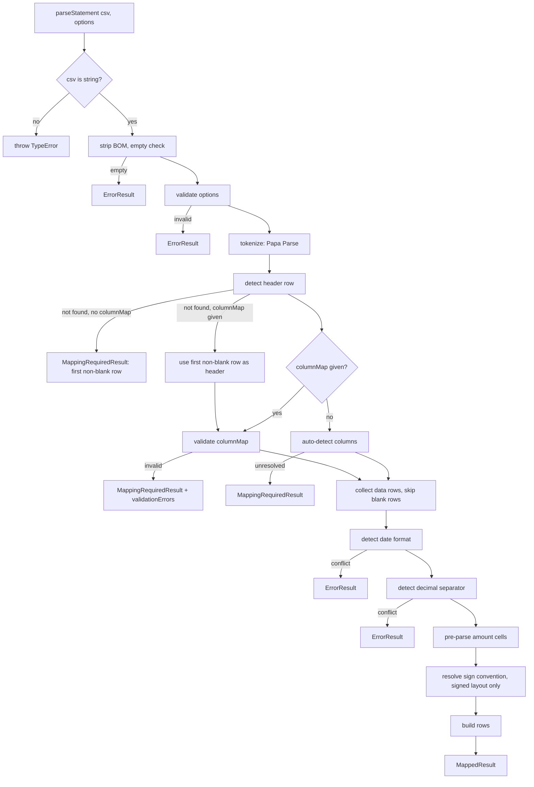

# Design Document: statement-parser

## Overview

`statement-parser` turns a raw bank-statement CSV string into a `ParseResult`. It lives in `packages/core/src/parse` and is exported from `@zombills/core`. It is a synchronous, pure function: no network, no DOM, no clock, no randomness, no logging. Papa Parse is the only runtime dependency.

The parser works in two passes over the data:

1. **Statement-level pass.** Find the header row, resolve columns, then decide the date format, decimal separator and sign convention once, from every data row.
2. **Row pass.** Convert each data row into a `Transaction` or a `RowError`, using the statement-level decisions without re-evaluating them.

This split is what the requirements demand (Req 3.6, 4.7, 6.1). It also makes row order irrelevant to the statement-level decisions, which several properties test.

### Design decisions

| Decision | Choice | Reason |
| --- | --- | --- |
| Control flow for value errors | Leaf parsers (`parseAmountCents`, `parseDate`) throw `ParseError`; the row builder catches only `ParseError` | Req 13.2 specifies the throw contract. Catching only `ParseError` lets real bugs surface in tests. |
| No top-level `try/catch` in `parseStatement` | Bugs throw | A blanket catch would hide defects. Property P9 checks that no input makes it throw. |
| Money arithmetic | String → integer cents, no `parseFloat`, no `Number()` on decimal strings | `money.md`. The integer part is limited to 8 digits before conversion, so every intermediate value is a safe integer. |
| Date arithmetic | Pure integer calendar check (leap-year rule); no `Date` object | `Date` brings in time zones and locale behaviour; integer checks are deterministic (Req 1.7). |
| Papa Parse mode | `header: false`, `dynamicTyping: false`, `skipEmptyLines: false`, `worker: false`, `download: false` | All cells stay strings, so amounts are never coerced. Blank rows are kept so the parser applies its own blank-row definition (glossary "Data row"). No worker and no download, so there is no network or DOM path. |
| One `RowError` per failing row | All fields of the row are checked; failures are joined into one `reason` | Req 3.9 asks the parser to keep checking non-date fields; the row-count invariant (Req 13.1) needs at most one error per row. |
| `RowError.rowIndex` | 1-based ordinal among data rows (blank rows not counted) | Literal reading of the glossary ("first data row = row 1") combined with the Data row definition. Confirmed in design review. |
| `-0` | Every negation goes through `negate(x) = x === 0 ? 0 : -x`, and `parseAmountCents` never returns `-0` | `-0` breaks deep equality (`Object.is`) in the determinism and round-trip properties. |
| Locale | Only `toLowerCase()` and explicit regexes; no `Intl`, no `toLocale*` | Results must not depend on the user's machine (Req 1.7). |

---

## Architecture



### Detection pipeline order

Each step runs only if the previous one did not return. The order is fixed, so the same input always fails at the same step with the same reason (Req 1.7).

| # | Step | Outcome on failure | Requirements |
| --- | --- | --- | --- |
| 0 | `typeof csv !== "string"` | throw `TypeError` (the only throw) | 8.2 |
| 1 | Strip one leading U+FEFF | none | 1.6 |
| 2 | Empty / whitespace-only check | `error`: empty input | 1.4 |
| 3 | Validate `options.currency` (`/^[A-Za-z]{3}$/`, then upper-cased) and `options.signConvention` (`"positive-out"` or `"negative-out"`) | `error`: invalid option | 10.1, 10.3, glossary ErrorResult |
| 4 | Tokenize with Papa Parse (delimiter guessed among `,` `;` `\t`) | none: Papa Parse problems such as unbalanced quotes show up later as row errors | 1.6 |
| 5 | Header-row detection over the first 20 non-blank rows. If none matches and `columnMap` is given, the first non-blank row becomes the header. | `mapping-required` with `columns` from the first non-blank row (only when no `columnMap`) | 11.1–11.3 |
| 6a | If `columnMap` is given: validate it against the header cells | `mapping-required` with `validationErrors` | 2.8, 2.9, 9.3–9.5 |
| 6b | Otherwise: auto-detect columns | `mapping-required` with `columns` | 1.5, 2.1–2.7, 2.10 |
| 7 | Collect data rows: every row after the header that is not fully blank | none | glossary Data row, 8.5, 11.2, 11.4 |
| 8 | Date-format detection over all date cells | `error`: conflicting date formats | 3.1–3.5, 3.9–3.11 |
| 9 | Decimal-separator detection over all non-empty amount cells | `error`: conflicting decimal separator patterns | 4.1–4.6 |
| 10 | Parse every amount cell once with the chosen separator and cache the results | none (failures are cached) | 4.7, 5.x |
| 11 | Sign convention (signed layout only): from the option, or by majority of cached non-zero values | none | 6.1, 6.2 |
| 12 | Build rows | `RowError` per failing row | 3.6–3.8, 5.x, 6.3–6.10, 7.x, 8.1, 10.x |
| 13 | Assemble `MappedResult` | none | 8.3–8.5 |

---

## Module layout

All paths are relative to `packages/core/src/parse/`. File names are kebab-case, constants are `SCREAMING_SNAKE_CASE` (`structure.md`).

| File | Responsibility | Exported from package root? |
| --- | --- | --- |
| `index.ts` | Public barrel: `parseStatement` and the public types | yes (via `packages/core/src/index.ts`) |
| `types.ts` | Public types (see below) | yes |
| `internal-types.ts` | `ParsedTable`, `ResolvedColumns`, `DataRow`, `AmountOutcome`, detection result unions | no |
| `parse-error.ts` | `ParseError` class | no |
| `parse-statement.ts` | Orchestrates the pipeline above | yes (`parseStatement`) |
| `tokenize.ts` | BOM strip, Papa Parse call, `isBlankRow` | no |
| `header-names.ts` | Recognition lists and `normalizeHeader` | no |
| `header-detect.ts` | Finds the header row | no |
| `columns.ts` | Auto-detects columns, validates `ColumnMap`, finds the currency column | no |
| `date-format.ts` | `detectDateFormat`, `parseDate`, calendar check | no |
| `decimal-separator.ts` | `detectDecimalSeparator` | no |
| `amount.ts` | `parseAmountCents`, `tryParseAmount`, `negate` | no |
| `sign-convention.ts` | `detectSignConvention`, `applySignConvention` | no |
| `debit-credit.ts` | Classifies cells as populated, zero or empty; combines debit and credit | no |
| `currency.ts` | `isCurrencyCode`, `resolveRowCurrency` | no |
| `build-rows.ts` | Row pass: `Transaction` or `RowError` per data row | no |
| `test-arbitraries.ts` | Shared fast-check generators and the statement model used by property tests | no; excluded from the build |
| `*.test.ts`, `*.property.test.ts` | Co-located tests (see Testing strategy) | no; excluded from the build |
| `no-network.test.ts` | Static analysis check for Req 12.4 | no |

Internal functions are exported from their own files so tests can import them directly (Req 13.2 tests `parseAmountCents`). They are not re-exported from `index.ts`. The build `tsconfig` excludes `**/*.test.ts`, `**/*.property.test.ts` and `**/test-*.ts`, so none of the test code reaches `dist`.

---

## Public types (`types.ts`)

```ts
export type DateFormat =
  | "yyyy-mm-dd"
  | "dd/mm/yyyy"
  | "mm/dd/yyyy"
  | "dd.mm.yyyy"
  | "dd-mm-yyyy";

export type SignConvention = "positive-out" | "negative-out";

export interface Transaction {
  /** ISO yyyy-mm-dd */
  date: string;
  /** Trimmed, non-empty */
  description: string;
  /** Integer cents. Positive = money out, negative = money in, 0 allowed. */
  amountCents: number;
  /** ISO 4217 alpha-3, e.g. "USD" */
  currency: string;
}

export interface RowError {
  /** 1-based ordinal among data rows (blank rows are not counted). */
  rowIndex: number;
  /** The row's cells re-serialised with the detected delimiter. */
  rawRow: string;
  /** "<field>: <why>" entries joined with "; " */
  reason: string;
}

export interface DateFormatInfo {
  format: DateFormat;
  assumed: boolean;
}

export interface SignConventionInfo {
  convention: SignConvention;
  assumed: boolean;
}

/**
 * Column names as they appear in MappingRequiredResult.columns (exact,
 * untrimmed). Every field is optional at the type level because the UI may
 * submit an incomplete map; completeness is checked at runtime (Req 9.4).
 */
export interface ColumnMap {
  date?: string;
  description?: string;
  amount?: string;
  debit?: string;
  credit?: string;
  currency?: string;
}

export type ColumnRole = keyof ColumnMap;

export interface ColumnMapValidationError {
  role: ColumnRole;
  /** The offending column name, or null when the role was omitted. */
  column: string | null;
  problem: "missing-mapping" | "unknown-column";
}

export interface ParseOptions {
  columnMap?: ColumnMap;
  /** ISO 4217 alpha-3; default "USD" */
  currency?: string;
  /** Overrides auto-detection for the signed-amount layout */
  signConvention?: SignConvention;
}

export interface MappedResult {
  status: "mapped";
  transactions: Transaction[];
  rowErrors: RowError[];
  /** null only when no date cell matched any supported format (Req 3.9) */
  detectedDateFormat: DateFormatInfo | null;
  /** null for DebitCreditLayout, where no sign convention applies */
  detectedSignConvention: SignConventionInfo | null;
}

export interface MappingRequiredResult {
  status: "mapping-required";
  columns: string[];
  validationErrors?: ColumnMapValidationError[];
  /** Always empty: no data rows are read before mapping is resolved */
  rowErrors: RowError[];
}

export interface ErrorResult {
  status: "error";
  reason: string;
}

export type ParseResult = MappedResult | MappingRequiredResult | ErrorResult;
```

Both nullable fields match the glossary entry for `MappedResult`: `detectedDateFormat` is `null` when Req 3.9 leaves the format unset, and `detectedSignConvention` is `null` for the debit/credit layout.

## Internal types (`internal-types.ts`)

```ts
export type DecimalSeparator = "." | ",";
export type Layout = "signed-amount" | "debit-credit";

export interface ParsedTable {
  rows: string[][];
  delimiter: "," | ";" | "\t";
}

/** Column indices into a row's cells */
export type ResolvedColumns =
  | { layout: "signed-amount"; date: number; description: number; amount: number; currency: number | null }
  | { layout: "debit-credit"; date: number; description: number; debit: number; credit: number; currency: number | null };

export interface DataRow {
  /** 1-based ordinal among data rows; becomes RowError.rowIndex */
  ordinal: number;
  cells: string[];
}

export type AmountOutcome =
  | { ok: true; cents: number }
  | { ok: false; reason: string };

export type DateDetection =
  | { kind: "detected"; info: DateFormatInfo }
  | { kind: "none" }
  | { kind: "conflict"; reason: string };

export type SeparatorDetection =
  | { kind: "detected"; separator: DecimalSeparator }
  | { kind: "conflict"; reason: string };
```

---

## Function signatures

```ts
// parse-statement.ts
export function parseStatement(csv: string, options?: ParseOptions): ParseResult;

// parse-error.ts
export class ParseError extends Error {
  constructor(readonly field: "date" | "description" | "amount" | "debit" | "credit" | "currency", message: string);
}

// tokenize.ts
export function stripBom(csv: string): string;
export function tokenize(csv: string): ParsedTable;
export function isBlankRow(cells: readonly string[]): boolean;
export function serializeRow(cells: readonly string[], delimiter: ParsedTable["delimiter"]): string;

// header-names.ts
export const DATE_HEADERS: readonly string[];
export const DESCRIPTION_HEADERS: readonly string[];
export const AMOUNT_HEADERS: readonly string[];
export const DEBIT_HEADERS: readonly string[];
export const CREDIT_HEADERS: readonly string[];
export const CURRENCY_HEADERS: readonly string[]; // ["currency", "ccy"]
export function normalizeHeader(name: string): string; // trim + toLowerCase

// header-detect.ts
/** Index into rows of the header row, or null when none of the first 20 non-blank rows matches. */
export function detectHeaderRow(rows: readonly string[][]): number | null;
export function firstNonBlankRow(rows: readonly string[][]): string[] | null;

// columns.ts
export function autoDetectColumns(header: readonly string[]): ResolvedColumns | null;
export function resolveColumnMap(
  header: readonly string[],
  map: ColumnMap,
): { ok: true; columns: ResolvedColumns } | { ok: false; errors: ColumnMapValidationError[] };

// date-format.ts
export function detectDateFormat(cells: readonly string[]): DateDetection;
export function parseDate(raw: string, format: DateFormat): string; // throws ParseError

// decimal-separator.ts
export function detectDecimalSeparator(cells: readonly string[]): SeparatorDetection;

// amount.ts
export function parseAmountCents(raw: string, separator: DecimalSeparator): number; // throws ParseError
export function tryParseAmount(raw: string, separator: DecimalSeparator): AmountOutcome;
export function negate(cents: number): number;

// sign-convention.ts
export function detectSignConvention(nonZeroRawCents: readonly number[]): SignConventionInfo;
export function applySignConvention(rawCents: number, convention: SignConvention): number;

// debit-credit.ts
export type CellState = "empty" | "zero" | "populated";
export function classifyCell(raw: string, outcome: AmountOutcome): CellState;
export function combineDebitCredit(
  debit: { raw: string; outcome: AmountOutcome },
  credit: { raw: string; outcome: AmountOutcome },
): number; // throws ParseError

// currency.ts
export function isCurrencyCode(value: string): boolean; // /^[A-Za-z]{3}$/
export function normalizeCurrency(value: string): string; // upper-case
export function resolveRowCurrency(cell: string | undefined, fallback: string): string; // throws ParseError

// build-rows.ts
export function buildRows(input: {
  dataRows: readonly DataRow[];
  columns: ResolvedColumns;
  dateFormat: DateFormat | null;
  amounts: ReadonlyMap<number, readonly AmountOutcome[]>; // amount column index → outcome per data row
  signConvention: SignConvention | null;
  currencyFallback: string;
  delimiter: ParsedTable["delimiter"];
}): { transactions: Transaction[]; rowErrors: RowError[] };
```

The exact shape of the cached `amounts` input is an implementation detail; the requirement is that each amount cell is parsed once and the same outcome feeds sign detection, debit/credit classification and row building.

---

## Component design

### Tokenizer (`tokenize.ts`)

- `stripBom` removes one leading `\uFEFF`. It runs before the empty check, so a file containing only a BOM is reported as empty.
- `Papa.parse(csv, { delimiter: "", delimitersToGuess: [",", ";", "\t"], header: false, dynamicTyping: false, skipEmptyLines: false, worker: false, download: false })`. If Papa Parse cannot guess, it falls back to `,`, which is the correct default.
- Papa Parse `errors` (for example unbalanced quotes) are not fatal. The affected rows usually have the wrong cell count and fail field checks in the row pass.
- `isBlankRow`: every cell is `""` or whitespace only. This also covers the trailing `[""]` row Papa Parse produces for a final newline.
- `serializeRow` uses `Papa.unparse([cells], { delimiter })` to build `RowError.rawRow`.

### Header detection (`header-detect.ts`)

- Walk rows in order, skipping blank rows, and count up to 20 non-blank rows.
- A row is the header if any cell, after `normalizeHeader`, exactly equals an entry in `DATE_HEADERS`, `DESCRIPTION_HEADERS`, `AMOUNT_HEADERS`, `DEBIT_HEADERS` or `CREDIT_HEADERS` (Req 11.1). Matching is exact, so a preamble cell such as `"Statement date: 01/05/2026"` does not match `"date"`.
- Rows before the header are preamble and are discarded (Req 11.2).
- If no header is found and `columnMap` is not given, the result is `mapping-required` with `columns = firstNonBlankRow(rows)` (Req 11.3).
- If no header is found and `columnMap` is given, the first non-blank row is used as the header row and the map is validated against its cells (Req 11.3). This lets the mapping UI resubmit for a file whose headers aren't recognised, without looping. Rows after it are data rows.

### Column resolution (`columns.ts`)

**Auto-detection (Req 2.1–2.7, 2.10).** Normalize every header cell once. For each role, take the leftmost header whose normalized name is in that role's list.

- If both a debit and a credit column exist, the layout is debit/credit, even if an amount column also exists (Req 2.4, 2.5).
- Otherwise, if an amount column exists, the layout is signed.
- `date` and `description` are always required. If any required role is missing, return `null`, which leads to `mapping-required` with the raw header cells as `columns`.

**ColumnMap validation (Req 2.8, 2.9, 9.3–9.5).** Auto-detection does not run.

1. Pick the layout: if `debit` or `credit` is set, the layout is debit/credit and both are required. Otherwise the layout is signed and `amount` is required. If `amount` is set as well as both `debit` and `credit`, `amount` is ignored, matching Req 2.5.
2. Collect every validation error before returning, one entry per role. An omitted required role gives `{ role, column: null, problem: "missing-mapping" }`. A name not found among the header cells gives `{ role, column: name, problem: "unknown-column" }`. The optional `currency` role is checked only when it is set.
3. Column names are matched exactly against the raw header cells, which are the strings the UI received in `columns`. With duplicate names, the leftmost column wins.

The function is pure and holds no state between calls, so Req 9.5 ("SHALL NOT modify any previously accumulated parse state") holds by construction.

**Currency column (Req 10.4).** Use `columnMap.currency` if it is set. Otherwise take the leftmost header whose normalized name is `currency` or `ccy`. The same trim-and-lowercase normalization is used here for consistency with Req 2.10.

### Date format (`date-format.ts`)

Each date cell is trimmed and matched against these shapes:

| Shape | Regex | Interpretations |
| --- | --- | --- |
| ISO | `^(\d{4})-(\d{1,2})-(\d{1,2})$` | `yyyy-mm-dd` |
| Slash | `^(\d{1,2})/(\d{1,2})/(\d{2}\|\d{4})$` | `dd/mm/yyyy`, `mm/dd/yyyy` |
| Dot | `^(\d{1,2})\.(\d{1,2})\.(\d{2}\|\d{4})$` | `dd.mm.yyyy` |
| Dash, day first | `^(\d{1,2})-(\d{1,2})-(\d{2}\|\d{4})$` | `dd-mm-yyyy` |

A cell is a **candidate** (Req 3.1) if it matches a shape and at least one of that shape's interpretations is a real calendar date. Two-digit years are read as `20yy`. All candidates are used, in any order.

**Decision procedure:**

1. If there are no candidates, return `{ kind: "none" }` (Req 3.9).
2. Group the candidates by shape. If more than one shape is present, the most frequent shape wins; ties are broken in the order ISO, Slash, Dot, Dash. Only the winning shape's cells feed step 3. Cells of other shapes then fail in the row pass under Req 3.8 (Req 3.12).
3. For each shape:
   - ISO gives `yyyy-mm-dd`, not assumed (Req 3.2).
   - Dot gives `dd.mm.yyyy`, not assumed; Dash gives `dd-mm-yyyy`, not assumed (Req 3.11).
   - Slash: let `L` be "some candidate has a leftmost part above 12" and `M` be "some candidate has a middle part above 12".
     - `L` and `M` both true: return a conflict (Req 3.10).
     - Only `L`: `dd/mm/yyyy`, not assumed (Req 3.3).
     - Only `M`: `mm/dd/yyyy`, not assumed (Req 3.4).
     - Neither: `mm/dd/yyyy`, assumed (Req 3.5).

Because the decision depends only on the set of candidates, shuffling the rows cannot change it. A dd/mm statement whose first ten rows have days 1–10 is still read as dd/mm once any later row has a day above 12.

**`parseDate(raw, format)`:** trim, match the regex for `format`, pull out year, month and day, expand a two-digit year to `20yy`, and check `1 ≤ month ≤ 12` and `1 ≤ day ≤ daysInMonth(year, month)` with the Gregorian leap-year rule. Years must be at least 0001. The result is a zero-padded `yyyy-mm-dd`. Any failure throws `ParseError("date", …)` naming the cell and the expected format.

### Decimal separator (`decimal-separator.ts`)

Run over every non-empty amount cell: the amount column for the signed layout, or both debit and credit columns for the debit/credit layout (Req 4.1). For each cell, remove the outer whitespace, sign characters and currency symbols, then look at the punctuation:

| Cell pattern | Indicator |
| --- | --- |
| Contains both `,` and `.`; the later one is the decimal | `"."` if `.` is later (Req 4.2), `","` if `,` is later (Req 4.3) |
| One kind of punctuation, last occurrence followed by exactly 1–2 digits at the end | that character (Req 4.4) |
| Punctuation followed by exactly 3 trailing digits, or digits only | no indicator (Req 4.4, 4.6) |

If both indicators appear across the cells, return a conflict (Req 4.5). If only one appears, use it. If none appears, use `"."` (Req 4.6). The result does not depend on row order (Req 4.7).

### Amount parser (`amount.ts`)

`parseAmountCents(raw, separator)` follows `money.md`, tightened by Req 5:

1. Trim `[\p{Zs}\p{Zl}\p{Zp}\t\n\r]` from both ends (Req 5.1). If nothing is left, throw "empty" (Req 5.9).
2. If any whitespace (`\s` or `\p{Z}`) remains inside the string, throw (Req 5.10).
3. Match the sign and currency grammar below. Anything else throws, which covers `--5`, `(-5)`, `(5`, `5)` and `-5-` (Req 5.2). At most one `\p{Sc}` symbol is allowed, and it is stripped (Req 5.3).

   ```
   signed   := "(" unsigned ")" | "-" unsigned | unsigned "-" | SYM "-" NUMBER | unsigned
   unsigned := SYM NUMBER | NUMBER SYM | NUMBER
   NUMBER   := [0-9.,]+
   SYM      := one \p{Sc} character
   ```

4. Remove every thousands separator: `,` when the decimal separator is `.`, and `.` when it is `,` (Req 5.4, 5.5).
5. There may be at most one decimal separator left; more than one throws (Req 5.8). Split into an integer part and a fractional part. The string must contain at least one digit. The fractional part may have 0, 1 or 2 digits; 3 or more throws, with no rounding (Req 5.6, 5.7).
6. Strip leading zeros from the integer part. If more than 8 digits remain, throw "exceeds limit" before any conversion, so every value stays a safe integer.
7. Compute `cents = Number(intPart) * 100 + Number(fracPart.padEnd(2, "0"))`. If `cents > 999_999_9900`, throw (Req 5.11).
8. Return `negative ? negate(cents) : cents`. The result is never `-0` (Req 5.12).

Thousands separators are not checked for position, so `"1,2,3"` parses as `123`. No requirement asks for that check.

`tryParseAmount` wraps `parseAmountCents`. It catches `ParseError` and returns `{ ok: false, reason }`. Any other error is rethrown.

### Sign convention (`sign-convention.ts`)

- When `options.signConvention` is set, return `{ convention: option, assumed: false }` without inspecting values (Req 6.2).
- Otherwise count the positive and negative values among the successfully parsed, non-zero amount cells of all data rows. A strict majority decides, with `assumed: false`. A tie, including 0 versus 0, gives `{ "positive-out", assumed: true }` (Req 6.1).
- `applySignConvention`: `positive-out` returns the raw value and `negative-out` returns `negate(raw)`, so 0 stays 0 (Req 6.3–6.7).
- For the debit/credit layout this step is skipped, `options.signConvention` is ignored, and `detectedSignConvention` is `null`.

### Debit/credit combination (`debit-credit.ts`)

`classifyCell` implements Req 7.6:

| Cell | State |
| --- | --- |
| Empty or whitespace only | `empty` |
| Parses to 0 (e.g. `"0.00"`, `"-0"`) | `zero` |
| Parses to non-zero, **or** fails to parse | `populated` |

`combineDebitCredit` then decides:

| Debit | Credit | Result | Requirement |
| --- | --- | --- | --- |
| populated | not populated | parse failure → `ParseError("debit")`; otherwise `abs(cents)` | 7.1, 7.5 |
| not populated | populated | parse failure → `ParseError("credit")`; otherwise `negate(abs(cents))` | 7.2, 7.5 |
| populated | populated | `ParseError("amount", "both debit and credit populated")` | 7.3 |
| not populated | not populated, at least one `zero` | `0` | 7.4 |
| empty | empty | `ParseError("amount", "both debit and credit empty")` | 7.4 |

### Currency (`currency.ts`)

- The fallback currency is `normalizeCurrency(options.currency)` when the option is set, otherwise `"USD"`. It is validated and upper-cased in pipeline step 3 (Req 10.1–10.3), so `"usd"` becomes `"USD"` and `"US"` is an `ErrorResult`.
- `isCurrencyCode(value)` tests `/^[A-Za-z]{3}$/`. `normalizeCurrency(value)` returns `value.toUpperCase()`; it is only called on values that passed `isCurrencyCode`, so the result is always 3 ASCII capitals.
- `resolveRowCurrency(cell, fallback)` trims the cell. It returns the fallback when there is no currency column or the trimmed cell is empty (Req 10.5). A trimmed cell that passes `isCurrencyCode` is returned upper-cased, so `"eur"` becomes `"EUR"` (Req 10.4). Anything else throws `ParseError("currency")` (Req 10.6).

### Row builder (`build-rows.ts`)

For each `DataRow`, missing trailing cells are treated as `""` and extra cells are ignored. The builder checks every field and collects the failures:

| Field | Rule |
| --- | --- |
| `date` | No format detected → fail with "no recognisable date format in statement" (Req 3.9). Otherwise `parseDate` (Req 3.8). |
| `description` | Trimmed. Empty → fail ("missing required cell", Req 8.1). |
| amount | Signed layout: cached outcome, then `applySignConvention` (Req 6.3–6.10). Debit/credit layout: `combineDebitCredit` (Req 7). |
| `currency` | `resolveRowCurrency` (Req 10.4–10.6). |

If any field failed, the builder pushes one `RowError { rowIndex: ordinal, rawRow: serializeRow(cells), reason }`, where `reason` joins the `"<field>: <message>"` entries with `"; "`. Otherwise it pushes the `Transaction`. Output order follows input order.

---

## Error handling

| Tier | Mechanism | Cases | Caller sees |
| --- | --- | --- | --- |
| Contract violation | `throw new TypeError` | `csv` is not a string | Exception (Req 8.2) |
| Statement-level | `ErrorResult { status: "error", reason }` | Empty input (1.4); invalid `options.currency` (10.3); invalid `options.signConvention`; conflicting date formats (3.10); conflicting decimal separators (4.5) | Returned value |
| Mapping | `MappingRequiredResult` | No header row found and no `columnMap` (11.3); auto-detection incomplete (1.5, 2.7); invalid `columnMap` (2.9, 9.4) | Returned value with `columns` and optional `validationErrors` |
| Row-level | `RowError` in `MappedResult.rowErrors` | Any field failure in a data row (3.8, 3.9, 5.x, 6.9, 6.10, 7.3–7.5, 8.1, 10.6) | Returned value; other rows unaffected (8.1, 8.3–8.5) |
| Internal | `ParseError` | Thrown by leaf parsers, caught only in `tryParseAmount` and `build-rows.ts` | Never escapes (glossary ParseError) |

The `reason` strings are plain English with fixed wording, so they are deterministic. They may quote the offending cell. That text stays in memory and goes to the in-browser UI only; `packages/core` has no logging (`privacy.md`).

---

## Privacy and environment

- The only import outside `src/parse` is `papaparse`. Papa Parse is called synchronously on a string, with `worker: false` and `download: false`, so its file, URL and Web Worker code paths are never reached.
- No `console.*` calls in `src/parse`.
- `packages/core` Vitest runs with `environment: "node"` and no DOM polyfills, which covers Req 12.3.
- Req 12.4 is enforced twice:
  1. `no-network.test.ts` reads every non-test `.ts` file under `src/parse` and fails, naming the file, line and identifier, on any word-boundary match of `fetch`, `XMLHttpRequest`, `sendBeacon`, `WebSocket`, `document`, `window` or `navigator`. Comments are stripped first so the rule can be documented in prose.
  2. ESLint `no-restricted-globals` and `no-restricted-properties` rules for the same identifiers in `packages/core`, which give editor feedback.
- The existing `privacy-guard` hook stays as a third check on file save.

---

## Testing strategy

Tools: Vitest for unit tests and fast-check for property tests (`tech.md`). Tests are co-located with their source files (`structure.md`). Property tests use fast-check's default 100 runs; fast-check prints the seed and the shrunk counterexample when a run fails.

### Test oracle

`test-arbitraries.ts` generates a **statement model**: the intended transactions (date, description, cents, direction, currency), a layout, a date format, a decimal separator, a sign convention, header spellings, preamble rows, blank-row positions and delimiter. A serializer renders the model to CSV text. Properties compare parser output against the model, not against parser internals. For example, N in P1 is the number of generated non-blank rows. Separate arbitraries generate malformed cells (bad dates, bad amounts, invalid currencies) so the error paths are exercised too.

### Correctness properties

| ID | Property | File | Validates |
| --- | --- | --- | --- |
| P1 | Row-count invariant: for any accepted statement, `transactions.length + rowErrors.length = N`, where N counts non-blank rows after the header | `parse-statement.property.test.ts` | 13.1, 8.5, 11.2, 11.4, glossary Data row |
| P2 | `parseAmountCents` is total: for any string and either separator, it returns a safe integer that is not `-0`, or throws `ParseError`; it never returns NaN, Infinity or a fraction, and never throws another error type | `amount.property.test.ts` | 13.2, 5.12, money.md |
| P3 | US round-trip: `parseAmountCents((c / 100).toFixed(2), ".") === c` for every integer c in [−999_999_9900, 999_999_9900]. The formatter uses integer string building, so no float error enters the test. | `amount.property.test.ts` | 13.3, 5.13 |
| P4 | European round-trip: c formatted as `"1.234,56"`, with and without thousands separators, parses back to c with separator `","` | `amount.property.test.ts` | 13.4, 4.8, 5.5 |
| P5 | Date round-trip: for any valid date, any of the 5 formats, any padding choice, and (for non-ISO formats) a 4-digit or 2-digit year (2-digit only for 2000–2099), `parseDate(format(d), fmt)` returns the ISO string | `date-format.property.test.ts` | 13.5, 3.7, 3.8, 3.11 |
| P6 | Every `Transaction.amountCents` is an integer; for model rows with a known direction, debits are > 0, credits are < 0, and zero rows are 0 | `parse-statement.property.test.ts` | 13.6, 6.3–6.7, 7.1, 7.2, 7.4 |
| P7 | Determinism: two calls with identical arguments return deeply equal results (`toStrictEqual`) | `parse-statement.property.test.ts` | 13.7, 1.7 |
| P8 | Sign convention consistency: with auto-detection, every non-zero output amount has the sign the model expects for the returned `detectedSignConvention.convention` | `sign-convention.property.test.ts` | 13.8, 6.1, 6.3–6.6 |
| P9 | No throw: `parseStatement` never throws for any string `csv`, including arbitrary unicode, and any well-typed options | `parse-statement.property.test.ts` | 8.2, 1.4 |
| P10 | Decimal separator order independence: shuffling the amount cells never changes `detectDecimalSeparator` | `decimal-separator.property.test.ts` | 4.7 |
| P11 | Date format order independence: shuffling the date cells never changes `detectDateFormat`. A generated dd/mm statement whose only day above 12 is in the last row is still detected as `dd/mm/yyyy`. | `date-format.property.test.ts` | 3.1, 3.3, 3.6 |
| P12 | Slash conflict: for any set of cells in which the `/`-separated shape wins (Req 3.12), a cell with leftmost part > 12 together with another cell with middle part > 12 gives `kind: "conflict"`. When another shape has more candidates, the contradicting slash cells do not cause a conflict. | `date-format.property.test.ts` | 3.10, 3.12 |
| P13 | Debit/credit absolute value: for any c ≠ 0, a debit cell holding `fmt(c)` or `fmt(−c)` gives `abs(c)`, and a credit cell gives `−abs(c)` | `debit-credit.property.test.ts` | 7.1, 7.2 |
| P14 | Header normalization: adding random surrounding whitespace and random casing to recognized header names does not change the resolved columns or the parse result | `columns.property.test.ts` | 2.10, 11.1 |
| P15 | Blank-row invariance: inserting fully blank rows anywhere after the header leaves `transactions` and `rowErrors` unchanged, including every `rowIndex` | `parse-statement.property.test.ts` | glossary Data row, 8.5, 13.1 |
| P16 | Delimiter and BOM invariance: the same model serialized with `,`, `;` or tab, with or without a leading BOM, gives identical `transactions` | `parse-statement.property.test.ts` | 1.6 |
| P17 | Preamble invariance: prepending preamble rows that contain no recognized header name, keeping the header within the first 20 non-blank rows, does not change the result | `header-detect.property.test.ts` | 11.1, 11.2, 11.4 |
| P18 | Sign flip: negating every amount in a signed statement without a tie flips `detectedSignConvention.convention` and leaves `transactions` unchanged | `sign-convention.property.test.ts` | 6.1, 6.3–6.6 |

### Example-based unit tests

| File | Cases | Validates |
| --- | --- | --- |
| `tokenize.test.ts` | BOM stripped; `,` `;` `\t` detected; quoted delimiters inside cells; final newline | 1.6 |
| `parse-statement.test.ts` | `""`, `"   \n "`, BOM only → error; invalid currency and invalid signConvention options → error; non-string `csv` throws `TypeError`; every row failing → `mapped` with empty `transactions`; clean statement → empty `rowErrors` | 1.1–1.5, 8.2–8.5, 10.3 |
| `header-detect.test.ts` | Header on row 1; header after preamble; header as the 21st non-blank row → mapping-required with first-row cells; same file with a `columnMap` naming first-row cells → `mapped`; `"Statement date: …"` not matched | 11.1–11.3 |
| `columns.test.ts` | Each recognized spelling; leftmost wins; debit/credit beats amount; incomplete auto-detection → `null`; `columnMap` replaces auto-detection; unknown column and missing role each produce one validation error with the right role; duplicate and blank header names kept in `columns` | 2.1–2.10, 9.1–9.5 |
| `date-format.test.ts` | One case per row of the decision procedure; `"1/5/2026"`; `"01.05.26"` → `2026-05-01`; `"31/02/2024"` rejected; 29 Feb in leap and non-leap years; mixed shapes (majority wins, ISO/Slash tie → ISO, minority cells become row errors); no candidates → `none` | 3.1–3.12 |
| `decimal-separator.test.ts` | `"1,234.56"`; `"1.234,56"`; `"9,99"`; `"1,234"` alone → default `"."`; mixed indicators → conflict | 4.1–4.6 |
| `amount.test.ts` | `$1,234.56`; `(9.99)`; `9.99-`; `€9,99`; `--5`, `(-5)`, `(5`, `5)`; `"1 234.56"` rejected; `1.050` rejected; `""` rejected; `"abc"` rejected; just above and just below 999_999_9900; `-0.00` → `0` | 5.1–5.12 |
| `sign-convention.test.ts` | Majority positive; majority negative; tie → assumed; option overrides; zero amounts kept | 6.1–6.8 |
| `debit-credit.test.ts` | Every row of the combination table, including `"0.00"` beside `"12.00"`, `"0.00"`/`""`, `""`/`""`, `"abc"`/`""` | 7.1–7.6 |
| `currency.test.ts` | Option used; `options.currency: "usd"` → every row `"USD"`; default USD; per-row override; per-row `"eur"` and `" Eur "` → `"EUR"`; empty cell falls back to the normalised option; `"US"`, `"EURO"`, `"U$D"` → row error | 10.1–10.6 |
| `build-rows.test.ts` | Multi-field failure gives one `RowError` with both reasons; `rowIndex` skips blank rows; ragged rows | 3.9, 8.1 |
| `no-network.test.ts` | Static scan passes on the real sources; a fixture string containing `fetch(` is reported with the identifier named | 12.1, 12.2, 12.4 |
| `node-env.test.ts` | Importing `@zombills/core` and calling `parseStatement` under the Node environment does not throw | 12.3 |

### Fixture tests

`parse-statement.test.ts` also parses each CSV in `samples/` and snapshots the result. This covers real-world layouts (US signed, UK debit/credit, European semicolon with comma decimals, preamble lines) end to end. Sample files must stay fake and anonymised (`structure.md`).

---

## Design review decisions

1. **Unrecognised header row with a `columnMap`:** the first non-blank row is used as the header (Req 11.3 amended).
2. **Mixed date shapes:** the most frequent shape wins, ties go ISO > Slash > Dot > Dash, and cells of other shapes become row errors (new Req 3.12).
3. **`RowError.rowIndex`:** stays the 1-based data-row ordinal.
4. **Nullable result fields:** `detectedDateFormat` and `detectedSignConvention` are nullable; the glossary entry for `MappedResult` now says so.
5. **`money.md`:** step 1 now says to inspect all non-empty amount values, matching Req 4.1.
6. **Empty description:** stays a `RowError`.
7. **Currency case:** codes are matched case-insensitively and upper-cased, for both `options.currency` and the per-row currency column (Req 10.1, 10.3–10.6 amended).
