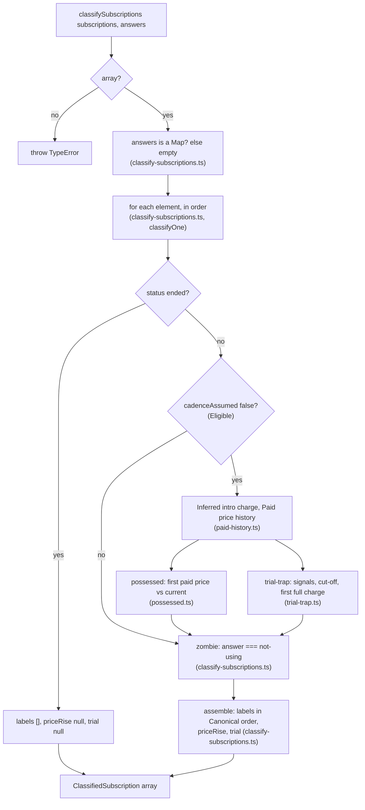

# Design Document: subscription-classifier

## Overview

`subscription-classifier` sets the `labels` of the `Subscription`s that `detectSubscriptions` returns and adds the facts behind each label. It lives in `packages/core/src/classify` and is exported from `@zombills/core`. Like the parser, normalizer and detector, it is synchronous and pure: no network, no DOM, no clock, no randomness, no logging, no storage and no runtime dependencies.

One call to `classifySubscriptions(subscriptions, answers)` maps each input element to a new `ClassifiedSubscription`, independently of every other element (Req 1.3):

1. **Read the answer.** `answers` is used only when it is a `Map`; the element's answer is `answers.get(element.id)` (Req 1.8, 1.10, 6.2).
2. **Ended?** An element with `status: "ended"` gets `labels: []`, `priceRise: null`, `trial: null` and nothing else is computed (Req 5.3).
3. **Intro.** Find the Inferred intro charge, if any, and the Paid price history (glossary).
4. **Possessed.** Compare the current price with the first Paid price history entry (Req 2).
5. **Trial trap.** Check the trial signals and the full-price charge cut-off (Req 3).
6. **Zombie.** Add `"zombie"` for a `"not-using"` answer (Req 6.3).
7. **Assemble.** Copy the element with the new `labels` (Canonical label order), `priceRise` and `trial` (Req 1.4, 1.7).

Steps 4 and 5 run only for an Eligible subscription (`status: "active"`, `cadenceAssumed: false`, Req 5.1). Step 6 reads nothing but `status`, `id` and the answer, so answers can never change steps 3–5 (Req 4.3).

The spec also changes two other places, covered at the end of this document:

- the vertical-slice page shows `possessed` and `trial-trap` as plain text lines (Req 9);
- the normalizer maps `PRIMEVIDEO MEMBERSHIP` to `amazon-prime` (Req 10), which changes one Subscription of the UK Sample.

All money is integer minor units (`money.md`). Dates are copied strings, compared only for equality (Req 7.3).

### Design decisions

| Decision | Choice | Reason |
| --- | --- | --- |
| One element at a time | `classifySubscriptions` is `subscriptions.map((s) => classifyOne(s, answerFor(s.id)))`; `classifyOne` reads no other element | Req 1.3, 11.9. Order, length and permutation behaviour follow from `Array.prototype.map` without any extra code. |
| Ignore earlier labels by construction | `classifyOne` never reads `labels`, `priceRise` or `trial` from its input; the result is `{ ...element, labels, priceRise, trial }`, so the three keys are always overwritten | Req 1.6, 11.6. Re-classifying a result with new answers gives the same value as classifying the detector output. |
| Shallow copy | The result is a new top-level object and a new `labels` array; `charges`, `priceHistory`, `evidence` and `cancel` are shared with the input element by reference. Only `firstSeen`, `latestRise`, `introCharge` and `firstFullCharge` are new objects | Req 1.4 asks for deep equality of the other fields, not fresh copies. Copying `charges` per call would cost `O(charges)` for nothing, and the classifier never writes to any shared value (Req 1.5). Callers already treat detector output as read-only; the TSDoc on `classifySubscriptions` says so, and graveyard-ui gets a hand-off to build new objects for corrections (Design review decision 1). |
| Band rise without overflow | `isBandRise(from, to)` is `to > from && to − from > (from − from % 20) / 20` | For non-negative integers this equals `(to − from) × 20 > from` (Glossary), and no intermediate leaves the safe-integer range. The same rewrite as the detector's banding test (subscription-detector design, "Banding without overflow"). |
| Cadence factor table | The classifier keeps its own frozen `CADENCE_FACTOR` (`52`, `12`, `1`) instead of importing the detector's private `YEARLY_FACTOR` from `build-subscription.ts` | No detector change. `band.test.ts` ties the two together: one fixture per cadence goes through `detectSubscriptions` and asserts `yearlyCostCents === currentAmountCents × CADENCE_FACTOR[cadence]`, which fails if the tables ever disagree. |
| Answers lookup | `answers instanceof Map ? answers.get(id) : undefined`, then compared with `=== "not-using"` | Req 1.10, 6.2, 6.4, 6.5. Any non-`Map` is treated as empty, any value other than `"not-using"` gives no zombie, and keys other than input ids are never looked at, because the classifier only calls `get` with input ids. |
| Errors | `TypeError` only for a non-array `subscriptions`; no `try/catch` anywhere | Req 1.10. The Req 3.3 and 2.4 guards are ordinary branches. A blanket `catch` would hide the bugs P1 is there to find. |
| Module format | ES modules under `module: NodeNext`, `.js` on every relative import | Same as the other core modules; the Reaper loads `dist/index.js` from plain Node. `build.test.ts` classifies the US Sample through `dist/index.js` to prove it. |
| Slice text built in `logic/` | The two label sentences are built by pure functions in `apps/web/src/slice/logic/label-text.ts` that take an optional `locale`; `SubscriptionItem` renders them with the money parts in `.money` spans | Req 9.3, 9.4, 9.6. The exact `en-US` and `en-GB` strings of Req 9.3 and 9.4 can be pinned in a unit test whatever locale the test machine has, the same split as `formatMoney` and `money.test.ts` (vertical-slice design, Testing strategy). |
| Generic slice lists | `groupForDisplay` and `CurrencyGroup` become generic in the subscription type (`<S extends Subscription>`) | Req 9.1. `ResultsView` gets `ClassifiedSubscription` back from `groupForDisplay` and passes it to `SubscriptionItem` without a cast. `currencyTotals` and `isCounted` keep taking `Subscription`, which `ClassifiedSubscription` extends. |

---

## Architecture

Each box names the file that owns it.



Nothing crosses an element boundary. `answers` is read only through `get` with the current element's `id`, during the call (Req 6.2).

The full pipeline after this spec, as the slice page and the sample tests run it:

```
parseStatement → normalizeTransactions → detectSubscriptions → classifySubscriptions(subscriptions, answers?)
```

---

## Module layout

All paths are relative to `packages/core/src/classify/`. File names are kebab-case and constants are `SCREAMING_SNAKE_CASE` (`structure.md`).

| File | Responsibility | Exported from package root? |
| --- | --- | --- |
| `index.ts` | Public barrel: `classifySubscriptions` and the public types | yes (via `packages/core/src/index.ts`) |
| `types.ts` | `UsageAnswer`, `PriceRise`, `TrialDetails`, `ClassifiedSubscription`, `SubscriptionLabel` (Req 1.1, 1.2) | yes, except `SubscriptionLabel` (internal alias) |
| `band.ts` | `CADENCE_FACTOR`, `isBandRise` | no |
| `paid-history.ts` | `findInferredIntro`, `paidPriceHistory` (glossary: Inferred intro charge, Paid price history) | no |
| `possessed.ts` | `findPriceRise` (Req 2) | no |
| `trial-trap.ts` | `findTrial` (Req 3) | no |
| `classify-subscriptions.ts` | `classifySubscriptions` (public), `classifyOne`, `answerFor` (Req 1, 4, 5, 6) | `classifySubscriptions` only |
| `test-arbitraries.ts` | fast-check generators: `classifierSubscriptionArb`, `detectorOutputArb`, `answersArb` (Req 11.1) | no; excluded from build |
| `test-fixtures.ts` | `makeSubscription(overrides)` builder for hand-written Subscriptions that keep the detector's invariants | no; excluded from build |
| `*.test.ts`, `*.property.test.ts` | Co-located tests | no; excluded from build |
| `no-network.test.ts`, `node-env.test.ts` | Req 7.4, 7.5 | no |

`packages/core/src/index.ts` gains `export * from "./classify/index.js";` after the detector line. `types.ts` imports `Subscription` and `PricePoint` from `../detect/types.js` and does not re-export them. The build `tsconfig` already excludes `**/*.test.ts`, `**/*.property.test.ts` and `**/test-*.ts`, so no build config changes.

`src/classify` imports only `../detect/types.js` (types only, erased at build). It does not import any detector runtime code.

---

## Data models (`types.ts`)

```ts
import type { PricePoint, Subscription } from "../detect/types.js";

export type UsageAnswer = "still-using" | "not-using";

/** One label; the element type of Subscription["labels"]. Internal alias. */
export type SubscriptionLabel = Subscription["labels"][number];

export interface PriceRise {
  /** First entry of the Paid price history (a new object) */
  firstSeen: PricePoint;
  /** = Subscription.currentAmountCents */
  currentAmountCents: number;
  /** Latest consecutive Paid price history step that is a Band rise, or null */
  latestRise: {
    fromAmountCents: number;
    toAmountCents: number;
    /** Date of the first charge at toAmountCents */
    date: string;
  } | null;
  /** currentAmountCents − firstSeen.amountCents; always > 0 */
  increasePerChargeCents: number;
  /** increasePerChargeCents × Cadence factor */
  increasePerYearCents: number;
}

export interface TrialDetails {
  /** evidence.freeTrialDate when it counts as a trial signal, else null */
  freeTrialDate: string | null;
  /** evidence.introCharge or the Inferred intro charge (a new object), else null */
  introCharge: PricePoint | null;
  /** First charge at the full price (a new object) */
  firstFullCharge: PricePoint;
}

export type ClassifiedSubscription = Subscription & {
  /** Non-null exactly when labels contains "possessed" */
  priceRise: PriceRise | null;
  /** Non-null exactly when labels contains "trial-trap" */
  trial: TrialDetails | null;
};
```

The Req 1.2 types are written as `interface` where the shape is an object, following `detect/types.ts`; `ClassifiedSubscription` stays a type alias because it is an intersection. The detector's `Subscription.labels` comment ("Always [] from the Detector; set by the classifier") is already correct and does not change.

`index.ts`:

```ts
export { classifySubscriptions } from "./classify-subscriptions.js";
export type { ClassifiedSubscription, PriceRise, TrialDetails, UsageAnswer } from "./types.js";
```

## Function signatures

```ts
// classify-subscriptions.ts
/**
 * Labels each Subscription. Nested values (`charges`, `priceHistory`, `evidence`, `cancel`)
 * are shared with the input; treat results as read-only.
 */
export function classifySubscriptions(
  subscriptions: readonly Subscription[],
  answers?: ReadonlyMap<string, UsageAnswer>,
): ClassifiedSubscription[];
/** Internal. `answer` is whatever answers.get(id) returned, or undefined. */
export function classifyOne(subscription: Subscription, answer: unknown): ClassifiedSubscription;
/** Internal. undefined when answers is not a Map (Req 1.8, 1.10). */
export function answerFor(answers: unknown, id: string): unknown;

// band.ts
export const CADENCE_FACTOR: Readonly<Record<Cadence, number>>;   // weekly 52, monthly 12, yearly 1
export function isBandRise(fromAmountCents: number, toAmountCents: number): boolean;

// paid-history.ts
export function findInferredIntro(subscription: Subscription): PricePoint | null;
export function paidPriceHistory(
  subscription: Subscription,
  inferredIntro: PricePoint | null,
): readonly PricePoint[];          // a slice of priceHistory; entries are not copied

// possessed.ts
/** null when not possessed. Call only for an Eligible subscription. */
export function findPriceRise(
  subscription: Subscription,
  paid: readonly PricePoint[],
): PriceRise | null;

// trial-trap.ts
/** null when not a trial trap. Call only for an Eligible subscription. */
export function findTrial(
  subscription: Subscription,
  inferredIntro: PricePoint | null,
): TrialDetails | null;
```

`findInferredIntro` and `paidPriceHistory` are computed once per Eligible element in `classifyOne` and passed to both label functions, so `possessed` and `trial-trap` always agree on whether there is an intro (Req 4.2).

---

## Component design

### Entry point (`classify-subscriptions.ts`)

```
classifySubscriptions(subscriptions, answers):
  if !Array.isArray(subscriptions):
    throw new TypeError("classifySubscriptions: subscriptions must be an array")
  return subscriptions.map((s) => classifyOne(s, answerFor(answers, s.id)))

answerFor(answers, id):
  return answers instanceof Map ? answers.get(id) : undefined

classifyOne(s, answer):
  if s.status === "ended":
    return { ...s, labels: [], priceRise: null, trial: null }            // Req 5.3
  priceRise = null; trial = null
  if !s.evidence.cadenceAssumed:                                        // Eligible (Req 5.1)
    intro     = findInferredIntro(s)
    priceRise = findPriceRise(s, paidPriceHistory(s, intro))
    trial     = findTrial(s, intro)
  labels = []
  if answer === "not-using": labels.push("zombie")                      // Req 6.3, 6.4, 5.2
  if priceRise !== null:     labels.push("possessed")
  if trial !== null:         labels.push("trial-trap")
  return { ...s, labels, priceRise, trial }
```

- `status` other than `"ended"` is treated as `"active"`; Detector output has no third value (subscription-detector Req 1.5).
- `labels` is pushed in Canonical label order, once per label, so Req 1.7 holds by construction.
- The spread copies every own enumerable property of the input element, including any extra property a caller added. The three result keys come last and overwrite whatever the input had (Req 1.6).
- Sparse array holes: `Array.prototype.map` skips them and leaves holes in the result. Detector output never has holes; this is outside the Req 1.10 guarantee, like any value that is not a Subscription.

### Band rise and cadence factor (`band.ts`)

```
CADENCE_FACTOR = Object.freeze({ weekly: 52, monthly: 12, yearly: 1 })

isBandRise(from, to):
  if to <= from: return false
  return to - from > (from - from % 20) / 20
```

`(from − from % 20) / 20` is exactly `floor(from / 20)` for a non-negative safe integer, and for integers `d`, `d × 20 > from` ⇔ `d > floor(from / 20)`. Examples (unit tests): `1549 → 1799` (`250 > 77`, rise), `1000 → 1050` (`50 > 50` is false, no rise), `1000 → 1051` (rise), `775 → 812` (`37 > 38` is false), `1000 → 1080` (`80 > 50`, rise), `999 → 1049` (`50 > 49`, rise; matches the detector's "two bands" example), `999 → 1029` (no rise; detector "one band").

### Inferred intro and Paid price history (`paid-history.ts`)

```
findInferredIntro(s):
  if s.evidence.introCharge !== null:           return null
  if !s.evidence.startedInStatement:            return null
  p0 = s.priceHistory[0]; p1 = s.priceHistory[1]
  if p0 === undefined || p1 === undefined:      return null
  if !isBandRise(p0.amountCents, p1.amountCents): return null
  if count(s.charges, amountCents === p0.amountCents) !== 1: return null
  if count(s.charges, amountCents === p1.amountCents) < 2:   return null
  return { date: p0.date, amountCents: p0.amountCents }

paidPriceHistory(s, inferred):
  p0 = s.priceHistory[0]; intro = s.evidence.introCharge
  if inferred !== null: return s.priceHistory.slice(1)
  if intro !== null && p0 !== undefined && p0.date === intro.date && p0.amountCents === intro.amountCents:
    return s.priceHistory.slice(1)
  return s.priceHistory
```

Both counts are one pass over `charges`. The checks follow the glossary order; the cheap field checks come first so most Subscriptions return after reading two fields. An `introCharge` that does not match `priceHistory[0]` cannot come from the detector (subscription-detector Req 3.8, 6.4); the Paid price history is then `priceHistory` unchanged, as the glossary states.

Worked examples (unit tests in `paid-history.test.ts`):

| `priceHistory` | `charges` amounts | `startedInStatement` | Inferred intro | Paid price history |
| --- | --- | --- | --- | --- |
| 01-10: 750; 02-10: 1499 | 750, 1499, 1499 | `true` | 01-10: 750 | 02-10: 1499 |
| same | same | `false` | `null` | 01-10: 750; 02-10: 1499 |
| 01-10: 750; 02-10: 1499 | 750, 1499 | `true` | `null` (one charge at `1499`) | unchanged |
| 01-10: 1450; 02-10: 1499 | 1450, 1499, 1499 | `true` | `null` (not a Band rise) | unchanged |
| 01-10: 750; 02-10: 1499; 04-10: 750 | 750, 1499, 1499, 750 | `true` | `null` (two charges at `750`) | unchanged |
| 01-10: 100; 02-10: 1499 with `introCharge` 01-10: 100 | 100, 1499, 1499 | any | `null` | 02-10: 1499 |

### Possessed (`possessed.ts`)

```
findPriceRise(s, paid):
  if paid.length < 2: return null
  first = paid[0]; current = s.currentAmountCents
  if !isBandRise(first.amountCents, current): return null
  perCharge = current - first.amountCents
  perYear   = perCharge * CADENCE_FACTOR[s.cadence]
  if !Number.isSafeInteger(perYear): return null                          // Req 2.4
  latestRise = null
  for i from paid.length - 1 down to 1:
    if isBandRise(paid[i - 1].amountCents, paid[i].amountCents):
      latestRise = { fromAmountCents: paid[i - 1].amountCents,
                     toAmountCents: paid[i].amountCents, date: paid[i].date }
      break
  return { firstSeen: { date: first.date, amountCents: first.amountCents },
           currentAmountCents: current, latestRise,
           increasePerChargeCents: perCharge, increasePerYearCents: perYear }
```

- `perCharge` is a difference of two safe integers with `current > first ≥ 0`, so it is exact. `perYear` is one multiplication, checked with `Number.isSafeInteger` (`money.md`).
- `latestRise.date` is the `priceHistory` entry's date, which is the date of the first charge at that amount (subscription-detector Req 6.4), as Req 1.2 asks.
- The comparison is first paid price against `currentAmountCents`, never the sum of steps, so rise-then-fall and fall-then-rise follow Req 2.3 directly, and in-band steps (FX drift) never add up to a label unless the current price itself is more than a band above the first.

Every Req 2.5 row is a unit test in `possessed.test.ts`, run through `classifySubscriptions` so the Paid price history and Eligible checks are included.

### Trial trap (`trial-trap.ts`)

```
findTrial(s, inferred):
  e = s.evidence
  intro = e.introCharge !== null ? e.introCharge : inferred
  free  = e.freeTrialDate !== null && e.freeTrialDate !== e.firstChargeDate ? e.freeTrialDate : null
  if intro === null && free === null: return null                       // no trial signal
  fullCount = inferred !== null ? e.regularChargeCount - 1 : e.regularChargeCount
  if fullCount > 3: return null                                          // cut-off (Req 3.1)
  if inferred !== null:
    p1 = s.priceHistory[1]                                               // exists: findInferredIntro checked it
    firstFull = { date: p1.date, amountCents: p1.amountCents }
  else:
    c = s.charges.find((t) => t.date === e.firstChargeDate)
    if c === undefined: return null                                      // guard (Req 3.3)
    firstFull = { date: c.date, amountCents: c.amountCents }
  return { freeTrialDate: free,
           introCharge: intro === null ? null : { date: intro.date, amountCents: intro.amountCents },
           firstFullCharge: firstFull }
```

- `inferred` is non-null only when `e.introCharge` is `null` (it is the first check of `findInferredIntro`), so at most one intro kind applies and `fullCount` subtracts at most once.
- `find` returns the first charge on `firstChargeDate`. Detector `charges` have distinct dates (subscription-detector P4), so there is at most one.
- No price comparison between trial and full price beyond these rules (Req 3.4).

Every Req 3.5 row is a unit test in `trial-trap.test.ts`, plus the cut-off at a full-price charge count of exactly 3 and 4 for each intro kind, and the Req 3.3 guard with `firstChargeDate` set to a date not in `charges` (labels lose `"trial-trap"`, `trial: null`).

### Zombie and answers

The answer is read once per element by `answerFor` and compared with `=== "not-using"`. So:

- `"still-using"`, `undefined` (no entry), `"maybe"`, `null`, `1` and any other value give no `"zombie"` (Req 6.4).
- A key that is not an input id, or not a string, is never passed to `get` (Req 6.5).
- `answers` is not stored, iterated or copied; the classifier holds no reference after it returns (Req 6.2).
- Duplicate ids in a hand-built input get the same answer. Detector ids are unique (subscription-detector Req 8.3).

### Both labels and ineligible elements

Possessed and trial-trap are computed independently from the same `inferred` value (Req 4.1). The intro step never counts as possessed because `paidPriceHistory` drops it whenever `findTrial` would treat it as an intro (Req 4.2):

| Case | `paidPriceHistory` drops `p0`? | intro signal in `findTrial`? |
| --- | --- | --- |
| `introCharge` set, equals `p0` | yes | yes |
| Inferred intro charge | yes | yes |
| neither | no | no |

An intro past the cut-off keeps its first entry out of the Paid price history while getting no `trial-trap` (Req 3.5, last row: not `possessed`, not `trial-trap`). `cadenceAssumed: true` and `status: "ended"` skip both functions (Req 5.1, 5.3); `cadenceAssumed: true` still gets `"zombie"` (Req 5.2).

---

## Vertical-slice changes (`apps/web`, Req 9)

| File | Change |
| --- | --- |
| `src/slice/logic/analyze-statement.ts` | Imports `classifySubscriptions` and `ClassifiedSubscription` from `@zombills/core`. After detection: `const subscriptions = classifySubscriptions(detection.subscriptions);`. The `"results"` member of `AnalysisOutcome` gets `subscriptions: ClassifiedSubscription[]`. The `subscriptions.length === 0` check, `currencyTotals(subscriptions, …)` and `facts` are unchanged (Req 9.1). The call sits inside the existing `try`, so a throw from the classifier reaches the existing `catch` (Req 9.2). |
| `src/slice/logic/totals.ts` | `CurrencyGroup<S extends Subscription = Subscription>` with `subscriptions: S[]`; `groupForDisplay<S extends Subscription>(subscriptions: readonly S[], …): CurrencyGroup<S>[]`. Logic unchanged. `currencyTotals` and `isCounted` unchanged. |
| `src/slice/logic/label-text.ts` (new) | `priceRiseParts`, `trialParts`, `partsToText` (below) |
| `src/slice/subscription-item.tsx` | Prop type `ClassifiedSubscription`. Renders the price-rise line, then the trial line, after the cost line and the "Ended" line and before the price-history list (Req 9.5, 9.6) |
| `src/slice/results-view.tsx` | No code change; the types flow through `ResultsOutcome` and the generic `groupForDisplay` |
| `.kiro/specs/vertical-slice/requirements.md` | Introduction out-of-scope list: a note that the subscription-classifier spec moved `possessed` and `trial-trap` in scope as plain text lines, and that `zombie` and the "Still using this?" question stay out of scope (Req 9.8) |

No new dependency, no CSS change, no new design token.

### Label text (`logic/label-text.ts`)

```ts
import type { PriceRise, TrialDetails } from "@zombills/core";

/** One piece of a label sentence. Money pieces are rendered in a `.money` span. */
export type TextPart = { kind: "text" | "money"; text: string };

export function priceRiseParts(rise: PriceRise, currency: string, locale?: string): TextPart[];
export function trialParts(trial: TrialDetails, currency: string, locale?: string): TextPart[];
/** The sentence as one string: the texts joined with "". */
export function partsToText(parts: readonly TextPart[]): string;
```

With `M(x) = { kind: "money", text: formatMoney(x, currency, locale) }`, `T(s) = { kind: "text", text: s }` and `D = formatDisplayDate`:

- `priceRiseParts`: `T("Price went up from ")`, `M(firstSeen.amountCents)`, `T(" (" + D(firstSeen.date) + ") to ")`, `M(currentAmountCents)`, `T(" (+")`, `M(increasePerYearCents)`, `T(" a year)")`.
- `trialParts`, with `end = D(firstFullCharge.date)` and `full = M(firstFullCharge.amountCents)`:

  | `trial` holds | Parts |
  | --- | --- |
  | `freeTrialDate` only | `T("Free trial ended on " + end + " (free on " + D(freeTrialDate) + ", then ")`, `full`, `T(")")` |
  | `introCharge` only | `T("Intro price ended on " + end + " (")`, `M(intro.amountCents)`, `T(" on " + D(intro.date) + ", then ")`, `full`, `T(")")` |
  | both | `T("Free trial and intro price ended on " + end + " (free on " + D(freeTrialDate) + ", ")`, `M(intro.amountCents)`, `T(" on " + D(intro.date) + ", then ")`, `full`, `T(")")` |
  | neither | `[]` (cannot come from the Classifier, which sets `trial` only with a signal; the item then renders no line) |

`formatMoney` throws `RangeError` only for a non-safe integer, which Req 2.4 rules out for every `priceRise` field and the detector rules out for every charge amount. The functions are pure and live in `logic/`, so the web privacy lint for `logic/` applies to them unchanged.

### List item (`subscription-item.tsx`)

```tsx
function Line({ parts }: { parts: readonly TextPart[] }) {
  return (
    <span>
      {parts.map((part, i) =>
        part.kind === "money" ? <span key={i} className="money">{part.text}</span> : part.text,
      )}
    </span>
  );
}
// inside SubscriptionItem, after the cost and "Ended" lines:
{subscription.priceRise !== null ? <Line parts={priceRiseParts(subscription.priceRise, currency)} /> : null}
{subscription.trial !== null ? <Line parts={trialParts(subscription.trial, currency)} /> : null}
```

The item decides from `priceRise` and `trial`, which are non-null exactly when the labels are present (Req 1.2). It passes no locale, like every other amount on the page, so money follows the browser's locale (vertical-slice Req 6). Text uses the page's Inter body font; money spans get tabular figures from the existing `.money` class (Req 9.6). No colour, icon or motion is added. The page never passes answers, so no `zombie` text exists (Req 9.7).

---

## Normalizer change (`packages/core/src/normalize`, Req 10)

| File | Change |
| --- | --- |
| `known-services.ts` | `amazon-prime` Variants gain `contains("prime video membership")` and `contains("primevideo membership")`, after the existing three. No service added, removed or reordered; 59 services; ids unchanged (Req 10.1) |
| `known-services.test.ts` | `EXCLUDED_TEXTS` gains `"primevideo"` next to `"prime video"`, so "includes none of the Req 4.8 excluded tokens as a variant" also covers it (Req 10.2). The 59-service, id, Variant-form and no-shared-Variant tests need no change and still pass |
| `normalize-merchant.test.ts` | `KNOWN` gains `PRIMEVIDEO MEMBERSHIP`, `PRIME VIDEO MEMBERSHIP` and `AMAZON PRIME VIDEO MEMBERSHIP` → `amazon-prime`, plus a display-name check `Amazon Prime` for the first (Req 10.3). `GENERIC` gains `PRIMEVIDEO*2K4LJ8MB3` (generic, key not pinned). "never matches the company-wide names" gains `PRIMEVIDEO`. Existing rows unchanged |
| `__snapshots__/samples.test.ts.snap` | Regenerated with `vitest -u` for this file only. In the `uk-debit-credit.csv` entry the `Primevideo Membership` identity becomes `{ displayName: "Amazon Prime", key: "amazon-prime", processor: null, serviceId: "amazon-prime", source: "known" }` and moves to its sorted position, which is first (`"amazon-prime"` sorts before every `"merchant:…"` key). The other three samples' entries are byte-identical (Req 10.5) |
| `.kiro/specs/merchant-normalizer/requirements.md` | Req 4.8 table gains the Req 10.3 rows; its not-a-Variant list gains `"PRIMEVIDEO"`; a note that the subscription-classifier spec made the change. Service count (59) and the Req 4.2 table unchanged (Req 10.4) |

`"amazon prime video membership"` matches both `"amazon prime"` and `"prime video membership"`; Req 4.7 picks the longer, and both are `amazon-prime`, so the result is the same either way. `"prime video"` alone still matches no Variant, so `PRIME VIDEO*2K4LJ8MB3` and `PRIME VIDEO CHANNELS` stay generic. The Req 4.11 property test and `test-known-service-fixtures.ts` need no change (Req 10.4): the property test iterates every Variant, so it picks up the two new ones automatically.

The parser snapshot does not change, because the parser does not normalize (Req 10.5).

### Effect on the UK Sample (Req 10.6)

`PRIMEVIDEO MEMBERSHIP` is the only UK line that changes key, and no other UK line normalizes to `amazon-prime`, so no Group merges or splits. The detector's output changes only in that Subscription:

| Field | Before | After |
| --- | --- | --- |
| `merchantKey` | `merchant:primevideo-membership` | `amazon-prime` |
| `merchant` | `Primevideo Membership` | `Amazon Prime` |
| `serviceId` | `null` | `amazon-prime` |
| `source` | `generic` | `known` |
| `id` | `sub:GBP:monthly:*:merchant:primevideo-membership` | `sub:GBP:monthly:*:amazon-prime` |

`currentAmountCents: 899`, `yearlyCostCents: 10788`, `priceHistory` 2026-01-09: 899, `confidence: "high"` and the position (fourth, sorted by `yearlyCostCents`) stay. A `"known"` source changes no detector result for three on-schedule monthly charges at one amount: what it enables (weekly cadence, one-charge joins, Introductory charges, single known charges) does not apply to them, and the requirement fixes `confidence: "high"`, which `samples.test.ts` checks. The usage counts of the UK Sample are unchanged.

`.kiro/specs/subscription-detector/requirements.md` Req 10.1, UK table: the row's key, display name and id change, with a note that the subscription-classifier spec changed the expectation and no detector rule. The detector `design.md` needs no change.

---

## Error handling

| Case | Behaviour |
| --- | --- |
| `subscriptions` is not an array | `throw new TypeError("classifySubscriptions: subscriptions must be an array")` (Req 1.10) |
| `subscriptions` is `[]` | `[]` (Req 1.9) |
| `answers` absent, `null`, a plain object, an array or any non-`Map` | Treated as an empty map (Req 1.8, 1.10) |
| An answer that is not `"not-using"` | No `"zombie"` (Req 6.4) |
| An `answers` key that is not an input id | Never read (Req 6.5) |
| `increasePerYearCents` not a safe integer | No `"possessed"`, `priceRise: null` (Req 2.4); unreachable for Detector output |
| `firstFullCharge` to come from `charges`, but no charge on `firstChargeDate` | No `"trial-trap"`, `trial: null` (Req 3.3); unreachable for Detector output |
| `introCharge` not equal to `priceHistory[0]` | Paid price history is `priceHistory` unchanged (glossary); unreachable for Detector output |

No other path throws for Detector output or for values of the Req 11.1 arbitrary. The Classifier uses only property reads, `Array.isArray`, `instanceof Map`, `Map.prototype.get`, `Array.prototype.map`, `slice`, `find`, a counting loop, `Number.isSafeInteger`, string equality and integer arithmetic. Values that are not Subscriptions (missing `evidence`, a `priceHistory` that is not an array, getters, proxies) are outside the guarantee, as for the detector, and may throw a `TypeError` from a property read. The slice page never passes such values; its `catch` would turn one into the generic failure (Req 9.2).

---

## Privacy and environment

- `src/classify` imports only `../detect/types.js` (types only). No third-party packages; no new dependency anywhere in the repo.
- No `console.*`, no storage, no network. Subscriptions and answers never leave the return value (Req 7.2, `privacy.md`).
- No `Date` object is created; dates are copied from `priceHistory`, `evidence` and `charges` and compared with `===` only (Req 7.3).
- No mutable module-level state (Req 7.1). The only module-level value is the frozen `CADENCE_FACTOR`.
- `no-network.test.ts` scans every non-test `.ts` file under `src/classify` with `sourceFilesUnder`, `findForbiddenReferences` and `findClockAndRandomReferences` from `src/test-no-network-scan.ts`, exactly as the detector's test does, and asserts the file list is non-empty and includes `classify-subscriptions.ts` (Req 7.4).
- The extra Req 7.4 check (`console`, `sessionStorage`, `indexedDB`) uses a new exported helper in `src/test-no-network-scan.ts`: `findWordReferences(source, file, words: readonly string[]): Violation[]`, the same syntax-tree walk as `findForbiddenReferences` with the word list as a parameter. `findForbiddenReferences` and `FORBIDDEN` stay unchanged, so the parser, normalizer and detector tests are unaffected. The classifier test also checks the helper itself: it reports `console.log(x)` and `sessionStorage` with file and line, and ignores a comment that mentions `console`. The helper is a test file (`test-` prefix), so it is never built.
- `node-env.test.ts` imports `classifySubscriptions` from `../index.js` under Vitest's Node environment, asserts the same absent browser globals as the detector's `node-env.test.ts` (Node's built-in `navigator` allowed), and classifies the detector output of three Netflix charges at `1549`, `1549`, `1799` (Req 7.5).

---

## Performance

Each element costs `O(c + h)` for `c` charges and `h` price-history entries: two counting passes over `charges` (only when `p0` to `p1` is a Band rise and `startedInStatement` is `true`), one `find`, one backward scan of the Paid price history. A call is linear in the total size of its input. Sample statements give 3 to 5 Subscriptions of 3 charges; the slice page cost is negligible next to parsing. No performance test is needed; no requirement sets a bound.

---

## Testing strategy

Tools are Vitest and fast-check, with co-located tests (`tech.md`, `structure.md`). Property tests use fast-check's default 100 runs per input source; P1 and P3 use 300.

### Generators (`test-arbitraries.ts`)

- `detectorOutputArb`: source (a) of Req 11.1. `fc.oneof` over the detector's `monthlySeriesArb`, `weeklySeriesArb`, `yearlyPairArb` and arrays of `validTxArb`, each optionally mixed with `unrelatedChargesArb`, mapped through `detectSubscriptions(…).subscriptions`. Also a hand-made branch that builds detector input with an intro (`100` then `1499` monthly, known key), an Inferred intro (`750` then `1499`, known key, a statement that starts at least 35 days before the first charge, for example an unrelated transaction on 2025-12-01 before `750` on 2026-01-10, so `startedInStatement` is `true` (detector Req 9.6 needs more than one Period plus Tolerance)) and a zero row before the first charge, so the detector itself produces `introCharge`, `freeTrialDate` and Inferred intros.
- `classifierSubscriptionArb`: source (b) of Req 11.1. Builds one `Subscription` that keeps the detector's invariants:
  1. Draw `cadence`, `currency` (`USD`, `GBP`, `EUR`), `source` and a matching `merchantKey`, a base Day number and a step (`7`, `30` or `365` days; the classifier never checks spacing, only distinct ascending dates). Dates are formatted with the detector's `fromDayNumber` (test code only).
  2. Draw a regular price shape: constant; one in-band step; one Band rise; rise then fall back within a band of the first price; rise then fall that stays above; fall then rise; several in-band steps that together cross a band; or random levels. Each level has 1 to 4 charges, consecutive levels differ, and amounts run from `1` to `floor(Number.MAX_SAFE_INTEGER / 52)` with a branch of small amounts (`50` to `5000`) so Band rises are common.
  3. Optionally prepend an intro: an `introCharge` with `2 × intro < first regular amount`; or, for `source: "known"` only, a single first charge followed by a different price (which may or may not be a Band rise and may or may not be followed by 2 charges at the next price, so Inferred intros appear and nearly-inferred ones fail).
  4. Draw `startedInStatement`, `status`, and `freeTrialDate` from `null`, a date before the first charge, or `firstChargeDate`.
  5. Derive the rest: `charges` (oldest first, distinct dates, merchant fields from step 1), `priceHistory` (first charge and every amount change), `currentAmountCents` (last charge), `yearlyCostCents` (`current × factor`, with literal factors `52`/`12`/`1` written in the arbitrary, not imported from `CADENCE_FACTOR`), `regularChargeCount` (non-intro charges), `firstChargeDate`, `lastChargeDate`, `nextExpectedDate` (one step after the last), empty `lateChargeDates` and `partialRefunds`, `missedPeriods: 0`, `labels: []`, and `confidence`.
  6. With low probability, `cadenceAssumed: true`: one charge, no intro, `confidence: "low"`.
  
  `classifierSubscriptionsArb` is an array of 0 to 8 of these with ids made unique by an index discriminator (`sub:<currency>:<cadence>:<i>:<key>`), and a branch that carries leftover `labels`, `priceRise` and `trial` values (from classifying with random answers) to exercise Req 1.6.
- `answersArb(ids)`: a `Map` built from 0 to 10 entries whose keys are drawn from the input ids, random strings, numbers and `null`, and whose values are drawn from `"still-using"`, `"not-using"`, `"maybe"`, `null`, `1` and `undefined`. The test also passes non-`Map` values (`undefined`, `null`, `{}`, `[]`, an object with a `get` method) with low probability, typed through `unknown` with a comment.

`test-arbitraries.test.ts` (Req 11.1) samples 2,000 values of `classifierSubscriptionArb` with a fixed seed and asserts that each of these appears at least once: a current price more than a band above the first paid price; a rise followed by a fall back to within a band of the first paid price; an in-band step only; an `introCharge`; an Inferred intro charge (`findInferredIntro` non-null); a `freeTrialDate` equal to `firstChargeDate`; a full-price charge count above 3 with a trial signal; `status: "ended"`; `cadenceAssumed: true`. It also asserts every sampled value keeps the step 5 invariants (so source (b) cannot drift from the detector's). A second fixed-seed case samples `detectorOutputArb` (source (a)) and asserts at least one result has an `introCharge`, one has a `freeTrialDate`, and one has an Inferred intro charge, so the hand-made branch really reaches the paths it exists for.

`test-fixtures.ts` has `makeSubscription({ cadence?, currency?, source?, merchantKey?, charges: [date, amount][], intro?: [date, amount], freeTrialDate?, startedInStatement?, status?, cadenceAssumed? })`, which derives every other field exactly as step 5 does. `startedInStatement` defaults to `false`; only rows that name `startedInStatement: true` set it, so a fixture that repeats a price cannot turn into an Inferred intro by accident. All example tables are written with it, so each row lists only what the requirement row names.

### Correctness properties

Every property runs on both sources of Req 11.1 unless stated. `oracle(s, answer)` is a reference written in the test file straight from the requirement text (glossary, Req 2.1, 3.1, 5, 6.3), using `BigInt` for `(to − from) × 20 > from`; it shares no code with `src/classify`.

| ID | Property | File | Validates |
| --- | --- | --- | --- |
| P1 | Never throws, order kept: for any input and any `answersArb` value or non-`Map` value, the result has the input's length and the same ids in the same order; a non-array input (`fc.anything()` filtered to non-arrays) throws `TypeError`; `[]` gives `[]` | `classify-subscriptions.property.test.ts` | 1.3, 1.8, 1.9, 1.10, 11.2 |
| P2 | No other field changes: each result element minus `labels`, `priceRise`, `trial` deep-equals its input minus the same keys; `labels` is a new array (`!==` the input's); the input deep-equals its `structuredClone` taken before the call, and so does `answers` when it is a `Map`; for a non-`Map` `answers` (which `structuredClone` cannot copy when it holds a function), a spy on its `get` shows it was never called | `classify-subscriptions.property.test.ts` | 1.4, 1.5, 6.2, 11.3 |
| P3 | Labels only from evidence: for every element, `labels`, `priceRise !== null` and `trial !== null` equal `oracle`'s; `"possessed"` ⇔ `priceRise !== null`; `"trial-trap"` ⇔ `trial !== null`; `"zombie"` ⇔ `status === "active"` and `answers.get(id) === "not-using"`; `"ended"` ⇒ `labels: []`; `cadenceAssumed` ⇒ `labels ⊆ ["zombie"]`; no duplicates; Canonical label order; a `trial.introCharge` that is an Inferred intro is never `priceRise.firstSeen` | `classify-subscriptions.property.test.ts` | 1.2, 1.7, 2.1, 3.1, 4.1, 4.2, 5.1–5.3, 6.1, 6.3, 6.4, 11.4 |
| P4 | Price-rise arithmetic: for every `priceRise`, all money fields are safe integers; `currentAmountCents` equals the element's; `firstSeen` equals the first Paid price history entry; `increasePerChargeCents = current − firstSeen.amountCents` and `increasePerChargeCents × 20 > firstSeen.amountCents` (in `BigInt`); `increasePerYearCents = increasePerChargeCents × factor = yearlyCostCents − firstSeen.amountCents × factor` exactly (in `BigInt`); `latestRise`, when set, is a consecutive Paid price history pair forming a Band rise with no later such pair, and is `null` only when no pair is a Band rise | `possessed.property.test.ts` | 2.2, 2.4, 11.5 |
| P5 | Trial details: for every `trial`, `firstFullCharge` equals `{ date, amountCents }` of some element of `charges`; `introCharge` deep-equals `evidence.introCharge` when that is set, else the oracle's Inferred intro; `freeTrialDate` is `evidence.freeTrialDate` or `null`, never equal to `firstChargeDate`; at least one of `introCharge` and `freeTrialDate` is non-null | `trial-trap.property.test.ts` | 3.2 |
| P6 | Idempotent: `classify(classify(s, a), a)` deep-equals `classify(s, a)`, and `classify(classify(s, a), b)` deep-equals `classify(s, b)` | `classify-subscriptions.property.test.ts` | 1.6, 11.6 |
| P7 | Deterministic: two calls with the same arguments give deeply equal results | `classify-subscriptions.property.test.ts` | 7.1, 11.7 |
| P8 | Answers touch only zombie: results for answer maps `a` and `b` are deeply equal after removing `"zombie"` from every `labels`; adding entries with keys that are not input ids to `a` changes nothing | `classify-subscriptions.property.test.ts` | 4.3, 6.5, 6.6, 11.8 |
| P9 | Input order: for any permutation `π` (`fc.shuffledSubarray` of full length), `classify(π(s), a)` deep-equals `π(classify(s, a))` | `classify-subscriptions.property.test.ts` | 1.3, 11.9 |

P5 goes beyond the list in Req 11 to check the Req 3.2 fields, which P3 only checks for presence.

### Example-based unit tests

| File | Cases | Validates |
| --- | --- | --- |
| `band.test.ts` | The `isBandRise` examples of "Band rise and cadence factor", equal and falling amounts, `0 → 1`, amounts near `Number.MAX_SAFE_INTEGER` checked against `BigInt`; `CADENCE_FACTOR` values and frozen; one fixture per cadence through `detectSubscriptions` (known weekly ×3, known monthly ×2, known yearly pair) asserting `yearlyCostCents === currentAmountCents * CADENCE_FACTOR[cadence]`, so a change to the detector's `YEARLY_FACTOR` fails here | glossary Band rise, Cadence factor |
| `paid-history.test.ts` | The worked-examples table | glossary Inferred intro charge, Paid price history |
| `possessed.test.ts` | Every Req 2.5 row; a hand-built value with `increasePerYearCents` above `MAX_SAFE_INTEGER` (weekly, first `1`, current `floor(MAX_SAFE / 52) + 2`, so the per-charge rise is `173215370283481` and `× 52 = 9007199254741012 > MAX_SAFE`, with a `yearlyCostCents` that is not Detector output) gives no `"possessed"` and `priceRise: null`. (`+ 1` does not overflow: `173215370283480 × 52 = 9007199254740960`.) | 2.1–2.5 |
| `trial-trap.test.ts` | Every Req 3.5 row; full-price charge count 3 and 4 for `introCharge`, Inferred intro and `freeTrialDate`; the Req 3.3 guard | 3.1–3.5 |
| `classify-subscriptions.test.ts` | Every Req 5.4 row; both labels together with and without `"not-using"` (Req 4.1, 4.2 example); non-array inputs (`undefined`, `null`, `{}`, `"x"`) throw `TypeError` with the fixed message; `answers` absent, `null`, `{}`, `[]` and `{ get: () => "not-using" }` all give no zombie; Req 6.4 values (`"still-using"`, `"maybe"`, `null`, `1`); Req 6.5 unknown and non-string keys; an element already carrying `["zombie", "possessed", "trial-trap"]`, a stale `priceRise` and `trial` gets fresh values, and re-classifying with `"still-using"` removes `"zombie"` (Req 1.6); an extra own property on the input survives; `[]` → `[]` | 1, 4, 5, 6 |
| `samples.test.ts` | Below | 6.7, 8 |
| `no-network.test.ts`, `node-env.test.ts` | As in Privacy and environment | 7.4, 7.5 |

### Sample tests (`classify/samples.test.ts`)

For each of the four files in `samples/`: read, `parseStatement` (no options), `normalizeTransactions`, `detectSubscriptions` (no options), `classifySubscriptions` (no answers). Assert:

- exactly the Req 8.1 row is labelled: its `merchantKey`, `labels: ["possessed"]`, the full `priceRise` deep-equal to the row, `trial: null`;
- every other Subscription has `labels: []`, `priceRise: null`, `trial: null`;
- the result minus `labels`, `priceRise`, `trial` deep-equals the detector output minus `labels`, element by element in order (Req 8.2);
- for `us-signed.csv`, each Req 6.7 row: build the map with the ids as written (`*` is the detector's discriminator when a key has one Subscription, subscription-detector Req 8.1), classify the detector output again, and compare the Netflix, Spotify and Adobe labels; the `hulu` row uses an id that is not in the result.

The sample files are never edited to make the test pass (Req 8.3).

### Web tests (`apps/web`, Req 9.9)

| File | Status | Cases |
| --- | --- | --- |
| `src/slice/logic/analyze-statement.test.ts` | changed | The per-Sample table gains the expected labels: for each Sample, `outcome.subscriptions.map((s) => [s.merchant, s.yearlyCostCents, s.labels])`, with `["possessed"]` on the Req 8.1 row and `[]` elsewhere, and the labelled row's `priceRise` checked against Req 8.1. The UK row `["Primevideo Membership", 10788]` becomes `["Amazon Prime", 10788, []]` (Req 10.6). Totals unchanged |
| `src/slice/logic/analyze-statement.classify-throw.test.ts` | new | Own file because `vi.mock` is hoisted file-wide: mocks `classifySubscriptions` to throw `new Error("boom: Netflix 17.99")`; `analyzeStatement(usSigned)` returns `{ kind: "parse-error", reason: GENERIC_FAILURE_REASON }` and the reason contains none of `Netflix`, `17.99`, `boom` (Req 9.2) |
| `src/slice/logic/label-text.test.ts` | new | Exact strings through `partsToText`: the three Req 9.3 examples (hand-built `en-US`, `us-signed` `en-US`, `uk-debit-credit` `en-GB`) and the three Req 9.4 examples in `en-US`; the money parts are exactly the `formatMoney` outputs and are `kind: "money"`; `trialParts` of a value with neither field is `[]` |
| `src/slice/subscription-item.test.tsx` | new | Renders `SubscriptionItem` (inside a `<ul>`) for hand-built `ClassifiedSubscription` values from a local builder: each Req 9.4 row shows exactly its line; a subscription with both labels shows the price-rise line before the trial line (document order) and the price-history list after them (Req 9.5, 9.6); one with neither shows no "Price went up", "ended on" text; every money figure in the lines sits in a `.money` span; no `zombie` text even when `labels` contains `"zombie"` (Req 9.7). Expected text is built with `partsToText(priceRiseParts(…))` in the default locale, like the other component tests |
| `src/slice/slice-page.test.tsx` | changed | "Results from a Sample" (us-signed) also asserts that the Netflix item contains `partsToText(priceRiseParts(netflix.priceRise, "USD"))` and that no other item contains `Price went up`. Existing assertions unchanged |
| `src/slice/logic/totals.test.ts`, `totals.property.test.ts` | unchanged | Still pass with the generic signature; `subscriptionArb` gives `Subscription`, which satisfies `S extends Subscription` |
| `e2e/demo-path.spec.ts` | changed | After the US Sample's results appear (locale `en-US`), asserts the page contains `Price went up from $15.49 (2 Jan 2026) to $17.99 (+$30.00 a year)`. This pins the exact Req 9.3 string in a real browser, next to the unit test (Req 9.9) |

Req 9.9 (amended in design review 1) names the `en-US` Netflix string in `label-text.test.ts` and the E2E assertion (Playwright runs with `locale: "en-US"`) as the places where the exact `en-US` text is pinned. The jsdom component tests keep the vertical-slice rule of building expected money text in the machine's default locale (vertical-slice design, Testing strategy), so they pass on any machine.

### Existing tests and snapshots that change

| Test or snapshot | Change | Why |
| --- | --- | --- |
| `packages/core/src/normalize/__snapshots__/samples.test.ts.snap` | Regenerated; one UK identity changes and moves first | Req 10.5 |
| `packages/core/src/normalize/known-services.test.ts` | `EXCLUDED_TEXTS` gains `"primevideo"` | Req 10.2, 10.4 |
| `packages/core/src/normalize/normalize-merchant.test.ts` | New `KNOWN`, `GENERIC` and company-wide rows; nothing removed | Req 10.3 |
| `packages/core/src/detect/samples.test.ts` | UK expectation: `sub("amazon-prime", "Amazon Prime", 899, 10788, ["2026-01-09", 899])` replaces the `merchant:primevideo-membership` row; the shared-fields test already derives the id from `merchantKey`, so it checks `sub:GBP:monthly:*:amazon-prime` with no edit. A new assertion for the UK sample checks the `amazon-prime` row has `source: "known"` and `serviceId: "amazon-prime"` | Req 10.6 |
| `packages/core/src/build.test.ts` | New case: a script run in a fresh Node process (the file's `runModule`) imports the built `dist/index.js`, runs parse, normalize, `detectSubscriptions` then `classifySubscriptions` on the US Sample, and prints the Netflix labels; the test asserts `["possessed"]`, so a missing `.js` extension or barrel line fails here | Req 1.1 |
| `packages/core/src/test-no-network-scan.ts` | Gains `findWordReferences`; existing exports unchanged | Req 7.4 |
| `apps/web/src/slice/logic/analyze-statement.property.test.ts` | P3 (name prefix `P3:` kept) compares `outcome.subscriptions` with `classifySubscriptions(detectSubscriptions(…).subscriptions)`, and with `priceRise`, `trial` and `labels` removed from each item, with the detector's subscriptions in the same order | The old P3 expected the detector's output verbatim, which the classifier now extends with `priceRise`, `trial` and `labels` |
| `apps/web/src/slice/logic/analyze-statement.test.ts` | UK merchant name and the labels column | Req 9.9, 10.6 |
| `apps/web/src/slice/slice-page.test.tsx` | Two new assertions in the US Sample test | Req 9.9 |
| `apps/web/e2e/demo-path.spec.ts` | One new assertion | Req 9.3, 9.9 |
| `apps/web/src/slice/logic/test-arbitraries.ts` | Gains `classifiedSubscriptionArb`: `subscriptionArb` mapped with `(s) => ({ ...s, priceRise: null, trial: null })` | Typecheck of the two files below |
| `apps/web/src/slice/page-state.test.ts`, `apps/web/src/slice/logic/announce.test.ts` | Results outcomes are built from `classifiedSubscriptionArb` (or hand-built values mapped the same way) instead of plain `Subscription`s. Assertions unchanged | `ResultsOutcome.subscriptions` becomes `ClassifiedSubscription[]`; without this `npm run typecheck` fails with TS2322 (Vitest does not typecheck) |

Unchanged and expected to pass as they are (Req 10.7, 9.9): the parser snapshot `parse/__snapshots__/parse-statement.test.ts.snap`; every other parser, normalizer and detector test, including `known-services.property.test.ts` and `test-known-service-fixtures.ts`; `analyze-statement.throw.test.ts`; `totals`, `money`, `display-date` and `assumed-values` tests; `app.test.tsx`. The live-region text and the yearly totals do not change for any Sample, because the classifier changes no field they read and the UK Amazon Prime row keeps `899` / `10788`.

The full check after implementation is, at the repo root, `npm test`, `npm run typecheck` and `npm run lint` (each runs both workspaces), then `npm run test:e2e --workspace @zombills/web`.

---

## Design review decisions

These are the places where the design narrows or interprets a requirement. They were reviewed in design review 1 (`review-design-1.md`); only decision 5 changed `requirements.md` (Req 9.9).

1. **Shallow result copy (Req 1.4, 1.5).** Results share `charges`, `priceHistory`, `evidence` and `cancel` with the input element. Req 1.4 asks for a new object with deeply equal fields, which this meets; a caller that mutates a result's `evidence` would also change the input. The slice page and the planned graveyard UI never mutate either. The alternative, `structuredClone` per element, costs a full copy on every re-classification after each answer. Resolved in design review 1: the shallow copy stays, `classifySubscriptions` carries a TSDoc read-only note (Function signatures), and the hand-off below goes to graveyard-ui.

   **Hand-off to graveyard-ui:** a cadence correction (subscription-detector Req 9.8) or any other edit must build new objects (for example `{ ...s, evidence: { ...s.evidence, cadenceAssumed: false } }`) and never mutate a Subscription, its `evidence`, `charges` or `priceHistory`, because those are shared by the detector output and every classified copy.
2. **Own cadence factor table.** `CADENCE_FACTOR` duplicates the detector's private `YEARLY_FACTOR` rather than exporting it, to keep the detector untouched. The per-cadence detector fixtures in `band.test.ts` fail if the two ever differ. P4 cannot catch drift: source (b) uses literal factors, and source (a) almost never produces a weekly or yearly `priceRise`.
3. **A non-`Map` with a `get` method is empty (Req 1.10).** The parameter is typed `ReadonlyMap`, but a duck-typed object is "a value that is not a `Map`", so `instanceof Map` decides. A `Map` subclass counts as a `Map`.
4. **Inferred intro for any source.** The glossary does not mention `source`, so `findInferredIntro` does not check it. Detector output only produces the shape for `"known"` Groups (subscription-detector Req 3.6), and the Req 11.1 arbitrary generates it only there, as Req 11.1 asks.
5. **Where `en-US` is pinned (Req 9.9).** The exact `en-US` Netflix sentence is checked in `label-text.test.ts` and in the E2E test, not in the jsdom component test, which builds expected text in the default locale like every existing component test. Forcing a locale in jsdom would mean passing a locale prop through the page only for tests. Resolved in design review 1 by amending Req 9.9 to name these two tests.
6. **Generic `groupForDisplay`.** A type-only change to the vertical-slice `totals.ts`, so `ClassifiedSubscription` reaches `SubscriptionItem` without a cast. Its behaviour and tests are unchanged.
7. **Shared scan helper gains `findWordReferences` (Req 7.4).** Req 7.4 asks for a `console`, `sessionStorage` and `indexedDB` check next to the shared scan. Adding a parameterised word scan to the test helper reuses its syntax-tree walk without changing `FORBIDDEN`, which the parser, normalizer and detector tests depend on.
8. **Extra checks beyond Req 11.** P5 (trial details) is not named in Req 11. It is small and checks fields the UI prints.
9. **Docs changed by this spec.** `vertical-slice/requirements.md` (Req 9.8), `merchant-normalizer/requirements.md` (Req 10.4) and `subscription-detector/requirements.md` Req 10.1 UK table (Req 10.6) each get the edit and a note naming this spec. No other spec's `design.md` or `tasks.md` changes. This spec's own `requirements.md` Req 9.9 was amended in design review 1 (decision 5).
