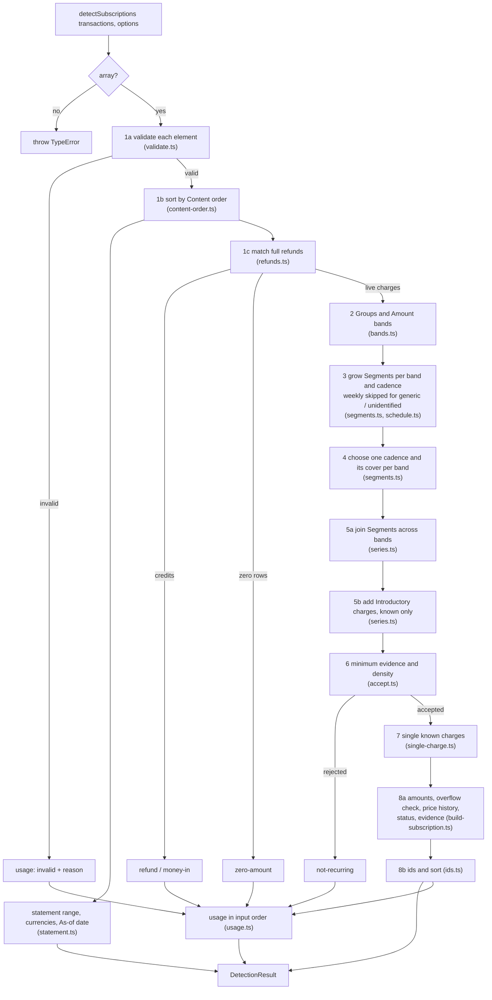

# Design Document: subscription-detector

## Overview

`subscription-detector` turns the normalized transactions of one statement into `Subscription`s: the recurring charges the web UI shows as undead cards. It lives in `packages/core/src/detect` and is exported from `@zombills/core`. Like the parser and the normalizer, it is synchronous and pure: no network, no DOM, no clock, no randomness, no logging, no runtime dependencies.

One call to `detectSubscriptions` runs the eight steps of Req 3.10, in that order, and no step revisits an earlier one:

1. **Validate and refund.** Check every element (Req 2.1), sort the valid ones by Content order, and match full refunds (Req 2.4–2.5).
2. **Group and band.** Group Charges by `merchant.key` and `currency`; split each Group into Amount bands (Req 3.1–3.2).
3. **Segments.** Per band and per allowed cadence, grow candidate Segments (Req 4).
4. **Cover.** Per band, choose one cadence and its Segments (Req 3.4, 4.7).
5. **Series.** Join Segments across bands on a price change (Req 3.6), then add Introductory charges (Req 3.7).
6. **Accept.** Apply the minimum evidence and the density rule (Req 5.1, 5.6).
7. **Single known charges.** Report one low-confidence Subscription for a `"known"` Group with nothing else reported (Req 5.4).
8. **Build.** Compute amounts, price history, status, evidence and ids (Req 6–9); assemble `usage` and `statement`.

All dates are handled as integer Day numbers; all money is integer cents (`money.md`).

### Design decisions

| Decision | Choice | Reason |
| --- | --- | --- |
| Order independence by construction | Sort the valid transactions once by Content order (position last) in step 1; every later step reads only the sorted array and never looks at input positions | Req 11.3. Every tie-break of the requirements ends in Content order, so a single sort makes every scan, greedy choice and "first" deterministic on the set of transactions. Positions are used only to write `usage` back in input order. |
| Dates as Day numbers | Parse `yyyy-mm-dd` once into `{ y, m, d, day }` with `day` from the days-from-civil formula; all differences are integer subtraction; `addMonths` works on `(y, m)` and clamps the day | Req 7.3 and the Day-number glossary entry. No `Date` object is ever built, so time zones and DST cannot shift a date. |
| Banding without overflow | Test `a − m ≤ (m − m % 20) / 20` instead of `(a − m) × 20 ≤ m` | The two are equivalent for non-negative integers, and the left form never leaves the safe-integer range, even for `amountCents` near `Number.MAX_SAFE_INTEGER`. |
| Segments by a greedy sweep | Per band and cadence, take the earliest unused charge in Content order, grow one chain from it with a fixed successor preference, keep its longest valid prefix, repeat | Req 11.14 forbids subset enumeration and asks for a `c × b²` comparison bound. The sweep gives `c = 24` (see Comparison bound) and reproduces every example in Req 3.4, 3.11 and 4.8. It is maximal, not always maximum; Req 3.4 describes it (Design review decision 1). |
| Late charges valid by construction | After a late charge, the only successors tried are the two continuations Req 4.6 allows | The chain never needs lookahead or backtracking to check that a late charge is legal. |
| One pass per step | Joins, introductory charges, acceptance and single-charge reporting each run once over the step's input | Req 3.10's "no step revisits". A rejected Series is never split or re-chosen. |
| No floats | The only division is the exact `(m − m % 20) / 20`; yearly cost is one multiplication checked with `Number.isSafeInteger` | `money.md`, Req 6.2, 6.5. |
| Errors | `TypeError` only for a non-array `transactions`; every other input problem becomes a `usage` entry with role `"invalid"` | Req 1.13. No blanket `try/catch`, which would hide the bugs P1 is there to find. |
| Comparison counter | An internal `detectSubscriptionsCounted(transactions, options, counter)` that the public function calls with no counter; the counter is a per-call object, not module state | Req 11.14, 12.5. |
| Module format | Same as the parser and normalizer: ES modules under `module: NodeNext`, `.js` on every relative import | The Reaper loads `dist/index.js` from plain Node. |

---

## Architecture

The flow follows Req 3.10 step for step. Each box names the file that owns it.



Steps 2–5 run independently per Group, and steps 3–4 independently per band. Nothing crosses a Group boundary except the Statement range and the As-of date, which are computed from all valid transactions before step 2.

---

## Module layout

All paths are relative to `packages/core/src/detect/`. File names are kebab-case and constants are `SCREAMING_SNAKE_CASE` (`structure.md`).

| File | Responsibility | Exported from package root? |
| --- | --- | --- |
| `index.ts` | Public barrel: `detectSubscriptions` and the public types | yes (via `packages/core/src/index.ts`) |
| `types.ts` | Public types (Req 1.1–1.8, 9.1) | yes |
| `internal-types.ts` | `Entry`, `CivilDate`, `Band`, `Segment`, `Interval`, `Series`, `ComparisonCounter`, `Assigned` | no |
| `dates.ts` | `parseIsoDate`, `dayNumber`, `fromDayNumber`, `daysInMonth`, `isLastDayOfMonth`, `addMonths`, `formatDate` | no |
| `cadence-rules.ts` | `TOLERANCE_DAYS`, `MIN_GAP_DAYS`, `ENDED_GRACE_DAYS`, `LATE_MIN_DAYS`, `LATE_MAX_DAYS`, `MAX_K`, `WINDOW_DAYS`, `addPeriods` | no |
| `validate.ts` | `validateElement`: Req 2.1 checks, returns an `Entry` or a reason | no |
| `content-order.ts` | `compareContent` (Content order, position last) | no |
| `statement.ts` | `buildStatementInfo`, `resolveAsOf` (Req 1.4, 7.1–7.2) | no |
| `refunds.ts` | `matchRefunds` (Req 2.4–2.7) | no |
| `bands.ts` | `groupCharges`, `splitIntoBands` (Req 3.1–3.2) | no |
| `schedule.ts` | `expectedDays`, `deviation`, `classifyStep` (Req 4.2–4.3, 4.6) | no |
| `segments.ts` | `growChain`, `longestValidPrefix`, `coverBand`, `chooseBandCover` (Req 3.4, 3.10 steps 3–4, 4.4, 4.7) | no |
| `series.ts` | `joinSegments`, `addIntroCharges` (Req 3.5–3.8) | no |
| `accept.ts` | `meetsMinimum`, `densityCount`, `acceptSeries` (Req 5.1–5.2, 5.5–5.6) | no |
| `single-charge.ts` | `reportSingleKnownCharges` (Req 5.4) | no |
| `build-subscription.ts` | `buildSubscription`: amounts, overflow, `priceHistory`, status, evidence, charge copies (Req 6, 7, 9) | no |
| `ids.ts` | `assignIds`, `sortSubscriptions` (Req 1.11, 8) | no |
| `usage.ts` | `buildUsage` (Req 1.8–1.10) | no |
| `detect-subscriptions.ts` | `detectSubscriptions` (public), `detectSubscriptionsCounted` (internal) | `detectSubscriptions` only |
| `test-arbitraries.ts` | fast-check generators (valid transactions, monthly / weekly / yearly series, habits, junk elements) | no; excluded from build |
| `test-fixtures.ts` | Builders for hand-written fixture rows (`charge("2026-01-15", 999, "merchant:gym")`) | no; excluded from build |
| `*.test.ts`, `*.property.test.ts` | Co-located tests | no; excluded from build |
| `no-network.test.ts`, `node-env.test.ts` | Req 12 checks | no |

`packages/core/src/index.ts` gains `export * from "./detect/index.js";`. `types.ts` imports `NormalizedTransaction` and `MerchantSource` from `../normalize/types.js` and does not re-export them, so there is no duplicate export. The build `tsconfig` already excludes `**/*.test.ts`, `**/*.property.test.ts` and `**/test-*.ts`.

---

## Public types (`types.ts`)

```ts
import type { MerchantSource, NormalizedTransaction } from "../normalize/types.js";

export type Cadence = "weekly" | "monthly" | "yearly";
export type SubscriptionStatus = "active" | "ended";
export type Confidence = "high" | "medium" | "low";

export interface DetectOptions {
  /** ISO yyyy-mm-dd; ignored when absent or not a real date (Req 7.1–7.2) */
  asOf?: string;
}

export interface PricePoint {
  date: string;
  amountCents: number;
}

export interface StatementInfo {
  firstDate: string | null;
  lastDate: string | null;
  asOf: string | null;
  asOfSource: "option" | "statement" | null;
  /** Distinct currencies of all valid transactions, code-unit ascending */
  currencies: string[];
}

export interface DetectionEvidence {
  regularChargeCount: number;
  firstChargeDate: string;
  lastChargeDate: string;
  nextExpectedDate: string;
  missedPeriods: number;
  lateChargeDates: string[];
  cadenceAssumed: boolean;
  introCharge: PricePoint | null;
  freeTrialDate: string | null;
  startedInStatement: boolean;
  partialRefunds: PricePoint[];
}

export interface Subscription {
  id: string;
  merchant: string;
  merchantKey: string;
  serviceId: string | null;
  source: MerchantSource;
  currency: string;
  cadence: Cadence;
  /** Series charges, oldest first; copies of the 4 + 5 fields only (Req 1.12) */
  charges: NormalizedTransaction[];
  currentAmountCents: number;
  yearlyCostCents: number;
  /** Always [] from the Detector; set by the classifier */
  labels: ("zombie" | "possessed" | "trial-trap")[];
  priceHistory: PricePoint[];
  status: SubscriptionStatus;
  confidence: Confidence;
  evidence: DetectionEvidence;
  /** Never set by the Detector (cancel-helper spec) */
  cancel?: { url?: string; email?: string; notes?: string };
}

export type TransactionRole =
  | "subscription-charge" | "refunded-charge" | "refund" | "money-in"
  | "zero-amount" | "not-recurring" | "invalid";

export interface TransactionUsage {
  index: number;
  role: TransactionRole;
  subscriptionId: string | null;
  reason: string | null;
}

export interface DetectionResult {
  subscriptions: Subscription[];
  statement: StatementInfo;
  usage: TransactionUsage[];
}
```

## Internal types (`internal-types.ts`)

```ts
/** A parsed calendar date. `day` is the Day number (days since 1970-01-01, may be negative). */
export interface CivilDate { y: number; m: number; d: number; day: number; iso: string }

/** A valid input element, with its fields read once (Req 1.13). */
export interface Entry {
  index: number;               // input position
  date: CivilDate;
  description: string;
  amountCents: number;
  currency: string;
  merchant: { key: string; displayName: string; source: MerchantSource;
              serviceId: string | null; processor: string | null };
  // processor is validated only as a string (Req 2.1); build-subscription.ts copies it into
  // `charges` with `as ProcessorId | null`, the one cast in the module (review finding 8)
  /** Position in Content order among all valid entries; the only order used after step 1 */
  rank: number;
}

/** Group: same merchant.key and currency. Holds only live charges (not fully refunded). */
export interface Group {
  key: string; currency: string; source: MerchantSource;
  charges: Entry[];            // Content order
  zeroRows: Entry[];           // Content order, for freeTrialDate
  moneyIn: Entry[];            // credits with role "money-in", for partialRefunds
  bands: Band[];               // ascending by lowest amount
}

export interface Band { id: number; low: number; high: number; charges: Entry[] } // Content order

export type StepKind = "on-schedule" | "late";

/** The interval into a charge of a chain. */
export interface Interval { k: 1 | 2; kind: StepKind; deviation: number }

export interface Segment {
  bandId: number;
  cadence: Cadence | null;     // null for a one-charge Segment (Req 3.10 step 4)
  charges: Entry[];            // ascending date, distinct dates
  intervals: Interval[];       // intervals[i] leads into charges[i + 1]
}

export interface Series {
  group: Group;
  cadence: Cadence;
  regular: Entry[];            // ascending date
  intervals: Interval[];       // between consecutive regular charges, including join gaps
  bandIds: number[];           // bands of its Segments, for the density rule
  intro: Entry | null;
  cadenceAssumed: boolean;
  confidence: Confidence;
}

/** Per-call counter for Req 11.14. Absent in production calls. */
export interface ComparisonCounter { comparisons: number }
```

## Function signatures

```ts
// detect-subscriptions.ts
export function detectSubscriptions(
  transactions: readonly NormalizedTransaction[], options?: DetectOptions,
): DetectionResult;
/** Internal; not exported from index.ts. */
export function detectSubscriptionsCounted(
  transactions: readonly unknown[], options: unknown, counter: ComparisonCounter | undefined,
): DetectionResult;

// dates.ts
export function parseIsoDate(value: unknown): CivilDate | null;
export function dayNumber(y: number, m: number, d: number): number;
export function fromDayNumber(day: number): CivilDate;
export function daysInMonth(y: number, m: number): number;
export function isLastDayOfMonth(date: CivilDate): boolean;
export function addMonths(date: CivilDate, k: number): CivilDate;   // any integer k
export function formatDate(y: number, m: number, d: number): string;

// cadence-rules.ts
export function addPeriods(date: CivilDate, cadence: Cadence, k: number): CivilDate;

// validate.ts
export function validateElement(value: unknown, index: number):
  { ok: true; entry: Omit<Entry, "rank"> } | { ok: false; reason: string };

// content-order.ts
export function compareContent(a: Omit<Entry, "rank">, b: Omit<Entry, "rank">): number;

// statement.ts
export function buildStatementInfo(sorted: readonly Entry[], options: unknown): StatementInfo;
export function resolveAsOf(info: StatementInfo): CivilDate | null;

// refunds.ts
export function matchRefunds(sorted: readonly Entry[]):
  { refunded: Set<Entry>; refunds: Set<Entry> };

// bands.ts
export function groupCharges(sorted: readonly Entry[], refunded: ReadonlySet<Entry>,
  refunds: ReadonlySet<Entry>): Group[];          // Groups in Content order of their first entry
export function splitIntoBands(charges: readonly Entry[]): Band[];

// schedule.ts
export function expectedDays(prev: CivilDate, anchor: CivilDate, anchorIndex: number,
  cadence: Cadence, k: 1 | 2): number[];        // forward and anchor expected Day numbers
export function deviation(prev: CivilDate, candidate: CivilDate, expected: readonly number[],
  cadence: Cadence, k: 1 | 2): number;          // min over expected dates and the backward check

// segments.ts
export function coverBand(band: Band, cadence: Cadence, counter?: ComparisonCounter): Segment[];
export function chooseBandCover(band: Band, source: MerchantSource,
  counter?: ComparisonCounter): Segment[];      // multi-charge Segments + one-charge leftovers

// series.ts
export function joinSegments(group: Group, segments: readonly Segment[]): Series[];
export function addIntroCharges(group: Group, series: Series[], leftovers: readonly Entry[]): void;

// accept.ts
export function acceptSeries(series: Series): Confidence | null;   // null = rejected

// single-charge.ts
export function reportSingleKnownCharges(groups: readonly Group[],
  accepted: readonly Series[], asOf: CivilDate): Series[];

// build-subscription.ts
export function buildSubscription(series: Series, statement: StatementInfo,
  asOf: CivilDate): Omit<Subscription, "id"> | null;   // null = overflow (Req 6.5)

// ids.ts
export function assignIds(subs: readonly Omit<Subscription, "id">[], series: readonly Series[]): Subscription[];
export function sortSubscriptions(subs: Subscription[]): Subscription[];

// usage.ts
export function buildUsage(length: number, roles: ReadonlyMap<number, Assigned>): TransactionUsage[];
```

`Assigned` is `{ role: TransactionRole; subscriptionId: string | null; reason: string | null }`. `buildSubscription` runs before `assignIds` because ids depend on the final set of Subscriptions (Req 8.1–8.2).

---

## Component design

### Date arithmetic (`dates.ts`)

**Parsing.** `parseIsoDate` accepts a string matching `^[0-9]{4}-[0-9]{2}-[0-9]{2}$` whose month is 1–12 and whose day is 1 to `daysInMonth(y, m)`. Year `0000` is accepted (proleptic Gregorian, year 0 is a leap year). Anything else returns `null`. It is used for `transaction.date` and `options.asOf`.

**Leap years and month lengths.** `isLeap(y) = (y % 4 === 0 && y % 100 !== 0) || y % 400 === 0`. `daysInMonth` reads a 12-entry table and adds 1 for February in a leap year.

**Day numbers.** `dayNumber(y, m, d)` is the days-from-civil formula, integer operations only:

```
y' = m <= 2 ? y - 1 : y
era = floor(y' / 400)                 // Math.floor on an integer quotient; y' may be -1
yoe = y' - era * 400                  // 0..399
doy = floor((153 * (m + (m > 2 ? -3 : 9)) + 2) / 5) + d - 1
doe = yoe * 365 + floor(yoe / 4) - floor(yoe / 100) + doy
day = era * 146097 + doe - 719468
```

Every intermediate is a small integer and every division is `Math.floor` of an exact integer quotient (the operands are below 2^31), so the result is exact. `fromDayNumber` is the inverse (civil-from-days) and is used only to format computed dates.

**Months after.** `addMonths(date, k)` for any integer `k`:

```
t  = date.y * 12 + (date.m - 1) + k
ny = Math.floor(t / 12);  nm = t - ny * 12 + 1
nd = Math.min(date.d, daysInMonth(ny, nm))
```

This clamps to the last day of a shorter target month, so `addMonths(2026-01-31, 1)` = `2026-02-28`, `addMonths(2024-01-31, 1)` = `2024-02-29` and `addMonths(2024-02-29, 12)` = `2025-02-28`, exactly as in the glossary. `addPeriods(date, cadence, k)` is `day + 7k` for weekly, `addMonths(date, k)` for monthly and `addMonths(date, 12k)` for yearly.

**Formatting.** `formatDate` pads the year to 4 digits and month and day to 2. Computed dates are formatted only for `nextExpectedDate`. Input years are at most 9999, so `nextExpectedDate` can reach year 10000 only for a charge in 9999; it is then formatted with 5 year digits (Design review decision 9). Windows that reach before year 0 (the free-trial window) are compared as Day numbers and never formatted.

### Cadence constants (`cadence-rules.ts`)

| Constant | weekly | monthly | yearly | Source |
| --- | --- | --- | --- | --- |
| `TOLERANCE_DAYS` | 2 | 3 | 7 | Req 4.3 |
| `MAX_K` | 2 | 2 | 1 | Req 4.3 |
| `MIN_GAP_DAYS` | 5 | 25 | 358 | Req 4.3 (anchor rule) |
| `WINDOW_DAYS` (from / to, days after the keyed charge) | 5 / 16 | 25 / 65 | 358 / 373 | derived; see Growing one chain |
| `LATE_MIN_DAYS` / `LATE_MAX_DAYS` | n/a | 4 / 10 | n/a | Req 4.6 |
| `ENDED_GRACE_DAYS` | 2 | 10 | 7 | Req 7.5 |

All are frozen `Readonly<Record<Cadence, number>>` objects.

### Validation (`validate.ts`)

`validateElement` checks, in this order, and returns the first failure as the `reason` (the field name plus what was wrong, for example `"date: not a real calendar date"`, Req 1.10):

1. The element is a plain object: `typeof v === "object"`, not `null`, not an array, and `Object.getPrototypeOf(v)` is `Object.prototype` or `null`.
2. `date` parses with `parseIsoDate`.
3. `description` is a string.
4. `amountCents` passes `Number.isSafeInteger`.
5. `currency` matches `^[A-Z]{3}$`.
6. `merchant` is a plain object; `key` and `displayName` are non-empty strings; `source` is one of the three values; `serviceId` and `processor` are each a string or `null`.
7. Key and source agree (Req 2.1): `"known"` → no `:` in `key` and `serviceId === key`; `"generic"` → `key` starts with `"merchant:"` and `serviceId === null`; `"unidentified"` → `key` starts with `"unidentified:"` and `serviceId === null`.

Each field is read exactly once into the `Entry`, and later steps never touch the input object again. That is what makes Req 1.12 (no mutation, copies only of the 4 + 5 fields) hold, and it keeps a plain-data input from being read twice with different results.

### Content order (`content-order.ts`)

`compareContent` compares `date.day`, then `amountCents` (numeric), then `description`, `merchant.displayName`, `merchant.source`, `merchant.serviceId` (`null` first), `merchant.processor` (`null` first), `currency` and `merchant.key`, each string by code units (`<` / `>`, never `localeCompare`), and only then `index`. The valid entries are sorted once with this comparator, and each gets its `rank`. Because `currency` and `merchant.key` are compared, the global sort depends only on content, and `index` decides only between elements whose four Transaction fields and five `merchant` fields are all equal, as the glossary states (review finding 6; replaces Design review decision 8).

### Statement info and As-of date (`statement.ts`)

- `firstDate`, `lastDate`: the `iso` of the first and last sorted entry, or `null` (Req 1.4, 11.13).
- `currencies`: distinct `currency` values sorted by code units.
- `asOf`: `options` is read only when it is a non-null, non-array object; then `options.asOf` is read once and used when `parseIsoDate` accepts it (`asOfSource: "option"`). Otherwise `lastDate` with `"statement"`, or `null` with `null` (Req 7.1–7.2, 1.14).

### Full refunds (`refunds.ts`)

The entries are partitioned per Group into Charges, Credits and Zero-amount rows. Within each Group, Charges are indexed by `amountCents` in a `Map<number, Entry[]>`, each list in Content order (so ascending date).

Credits are processed in Content order, which is ascending date with ties broken as Req 2.4 asks. For a Credit `r`, the list for `−r.amountCents` is searched for the latest unmatched Charge with `r.day − 45 ≤ c.day ≤ r.day`. A binary search finds the last Charge with `c.day ≤ r.day`; from there the scan follows a per-list "previous unmatched" pointer (each matched Charge links to the unmatched Charge before it), so matched Charges are never rescanned, and stops below `r.day − 45`. Once the latest qualifying date is found, the scan steps back to the first unmatched Charge on that date in Content order, which is the one Req 2.4's tie-break selects (review finding 7). Matched pairs get `"refunded-charge"` and `"refund"`; every other Credit is `"money-in"`; Zero-amount rows are `"zero-amount"` (Req 2.3, 2.5, 2.6). Because the search is per Group, a Credit never matches a Charge of another key or currency (Req 2.7).

Refunded Charges are removed before step 2, so a refunded month is simply absent when Segments are grown and shows up as a `k = 2` interval (Req 2.5, 4.5).

### Groups and Amount bands (`bands.ts`)

`groupCharges` keys Groups by `key + "\u0000" + currency` (neither field can contain NUL after validation of the currency; the key is only used as a map key). Every live Charge, Zero-amount row and `"money-in"` Credit goes to its Group. Validation guarantees that every entry of a Group has the same `source` and `serviceId` (Req 1.6).

`splitIntoBands` implements Req 3.2 on the distinct amounts in ascending order:

```
i = 0
while i < amounts.length:
  m = amounts[i]; q = (m - m % 20) / 20            // floor(m / 20), exact
  j = i; while j + 1 < amounts.length and amounts[j + 1] - m <= q: j++
  band = { low: m, high: amounts[j], charges: charges with amount in [m, amounts[j]] }
  i = j + 1
```

`m % 20` is exact for safe integers and the subtraction leaves an exact multiple of 20, so `q = floor(m / 20)`. For integers, `(a − m) × 20 ≤ m` ⇔ `a − m ≤ floor(m / 20)`. `a − m` is the difference of two non-negative safe integers and is exact, so no intermediate leaves the safe range even for amounts near `Number.MAX_SAFE_INTEGER`. Band examples (`999`/`1029` one band, `999`/`1049` two, `1549`/`1799` two, `99`/`1099` two) are unit tests. Bands get ids `0, 1, …` in ascending order of `low`.

### Schedule rules (`schedule.ts`)

A chain is grown from its first Regular charge `f` (the anchor). For the step from the current charge `a`, with period index `j` (the sum of the `k` values from `f` to `a`) and a trial `k`, the **expected Day numbers** of the next charge are:

| Cadence | From the previous charge (Req 4.2) | Backward check (Req 4.3) | From the anchor (Req 4.3) |
| --- | --- | --- | --- |
| weekly | `a.day + 7k` | same as forward (`a` within 2 days of `b.day − 7k`) | `f.day + 7(j + k)` |
| monthly | `addMonths(a, k)`; also the last day of that month when `a` is the last day of its month | `a` within 3 days of `addMonths(b, −k)` | `addMonths(f, j + k)`; also the last day of that month when `f` is the last day of its month |
| yearly (`k = 1`) | `addMonths(a, 12)` | `a` within 7 days of `addMonths(b, −12)` | `addMonths(f, 12(j + 1))` |

`deviation(b, …)` is the smallest of `|b.day − e|` over the forward and anchor expected dates and `|a.day − addPeriods(b, cadence, −k).day|` for the backward check. `b` is **on schedule** with that `k` when the deviation is at most `TOLERANCE_DAYS[cadence]`, except that an anchor date counts only when `b.day − a.day ≥ MIN_GAP_DAYS[cadence]` (25 monthly, 5 weekly, 358 yearly; Req 4.3).

The backward check differs from the forward rule only when `addMonths` clamps a day near a month end. It rescues a first charge pushed past the end of February (2026-03-01 → 03-27: `addMonths(03-27, −1)` = 02-27, 2 days off; review finding 1) and the matching yearly case (2023-03-07 → 2024-02-28: `addMonths(2024-02-28, −12)` = 2023-02-28, 7 days off). It also accepts a few dates the forward rule would call late, such as 2026-02-25 → 03-31 (`addMonths(03-31, −1)` = 02-28, 3 days off); this is the backward form of the month-end alternative and is accepted as such. Every rule puts `b` at least `MIN_GAP_DAYS` after `a`: the forward and backward rules because `addMonths` moves at least 28 days, the anchor rule by the minimum gap, and a late charge because it is at least 32 days after `a`.

For monthly, `b` is **late** after `a` when `b.day − addMonths(a, 1).day` is 4 to 10 (Req 4.6). Late is measured from the previous charge only, as Req 4.6 states. The two month-end examples of Req 4.8 (`2026-01-31 → 02-28 → 03-31` and `2026-01-30 → 03-02 → 03-30`) are on schedule through the month-end rule and the anchor rule, so they never need the late rule.

### Growing one chain (`segments.ts`, `growChain`)

Input: a band's charges in Content order, a set of charges already used by earlier chains of this cover, a start charge `s`, and a cadence. Same-date charges are never both in one chain: a successor must have a strictly later Day number.

```
chain = [s]; intervals = []; j = 0; lateState = null
loop:
  a = last of chain
  if lateState is null:
     candidates, in preference order:
       1. on schedule with k = 1               (best = smallest deviation, then Content order)
       2. monthly only: late after a           (best = smallest lateness, then Content order)
       3. on schedule with k = 2 (not yearly)  (best = smallest deviation, then Content order)
  else (a is late; p = the charge before a):
     candidates, in preference order:
       1. on schedule after p with k = 2, anchor index j + 1   (schedule continues from p)
       2. on schedule after a with k = 1                       (re-billed from the retry date)
     a late candidate is never considered here, so two late charges are never consecutive
  take the first non-empty preference class; append its best charge with its Interval
  (a late step and the step out of a late charge are recorded as k = 1, kind as found)
  stop when every class is empty
```

Only unused charges whose Day number lies in a candidate window are examined. There are two kinds of window, each a contiguous date range:

- The **previous-charge window** keyed to a chain charge `x` is the fixed range `x + WINDOW_DAYS.from` to `x + WINDOW_DAYS.to` (monthly 25 to 65 days, weekly 5 to 16, yearly 358 to 373). It holds every forward, backward, month-end and late candidate for `k = 1` and `k = 2`, because two calendar months span at most 62 days. A normal step from `a` scans the window keyed to `a`. A step out of a late charge `a` scans the window keyed to `p` (for the `k = 2` continuation) and the window keyed to `a` (for the re-billed continuation).
- The **anchor window** of a normal step runs from the anchor date for index `j + 1` minus the Tolerance to the anchor date for index `j + 2` plus the Tolerance (yearly: index `j + 1` only), one day longer when `f` is the last day of its month; for a step out of a late charge it covers index `j + 1` only. It is clipped below at `a + MIN_GAP_DAYS`.

When the windows of a step overlap they are scanned once as their union; after the billing day has drifted they are scanned separately. A binary search on the band's sorted Day numbers finds each window's first charge; this is not counted as a pairwise comparison. Each charge examined in a window, used or not, counts as one comparison.

**Longest valid prefix.** The finished chain is cut to its longest prefix that has at least 2 charges and satisfies Req 4.4: at least one `k = 1` interval, and no more `k = 2` intervals than `k = 1` intervals. A prefix that ends on a late charge is valid (the late charge is then "the last Regular charge of the Series", Req 4.6). If no prefix qualifies, `s` becomes a leftover and nothing else is consumed.

Examples from the requirements:

- Req 3.4 (Jan 10, Feb 9, Feb 11, Mar 10): from Jan 10, Feb 9 and Feb 11 both deviate by 1 from Feb 10; Content order picks Feb 9. From Feb 9, Mar 10 deviates 1 from Mar 9 and 0 from the anchor date `addMonths(Jan 10, 2)`. Feb 11 then starts its own chain, finds nothing, and is a leftover.
- Req 4.8 gym (Jan 2, Feb 2, Feb 27, Apr 1, May 1): Feb 27 is 3 days before Mar 2 (on schedule, `j = 2`); Apr 1 is 5 days after Mar 27 but 1 day before the anchor date `addMonths(Jan 2, 3)` = Apr 2 (33 days after Feb 27, above the minimum gap; the backward check also passes, `addMonths(Apr 1, −1)` = Mar 1 being 2 days after Feb 27); May 1 is 0 days from `addMonths(Apr 1, 1)`.
- Review finding 1 (generic `999` on 2026-03-01, 03-27, 04-27, 05-27): from 03-01, 03-27 is 5 days before `addMonths(03-01, 1)` and the anchor is 03-01 itself, but the backward check gives 2 days, so the chain is 03-01 → 03-27 → 04-27 → 05-27.
- Req 4.8 retry (Jan 15, Feb 22, Mar 22): no `k = 1` candidate; Feb 22 is 7 days late; from Feb 22, Mar 22 is not on schedule after Jan 15 with `k = 2` (7 days off), but is on schedule after Feb 22 with `k = 1`.
- Req 4.8 (Jan 15, Feb 26, Mar 26): Feb 26 is 11 days late and 17 days before Mar 15, so the chain from Jan 15 is `[Jan 15]` and Jan 15 is a leftover; the chain from Feb 26 is `[Feb 26, Mar 26]`.

### Cover per cadence (`coverBand`)

```
used = ∅; segments = []
for s in band.charges in Content order:
  if s ∈ used: continue
  chain = longestValidPrefix(growChain(band, used, s, cadence))
  if chain has ≥ 2 charges: segments.push(chain); used ∪= chain
leftovers = band.charges \ used     // one-charge Segments, cadence null
```

The sweep is the earliest-start choice of Req 3.4: the first Segment starts at the earliest charge that can start one, each successor is the one with the smallest deviation and then the first in Content order, and the result depends only on the set of charges. It is a greedy cover, not always the maximum one; see Design review decision 1.

Req 3.11 checks:

- Coffee at `450` every Monday with a 3-week gap: the chain from Jan 5 is Jan 5 → Feb 2 (3 days early) → Mar 2. The chains from Jan 12, 19 and 26 reach only `k = 2` steps (Mar 9, 16, 23), so they have no valid prefix and their starts are leftovers; Mar 9, 16 and 23 then find no successor. The cover is the one Segment Jan 5, Feb 2, Mar 2, which step 6 rejects.
- Generic `999` on Jan 1, 8, 15, Feb 1, Mar 1, Apr 1: the chain from Jan 1 takes Feb 1, Mar 1, Apr 1; Jan 8 and Jan 15 find nothing and are leftovers.

### Cadence per band (`chooseBandCover`)

The allowed cadences are monthly and yearly for every source, plus weekly for `"known"` (Req 3.10 step 3). `coverBand` runs once per allowed cadence. The band takes the cadence whose Segments cover the most charges, then the shorter Period (weekly before monthly before yearly), as Req 4.7 states. When no cadence covers any charge, the band has only leftovers. The chosen Segments get that cadence; leftovers stay one-charge Segments with `cadence: null`.

### Comparison bound (Req 11.14)

Every rule that accepts `b` after `a` puts it at least `MIN_GAP_DAYS` after `a` (Schedule rules), so the charges of one chain are at least 25 days apart monthly, 5 weekly and 358 yearly, and the period index `j` strictly increases along the chain. Fix one chain and one charge `y` of the band, and count how often `y` is examined:

- **Previous-charge windows.** `y` lies in the window keyed to `x` only when `x` is 25 to 65 days before `y` monthly (a range of 41 days), 5 to 16 weekly (12 days) or 358 to 373 yearly (16 days). With the minimum gaps, at most 2 chain charges fit in that range monthly, 3 weekly and 1 yearly. A chain charge keys the scan of its own step and, when its successor is late, also the scan of the step out of that late charge, so at most 2 scans monthly and 1 for the other cadences.
- **Anchor windows.** With `A_i` the anchor date for index `i`, a window of a normal step covers `A_{j+1} − t` to `A_{j+2} + t`, and the anchor dates are at least 28 days apart while `t ≤ 3` (weekly: 7 days apart, `t = 2`). If `y` lies between `A_i − t` and `A_{i+1} − t`, it is in the window only when `j + 1` is `i − 1` or `i`. Each `j` belongs to one step, so `y` is in at most 2 anchor windows of a chain (yearly: 1, since its window covers one index; a late step's window also covers one index).

| Per charge `y`, per chain | monthly | weekly | yearly |
| --- | --- | --- | --- |
| previous-charge scans | 2 × 2 = 4 | 3 × 1 = 3 | 1 |
| anchor scans | 2 | 2 | 1 |
| total | 6 | 5 | 2 |

A sweep starts at most `b` chains, so steps 3–4 cost at most `(6 + 5 + 2) × b² = 13 b²` for a band of `b` charges (weekly runs only for `"known"` Groups; the bound covers both).

Joins and introductory charges (next sections) scan the Group's pieces through a binary-searched window. A Group's Series make at most `2p` extension attempts for `p` pieces (each successful attempt consumes a piece, and each Series ends with one failed attempt), each examining at most `p` pieces; the introductory-charge pass examines at most `p` leftovers per Series. A single band has `p ≤ b`, so joins and intros add at most `3 b²`.

The derivation gives `16 b²`. The stated constant is **`c = 24`**: for a band of `b` charges, the counted comparisons of steps 3–5 are at most `24 × b²`, which leaves a margin so that the test does not pin down scan details such as where a union of overlapping windows is split. Sorting (`O(n log n)`) and binary searches are not counted.

### Joins across bands (`series.ts`, `joinSegments`)

The pieces of a Group are the chosen Segments of all its bands plus their one-charge leftovers. They are sorted by the Content order of their first charge, and a second index holds them sorted by first-charge Day number for the window search below. A piece is **consumed** once it has been appended to a Series.

```
series = []
for A in pieces, in order, skipping consumed pieces:
  if A is a one-charge leftover and group.source !== "known": continue   // stays a leftover
  S = A; consumed ∪= {A}
  loop:
    B = best candidate among unconsumed pieces (rules below)
    if none: break
    append B to S (its charges, its intervals, and the join interval); consumed ∪= {B}
  if S has ≥ 2 Regular charges: series.push(S)     // else A stays a leftover
```

`B` is a candidate for the Series `S` built so far (Req 3.6) when:

- `B`'s band differs from the band of the last piece of `S`;
- `B`'s cadence equals `S`'s cadence, or exactly one of them is `null`, in which case the joined Series takes the other's cadence;
- both are `null` (two one-charge pieces) only for `source: "known"`: `g` must be on schedule after `l` with `k = 1`, tried as monthly and then as yearly, and the Series takes the first cadence that fits (Req 3.6, review finding 2; replaces Design review decision 3). Weekly and late are not tried;
- every charge of `B` is dated after every charge of `S`;
- with `l` the last charge of `S` and `g` the first of `B`, either `g` is on schedule after `l` with `k = 1` or `k = 2` (`k = 1` only for yearly) by the previous-charge rule of `schedule.ts`, including the month-end alternative and the backward check, or, for a monthly Series that is not two one-charge pieces, `g` is late after `l` (review finding 11). The anchor rule is not used at a join;
- a late join also needs `l` not to be late itself, and, when `B` has a second charge `g₂`, `g₂` must be on schedule after `l` with `k = 2` or after `g` with `k = 1` (Req 4.6). The join interval is then a late `k = 1` interval, and the interval out of `g` counts as `k = 1` whichever continuation it is, as Req 4.6 states;
- with `p = l.amountCents` and `q = g.amountCents`, `max(p, q) ≤ 2 × min(p, q)` (both are safe integers; `2 × min` is exact in a double and only compared);
- `S` has at least 2 charges, or the source is `"known"`;
- the joined Series still satisfies Req 4.4, with the join interval counted as `k = 1` or `k = 2` (Req 4.5). A join that would break the `k = 2` ≤ `k = 1` rule is not made (Design review decision 4).

Candidates are found by binary search on the first-charge Day numbers: only pieces whose first charge lies in the previous-charge window keyed to `l` for the cadence of `S` (monthly 25 to 65 days after `l`, weekly 5 to 16, yearly 358 to 373), or, while `S` is one charge with no cadence, in the window of each cadence allowed for the Group, are examined (review finding 9). Among candidates, the one whose first charge is earliest wins, then the smaller `|q − p|`, then Content order of the first charge (Req 3.6). Two Series that want the same piece are settled by processing order: the Series whose first piece starts first in Content order takes it (Design review decision 5).

Because a candidate must lie wholly after `S`, two Segments with overlapping spans are never joined and stay two Series (Req 3.5, the iCloud+ and Apple Music example).

Netflix in `us-signed.csv`: the `1549` band gives the Segment 2026-01-02, 02-02 and the `1799` band a leftover 2026-03-02. The leftover is 0 days from `addMonths(02-02, 1)`, `1799 ≤ 2 × 1549`, and the joined Series has one `k = 1` interval more, so they join. Streaming Dienst in `eu-semicolon.csv` is the same with a generic source and a 2-charge `A`.

Review findings 2 and 11 (Req 3.6 examples):

- Netflix `1549` on 01-02 and `1799` on 02-02: two one-charge pieces of a known Group; 02-02 is 0 days from `addMonths(01-02, 1)`, so they join as monthly. `n = 2`, `confidence: "high"`, `priceHistory` 1549 → 1799, id `sub:USD:monthly:*:netflix`. Before this rule, step 7 reported the `1799` charge alone with `cadenceAssumed: true`.
- Netflix `1549` on 01-02, 02-02 and `1799` on 03-07: 03-07 is 5 days after `addMonths(02-02, 1)`, so it joins as a late charge. `n = 3`, `lateChargeDates: ["2026-03-07"]`, `currentAmountCents: 1799`.
- Side effect: Netflix `999` and then `1499` one month later is now a price change, not an Introductory charge, as Req 3.7's "Criterion 6 did not join" already implies for three-charge inputs.

### Introductory charges (`addIntroCharges`)

Only for `source: "known"` (Req 3.7, 3.9). The Series of the Group are processed in Content order of their first Regular charge `r`. For each Series with at least 2 Regular charges, the candidates are the Group's remaining leftovers `c` with `c.amountCents < r.amountCents`, `c` dated before `r`, and `r` on schedule after `c` with `k = 1` by the previous-charge rule (including the month-end alternative and the backward check). The latest candidate wins, then the lower amount, then Content order. It becomes the Series' `intro` and is removed from the leftovers, so a Series has at most one and a leftover is used at most once.

A candidate is a leftover by construction, so it is in no Series and Criterion 6 did not join it. The Introductory charge is not a Regular charge: it adds no interval and does not count towards `n`, Req 4.4 or the status (Req 3.8).

### Minimum evidence and density (`accept.ts`)

`meetsMinimum` implements the Req 5.1 table with `n = regular.length`:

| `source` | Cadence | Accepted when | `confidence` |
| --- | --- | --- | --- |
| `known` | monthly, yearly | `n ≥ 2` | `"high"` |
| `known` | weekly | `n ≥ 3` | `"high"` |
| other | monthly | `n ≥ 3`, or `n = 2` and both amounts equal | `n ≥ 3` → `"high"`, else `"medium"` |
| other | yearly | `n ≥ 2` | `n ≥ 3` → `"high"`, else `"medium"` |
| other | weekly | never (and never produced, step 3) | n/a |

`densityCount` counts `m`: for every band of the Series' Regular charges, the band's live charges dated from the first to the last Regular charge inclusive, found with two binary searches on the band's sorted Day numbers. The Series is rejected when `m ≥ 2n − 1` (Req 5.6). Refunded charges are not in any band, so they are excluded as Req 5.6 asks. The intro's band is not added, because the intro lies before the span; see Design review decision 6.

A rejected Series gives all its charges, including its intro, role `"not-recurring"` (Req 5.5) and is not reconsidered (Req 3.10 step 6). Coffee (Req 3.11): `n = 3`, `m = 6 ≥ 5`, rejected. Generic `999`: `n = 4`, `m = 6 < 7`, accepted. iCloud+ with one app purchase: `n = 3`, `m = 4 < 5`, accepted; with two: `m = 5`, rejected.

### Single known charges (`single-charge.ts`)

For every `"known"` Group with no accepted Series and at least one live charge (Req 5.4): take the charge with the latest date, ties by Content order (so `999` before `1549` on the same date). Its cadence is `"monthly"` when `asOf.day ≤ addMonths(charge, 1).day + 3`, otherwise `"yearly"`. It becomes a Series with one Regular charge, no intervals, `confidence: "low"` and `cadenceAssumed: true`. `asOf` is never `null` here, because the Group has a valid transaction. The Group's other live charges stay `"not-recurring"`. A charge of a rejected Series may be reported here (Req 5.5).

### Amounts and price history (`build-subscription.ts`)

- `currentAmountCents` = amount of the last Regular charge (Req 6.1).
- `yearlyCostCents` = `currentAmountCents × FACTOR[cadence]` with `FACTOR = { weekly: 52, monthly: 12, yearly: 1 }` (Req 6.2). One multiplication of two integers, no division or rounding.
- **Overflow (Req 6.5).** When `Number.isSafeInteger(yearlyCostCents)` is false, `buildSubscription` returns `null`: the Series is not reported and its charges get `"not-recurring"`. If the exact product exceeds `MAX_SAFE_INTEGER`, the rounded double does too, so the check never passes a wrong value. The other money fields are copies of validated safe integers. This check runs in step 8, after step 7, so a dropped `"known"` Series does not fall back to a single-charge report (Req 3.10's "no step revisits"; Design review decision 7).
- `priceHistory`: walk `charges` (intro first, then Regular charges by date) and emit `{ date, amountCents }` for the first charge and for every charge whose amount differs from the previous charge's (Req 6.4).
- `charges`: new objects `{ date, description, amountCents, currency, merchant: { key, displayName, source, serviceId, processor } }` built from the `Entry` (Req 1.12).
- `merchant` = `displayName` of the last charge; `merchantKey`, `serviceId`, `source`, `currency` from the Group (Req 1.6). `labels: []`, no `cancel` (Req 1.7).

### Status (Req 7)

```
next   = addPeriods(lastRegular, cadence, 1)            // monthly: addMonths(last, 1), no month-end variant
status = asOf.day > next.day + ENDED_GRACE_DAYS[cadence] ? "ended" : "active"
```

When the As-of date is before the last Regular charge it is also before `next`, so the formula gives `"active"` and Req 7.8 needs no special case. Example (Req 7.5): last charge 2026-02-20, `next` 2026-03-20, active on 2026-03-30, ended on 2026-03-31. A single known charge uses its assumed cadence, so a 2025-01-10 charge with As-of 2026-03-01 is yearly, `next` 2026-01-10, and ended after 2026-01-17 (Req 7.7).

### Evidence (Req 9)

With `e` the earliest Series charge (the intro when present, else the first Regular charge) and `t = TOLERANCE_DAYS[cadence]`:

| Field | Computation |
| --- | --- |
| `regularChargeCount` | `n` |
| `firstChargeDate`, `lastChargeDate` | first and last Regular charge |
| `nextExpectedDate` | `formatDate` of `next` above |
| `missedPeriods` | number of intervals with `k = 2`, join gaps included (Req 4.5) |
| `lateChargeDates` | dates of Regular charges whose incoming interval is `late`, ascending |
| `cadenceAssumed` | `true` only for step 7 Series |
| `introCharge` | `{ date, amountCents }` of `intro`, or `null` |
| `freeTrialDate` | latest Zero-amount row of the Group with `addPeriods(e, cadence, −1).day − t ≤ day ≤ e.day`, or `null` (binary search on the Group's sorted zero rows) |
| `startedInStatement` | `e.day > addPeriods(firstDate, cadence, 1).day + t` |
| `partialRefunds` | the Group's `"money-in"` Credits with `e.day ≤ day ≤ lastRegular.day + 45`, as `{ date, amountCents }` with the negative amount, in Content order (ascending date) |

The detector reports these facts and never decides a label (Req 9.2).

### Ids (`ids.ts`)

After `buildSubscription`, the reported Subscriptions are grouped by `(merchantKey, currency, cadence)`:

- A group of one gets discriminator `"*"` (Req 8.1).
- In a larger group, each Subscription gets `String(currentAmountCents)`. Subscriptions that share an amount get `"<amount>-<r>"`, where `r` ranks them by first `charges` date, then the list of `charges` dates, then the list of `charges` amounts, compared element by element (a shorter list that is a prefix of a longer one comes first) (Req 8.2).

The id is `"sub:" + currency + ":" + cadence + ":" + discriminator + ":" + merchantKey`. Uniqueness (Req 8.3): within one `(key, currency, cadence)` group, distinct amounts give distinct discriminators and equal amounts get distinct ranks. Equal rank keys would need two Series with the same charge dates and amounts in one Group, and both would have been rejected by the density rule (every charge of one lies in the other's span and band, so `m ≥ 2n`). Everything in the id comes from data, so it is the same for any input order (Req 8.4, 8.5).

`sortSubscriptions` orders by `yearlyCostCents` descending, then `id` by code units (Req 1.11).

### Usage (`usage.ts`)

Roles are assigned to input positions as the steps run: `"invalid"` with its reason in step 1; `"refunded-charge"`, `"refund"`, `"money-in"` and `"zero-amount"` in step 1; `"subscription-charge"` with the id after step 8; every other valid Charge is `"not-recurring"`. `buildUsage` writes one entry per input position in input order (Req 1.8–1.10). An empty input gives empty arrays and `null` dates (Req 1.14).

---

## Error handling

| Case | Behaviour |
| --- | --- |
| `transactions` is not an array | `throw new TypeError("detectSubscriptions: transactions must be an array")` (Req 1.13) |
| Element is not a plain object, or a field fails Req 2.1 | Role `"invalid"`, `reason` naming the first failing field; ignored everywhere else, including the Statement range |
| `options` is `undefined`, `null`, a primitive, an array, or has a missing or invalid `asOf` | Ignored; As-of date from the statement (Req 7.2) |
| Yearly cost not a safe integer | Series unreported, charges `"not-recurring"` (Req 6.5) |
| Sparse array holes | Read as `undefined`, which is not a plain object → `"invalid"` |

No other path throws. The Detector reads each element's fields once, uses only `typeof`, `Object.getPrototypeOf`, `Array.isArray`, `Number.isSafeInteger`, string comparison and integer arithmetic, and never calls a method on an input value, so plain data of any shape cannot make it throw (Req 1.13, 11.1). Getters, proxies and exotic prototypes are outside the guarantee, as Req 1.13 states; the plain-object check rejects objects with a non-`Object` prototype before any field is read.

---

## Privacy and environment

- `src/detect` imports only `../normalize/types.js` (types only, erased at build). No third-party packages.
- No `console.*`. Transaction data never leaves the function's return value.
- `no-network.test.ts` runs the shared syntax-tree scan in `src/test-no-network-scan.ts` over every non-test `.ts` file under `src/detect`, failing on its `FORBIDDEN` list (`fetch`, `XMLHttpRequest`, `sendBeacon`, `WebSocket`, `document`, `window`, `navigator`, `localStorage`) and naming the file, line and identifier (Req 12.1, 12.2, 12.6). The helper gains a second, opt-in check used only by the detector test: the property accesses `Date.now`, `performance.now`, `Math.random` and `crypto.randomUUID`, and a `new Date` expression with no arguments, found on the syntax tree (a `NewExpression` whose callee is `Date` and whose argument list is empty) rather than by word match (Req 12.3, 12.6). The parser and normalizer tests keep calling the existing check unchanged.
- No `Date` object is constructed anywhere, with or without arguments, so time zones cannot affect results (Req 7.3).
- `node-env.test.ts` imports `@zombills/core` under Vitest's Node environment and calls `detectSubscriptions` on a sample (Req 12.4).
- No mutable module-level state (Req 12.5). Module-level values are frozen constant tables. The comparison counter is an argument of the internal entry point, created per call by the test.

---

## Performance

| Step | Cost |
| --- | --- |
| Validate, sort | `O(n)` + `O(n log n)` |
| Refunds | `O(n log n)`: one binary search per Credit; the "previous unmatched" pointers skip matched Charges, so each Credit examines only unmatched Charges in its 45-day window |
| Groups, bands | `O(n log n)` (sorting distinct amounts) |
| Segments and cover | at most `13 b²` counted comparisons per band of `b` charges, plus binary searches |
| Joins, intros | at most `3 p²` per Group of `p` pieces (`p ≤ b` for a single band), plus binary searches |
| Accept, single charges, build, ids | `O(n log n)` |

Realistic statements have bands of 1 to 13 charges, so steps 3–5 are negligible. The Req 11.14 inputs are the worst cases the requirements name: a band of 1,000 equal charges on distinct consecutive days costs at most `24 × 10⁶` comparisons, and in practice far fewer, because each window holds about 41 days of charges. The 2 s budget for 10,000 transactions leaves a wide margin.

---

## Testing strategy

Tools are Vitest and fast-check, with co-located tests (`tech.md`, `structure.md`). Property tests use fast-check's default 100 runs; P1 and P3 use 300.

### Generators (`test-arbitraries.ts`)

- `isoDateArb`: real dates from 2020-01-01 to 2030-12-31, plus a rare branch over 0000–9999 for date-arithmetic properties.
- `merchantArb(source)`: a `MerchantIdentity` that passes Req 2.1 (known: a `KNOWN_SERVICES` id; generic: `merchant:<slug>`; unidentified: `unidentified:<processor|none>:<residue>`).
- `validTxArb`: a `NormalizedTransaction` with `amountCents` from `−10⁶` to `10⁶` (zero included), currency from `USD`, `EUR`, `GBP`.
- `junkElementArb`: `null`, numbers, strings, arrays, objects with missing or wrongly typed fields, a bad date (`2026-02-30`), a lower-case currency, a key that disagrees with its source, a `Symbol`-free `description` of the wrong type.
- `monthlySeriesArb`: anchor day 1–28 (1–31 for P9), start date, 4–24 charges at `addMonths(start, i)` plus a shift of 0–2 days each, one constant amount, source `"known"` or `"generic"`.
- `weeklySeriesArb`: as Req 11.9.
- `yearlyPairArb`: a start `a` and `b = addMonths(a, 12) + s` with `s` from 0 to 7 days (Req 11.9). Shifting both charges independently could add a day when the span crosses 29 February (review finding 4).
- `driftingLateBandArb`: one key and amount; 2–10 interleaved monthly chains starting on consecutive days, each charge 3 days after `addMonths` of the previous one, and every fourth step instead 4–10 days late followed by either continuation of Req 4.6. Used for the comparison counter (P20), so the anchor windows drift away from the previous-charge windows and late steps rescan the window keyed to `p`.
- `habitArb`: generic key, one amount, every 7 or 14 days over 3–26 weeks, shift 0–2 days, and for the 7-day habit random non-consecutive skipped weeks (Req 11.10).
- `unrelatedChargesArb(input)`: Charges with fresh generic keys, currencies and dates taken from the input's range (Req 11.7).

### Correctness properties

| ID | Property | File | Validates |
| --- | --- | --- | --- |
| P1 | Never throws: for arrays of `validTxArb` and `junkElementArb` mixed, and any `fc.anything()` options without getters, `detectSubscriptions` returns a result with `usage.length` equal to the input length; a non-array input throws `TypeError` | `detect-subscriptions.property.test.ts` | 1.13, 11.1 |
| P2 | Deterministic: two calls give deeply equal results | `detect-subscriptions.property.test.ts` | 11.2 |
| P3 | Order independence: for valid inputs (with duplicates and same-date ties forced in), any permutation gives equal `subscriptions` and `statement`, and each element keeps its `role` and `subscriptionId`, except that fully equal elements may swap | `order-independence.property.test.ts` | 2.4, 3.4, 5.4, 8.4, 11.3 |
| P4 | Each charge used once: no element in two `charges` lists; every charge has `amountCents > 0` and the Subscription's key and currency; `charges` ascend with distinct dates; Req 1.9 usage rules both ways; `reason` non-null exactly for `"invalid"` | `detect-subscriptions.property.test.ts` | 1.8–1.10, 11.4 |
| P5 | Yearly cost formula: `yearlyCostCents === currentAmountCents × {52, 12, 1}`; `currentAmountCents` equals the last Regular charge and the last `priceHistory` entry | `amounts.property.test.ts` | 6.1, 6.2, 11.5 |
| P6 | No floats: every money field is a safe integer; `regularChargeCount` and `missedPeriods` are non-negative integers; with amounts near `MAX_SAFE_INTEGER / 12`, unsafe products are never reported | `amounts.property.test.ts` | 6.5, 11.6 |
| P7 | Unrelated purchases: adding `unrelatedChargesArb` leaves `subscriptions` deeply equal and gives each added Charge `"not-recurring"` | `detect-subscriptions.property.test.ts` | 11.7 |
| P8 | Missed month: a `monthlySeriesArb` series among unrelated transactions is one monthly Subscription with all its charges; removing any middle charge keeps the id and all other charges, with `missedPeriods: 1` | `cadence.property.test.ts` | 4.3, 4.5, 8.5, 11.8 |
| P9 | Cadence recognition: exact `addMonths` monthly series (anchor 1–31) → monthly; known weekly with shift → weekly; known yearly pair with shift 0–7 → yearly | `cadence.property.test.ts` | 4.1–4.3, 11.9 |
| P10 | Habits: no Subscription with the habit's key | `cadence.property.test.ts` | 5.2, 5.6, 11.10 |
| P11 | Refunds: a full refund of one middle charge of a constant-amount monthly series gives `"refunded-charge"` / `"refund"`, the same id, `missedPeriods` one higher | `refunds.property.test.ts` | 2.4, 2.5, 4.5, 11.11 |
| P12 | Ids: unique, match `^sub:[A-Z]{3}:(weekly\|monthly\|yearly):(\*\|\d+(-\d+)?):.+$`, remainder after the fourth `:` equals `merchantKey` | `ids.property.test.ts` | 8.1–8.3, 11.12 |
| P13 | Statement range: `firstDate`, `lastDate` are min and max valid dates (or `null`); `currencies` sorted distinct; `asOf` follows Req 7.1–7.2 for valid, invalid and absent options | `statement.property.test.ts` | 1.4, 7.1, 7.2, 11.13 |
| P14 | No mutation and exact copies: the input deep-equals its pre-call `structuredClone`; each `charges` element is a new object whose own keys are exactly the 4 + 5 fields, equal to the source element's; extra input properties are absent | `detect-subscriptions.property.test.ts` | 1.12 |
| P15 | Date arithmetic: `fromDayNumber(dayNumber(d))` round-trips over 0000–9999; consecutive dates differ by 1; `addMonths` equals a reference that counts months one at a time and clamps the day; known values (`1970-01-01` → 0, `2000-03-01` → 11017) | `dates.property.test.ts` | glossary (Day number, Months after), 7.3 |
| P16 | Bands: bands partition the distinct amounts; for each band `20 × (high − low) ≤ low` (checked with `BigInt`); the next band's `low` fails that test against the previous band's `low` | `bands.property.test.ts` | 3.2 |
| P17 | Price history: never empty; first entry is the first Series charge; consecutive entries differ in amount; every entry is a Series charge; a constant-amount series has one entry | `amounts.property.test.ts` | 6.4 |
| P18 | Status: with a random valid `asOf`, `status === "ended"` exactly when `asOf > nextExpectedDate + grace`; `nextExpectedDate` is one Period after `lastChargeDate`; an `asOf` before the last Regular charge gives `"active"` | `status.property.test.ts` | 7.4, 7.5, 7.8 |
| P19 | Zero rows: adding Zero-amount rows dated inside the Statement range changes nothing in `subscriptions` except `evidence.freeTrialDate`, and every added row is `"zero-amount"` | `detect-subscriptions.property.test.ts` | 2.3, 9.5 |
| P20 | Comparison counter: for any single-Group, single-band input of `b` charges (from `driftingLateBandArb`, `monthlySeriesArb` with one amount, or random dates at one amount, for known and generic sources), `detectSubscriptionsCounted` gives `counter.comparisons ≤ 24 × b²` | `performance.property.test.ts` | 11.14 |

P8 also covers review finding 1: with anchor day 27 or 28 and a shift of 2, the first charge can land in early March and stays in the Series through the backward check.

The comparison bound (Req 11.14) is checked by `performance.test.ts` as well as by P20: it calls `detectSubscriptionsCounted` with bands of 100 and 1,000 charges of known and generic sources, of two shapes, and asserts `counter.comparisons ≤ 24 × b²` for each. The first shape is equal charges on consecutive days. The second is the drifting and late-step band: 10 interleaved monthly chains starting on 10 consecutive days, each charge 3 days after `addMonths` of the previous one and every fourth step 7 days late, so the previous-charge and anchor windows are scanned separately and late steps take the extra scan. The same file times the two 10,000-transaction inputs of Req 11.14 (1,000-charge band plus filler, and a year of weekday lunches at `1050` plus filler) against the 2 s bound after one warm-up call; timing uses `performance.now()` in the test file only.

### Example-based unit tests

| File | Cases | Validates |
| --- | --- | --- |
| `dates.test.ts` | Leap years (1900, 2000, 2024, 2026); glossary `addMonths` examples; negative `k`; year 0000; `parseIsoDate` rejects `2026-02-29`, `2026-13-01`, `26-01-01`, `2026-1-1` | glossary, 2.1 |
| `validate.test.ts` | One case per Req 2.1 check, with the expected `reason` field name; key/source disagreement for each source | 1.10, 2.1 |
| `content-order.test.ts` | Each comparison level in turn, including `currency` and `merchant.key` before position; `null` before strings, code-unit order (`"Z" < "a"`) | glossary Content order |
| `refunds.test.ts` | 0 and 45 days inclusive, 46 excluded; latest charge matched; on the latest date, the first unmatched charge in Content order is matched; many identical same-day charges and credits; one credit per charge; partial refund → `"money-in"`; R2.7 order/refund keys | 2.4–2.7 |
| `bands.test.ts` | Req 3.2 examples; amounts near `MAX_SAFE_INTEGER` | 3.2 |
| `schedule.test.ts` | Month-end alternative; anchor dates; backward check (2026-03-01 → 03-27 on schedule; 2023-03-07 → 2024-02-28 yearly on schedule; Req 4.8 rows 01-15 → 02-26 and Greenleaf 01-05 → 03-09 still off); anchor rule refused below the minimum gap (Req 4.3 example, 04-10 → 04-28) and accepted at exactly 25 days; late window 4 and 10 days in, 3 and 11 out | 4.2, 4.3, 4.6 |
| `segments.test.ts` | Longest valid prefix cut; same-date charges; cadence choice by coverage then shorter Period; weekly skipped for generic | 3.10, 4.4, 4.7 |
| `series.test.ts` | Join tie-breaks; ratio exactly 2 joins, just above does not; generic one-charge `A` does not join; known one-charge pieces join as monthly, as yearly when 12 months apart, and not when 2 months apart or on the same date; generic one-charge pieces never join; late join at 4 and 10 days, refused at 11, refused after a late `l`, refused when `B`'s second charge fits neither continuation; join that breaks Req 4.4 refused; intro tie-breaks | 3.5–3.8 |
| `build-subscription.test.ts` | `freeTrialDate`: a zero-amount row exactly at `addPeriods(e, cadence, −1)` minus the Tolerance is used, one day earlier is not. `startedInStatement` with `firstDate` 2026-01-02: a Series starting 02-05 (`addMonths` + 3 days) gives `false`, 02-06 (+ 4 days) gives `true`. `partialRefunds`: a `"money-in"` Credit at the last Regular charge + 45 days is included, + 46 days is excluded. `processor` copied with the cast | 9.5, 9.6, 9.7 |
| `accept.test.ts` | Every Req 5.1 row at and below its minimum; density at `2n − 2` kept and `2n − 1` rejected | 5.1, 5.5, 5.6 |
| `single-charge.test.ts` | Monthly/yearly boundary at `addMonths + 3`; refunded charges excluded | 5.4 |
| `ids.test.ts` | `*`; amount discriminators; `-r` ranks; sort order | 1.11, 8 |
| `no-network.test.ts`, `node-env.test.ts` | As in Privacy | 12 |

### Fixture tests (`fixtures.test.ts`)

Every example table and named example in the requirements is a fixture with the full expected result (roles, Subscriptions and the evidence fields the row names). Dates are 2026 unless stated; amounts in cents; one Group per row unless stated.

| Source | Input | Expected |
| --- | --- | --- |
| Req 2.7 | `ONLINE MARKETPLACE ORDER` `2347` on 02-14, `REFUND` `−2347` on 02-17, different keys | order `"not-recurring"`, refund `"money-in"` |
| Req 3.4 | generic `999` on 01-10, 02-09, 02-11, 03-10 | Series 01-10, 02-09, 03-10; 02-11 `"not-recurring"` |
| Req 3.5 | unidentified Apple key: `99` and `1099` monthly 01-12 to 03-12 | two Subscriptions, ids `…:99:…` and `…:1099:…` (also Req 8.2) |
| Req 3.6 | Netflix `1549` 01-02, 02-02, `1799` 03-02 | one Series, price history 1549 → 1799 |
| Req 3.6 | Netflix `1549` 01-02, `1799` 02-02 (two one-charge pieces) | one monthly Series, `confidence: "high"`, `cadenceAssumed: false`, price history 1549 → 1799, id `sub:USD:monthly:*:netflix` |
| Req 3.6 | Netflix `1549` 01-02, 02-02, `1799` 03-07 (late price change) | one Series, `lateChargeDates: ["2026-03-07"]`, `currentAmountCents: 1799`, price history 1549 → 1799 |
| Req 3.6 | generic supermarket `5430` 01-10, `6118` 02-10 | no Subscription |
| Req 3.7 | Netflix `100` 01-10, `1499` 02-10, 03-10 | `introCharge` `{01-10, 100}`, `n = 2` |
| Req 3.7 | unidentified Apple key `199` 01-10, `1099` 02-10, 03-10 | `introCharge: null`; 01-10 `"not-recurring"` |
| Req 3.11 | both rows | as in the table |
| Req 4.8 | all 12 rows | as in the table |
| Req 5.4 | Netflix `1549` and `999` on 03-01 | one low Subscription for the `999` charge, either input order |
| Req 5.6 | iCloud+ `99` × 3 plus one app purchase at `99` | kept, `m = 4` |
| Req 5.6 | iCloud+ `99` × 3 plus app purchases on 01-20 and 02-25 | no Subscription; 5 `"not-recurring"`. The sweep builds two Segments: 01-12, 02-12, 03-12 (`n = 3`, `m = 5`) and 01-20, 02-25 (02-25 late by 5 days; `n = 2`, `m = 3 = 2n − 1`); density rejects both (review finding 10) |
| Req 7.5 | monthly, last charge 02-20; `asOf` 03-30 and 03-31 | `"active"`, then `"ended"` |
| Req 7.7 | known single charge 2025-01-10, statement ending 2026-03-01 | yearly, `"ended"` |
| Req 9.8 | Amazon Prime `13900` on 03-20, statement ending 03-31 | monthly, `yearlyCostCents: 166800`, `cadenceAssumed: true` |
| Req 9.8 | Netflix `1549` on 01-02, statement ending 03-25 | yearly, `"active"`, `cadenceAssumed: true` |
| Intro, 4-weekly | NYT `2500` every 28 days 01-01 to 12-31 | monthly, `yearlyCostCents: 30000` |
| Intro, cadences | fortnightly generic; quarterly generic (Req 4.8 last row) | no Subscription |
| Intro, cadences, known | quarterly Netflix `1549` on 01-15, 04-15, 07-15, range to 07-20 | no Series; one low-confidence single-charge Subscription for 07-15 (Req 5.4, Introduction) |
| Intro, two accounts | generic `1099` monthly on the 5th and on the 20th | no Subscription |
| Intro, two accounts, known | Spotify `1099` monthly on the 5th and on the 20th | one low-confidence single-charge Subscription (Req 5.4, Introduction) |
| Intro, replaced service | unidentified Apple `1099` 2025-11-10 to 2026-01-10, `999` 02-10 to 04-10 | one Series, price history 1099 → 999 |
| Intro, converted currency | generic GBP `775` 01-15, `821` 02-15, `798` 03-15 | no Subscription |
| Intro, short statement | generic Fitzone `2499` on 01-10 only, range 01-01 to 01-31 | `subscriptions: []` |
| Intro, id stability | Apple Music `1099` next to iCloud+ `99`, then a second run with Apple Music at `1199` | id changes from `…:1099:…` to `…:1199:…` |
| Intro, id stability | Netflix single charge 01-02, range to 03-25; second run adding 02-02 and 03-02 | id changes from `…:yearly:*:netflix` to `…:monthly:*:netflix` |

### Sample tests (`samples.test.ts`)

For each of `us-signed.csv`, `uk-debit-credit.csv`, `eu-semicolon.csv` and `with-preamble.csv`: read the file, run `parseStatement` (no options), `normalizeTransactions`, then `detectSubscriptions` (no options), and compare with the Req 10.1 tables: the Subscriptions in order with every listed field, the shared fields of Req 10.1 (cadence, status, confidence, 3 Regular charges, empty evidence lists, id form), the Statement range, and the usage counts per role. The named non-recurring merchants are checked by key. The sample files are never edited to make this test pass (Req 10.2).

---

## Design review decisions

These are the places where the design narrows or interprets a requirement. Design review 1 (`review-design-1.md`) decided each one; the status is given in brackets, and accepted amendments are carried into `requirements.md`.

1. **[Accepted; Req 3.4, 3.10 step 4 and 4.7 now describe the sweep] Greedy cover instead of a maximum cover (Req 3.4, 3.10 step 4, 11.14).** The earliest-start sweep applies Req 3.4's preferences (earliest start, smallest deviation, Content order) at each step of a chain rather than across whole covers. The sweep can cover fewer charges than the maximum. Example: generic `999` on 01-01, 02-01, 02-03 and 03-03. The sweep gives one Series 01-01, 02-01, 03-03 and leaves 02-03 `"not-recurring"`. The maximum cover is 01-01, 02-01 plus 02-03, 03-03 (4 charges), which would report the same plan twice as `…:999-1:…` and `…:999-2:…`. An exact maximum cover with the anchor and late rules would need search over chain combinations, which Req 11.14 rules out.
2. **[Accepted; Introduction amended] Single known charges after a rejection (Req 5.4 against the Introduction).** Req 5.4 reports the latest charge of any `"known"` Group with no Series accepted in step 6. So two Spotify accounts at the same price give one low-confidence single-charge Subscription, and a quarterly Netflix plan gives one for its latest charge. Req 9.8 keeps the guessed yearly cost out of any saving.
3. **[Rejected; replaced by review finding 2] Two one-charge pieces never join.** Known one-charge pieces in different bands now join when the second is one Period after the first, trying monthly and then yearly (Req 3.6; Joins across bands).
4. **[Accepted] A join must keep Req 4.4 true (Req 3.6, 4.5).** The join gap counts as `k = 1` or `k = 2`. A join that would leave more `k = 2` intervals than `k = 1` intervals is not made, so every Series meets Req 4.4 without a later check. A refused join leaves `B` free for other Series.
5. **[Accepted] What "A" means when joining repeats, and join conflicts (Req 3.6).** `A` is the Series built so far: its last charge gives `p` and the Tolerance check, and "at least 2 charges" counts the whole Series so far. The anchor rule is not used at a join; the late rule is, for monthly Series (review finding 11). When two Series could take the same piece, the Series whose first piece comes first in Content order takes it. The same rule settles Introductory charges between two Series of one `"known"` Group (Req 3.7).
6. **[Accepted; Req 5.6 amended] Density counts the bands of Regular charges (Req 5.6).** Req 5.6 now says "any Amount band of its Regular charges". The Introductory charge lies before the span, and the charges of its band inside the span (other cheap purchases of a known service) are not counted.
7. **[Accepted; Req 5.4 amended] Overflow is checked in step 8 (Req 6.5, 3.10).** A Series dropped because its yearly cost is not a safe integer does not fall back to a single-charge report in step 7, because step 7 has already run; Req 5.4 now says "no Series accepted in step 6". This only affects amounts above the parser's limit.
8. **[Rejected; replaced by review finding 6] Content order and `merchant.key` / `currency`.** `compareContent` now compares `currency` and `merchant.key` before position, and the glossary lists them.
9. **[Accepted] Dates outside 0000–9999.** `nextExpectedDate` one Period after a charge in 9999 is formatted with a 5-digit year (`10000-01-15`), the only way to state that date. Windows before year 0000 are compared as Day numbers and never formatted.
10. **[Accepted with the wording fix; Req 3.4 now states the order] Successor preference inside a chain (Req 4.3, 4.6).** When several steps are possible from a charge, an on-schedule `k = 1` step is taken before a late step, and a late step before a `k = 2` step. Continuation 1 after a late charge is the same test as the `k = 2` class, so preferring the late step never loses a charge. The order does not keep both `missedPeriods` and `lateChargeDates` minimal: a late step trades one missed period for one late date. A late charge is measured from the previous Regular charge only, as Req 4.6 states.
11. **[Accepted] Window formulas for evidence (Req 9.5, 9.6).** "One Period plus Tolerance before `e`" is `addPeriods(e, cadence, −1)` minus the Tolerance, and "more than one Period plus Tolerance after `firstDate`" is `e.day > addPeriods(firstDate, cadence, 1).day + Tolerance`. For monthly cadence these use calendar months, matching Req 4.2.
12. **[Re-derived per review finding 3] Comparison bound constant (Req 11.14).** With the minimum gap of Req 4.3 and the late-state windows counted, the derivation gives `16 b²` and the design states `c = 24` for steps 3–5 on a single band (Comparison bound). Binary searches on sorted Day numbers are not counted as pairwise comparisons.
