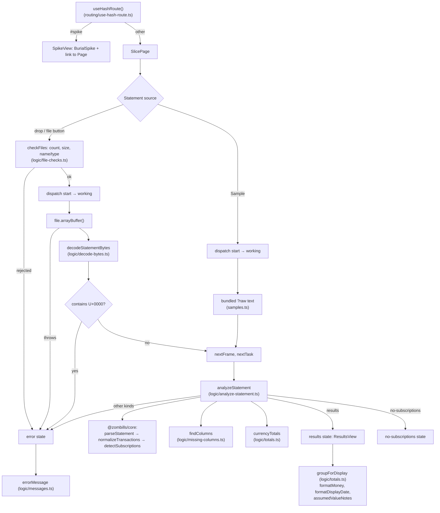

# Design Document: vertical-slice

## Overview

`vertical-slice` replaces the art spike at the site root with the first working Zombills page. The user drops a CSV, picks one with the file button, or chooses one of the four bundled Samples. The page reads the bytes in the browser, decodes them, runs `parseStatement` → `normalizeTransactions` → `detectSubscriptions` from `@zombills/core`, and shows a plain list of subscriptions grouped by currency with a yearly total per currency. The spike stays reachable at `#spike`.

The design splits the work into two layers:

1. **Pure logic** (`apps/web/src/slice/logic/`): the Analyzer, byte decoding, file checks, error messages, Assumed-value notes, Currency totals, display ordering, the Money formatter and the date formatter. No React, no DOM, no storage, no clock. This layer carries all the property tests.
2. **React view** (`apps/web/src/slice/`): one `useReducer` holding the Page state, a hash-route hook that picks the Page or the Spike, and a few small components. The view owns file reading, the paint delay before analysis, focus moves and the live region.

`packages/core` changes only as Requirement 11 states: more header names, priority order for the description column, two exported empty-input constants, and the header lists exported from the package root.

### Design decisions

| Decision | Choice | Reason |
| --- | --- | --- |
| Routing | A `useHashRoute()` hook that reads `location.hash` and listens to `hashchange`; `"#spike"` gives the Spike, anything else the Page | Req 1.1–1.5. One route needs no router library, and the hash needs no Netlify rewrite. |
| State | One `useReducer` over a discriminated `PageView` union plus a `runId` counter | Req 4.1 (exactly one state). `tech.md` forbids state libraries. The `runId` drops a late result from a run the user has already left (Start again, StrictMode double effects). |
| Statement text lifetime | The text is a local variable of one async `runAnalysis` call and is never put in React state | Req 7.5. Once the call returns, nothing references the text. The reducer keeps only the Analysis outcome, which Start again or a new statement replaces. |
| Samples | Imported with Vite's `?raw` suffix from `samples/*.csv` | Req 2.3, 9.4. The text is bundled into the JS at build time, so choosing a Sample makes no request. The same imports work under Vitest. |
| Money formatting | Build the exact decimal string `"<units>.<cc>"` with integer arithmetic and pass that string to `Intl.NumberFormat.prototype.format` | Req 6.1, 6.3, 6.6. `format` accepts decimal strings exactly (Intl.NumberFormat v3, in Node 24 and every current browser), so no float division can lose a cent. The value shown is still `minorUnits / 100`. |
| Date display | A fixed English month-name table applied to the `yyyy-mm-dd` parts; no `Date` object | Req 5.8. Nothing depends on the time zone or the clock. |
| Totals overflow | Add one Counted subscription at a time and throw `RangeError` as soon as the sum is not a safe integer | Req 5.11a. Every `yearlyCostCents` is non-negative, so the running sum only grows and the first unsafe step is detected. |
| Paint before analysis | `await nextFrame()` (one `requestAnimationFrame`) then `await nextTask()` (one `setTimeout(…, 0)`) before calling the Analyzer | Req 3.8. The browser paints `Reading <name>…` before a large statement blocks the main thread. |
| CSP | A Vite plugin `cspPlugin()` with `apply: "build"` that inserts the `<meta http-equiv>` tag straight after `<meta charset>` | Req 7.6. The dev server keeps hot reload; the built page is locked down. |
| Motion | One `FadeIn` wrapper (Framer Motion `motion.div`, opacity only, 150 ms) around each state's content | Req 8.7. Opacity-only motion is already the reduced-motion form; `useReducedMotion` sets the duration to 0 when reduced motion is on, so the rule holds whatever the wrapper later grows into. |
| DOM test environment | jsdom, opted in per file with `// @vitest-environment jsdom`; the default environment stays `node` | Req 10.1. The pure-logic and property tests run in plain Node, which is faster and proves the logic has no DOM dependency. Vitest's jsdom environment sets `pretendToBeVisual`, so `requestAnimationFrame` exists. |
| E2E server | Playwright `webServer` runs `vite preview` on the built `dist` | Req 10.5, 9.5. `vite preview` is a plain static file server over `dist`. |

---

## Architecture



The checks that need no read (count, size, name and type) run synchronously on the drop or change event. A file they reject goes straight to `error` with a `reject` action and never enters `working`, so there is no `Reading…` flash for it and no `runId` is spent. Every file that passes, and every Sample, enters `working` with a `start` action before anything asynchronous happens (Req 2.4). The read, the decode and the NUL check then run, then the paint delay, then the Analyzer.

### Run lifecycle

```mermaid
sequenceDiagram
    participant U as User
    participant P as SlicePage
    participant R as reducer
    participant A as analyzeStatement
    U->>P: drop / pick / Sample
    P->>P: checkFiles (files only)
    P->>R: start(n, sourceName) → working
    P->>P: read, decode, NUL check (files only)
    P->>P: await nextFrame(); await nextTask()
    P->>A: analyzeStatement(text)
    A-->>P: AnalysisOutcome
    P->>R: finish(n, outcome) or fail(n, error)
    Note over R: ignored unless runId === n and view is working
    R-->>P: results / no-subscriptions / error
    P->>P: focus state heading, live region text
```

---

## Module layout

Paths are relative to `apps/web/`. New files are kebab-case (`structure.md`). The existing `src/App.tsx` and `src/main.tsx` keep their names to avoid churn in files the spike already uses.

| File | Responsibility | Req |
| --- | --- | --- |
| `index.html` | Title becomes `Zombills`; adds `<link rel="icon" href="data:,">` so the browser never requests `/favicon.ico` (allowed by `img-src 'self' data:`); no CSP tag | 7.1, 7.6, 10.5 |
| `vite.config.ts` | Plugins `react()`, `tailwindcss()`, `cspPlugin()`; `build.assetsInlineLimit: 0`; `build.modulePreload: { polyfill: false }`; Vitest `test` block | 7.6, 7.7, 10.1 |
| `csp-plugin.ts` | `CSP_POLICY`, `injectCsp(html)`, `cspPlugin()` | 7.6 |
| `csp-plugin.test.ts` | `injectCsp` places the tag after `<meta charset>` and before every `<script>` and `<link>` | 7.6 |
| `vite-config.test.ts`, `netlify-config.test.ts` | Build settings and `netlify.toml` contents | 7.7, 9.3 |
| `playwright.config.ts` | Chromium only, `webServer: vite preview`, `locale: "en-US"`, `timezoneId: "UTC"` | 10.5 |
| `e2e/demo-path.spec.ts` | The one Playwright test | 10.5 |
| `tsconfig.json` | `lib` gains `"ES2023.Intl"`; `include` gains `csp-plugin.ts`, `csp-plugin.test.ts`, `vite-config.test.ts` and `netlify-config.test.ts`; `e2e` stays out | 6.1 |
| `tsconfig.e2e.json` | `e2e/**`, `playwright.config.ts`, `types: ["node"]` | 10.5 |
| `src/App.tsx` | `App`: `useHashRoute()` → `SlicePage` or `SpikeView` | 1 |
| `src/routing/use-hash-route.ts` | `useHashRoute(): Route` | 1.1–1.3 |
| `src/routing/spike-view.tsx` | `SpikeView`: `BurialSpike` plus a fixed link back to `#` | 1.4 |
| `src/slice/slice-page.tsx` | `SlicePage`: reducer, `runAnalysis`, window drop guard, focus, live region | 2, 3.8, 4, 7.5, 8.3, 8.4 |
| `src/slice/page-state.ts` | `PageView`, `PageModel`, `PageAction`, `pageReducer`, `INITIAL_PAGE_MODEL` | 4.1 |
| `src/slice/drop-zone.tsx` | `DropZone`: drop area, hidden labelled input, file button | 2.1, 2.5, 2.7, 2.8, 8.2 |
| `src/slice/sample-buttons.tsx` | `SampleButtons` | 2.2, 2.7 |
| `src/slice/samples.ts` | `SAMPLES` (label, file name, `?raw` text) | 2.2, 2.3 |
| `src/slice/results-view.tsx` | `ResultsView`: summary, Assumed-value notes, currency groups, totals | 5 |
| `src/slice/subscription-item.tsx` | `SubscriptionItem`: one `li` | 5.3–5.6 |
| `src/slice/no-subscriptions-view.tsx` | `NoSubscriptionsView` | 4.7, 5.1a |
| `src/slice/error-view.tsx` | `ErrorView` | 4.3–4.6, 4.9 |
| `src/slice/fade-in.tsx` | `FadeIn`: opacity-only `motion.div` with `useReducedMotion`; `fadeInMotion(reduced)` returns its `initial`, `animate` and `transition` props | 8.7 |
| `src/slice/frame.ts` | `nextFrame()`, `nextTask()` | 3.8 |
| `src/slice/logic/analyze-statement.ts` | `analyzeStatement`, `AnalysisOutcome`, `GENERIC_FAILURE_REASON` | 3.1–3.7, 3.9 |
| `src/slice/logic/missing-columns.ts` | `findColumns(columns): ColumnPresence` | 3.9 |
| `src/slice/logic/decode-bytes.ts` | `decodeStatementBytes(bytes)` | 3.10 |
| `src/slice/logic/file-checks.ts` | `SIZE_LIMIT_BYTES`, `checkFiles(files)`, `containsNul(text)` | 4.3–4.5 |
| `src/slice/logic/messages.ts` | `PageError`, `errorMessage`, `errorFromOutcome`, `isDateShaped`, `isAmountShaped`, `visibleColumnNames` | 4.3–4.6, 4.12 |
| `src/slice/logic/assumed-values.ts` | `assumedValueNotes(facts)` | 5.1a |
| `src/slice/logic/totals.ts` | `isCounted`, `currencyTotals`, `groupForDisplay` | 5.2, 5.7, 5.11, 5.11a, 5.12 |
| `src/slice/logic/money.ts` | `formatMoney` | 6 |
| `src/slice/logic/display-date.ts` | `formatDisplayDate`, `CADENCE_LABELS` | 5.3, 5.8 |
| `src/slice/logic/announce.ts` | `announcement(view, locale?)`: live-region text per state | 8.3 |
| `src/slice/logic/test-arbitraries.ts` | fast-check generators for the property tests; imported only by tests, so it never reaches the bundle | 10.2 |
| `src/**/*.test.ts(x)`, `*.property.test.ts` | Co-located tests | 10 |

`src/spike/*` is not changed (Req 1.5).

---

## Components and interfaces

### Analyzer (`logic/analyze-statement.ts`)

```ts
import {
  EMPTY_CSV_REASON,
  NO_CONTENT_ROWS_REASON,
  detectSubscriptions,
  normalizeTransactions,
  parseStatement,
} from "@zombills/core";
import type {
  CurrencyInfo,
  DateFormatInfo,
  SignConventionInfo,
  StatementInfo,
  Subscription,
} from "@zombills/core";
import type { ColumnPresence } from "./missing-columns";
import type { CurrencyTotal } from "./totals";

/** Fixed text for a thrown Pipeline error; contains no statement content (Req 3.3). */
export const GENERIC_FAILURE_REASON = "An unexpected problem stopped the statement from being read";

/** What the parser and detector found about the statement as a whole. */
export interface StatementFacts {
  transactionCount: number;
  rowErrorCount: number;
  statement: StatementInfo;
  detectedCurrency: CurrencyInfo;
  detectedDateFormat: DateFormatInfo | null;
  detectedSignConvention: SignConventionInfo | null;
}

export type AnalysisOutcome =
  | { kind: "empty" }
  | { kind: "parse-error"; reason: string }
  | { kind: "columns-unreadable"; columns: string[]; found: ColumnPresence }
  | { kind: "no-transactions"; rowErrorCount: number }
  | ({ kind: "no-subscriptions" } & StatementFacts)
  | ({ kind: "results"; subscriptions: Subscription[]; totals: CurrencyTotal[] } & StatementFacts);

export type ResultsOutcome = Extract<AnalysisOutcome, { kind: "results" }>;
export type NoSubscriptionsOutcome = Extract<AnalysisOutcome, { kind: "no-subscriptions" }>;

/** Runs the Pipeline with no options. Pure and total: never throws (Req 3.1–3.5). */
export function analyzeStatement(csv: string): AnalysisOutcome;
```

The body is one `try` around the Pipeline:

1. `const parsed = parseStatement(csv)`.
2. `status: "error"`: `"empty"` when `parsed.reason` is `EMPTY_CSV_REASON` or `NO_CONTENT_ROWS_REASON`, else `"parse-error"` with `parsed.reason`.
3. `status: "mapping-required"`: `"columns-unreadable"` with a copy of `parsed.columns` and `findColumns(parsed.columns)`.
4. `status: "mapped"` with `transactions.length === 0`: `"no-transactions"` with `rowErrors.length`.
5. Otherwise `detectSubscriptions(normalizeTransactions(parsed.transactions))`. No subscriptions gives `"no-subscriptions"`; one or more gives `"results"` with `subscriptions` exactly as returned (Req 3.4) and `totals: currencyTotals(subscriptions, statement.currencies)`.
6. `catch` returns `{ kind: "parse-error", reason: GENERIC_FAILURE_REASON }` and drops the error object (Req 3.3). This also covers the `RangeError` of `currencyTotals`.

The `try` is the Analyzer's only purpose for catching: it is the trust boundary between arbitrary user files and the UI. Core functions do not throw for string input, so this path exists for bugs, not for expected input.

### Missing columns (`logic/missing-columns.ts`)

```ts
import {
  AMOUNT_HEADERS,
  CREDIT_HEADERS,
  DATE_HEADERS,
  DEBIT_HEADERS,
  DESCRIPTION_HEADERS,
  normalizeHeader,
} from "@zombills/core";

export interface ColumnPresence {
  date: boolean;
  description: boolean;
  /** true when a signed amount column, or both a debit and a credit column, is found */
  amount: boolean;
}

export function findColumns(columns: readonly string[]): ColumnPresence;
```

Each column is compared with `normalizeHeader(column)` against the lists, the same way the parser compares (Req 3.9). When all three flags are true the outcome marks nothing missing, and the message falls back to listing the column names (Req 4.6).

### Byte decoding and file checks (`logic/decode-bytes.ts`, `logic/file-checks.ts`)

```ts
/** Req 3.10: UTF-16 by BOM, else strict UTF-8, else Windows-1252. Never throws. */
export function decodeStatementBytes(bytes: Uint8Array): string;

/** 1 MiB (Req glossary "Size limit"). */
export const SIZE_LIMIT_BYTES = 1_048_576;

/** The parts of a `File` the checks read, so tests can pass plain objects. */
export interface FileFacts {
  name: string;
  type: string;
  size: number;
}

export type FileCheck<F extends FileFacts = File> =
  | { ok: true; file: F }
  | { ok: false; error: Extract<PageError, { kind: "too-many-files" | "too-large" | "not-csv" | "empty-file" }> };

/** Req 4.3–4.5, checked in this order: count, size, name/type, zero bytes. Generic so tests can pass plain objects. */
export function checkFiles<F extends FileFacts>(files: readonly F[]): FileCheck<F>;

/** The name ends in .csv (any case) or the MIME type is text/csv. */
export function looksLikeCsv(file: FileFacts): boolean;

/** Req 4.5: the decoded text contains U+0000. */
export function containsNul(text: string): boolean;
```

`decodeStatementBytes` checks `bytes[0..1]` for `FF FE` (decode with `new TextDecoder("utf-16le")`) or `FE FF` (`"utf-16be"`). Otherwise it calls `new TextDecoder("utf-8", { fatal: true }).decode(bytes)` and, on the `TypeError` that a bad sequence throws, `new TextDecoder("windows-1252").decode(bytes)`, which cannot throw. The decoders strip a matching BOM themselves; the parser also strips one (statement-parser Req 1.4).

`checkFiles` is called with `File[]` (from `DataTransfer.files` or `input.files`) in the app and with plain `FileFacts` objects in tests; it returns the same element type it was given. An empty list is treated as no action and the caller does nothing. Size is checked before the name so a large non-CSV file reports the more useful size message; zero bytes is checked last so `notes.txt` with 0 bytes reports "not a CSV" (Req 4.5 names both, and this order is the assumption).

### Messages (`logic/messages.ts`)

```ts
import type { AnalysisOutcome } from "./analyze-statement";
import type { ColumnPresence } from "./missing-columns";

export type PageError =
  | { kind: "too-many-files" }
  | { kind: "too-large" }
  | { kind: "not-csv" }
  | { kind: "empty-file" }
  | { kind: "unreadable-file" }
  | { kind: "parse-error"; reason: string }
  | { kind: "columns-unreadable"; columns: string[]; found: ColumnPresence }
  | { kind: "no-transactions"; rowErrorCount: number };

/** Maps the four error kinds of AnalysisOutcome to a PageError ("empty" → "empty-file"). */
export function errorFromOutcome(
  outcome: Extract<AnalysisOutcome, { kind: "empty" | "parse-error" | "columns-unreadable" | "no-transactions" }>,
): PageError;

export interface ErrorMessage {
  /** One sentence, shown as the error heading's text and announced */
  summary: string;
  /** Optional second paragraph: parser reason, or found column names */
  detail: string | null;
}

export function errorMessage(error: PageError): ErrorMessage;

/** Req 4.12: matches one of the parser's five date formats once trimmed. */
export function isDateShaped(name: string): boolean;
/** Req 4.12: digits, ≤ 1 sign or bracket pair, currency symbols, spaces, . , ' — at least one digit. */
export function isAmountShaped(name: string): boolean;
/** Drops date- and amount-shaped names, keeps the first 10, cuts each to 40 characters. */
export function visibleColumnNames(columns: readonly string[]): string[];
```

`visibleColumnNames` counts characters as code points (`Array.from(name)`), so a cut never splits a surrogate pair. A name longer than 40 code points becomes its first 39 code points plus `…`, 40 characters in total (Req 4.6); a name of 40 or fewer is kept whole.

Message texts:

| `PageError.kind` | `summary` | `detail` |
| --- | --- | --- |
| `too-many-files` | Only one statement can be read at a time. Drop a single CSV file. | — |
| `too-large` | This file is larger than 1 MB, so it was not read. | — |
| `not-csv` | This file is not a CSV statement. | — |
| `empty-file` | The file is empty. | — |
| `unreadable-file` | The file could not be opened. | — |
| `parse-error` | The statement could not be read. | the parser's `reason` |
| `columns-unreadable` | The columns could not be recognised. + `No date column was found.` / `No date or amount column was found.` / `No date, description or amount column was found.` when columns are missing | `Columns found: A, B, C.` from `visibleColumnNames`, or `No header row was found.` when that list is empty |
| `no-transactions` | `No rows could be read: <n> rows failed.` when `n > 0`; `The statement has no transaction rows.` when `n = 0` | — |

The missing-column sentence lists missing roles in the fixed order date, description, amount, joined with "or" for two and ", … or" for three. Error text is built only from fixed strings, the parser's `reason` and filtered column names (Req 4.12). The file name appears in the error heading context line (`<name>`) rendered by `ErrorView`, not inside `summary`.

`isDateShaped` uses one regular expression per `DateFormat` (`^\d{4}-\d{1,2}-\d{1,2}$`, `^\d{1,2}/\d{1,2}/\d{2}(?:\d{2})?$`, `^\d{1,2}\.\d{1,2}\.\d{2}(?:\d{2})?$`, `^\d{1,2}-\d{1,2}-\d{2}(?:\d{2})?$`; `dd/mm` and `mm/dd` share one shape). The non-ISO formats accept 2- or 4-digit years, as the parser does (statement-parser R3.11), so `01/02/26` is date-shaped. `isAmountShaped` strips one leading or trailing `+`/`-` or one surrounding `(…)`, then tests `^[\d\s.,'\p{Sc}]*\d[\d\s.,'\p{Sc}]*$` with the `u` flag (`\p{Sc}` is the Unicode currency-symbol class).

### Assumed values (`logic/assumed-values.ts`)

```ts
import type { StatementFacts } from "./analyze-statement";

/** Req 5.1a: one sentence per Assumed value, in the order currency, date format, sign. */
export function assumedValueNotes(facts: StatementFacts): string[];
```

| Assumed value | Sentence |
| --- | --- |
| `detectedCurrency.source === "default"` | `No currency was found in the statement, so amounts are shown in <code>.` |
| `detectedDateFormat?.assumed` | `Dates were read as <label>.` with labels `year-month-day`, `day/month/year`, `month/day/year`, `day.month.year`, `day-month-year` |
| `detectedSignConvention?.assumed` | `Negative amounts were read as money out.` for `"negative-out"`; `Positive amounts were read as money out.` for `"positive-out"` |

### Totals and display order (`logic/totals.ts`)

```ts
import type { Subscription } from "@zombills/core";

export interface CurrencyTotal {
  currency: string;
  totalCents: number;
}

export interface CurrencyGroup {
  currency: string;
  /** Counted first, then the rest; each part ordered by yearlyCostCents desc, merchant asc, id asc */
  subscriptions: Subscription[];
  /** null when the group has no Counted subscription (Req 5.7) */
  total: CurrencyTotal | null;
  /** true when any subscription in the group is not Counted */
  hasExcluded: boolean;
}

/** status "active" and not cadenceAssumed (glossary "Counted subscription"). */
export function isCounted(subscription: Subscription): boolean;

/**
 * One entry per currency with a Counted subscription, in `currencyOrder` then code-unit order for
 * any currency not listed. @throws RangeError when a running sum is not a safe integer (Req 5.11a).
 */
export function currencyTotals(
  subscriptions: readonly Subscription[],
  currencyOrder: readonly string[],
): CurrencyTotal[];

/** Req 5.2, 5.7, 5.12. Groups follow `currencyOrder`; unlisted currencies follow in code-unit order. */
export function groupForDisplay(
  subscriptions: readonly Subscription[],
  totals: readonly CurrencyTotal[],
  currencyOrder: readonly string[],
): CurrencyGroup[];
```

`StatementInfo.currencies` always contains every subscription's currency, so the "unlisted" rule never applies to Pipeline output. It exists so `groupForDisplay` is total for any input, which P7 checks. Comparisons use `<` on strings (code-unit order), never `localeCompare`. Neither function mutates its inputs; `groupForDisplay` sorts copies.

### Money and dates (`logic/money.ts`, `logic/display-date.ts`)

```ts
/** Req 6. @throws RangeError when minorUnits is not a safe integer. */
export function formatMoney(minorUnits: number, currency: string, locale?: string): string;

/** "2026-01-12" → "12 Jan 2026" (Req 5.8). Returns the input unchanged if it is not yyyy-mm-dd. */
export function formatDisplayDate(isoDate: string): string;

export const CADENCE_LABELS: Readonly<Record<Cadence, string>>; // weekly → "Weekly", …
```

`formatMoney` steps:

1. `if (!Number.isSafeInteger(minorUnits)) throw new RangeError(…)`.
2. `abs = Math.abs(minorUnits)`; `cents = abs % 100`; `whole = (abs - cents) / 100`. Both steps are exact for every safe integer: `%` on integers is exact, and `abs - cents` is a multiple of 100, so the division has an exact integer result. This avoids any reasoning about float rounding in `abs / 100`.
3. `decimal = (minorUnits < 0 ? "-" : "") + whole + "." + String(cents).padStart(2, "0")`.
4. `defaults = new Intl.NumberFormat(locale, { style: "currency", currency }).resolvedOptions().maximumFractionDigits`.
5. Fraction options: when `defaults > 2`, or `defaults < 2` and `cents !== 0`, set `minimumFractionDigits = maximumFractionDigits = 2`; otherwise use the defaults (Req 6.3). With `defaults = 0` and `cents = 0` the string `"1000.00"` formats as `¥1,000`, losing nothing.
6. Return `new Intl.NumberFormat(locale, { style: "currency", currency, ...fraction }).format(decimal)`. The string overload of `format` is typed only in TypeScript's `lib.es2023.intl.d.ts` (`Intl.StringNumericLiteral`), so `apps/web/tsconfig.json` adds `"ES2023.Intl"` to `lib`. `decimal` is built as a `string` and passed as `decimal as Intl.StringNumericLiteral`, with a comment that step 3 guarantees the `${number}` shape.

Checked in Node 24: `format("90071992547409.91")` gives `$90,071,992,547,409.91`, `format("-15.49")` gives `-$15.49`, and the Req 6.7 examples hold.

`formatDisplayDate` splits on `-`, reads the month as an index into `["Jan", …, "Dec"]` and drops a leading zero from the day.

### Routing (`routing/use-hash-route.ts`, `routing/spike-view.tsx`, `App.tsx`)

```ts
export type Route = "page" | "spike";

/** "#spike" → "spike"; anything else, including no hash → "page" (Req 1.1–1.3). */
export function routeFromHash(hash: string): Route;

/** Reads location.hash on mount and on every `hashchange`; removes the listener on unmount. */
export function useHashRoute(): Route;

export function SpikeView(): JSX.Element; // <a href="#">Back to Zombills</a> + <BurialSpike />
export function App(): JSX.Element;       // route === "spike" ? <SpikeView /> : <SlicePage />
```

The Page's link is `<a href="#spike">See the burial art spike</a>` in the footer. Following `href="#"` clears the hash to empty, which `routeFromHash` maps to `"page"`. Switching routes unmounts `SlicePage`, which discards its reducer state; that is acceptable because the spike link is a team tool, and it also drops statement data (Req 7.5).

### Page state (`page-state.ts`)

```ts
import type { AnalysisOutcome, NoSubscriptionsOutcome, ResultsOutcome } from "./logic/analyze-statement";
import type { PageError } from "./logic/messages";

export type PageView =
  | { kind: "idle" }
  | { kind: "working"; sourceName: string }
  | { kind: "results"; sourceName: string; outcome: ResultsOutcome }
  | { kind: "no-subscriptions"; sourceName: string; outcome: NoSubscriptionsOutcome }
  | { kind: "error"; sourceName: string | null; error: PageError };

export interface PageModel {
  /** The id of the latest accepted `start`; a `finish` or `fail` with another id is ignored */
  runId: number;
  view: PageView;
}

export type PageAction =
  | { type: "start"; runId: number; sourceName: string }
  | { type: "finish"; runId: number; outcome: AnalysisOutcome }
  | { type: "fail"; runId: number; error: PageError }
  | { type: "reject"; sourceName: string | null; error: PageError }
  | { type: "reset" };

export const INITIAL_PAGE_MODEL: PageModel = { runId: 0, view: { kind: "idle" } };

export function pageReducer(model: PageModel, action: PageAction): PageModel;
```

| Action | From | To |
| --- | --- | --- |
| `start` | any view except `working` | `working`, `runId` from the action |
| `start` | `working` | unchanged (Req 2.7) |
| `finish` | `working` with the same `runId` | `results`, `no-subscriptions`, or `error` via `errorFromOutcome` (Req 4.6–4.8) |
| `fail` | `working` with the same `runId` | `error` (Req 4.5 NUL, 4.9) |
| `finish`, `fail` | anything else | unchanged |
| `reject` | any view except `working` | `error`; `runId` unchanged (Req 4.3–4.5) |
| `reject` | `working` | unchanged |
| `reset` | `results`, `no-subscriptions`, `error` | `idle` (Req 4.10) |
| `reset` | `idle`, `working` | unchanged |

The reducer is pure and is unit-tested without React. Replacing a view drops the previous outcome object (Req 7.5).

### Analysis run (`slice-page.tsx`, `frame.ts`)

```ts
/** Resolves on the next requestAnimationFrame callback. */
export function nextFrame(): Promise<void>;
/** Resolves on a setTimeout(…, 0) callback. */
export function nextTask(): Promise<void>;

export function SlicePage(): JSX.Element;
```

Inside `SlicePage`:

```ts
type StatementSource =
  | { kind: "file"; file: File }
  | { kind: "sample"; sample: Sample };

// Called by DropZone (after checkFiles passed) and by SampleButtons.
async function runAnalysis(source: StatementSource): Promise<void>;
```

`runAnalysis` takes a fresh id from a `useRef` counter (`nextRunId.current += 1`) and dispatches `start` with it, so the id is known without reading reducer state back. For a file it awaits `file.arrayBuffer()` inside `try`/`catch` (a throw dispatches `fail` with `unreadable-file`), decodes, and dispatches `fail` with `not-csv` when `containsNul` is true. It then awaits `nextFrame()` and `nextTask()`, calls `analyzeStatement(text)` and dispatches `finish`. The `text` and `bytes` locals go out of scope when the function returns.

Window drop guard: a `useEffect` adds `dragover` and `drop` listeners on `window` that call `preventDefault()`, so a file dropped outside the drop area is neither opened nor downloaded, and does nothing else (Req 2.6). The drop area calls `stopPropagation()` on its own events.

Focus: each non-idle state renders its heading with `tabIndex={-1}` and a ref. A `useEffect` keyed on `view.kind` focuses that heading on entering `results`, `no-subscriptions` or `error` (Req 8.4), and focuses the drop area after `reset` (Req 4.10). Focus after `reset` is tracked with a `focusDropZoneRef` flag set by the Start again handler, so the drop area is not focused on first load.

### Drop zone (`drop-zone.tsx`)

```ts
export interface DropZoneProps {
  disabled: boolean;                      // true while working (Req 2.7)
  onFiles(files: File[]): void;           // SlicePage runs checkFiles, then runAnalysis or reject
}

export interface DropZoneHandle {
  focus(): void;
}

export const DropZone: React.ForwardRefExoticComponent<DropZoneProps & React.RefAttributes<DropZoneHandle>>;
```

Markup:

- A `div` with `role="button"`, `tabIndex={0}`, `aria-label="Drop area: choose or drop a CSV statement"`, `aria-disabled` when disabled, and `aria-describedby` pointing at its visible text. Enter and Space call `input.click()` (Space on `keyup`, matching native buttons) (Req 2.8, 8.2).
- Visible text: `Drop a CSV statement here` normally; `Release to read this file` while a file is dragged over; `Reading…` while disabled (Req 2.5, 8.6). The border token changes too (`--bone` → `--moss`).
- `dragenter`/`dragleave` use a depth counter so child elements do not flicker the state. `dragover` calls `preventDefault()` so the drop is allowed. `drop` calls `preventDefault()` and `stopPropagation()`, and when not disabled passes `Array.from(event.dataTransfer.files)`.
- Next to it, a native `<button type="button">Choose a file</button>` that calls `input.click()`, and the input: `<input type="file" accept=".csv,text/csv" className="sr-only" tabIndex={-1} aria-label="CSV statement file">`. The input is not in the Tab order because the drop area and the button already open it. Its `change` handler passes the files, then sets `value = ""` so choosing the same file again fires `change`.

### Samples (`samples.ts`, `sample-buttons.tsx`)

```ts
import usSigned from "../../../../samples/us-signed.csv?raw";
// … three more

export interface Sample {
  fileName: string;  // "us-signed.csv"
  label: string;     // "US bank, signed amounts"
  text: string;
}

export const SAMPLES: readonly Sample[];

export interface SampleButtonsProps {
  disabled: boolean;
  onChoose(sample: Sample): void;
}
export function SampleButtons(props: SampleButtonsProps): JSX.Element;
```

| File | Label |
| --- | --- |
| `us-signed.csv` | US bank, signed amounts |
| `uk-debit-credit.csv` | UK bank, debit and credit columns |
| `eu-semicolon.csv` | EU bank, semicolons |
| `with-preamble.csv` | Statement with a header block |

The buttons are native `<button>`s in a `ul` under the heading "Or try a sample statement". The Page's `Reading <name>…` text uses the label for Samples (Req 4.2). The path `../../../../samples/` leaves `apps/web`; Vite's default `server.fs.allow` already includes the npm workspace root, so the dev server serves it, and the build inlines it.

### Result views

```ts
export interface ResultsViewProps {
  sourceName: string;
  outcome: ResultsOutcome;
  headingRef: React.Ref<HTMLHeadingElement>;
}
export function ResultsView(props: ResultsViewProps): JSX.Element;

export function SubscriptionItem(props: { subscription: Subscription }): JSX.Element;

export function NoSubscriptionsView(props: {
  sourceName: string;
  outcome: NoSubscriptionsOutcome;
  headingRef: React.Ref<HTMLHeadingElement>;
}): JSX.Element;

export function ErrorView(props: {
  sourceName: string | null;
  error: PageError;
  headingRef: React.Ref<HTMLHeadingElement>;
}): JSX.Element;

export function FadeIn(props: { children: React.ReactNode }): JSX.Element;
```

`ResultsView` layout, top to bottom:

1. `h2` "Recurring charges found" (focus target).
2. Summary paragraph: `<sourceName> · 2 Jan 2026 to 25 Mar 2026 · 47 transactions read`, plus `· 2 rows skipped because they could not be read` when `rowErrorCount > 0` (singular `· 1 row skipped because it could not be read`) (Req 5.1).
3. Assumed-value notes as a `ul` when `assumedValueNotes` is non-empty (Req 5.1a).
4. One `section` per `CurrencyGroup` with `h3` naming the currency (`USD`), a `ul` of `SubscriptionItem`s, and a footer: `Yearly total (USD): $1,355.64` when `total` is not null, and the note `Ended subscriptions and guessed ones are not included in the total.` when `hasExcluded` (Req 5.7, 5.9).
5. The Start again button.

`SubscriptionItem` renders, as text: `merchant` in a `strong`; `Monthly · $17.99 · $215.88 a year` built from `CADENCE_LABELS` and `formatMoney`; for a guessed cadence `Guessed from a single charge` and `about $215.88 a year (estimate)` (Req 5.6); for `status: "ended"`, `Ended · last charged 2 Mar 2026` (Req 5.5); and when `priceHistory.length > 1`, a nested `ol` labelled `Price history` with one `li` per entry, `2 Jan 2026: $15.49` (Req 5.4). Money spans use the class `money` (`font-family: var(--font-sans); font-variant-numeric: tabular-nums`) (Req 6.5). No logos (Req 5.10).

`NoSubscriptionsView` shows `h2` "No recurring charges found", the sentence `No recurring charges were found in the 18 transactions read between 2 Jan 2026 and 25 Mar 2026. A statement covering 2 to 3 months or more finds more.`, the Assumed-value notes and Start again (Req 4.7, 5.1a). When `firstDate` is null (no valid transactions reached the detector), the date clause is left out.

`ErrorView` shows `h2` with `summary`, a line `File: <sourceName>` when it is not null, the `detail` paragraph when present, and Start again.

The idle view shows `h1` "Zombills" in IM Fell English, the sentence `Your statement stays on this device. A statement covering 2 to 3 months gives the best results.`, the drop zone and the Sample buttons (Req 4.1). The `h1` and the spike link stay on screen in every state; the drop zone and Sample buttons stay too (disabled while working), so a new statement can replace a result (Req 4.11).

### Live region (`logic/announce.ts`)

```ts
/** Text for the always-mounted role="status" region (Req 8.3). */
export function announcement(view: PageView, locale?: string): string;
```

| View | Text |
| --- | --- |
| `idle` | empty |
| `working` | `Reading <name>…` |
| `results` | `Found 4 recurring charges. Yearly total in USD: $1,355.64.` (one total sentence per `CurrencyTotal`; `1 recurring charge` singular) |
| `no-subscriptions` | `No recurring charges found.` |
| `error` | the `summary` of `errorMessage` |

The region is one `<p role="status" className="sr-only">` rendered by `SlicePage` outside the state content, so its node persists and screen readers announce changes. The visible `Reading <name>…` text is a separate element in the drop zone area.

### Build pieces (`csp-plugin.ts`, `vite.config.ts`, `netlify.toml`)

```ts
import type { Plugin } from "vite";

export const CSP_POLICY =
  "default-src 'none'; script-src 'self'; style-src 'self' 'unsafe-inline'; font-src 'self'; " +
  "img-src 'self' data:; connect-src 'none'; base-uri 'none'; form-action 'none'";

/** Inserts the CSP meta tag straight after <meta charset>; throws if there is none. */
export function injectCsp(html: string): string;

export function cspPlugin(): Plugin; // { name: "zombills-csp", apply: "build", transformIndexHtml: { order: "post", handler: injectCsp } }
```

`order: "post"` runs after Vite has added its `<script type="module">` and `<link rel="stylesheet">` tags. Placing the tag after `<meta charset>` keeps the charset first (it must be in the first 1024 bytes) and puts the CSP before every `<script>` and `<link>`, because `index.html` has none above the charset line (the icon `<link>` sits below it).

`vite.config.ts`:

```ts
import { defineConfig } from "vitest/config";

export default defineConfig({
  plugins: [react(), tailwindcss(), cspPlugin()],
  build: { assetsInlineLimit: 0, modulePreload: { polyfill: false } },
  test: {
    include: ["src/**/*.test.{ts,tsx}", "*.test.ts"],
    exclude: ["e2e/**", "node_modules/**", "dist/**"],
    environment: "node",
  },
});
```

`netlify.toml` at the repository root:

```toml
[build]
  command = "npm run build"
  publish = "apps/web/dist"

[build.environment]
  NODE_VERSION = "24"
```

`NODE_VERSION` pins the Node major the repository already uses (`v24.22.1` locally; Vite 8 needs `^20.19.0 || >=22.12.0`). There are no redirects, functions or edge functions (Req 9.3).

### Lint block (`eslint.config.js`)

Four blocks after the `packages/core` block: privacy and money rules for all of `apps/web/src`, purity rules for `src/slice/logic`, the `money.ts` exception, and the `src/spike/**` money exemption (the spike is throwaway art code kept unchanged per Req 1.5, so only the `toFixed` and `/ 100` bans are off there; network, console and core-import bans still apply):

```js
const WEB_NETWORK_GLOBALS = ["fetch", "XMLHttpRequest", "WebSocket", "EventSource"].map(
  (name) => ({ name, message: PRIVACY_MESSAGE }),
);
const WEB_NETWORK_PROPERTIES = ["navigator", "window", "globalThis", "self"].flatMap((object) =>
  ["fetch", "XMLHttpRequest", "WebSocket", "EventSource", "sendBeacon"].map((property) => ({
    object, property, message: PRIVACY_MESSAGE,
  })),
);

{
  files: ["apps/web/src/**/*.{ts,tsx}"],
  ignores: ["apps/web/src/**/*.test.{ts,tsx}"],
  rules: {
    "no-restricted-globals": ["error", ...WEB_NETWORK_GLOBALS],
    "no-restricted-properties": ["error", ...WEB_NETWORK_PROPERTIES],
    "no-console": "error",
    "no-restricted-imports": [
      "error",
      { patterns: [{ group: ["**/packages/core/**"], message: "Import the Pipeline from @zombills/core only (Req 9.1)." }] },
    ],
    "no-restricted-syntax": [
      "error",
      { selector: "CallExpression[callee.property.name='toFixed']", message: MONEY_MESSAGE },
      { selector: "BinaryExpression[operator='/'][right.value=100]", message: MONEY_MESSAGE },
    ],
  },
},
{
  // Analyzer purity (Req 3.1): no DOM, storage, clock or randomness in the pure-logic layer.
  files: ["apps/web/src/slice/logic/**/*.ts"],
  ignores: ["apps/web/src/slice/logic/**/*.test.ts"],
  rules: {
    "no-restricted-globals": [
      "error",
      ...RESTRICTED_GLOBALS,
      ...["EventSource", "sessionStorage", "indexedDB", "caches"].map((name) => ({ name, message: PURITY_MESSAGE })),
    ],
    "no-restricted-properties": [
      "error",
      ...WEB_NETWORK_PROPERTIES,
      { object: "Date", property: "now", message: PURITY_MESSAGE },
      { object: "performance", property: "now", message: PURITY_MESSAGE },
      { object: "Math", property: "random", message: PURITY_MESSAGE },
    ],
  },
},
{
  // The one place that converts minor units for display (Req 6.2).
  files: ["apps/web/src/slice/logic/money.ts"],
  rules: { "no-restricted-syntax": "off" },
},
{
  // Throwaway art spike, kept unchanged (Req 1.5). Only the money selectors are exempt.
  files: ["apps/web/src/spike/**/*.{ts,tsx}"],
  rules: { "no-restricted-syntax": "off" },
},
```

`WEB_NETWORK_PROPERTIES` names the `flatMap` list used in the first block, so the logic block can repeat it: in flat config a later block's rule options replace the earlier ones for matching files, they do not merge. `RESTRICTED_GLOBALS` is the existing core list (`fetch`, `XMLHttpRequest`, `WebSocket`, `document`, `window`, `navigator`, `localStorage`). `MONEY_MESSAGE` is "Format money with formatMoney (money.md, Req 6.2)."; `PURITY_MESSAGE` is "The slice logic layer is pure (Req 3.1)."

The web code needs `window` and `document`, so outside `logic/` the block does not ban those identifiers or `globalThis`. The property rules catch `window.fetch`, `globalThis.fetch` and `navigator.sendBeacon`. The lint script of `@zombills/web` stays `eslint src` (Req 7.4). Build-time files outside `src` (`csp-plugin.ts`, `vite.config.ts`, `playwright.config.ts`, `e2e/`) are outside the privacy lint's scope on purpose: they run in Node at build or test time and never ship to the browser.

### Root scripts (`package.json`)

```json
"pretest": "npm run build --workspace @zombills/core",
"pretypecheck": "npm run build --workspace @zombills/core"
```

`npm run build --workspaces` runs workspaces in the order of the `workspaces` field, `packages/*` before `apps/*`, so the root build already builds core first (Req 9.2). `@zombills/web` gains `"@zombills/core": "0.0.0"` in `dependencies`, which npm resolves to the workspace (Req 9.1), and these scripts:

```json
"pretest": "npm run build --workspace @zombills/core",
"predev": "npm run build --workspace @zombills/core",
"test": "vitest run",
"test:e2e": "npm run build --workspace @zombills/core && npm run build && playwright test",
"typecheck": "tsc --noEmit -p tsconfig.json && tsc --noEmit -p tsconfig.e2e.json"
```

The web `pretest` and `predev` rebuild `packages/core/dist`, so `npm test -w @zombills/web` and `npm run dev -w @zombills/web` on a clean or stale checkout never resolve a missing or outdated core build (Req 9.2a). The root `pretest` then builds core twice; that extra `tsc` run is the price of correct per-workspace runs. `npm run dev` does not watch core: after editing core during a dev session, restart `dev`.

### Look and layout

- `SlicePage` renders a `main` with `max-w-[640px] mx-auto px-4` (one column up to 640 px) and vertical gaps from Tailwind's spacing scale at multiples of 8 px (`gap-2`, `gap-4`, `gap-6`, `py-8`) (Req 8.8).
- Colours come only from the `--color-*` theme tokens already in `index.css` (`bg-night`, `text-bone`, `bg-fog`, `border-moss`); no hex values in components (Req 8.5). Pairs used: `bone` on `night` and `bone` on `fog` for all text; `moss` only for focus rings and the drag-over border; `blood` for the error heading's left border, never for text on `fog`. The contrast of each text pair is computed in `contrast.test.ts` from the hex values parsed out of `index.css` with the WCAG relative-luminance formula, asserting ≥ 4.5:1.
- `index.css` gains one rule: `:focus-visible { outline: 2px solid var(--moss); outline-offset: 2px; }` (Req 8.1), and the `.money` class (Req 6.5).
- The `h1` uses `font-display`; everything else inherits `font-sans` (Req 8.8).

---

## Data models

The slice adds no persistent data. Everything lives in memory for one page visit, and nothing is written to storage, cookies or the URL (Req 7.3).

| Model | Owner | Lifetime |
| --- | --- | --- |
| Statement bytes and text | `runAnalysis` locals | One call; unreachable once it returns (Req 7.5) |
| `AnalysisOutcome` | `PageView` inside the reducer | Until Start again, a new statement, or leaving for `#spike` |
| `CurrencyGroup[]` | `ResultsView` render (`useMemo` on the outcome) | Same as the outcome |
| `SAMPLES` | Module constant | Whole visit; bundled text, not user data |
| `PageModel.runId` | Reducer | Whole visit; a counter, no statement data |

Money is integer minor units end to end (`money.md`). The only conversion to display text is `formatMoney` (Req 6.2). The web lint block enforces this: `no-restricted-syntax` bans `.toFixed(…)` calls and division by `100` in `apps/web/src/**`, with the rule turned off for `logic/money.ts`.

### Core amendment (Requirement 11)

`packages/core/src/parse/header-names.ts`:

```ts
export const DATE_HEADERS: readonly string[] = [
  "date", "transaction date", "posted date", "value date", "trans. date",
  "posting date",                                   // added by vertical-slice
];
export const DEBIT_HEADERS: readonly string[] = [
  "debit", "debit amount", "withdrawal", "withdrawals",
  "paid out", "money out",                          // added by vertical-slice
];
export const CREDIT_HEADERS: readonly string[] = [
  "credit", "credit amount", "deposit", "deposits",
  "paid in", "money in",                            // added by vertical-slice
];
```

`packages/core/src/parse/empty-reasons.ts` (new; the name keeps it apart from the existing `parse-error.ts`, which holds the internal `ParseError` class):

```ts
export const EMPTY_CSV_REASON = "The CSV is empty";
export const NO_CONTENT_ROWS_REASON = "The CSV has no rows with content";
```

`parse-statement.ts` replaces the two literals with these constants. `columns.ts` adds:

```ts
/** Index of the header cell whose name comes earliest in `names`; leftmost among equal names. */
function firstByListOrder(header: readonly string[], names: readonly string[]): number | null;
```

and `autoDetectColumns` uses it for `description` only; the other roles keep `leftmostMatch` (Req 11.7). For the Chase header row this gives `description` = 2 (`"description"` is index 0 of the list, `"details"` index 3), `date` = 1, `amount` = 3. `header-detect.ts` only asks whether a row has matching names, so it needs no change.

Parser tests changed by R11.7. The first three of these existing tests assume the leftmost description column wins between different names; the fourth pins the recognition lists. Together they are the only existing tests the amendment changes. In each, the description role switches to list priority (lowest index in `DESCRIPTION_HEADERS`, then leftmost among equal names); date, amount, debit, credit and currency keep leftmost choice.

| Place | Change |
| --- | --- |
| `packages/core/src/parse/columns.test.ts:74-83` ("takes the leftmost match for each role") | `["Memo","Date","Posted Date","Description","Value","Amount"]` now expects `description: 3` (`"description"` precedes `"memo"` in the list); the other roles keep their expected values. The test title names the description rule |
| `packages/core/src/parse/columns.property.test.ts:93` (P14 column resolution) | The expected `description` index comes from list priority over `entries` instead of `entries.findIndex(...)`; the other roles keep `findIndex` |
| `packages/core/src/parse/test-arbitraries.ts:808-822` (`parse-statement` row model) | The row model picks the description column by list priority among the real and duplicate description cells; the comment "the leftmost one wins" is narrowed to the other roles |
| `packages/core/src/parse/header-detect.test.ts` ("hold exactly the names the requirements list") | The pinned lists must include the five new names (`posting date`; `paid out`, `money out`; `paid in`, `money in`), in the order of `header-names.ts` |

`packages/core/src/parse/index.ts` adds:

```ts
export { EMPTY_CSV_REASON, NO_CONTENT_ROWS_REASON } from "./empty-reasons.js";
export {
  AMOUNT_HEADERS,
  CREDIT_HEADERS,
  DATE_HEADERS,
  DEBIT_HEADERS,
  DESCRIPTION_HEADERS,
  normalizeHeader,
} from "./header-names.js";
```

`CURRENCY_HEADERS` and `isHeaderIn` stay internal; the slice does not need them. The statement-parser `requirements.md` text of Req 2.1, 2.2 and 2.4 is updated with the new names and the description priority rule, each marked "(added by vertical-slice)" (Req 11.3, 11.7). This is a documentation change with no test; `tasks.md` must give it its own task.

---

## New dependencies

All versions were confirmed with `npm view <package> version` and are pinned exactly, like the existing ones. Every new package is a `devDependency` of `@zombills/web` except the workspace link.

| Package | Version | Kind | Why |
| --- | --- | --- | --- |
| `@zombills/core` | `0.0.0` (workspace) | dependency | The Pipeline (Req 9.1) |
| `vitest` | `5.1.0` | dev | Unit, property and component tests; same version as `packages/core`; peer range covers Vite 8 |
| `fast-check` | `4.10.2` | dev | Property tests; same version as `packages/core` |
| `jsdom` | `31.0.1` | dev | DOM for component tests; engines `^22.22.2 \|\| ^24.15.0 \|\| >=26`, met by Node 24.22.1 |
| `@testing-library/react` | `16.3.3` | dev | `render`, `screen`; peers React 18 and `@testing-library/dom` 10 |
| `@testing-library/dom` | `10.4.2` | dev | Required peer of `@testing-library/react` 16 |
| `@testing-library/user-event` | `14.6.10` | dev | Keyboard tests (Tab order, Enter and Space on the drop area) and `upload` |
| `@playwright/test` | `1.65.1` | dev | The one E2E test; engines `>=20` |
| `@types/node` | `24.19.2` | dev | Types for `playwright.config.ts`, the E2E file check (`node:fs`, `node:path`) and the tests that read files (`contrast.test.ts`, via a per-file `/// <reference types="node" />`); same version as `packages/core` |

Not added: `@testing-library/jest-dom` (plain `expect(…).toBe…` on `textContent`, `document.activeElement` and attributes is enough), `happy-dom` (jsdom is the more complete `File`/`DataTransfer`/`TextDecoder` stack, and one DOM library is enough), a router, a state library, `@vitest/coverage-v8`.

Playwright needs a browser binary: `npx playwright install chromium` once per machine (documented in the README task). The browser download is a developer-machine step, not a runtime request from the site.

---

## Correctness properties

Each property is a fast-check test in a `.property.test.ts` file next to its source, with the default 100 runs unless stated. Generators live in `src/slice/logic/test-arbitraries.ts` (excluded from the build because nothing in `src` outside tests imports it).

| ID | Property | File | Validates |
| --- | --- | --- | --- |
| P1 | Analyzer never throws: for `fc.string()`, `fc.string({ unit: "binary" })`, `fc.string({ unit: fc.constantFrom("\uD800", "\uDFFF", "\u0000", "a", ",") })` (U+0000 and lone surrogates, which the `binary` unit never produces), and `csvLikeArb`, `analyzeStatement` returns an object whose `kind` is one of the six kinds; 300 runs | `analyze-statement.property.test.ts` | 3.2, 3.3, 3.5 |
| P2 | Analyzer is deterministic: two calls on the same string give deeply equal outcomes | `analyze-statement.property.test.ts` | 3.6 |
| P3 | Analyzer passes subscriptions through: for `csvLikeArb` inputs whose outcome is `"results"`, `outcome.subscriptions` deep-equals `detectSubscriptions(normalizeTransactions(parseStatement(csv).transactions)).subscriptions`, in the same order | `analyze-statement.property.test.ts` | 3.4 |
| P4 | Kind matches the parser: `"empty"` exactly when `parseStatement` returns an error with one of the two exported reasons; `"columns-unreadable"` exactly when it returns `"mapping-required"`, and then `columns` equals the parser's | `analyze-statement.property.test.ts` | 3.2 |
| P5 | Found columns agree with the parser: for `headerRowArb` (cells drawn from every header list, case and space variants, and noise names) followed by one valid data row, whenever `parseStatement` returns `"mapped"`, `findColumns(header)` has all three flags true; whenever a header has no cell from `DATE_HEADERS`, `found.date` is false (and likewise for description, and for amount when it has neither an amount cell nor a debit and credit pair) | `missing-columns.property.test.ts` | 3.9 |
| P6 | Totals: for up to 10,000 `subscriptionArb` values over at least three currencies with `yearlyCostCents` in `[0, 999_999_9900 × 52]`, `currencyTotals` has one entry per currency with a Counted subscription, each equal to a `BigInt` reference sum of that currency's Counted `yearlyCostCents`, every total a safe integer, and no entry for a currency without a Counted subscription; 50 runs for the 10,000-element case | `totals.property.test.ts` | 5.7, 5.11 |
| P7 | Grouping is complete: for any `subscriptionArb[]` and any `currencyOrder` (including ones missing some currencies), the concatenated `groupForDisplay` lists contain every input exactly once (by reference), each in the group of its own currency, and group currencies are distinct | `totals.property.test.ts` | 5.12 |
| P8 | Display order: within each group every Counted subscription precedes every other, and each part is sorted by `yearlyCostCents` descending, then `merchant` code-unit ascending, then `id`; listed groups follow `currencyOrder`; `total` is non-null exactly when the group has a Counted subscription, and `hasExcluded` is true exactly when it has a non-Counted one | `totals.property.test.ts` | 5.2, 5.7 |
| P9 | Money exact in en-US: for safe integers `n` with `|n| ≤ 999_999_9900`, `formatMoney(n, "USD", "en-US")` with `$`, `,` and `-` removed equals the integer-built `` `${Math.floor(|n| / 100)}.${String(|n| % 100).padStart(2, "0")}` ``, and starts with `-` exactly when `n < 0` | `money.property.test.ts` | 6.1, 6.6 |
| P10 | Money keeps minor units: for `n` as in P9 and currencies `JPY`, `KWD`, `EUR`, `GBP` in locales `en-US`, `en-GB`, `de-DE`, `BigInt` of the output's digits (every non-digit removed) equals `BigInt(|n|)`, except that for `JPY` with `n % 100 === 0` it equals `BigInt(|n| / 100)`; any non-safe-integer `n` (fractions, `NaN`, `±Infinity`, `2⁵³`) throws `RangeError` | `money.property.test.ts` | 6.3, 6.4 |
| P11 | Dates: for every real date from 1900-01-01 to 2100-12-31 as `yyyy-mm-dd`, `formatDisplayDate` matches `^([1-9]\|[12]\d\|3[01]) (Jan\|Feb\|…\|Dec) \d{4}$` and maps back to the input through the month table. `display-date.ts` builds no `Date`, so the user's time zone cannot shift the result; the E2E test runs in `UTC` and the unit tests in the machine's zone, and both expect the same text | `display-date.property.test.ts` | 5.8 |
| P12 | Decoding round-trips: for any `fc.string({ unit: "binary" })` (well-formed UTF-16 over all of Unicode) that does not start with U+FEFF, its UTF-8 bytes decode to the string (a leading U+FEFF is excluded because `TextDecoder` strips it as a BOM); for any such string, `FF FE` + UTF-16 LE bytes and `FE FF` + UTF-16 BE bytes decode to it; for strings over the Windows-1252 repertoire that contain at least one non-ASCII character and do not start with `ÿþ` or `þÿ` (whose bytes `FF FE` / `FE FF` are a UTF-16 BOM by Req 3.10), their Windows-1252 bytes either are invalid UTF-8 and decode to the string, or are valid UTF-8 and decode as UTF-8; `decodeStatementBytes` never throws on any `fc.uint8Array()` | `decode-bytes.property.test.ts` | 3.10 |
| P13 | Error text leaks no cells: for any `columns` array mixing `dateCellArb`, `amountCellArb` and header names, `visibleColumnNames` returns at most 10 names, none date- or amount-shaped, each at most 40 characters (code points); and in the `columns-unreadable` `errorMessage`, after removing the `Columns found: ` prefix and the final `.` from `detail` and splitting on `", "`, no listed item equals a date- or amount-shaped input or that input's 40-character cut (39 code points plus `…`) | `messages.property.test.ts` | 4.6, 4.12 |
| P14 | Cell shapes: every `dateCellArb` value (the five formats, 2- and 4-digit years in the four non-ISO formats, optional surrounding spaces) is date-shaped; every `amountCellArb` value (digits with `.`, `,`, `'` and space grouping, optional sign or brackets, optional `$ £ € ¥`) is amount-shaped; any string containing a letter (`\p{L}`) is neither | `messages.property.test.ts` | 4.12 |
| P15 | Reducer: for random sequences of `PageAction`s with random `runId`s, after every step the model has exactly one view; a `start` or `reject` while `working` changes nothing; a `finish` or `fail` changes the model only when the view is `working` and its `runId` matches; `reset` from `results`, `no-subscriptions` or `error` gives `idle` | `page-state.property.test.ts` | 2.7, 4.1, 4.10, 7.5 |

Generators:

- `csvLikeArb`: a header row from the header lists or noise, a delimiter from `, ; \t |`, 0–40 rows of cells drawn from `dateCellArb`, `amountCellArb`, merchant words, empty cells and quoted cells with embedded delimiters and newlines, optionally a preamble and a BOM. One branch repeats a merchant monthly so the `"results"` kind is reached often enough for P3.
- `subscriptionArb`: a structurally valid `Subscription` with `currency` from `USD`, `EUR`, `GBP`, `JPY`, `status`, `cadenceAssumed`, `yearlyCostCents`, `merchant` (including equal merchants and code-unit edge cases such as `"Z"` and `"a"`) and a unique `id`.
- `headerRowArb`, `amountCellArb`: as named above.
- `dateCellArb`: the five formats; the four non-ISO formats get 2- or 4-digit years.

---

## Error handling

| Case | Where | Behaviour |
| --- | --- | --- |
| More than one file dropped or picked | `checkFiles` | `reject` → `error` `too-many-files`; no file is read (Req 4.3) |
| File larger than 1,048,576 bytes | `checkFiles` | `reject` → `too-large`, message says "1 MB"; not read (Req 4.4) |
| Name not `*.csv` (any case) and MIME type not `text/csv` | `checkFiles` | `reject` → `not-csv` (Req 4.5) |
| 0-byte file with a CSV name or type | `checkFiles` | `reject` → `empty-file` (Req 4.5) |
| Empty file list (cancelled picker, drag of non-files such as text) | `DropZone` | Nothing happens |
| `file.arrayBuffer()` rejects | `runAnalysis` | `fail` → `unreadable-file` (Req 4.9) |
| Decoded text contains U+0000 | `runAnalysis` | `fail` → `not-csv` (Req 4.5) |
| Bytes are not valid UTF-8 | `decodeStatementBytes` | Decoded as Windows-1252; no error (Req 3.10) |
| Parser `"error"` with an empty-input reason | Analyzer | `"empty"` → `empty-file` message |
| Parser `"error"` with any other reason | Analyzer | `"parse-error"`, reason shown (Req 4.6) |
| Parser `"mapping-required"` | Analyzer | `"columns-unreadable"`, missing roles named, safe column names listed or "No header row was found." (Req 4.6, 4.12) |
| `"mapped"` with no transactions | Analyzer | `"no-transactions"` with the failed-row count (Req 4.6) |
| Any Pipeline throw, or `currencyTotals` `RangeError` | Analyzer `catch` | `"parse-error"` with `GENERIC_FAILURE_REASON`; the error object is dropped, not logged (Req 3.3, 7.4) |
| `formatMoney` given a non-safe integer | `formatMoney` | `RangeError`. Unreachable from Pipeline output (subscription-detector Req 6.5); not caught by the views, so a bug fails loudly in tests rather than showing a wrong amount |
| `finish` or `fail` for a stale run | Reducer | Ignored |
| Drop while `working` | `DropZone`, reducer | `preventDefault()`, then ignored (Req 2.7) |
| Drop outside the drop area | Window guard | `preventDefault()`, ignored (Req 2.6) |
| Render error in the view | none | No error boundary in the slice. A render error is a bug; an error boundary would need to show something without logging, and the slice has nothing useful to show. The haunted-UI spec can add one |

No path logs, reports or sends an error anywhere (Req 7.4).

---

## Testing strategy

Tools: Vitest 5 and fast-check 4 for unit, property and component tests; `@testing-library/react` with jsdom for component tests; Playwright for one E2E test (`tech.md`). Pure-logic tests run in Vitest's `node` environment; component test files start with `// @vitest-environment jsdom`. Tests import the Pipeline only from `@zombills/core` (Req 9.1), which resolves to `packages/core/dist`, built by the root `pretest` script (Req 9.2a). Samples are read in tests through the same `?raw` imports as the app.

### Unit tests

| File | Cases | Validates |
| --- | --- | --- |
| `analyze-statement.test.ts` | One input per outcome kind: `""` and `"\n\n"` → `"empty"`; a CSV with conflicting date formats → `"parse-error"` with the parser's reason; `Foo,Bar\n1,2` → `"columns-unreadable"` with all three missing; `Date,Amount` → description missing; `Date,Description,Debit` → amount missing (debit without credit); `Date,Description,Amount` with only bad rows → `"no-transactions"` with the row count; one non-recurring row → `"no-subscriptions"` with facts; each Sample → `"results"` with the merchants, `yearlyCostCents` and order that `packages/core/src/detect/samples.test.ts` expects | 3.2, 3.7, 3.9 |
| `analyze-statement.throw.test.ts` | Its own file because `vi.mock` is hoisted and applies to the whole file: `vi.mock("@zombills/core", …)` keeps the real module through `vi.importActual` and replaces `detectSubscriptions` with one that throws; `analyzeStatement` on a Sample → generic `"parse-error"` with `GENERIC_FAILURE_REASON`, whose reason contains none of the input | 3.3 |
| `missing-columns.test.ts` | Case and space variants (`"  DATE "`); debit+credit counts as amount; debit alone does not; the new names `Paid out`/`Paid in`, `Money out`/`Money in`, `Posting Date` | 3.9, 11 |
| `decode-bytes.test.ts` | UTF-8 with and without BOM; UTF-16 LE and BE with BOM; `£` as `0xA3` → `£`; `0x80` → `€` (Windows-1252, not Latin-1); invalid UTF-8 continuation bytes; `"\uFEFFa"` as UTF-8 → `"a"` (BOM stripped); Windows-1252 `ÿþab` (bytes `FF FE 61 62`) → decoded as UTF-16LE, `"扡"`, pinning Req 3.10's BOM-first rule | 3.10 |
| `file-checks.test.ts` | Counts 0, 1, 2; size 1,048,576 accepted, 1,048,577 rejected; `.CSV`, `.csv`, `statement.txt` with `text/csv`, `statement.txt` with `text/plain`, `statement.csv.exe`; 0 bytes; check order; `containsNul` | 4.3–4.5 |
| `messages.test.ts` | Every row of the message table; missing-column wording for one, two and three roles; the headerless row `01/02/2026,NETFLIX.COM,-15.49` → only `NETFLIX.COM` is listed (it is neither date- nor amount-shaped); the same with `01/02/26` (2-digit year) → only `NETFLIX.COM`; a row of only dates and amounts → "No header row was found."; 11 names → 10 listed; a 60-character name cut to 39 characters plus `…` (40 in total); a 40-character name kept whole; a name with an emoji spanning code units 39–40 is cut without a lone surrogate | 4.6, 4.12 |
| `assumed-values.test.ts` | Each Assumed value alone and all three together; no notes when nothing is assumed; each date-format label | 5.1a |
| `totals.test.ts` | Two Counted subscriptions of `Number.MAX_SAFE_INTEGER` throw `RangeError`; a group with only guessed subscriptions has `total: null` and `hasExcluded: true`; ended excluded from total; ties on cost broken by merchant then id; `"Z"` before `"a"` | 5.2, 5.7, 5.11a |
| `money.test.ts` | The six Req 6.7 examples with exact strings (including `\u00a0`); `0`; `-1`; `JPY` `100050`; `RangeError` for `1.5`, `NaN`, `Infinity`, `2 ** 53` | 6.1, 6.3, 6.4, 6.7 |
| `display-date.test.ts` | `2026-01-12` → `12 Jan 2026`; `2026-12-01` → `1 Dec 2026`; `2024-02-29`; non-ISO input returned unchanged | 5.8 |
| `announce.test.ts` | Each view's text; singular and plural; two currency totals | 8.3 |
| `page-state.test.ts` | Every row of the transition table | 4.1, 4.10, 2.7 |
| `use-hash-route.test.ts` | `routeFromHash` for `""`, `"#"`, `"#spike"`, `"#SPIKE"` (→ page; the match is exact), `"#other"` | 1.1, 1.2 |
| `src/contrast.test.ts` | Reads `index.css` with `readFileSync(new URL("./index.css", import.meta.url), "utf8")` from `node:fs` (not `?raw`: Vitest's `vitest:css-disable` plugin empties every `.css` id, including `?raw`, under the default `css: false`). The file starts with `/// <reference types="node" />` because `apps/web/tsconfig.json` has `types: ["vite/client"]`. It parses the `--night`, `--fog`, `--bone` hex values and asserts each text pair of "Look and layout" is ≥ 4.5:1. It also asserts the `:focus-visible` rule sets `outline: 2px solid var(--moss)` and the `.money` rule sets `font-variant-numeric: tabular-nums` | 6.5, 8.1, 8.5 |
| `csp-plugin.test.ts` | `injectCsp` on Vite-shaped HTML puts the tag right after `<meta charset>` and before every `<script>` and `<link>`; the `content` attribute equals `CSP_POLICY`; HTML without a charset meta throws; `cspPlugin().apply === "build"` | 7.6 |
| `vite-config.test.ts` | Imports `vite.config.ts` and asserts `build.assetsInlineLimit === 0` and `build.modulePreload.polyfill === false` | 7.7 |
| `netlify-config.test.ts` | Reads the root `netlify.toml` with `node:fs` (`/// <reference types="node" />`) and asserts, with a line-based check of its few keys, that `[build]` has `command = "npm run build"` and `publish = "apps/web/dist"`, and that the file has no `[[redirects]]`, `[functions]`, `[[edge_functions]]` or `[[headers]]` table | 9.3 |
| `src/slice/fade-in.test.tsx` | `fadeInMotion(true)` and `fadeInMotion(false)` both give `initial` and `animate` that set only `opacity`, with transition `duration` 0 and 0.15; rendering `FadeIn` with `framer-motion`'s `useReducedMotion` mocked to return `true` (partial `vi.mock` via `vi.importActual`, own file so the mock touches nothing else) shows its children | 8.7 |
| `packages/core/src/parse/columns.test.ts` (amended) | `Date,Description,Paid out,Paid in` and `Date,Description,Money out,Money in` → debit/credit layout; `Posting Date,Description,Amount` → date 0; the Chase row → description 2, date 1, amount 3. Existing tests stay unchanged except the four places R11.7 changes, listed under "Parser tests changed by R11.7" | 11.6, 11.7 |
| `packages/core/src/parse/parse-statement.test.ts` (amended) | `""` and `"\n,\n"` return `EMPTY_CSV_REASON` and `NO_CONTENT_ROWS_REASON` by identity with the exported constants | 11.4, 11.6 |

### Component tests (`slice-page.test.tsx`, `app.test.tsx`)

Rendered with `render(<App />)`. Files are built as `new File([bytes], name, { type })`; drops use `fireEvent.drop(dropArea, { dataTransfer: { files, types: ["Files"] } })`; picks use `userEvent.setup({ applyAccept: false })` then `user.upload(input, file)`, because user-event 14's default `applyAccept: true` silently drops files that don't match `accept=".csv,text/csv"` and would hide the not-CSV path. For the working-state check, `requestAnimationFrame` is replaced with `vi.fn` callbacks held until the test releases them.

| Case | Assertion | Validates |
| --- | --- | --- |
| Idle | `h1` "Zombills" with class `font-display`, the `main` with `max-w-[640px]`, the privacy and history sentence, drop area with its accessible name, "Choose a file", the file input's `accept` attribute equal to `.csv,text/csv`, four Sample buttons with their labels, the spike link | 2.1, 2.2, 4.1, 8.2, 8.8 |
| Working | After choosing `us-signed.csv` and before releasing the held frame: `Reading US bank, signed amounts…` is shown, the file button and Sample buttons are disabled, the drop area has `aria-disabled="true"`, a second drop is ignored; after release: results | 2.7, 3.8, 4.2 |
| Results from a Sample | Summary line with dates `2 Jan 2026` to `25 Mar 2026` and the transaction count; USD heading; items in the order Adobe Creative Cloud, Riverside Gym Membership, Netflix, Spotify; the Spotify item's text contains `Monthly`, its monthly price and its yearly cost as `<formatMoney(yearlyCostCents, "USD")> a year`; every money span has the class `money`; Netflix price history `2 Jan 2026` then `2 Mar 2026` with `formatMoney(1549, "USD")` and `formatMoney(1799, "USD")`; the total line with `formatMoney(135564, "USD")`; focus on the results heading; live region text `Found 4 recurring charges. Yearly total in USD: ${formatMoney(135564, "USD")}.` | 5.1–5.4, 5.7, 5.9, 6.5, 8.3, 8.4 |
| Skipped rows | A CSV with a monthly Netflix series and one row whose amount cannot be read → the summary line contains `1 row skipped because it could not be read` | 5.1 |
| No subscriptions | A file of three unrelated purchases → the no-recurring sentence with count and dates | 4.7 |
| Error: two files | Two files dropped → only-one-statement message; `arrayBuffer` spies never called | 4.3 |
| Error: too large | A 1,048,577-byte file → message contains "1 MB"; not read | 4.4 |
| Error: not CSV | `notes.txt` (`text/plain`) picked through the input → not-a-CSV message; the same file dropped → same message; a `.csv` containing U+0000 → same message | 4.5 |
| Error: empty | 0-byte `empty.csv` → "The file is empty." | 4.5, 4.6 |
| Error: columns missing | `Date,Amount\n2026-01-02,-15.49` → "No description column was found." | 4.6 |
| Error: headerless | `01/02/2026,NETFLIX.COM,-15.49` → message lists `NETFLIX.COM` only and contains neither `01/02/2026` nor `-15.49` | 4.6, 4.12 |
| Error: unreadable | A `File` whose `arrayBuffer` is stubbed to reject → "The file could not be opened." | 4.9 |
| Windows-1252 file | `uk-debit-credit.csv` text re-encoded byte by byte (ASCII unchanged, `£` → `0xA3`; the test asserts the Sample has no other non-ASCII character) and dropped as a file → same transaction count, skipped-row count, subscription list and GBP total as choosing the UK Sample | 3.10 |
| Guessed-only group | A CSV with a `Currency` column holding one Netflix charge in EUR (a single known charge, so `cadenceAssumed: true`) alongside a USD monthly series; every row has an explicit `USD` or `EUR` currency cell, so the statement-currency rule (statement-parser R10.8) cannot reassign the USD rows → EUR group shows "Guessed from a single charge", the not-included note, no `Yearly total (EUR)` line | 5.6, 5.7 |
| Assumed value | `us-signed.csv` → "No currency was found in the statement, so amounts are shown in USD." | 5.1a |
| Ended | A monthly series whose last charge is more than one period plus grace before the statement end → "Ended · last charged …" | 5.5 |
| Start again | From results: activate Start again → idle view, `document.activeElement` is the drop area, no results heading in the DOM | 4.10, 7.5 |
| Replace result | From results, choose another Sample → its results replace the first | 4.11 |
| Keyboard | Tab order: drop area, Choose a file, the four Samples, spike link; Enter and Space on the drop area call the input's `click` (spied) | 2.8, 8.1 |
| Drag-over text | `dragenter` on the drop area → "Release to read this file"; `dragleave` → back | 2.5, 8.6 |
| Drop outside | A `drop` event on `document.body` has `defaultPrevented === true`; view stays idle | 2.6 |
| Spike route (`app.test.tsx`) | `location.hash = "#spike"` + `hashchange` → Spike shown with its back link; `location.hash = ""` + `hashchange` → Page shown; no reload (same `window` object) | 1.2–1.4, 10.4 |

Component tests build expected money text with `formatMoney(…)` in the default locale, so they pass whatever locale the machine has; the exact `en-US` strings are pinned by `money.test.ts` and by the E2E test.

### E2E test (`e2e/demo-path.spec.ts`)

Config (`playwright.config.ts`): `testDir: "e2e"`, one `chromium` project, `use: { baseURL: "http://localhost:4173", locale: "en-US", timezoneId: "UTC" }`, `webServer: { command: "npx vite preview --port 4173 --strictPort", url: "http://localhost:4173", reuseExistingServer: false }`. The `test:e2e` script builds core and web first.

Steps:

1. Collect every `console` message and `pageerror` into an array.
2. `const response = await page.goto("/")`, wait for the `load` event, then start recording `request` events.
3. Assert that the body of the navigation response (`await response.text()` on the value `page.goto` returned) contains `<meta http-equiv="Content-Security-Policy"` with the policy text of Req 7.6, before its first `<script`.
4. Click "US bank, signed amounts". Wait for the "Recurring charges found" heading.
5. Assert the USD list item names in order: Adobe Creative Cloud, Riverside Gym Membership, Netflix, Spotify; assert the text `Yearly total (USD): $1,355.64` (135564 minor units).
6. Click Start again; assert the drop area is focused. Assert in the page that `localStorage.length === 0`, `sessionStorage.length === 0`, `document.cookie === ""` and `location.href` equals the URL after step 2; assert `await context.cookies()` is empty (Req 7.3).
7. Assert every recorded request has the page's origin, method `GET`, empty `search`, `postData() === null`, and a pathname that names an existing file under `apps/web/dist` (resolved with `node:path` and checked to stay inside `dist`). Assert the console array is empty (a CSP violation would appear here too).
8. Walk `apps/web/dist` recursively with `node:fs` and assert every file's extension is one of `html`, `js`, `css`, `woff`, `woff2`, `svg`, `png` (Req 9.4).

The test runs only through `npm run test:e2e --workspace @zombills/web`, never the root `npm test` (Req 10.6).

### Static checks

- `npm run lint` passes with the new `apps/web/src/**` blocks (Req 3.1, 6.2, 7.4, 9.1).
- `npm run typecheck` covers `tsconfig.json` and `tsconfig.e2e.json`.
- `npm run build` writes `apps/web/dist` containing only HTML, JS, CSS, font and image files; E2E step 8 asserts this (Req 9.4).
