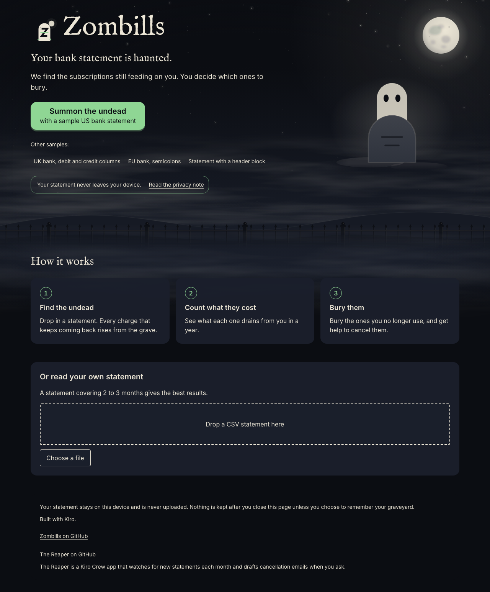

# Zombills

> Your bank statement is haunted: we find the zombie subscriptions draining your money, and you bury them.

Live: https://zombills.netlify.app

Companion Kiro Crew app: The Reaper, https://github.com/zaxcoraider/zombills-reaper



Built with [Kiro](https://kiro.dev) for the [Kiroween 2026](https://kiroween.devpost.com) hackathon, Costume Contest category.

## What it does

Zombills is a browser-only web app, presented as a haunted graveyard. You drop in a bank statement CSV and it finds the recurring charges.

- Drag-and-drop CSV upload, plus built-in sample statements.
- Auto-detects common CSV layouts, with a column-mapping fallback when detection fails.
- Detects recurring charges: groups by normalised merchant, detects cadence, and computes the yearly cost.
- Every recurring charge rises as an **undead** card asking "Still using this?". A bank statement cannot show whether you still use a service, so you decide. Answer no and it becomes a **zombie** to bury. Answer yes and it rests, kept.
- Labels charges as **possessed** (price increase) or **trial trap** (first paid charge after a free or low-price period), derived from the statement data.
- Keep or Bury with animation. A buried subscription gets a tombstone showing its yearly saving, and a running total tracks your savings.
- Cancel helper: a curated list of about 50 services with cancel URLs, and an email template generator for the rest.
- Graveyard view showing the total you have saved.

## Privacy

**Your statement data never leaves the browser.** Parsing, detection and classification all run on your device.

- No network call transmits transactions, merchant names or amounts.
- No backend, no analytics, no third-party requests at runtime. Fonts and icons are bundled with the app.
- No bank login and no account linking.
- If you choose to save your graveyard, it is stored in `localStorage` on your own device and synced nowhere.

## The Reaper

The Reaper is a Kiro Crew app, kept in a separate repo: [zaxcoraider/zombills-reaper](https://github.com/zaxcoraider/zombills-reaper). It watches a folder for new statements each month, alerts on Telegram about new or price-raised subscriptions, and drafts cancellation emails when asked.

## How it's built with Kiro

Kiro drives the project through steering files, specs, hooks and a custom agent, all committed in [`.kiro/`](.kiro/).

### Steering

[`.kiro/steering/`](.kiro/steering/) holds the standing rules the agent follows:

- `product.md`: what Zombills is, the scope, and the rule that the spooky theme must do real work.
- `tech.md`: the approved stack.
- `privacy.md`: statement data never leaves the browser.
- `structure.md`: repo layout, naming and where tests live.
- `money.md`: how money values are handled.
- `spooky-design.md`: the design tokens and the spooky design system.

### Specs

[`.kiro/specs/`](.kiro/specs/) holds one folder per feature, with `requirements.md`, `design.md` and `tasks.md`, except `landing-nits`, which has `bugfix.md` and `tasks.md`.

- `statement-parser`: CSV text to `Transaction[]`, column detection and the mapping fallback.
- `merchant-normalizer`: raw descriptions to a stable merchant identity, using a built-in list of 59 known services.
- `subscription-detector`: groups normalised transactions into recurring charges, decides the cadence and computes the current and yearly cost.
- `subscription-classifier`: sets the `possessed`, `trial-trap` and `zombie` labels and the details that explain them.
- `vertical-slice`: the first plain page of the site, from file or sample to result.
- `graveyard-ui`: the haunted flow with undead cards, Keep or Bury, tombstones, the savings counter and the graveyard view.
- `graveyard-memory`: opt-in `localStorage` persistence of the graveyard, re-attaching answers when ids change, and "Forget everything".
- `cancel-helper`: the cancel URL database, the cancellation email generator and their UI.
- `share-card`: the shareable graveyard image.
- `landing-polish`: the redesigned first screen.
- `landing-nits`: layout and art bugs on the landing view.

Most spec folders also hold `review-requirements-N.md` and `review-design-N.md` files, the reports from the spec reviewer (see Agents).

### Hooks

[`.kiro/hooks/`](.kiro/hooks/):

- `core-tests-on-save`: after a save of `packages/core/src/**/*.ts`, runs the `@zombills/core` tests.
- `privacy-guard`: after a save of `packages/core/src/**/*.ts`, runs the `@zombills/core` lint, which bans network, DOM and console APIs in core.
- `spec-task-gate`: after a spec task finishes, the whole workspace must pass type-check, lint and tests.

### Agents

[`.kiro/agents/`](.kiro/agents/) holds `spec-reviewer`, a read-only agent that reviews a spec's requirements, design or tasks, or a finished batch of tasks, against the steering docs and reports numbered findings with a severity. It has no write access.

## Tech

Vite, React 18, TypeScript, Tailwind CSS, Framer Motion and Papa Parse. Tests use Vitest, fast-check and Playwright. The repo is an npm workspaces monorepo: `packages/core` (`@zombills/core`) and `apps/web` (`@zombills/web`). It is hosted on Netlify as a static site.

## Samples

[`samples/`](samples/) holds four fake, anonymised statement CSVs for the demo and the tests: `us-signed.csv`, `uk-debit-credit.csv`, `eu-semicolon.csv` and `with-preamble.csv`.

## Setup

Tested on Node 24, from a clean clone, on 2026-11-18.

```sh
git clone https://github.com/zaxcoraider/zombills.git
cd zombills
npm ci
npm run build --workspace @zombills/core
npm run dev --workspace @zombills/web
```

Open the localhost URL that the dev server prints, then choose "Summon the undead" or drop a CSV from `samples/`.

Checks:

```sh
npm run typecheck
npm run lint
npm test
npm run build
```

Run `npx playwright install chromium` once per machine before `npm run test:e2e --workspace @zombills/web`.

## License

[MIT](LICENSE)
