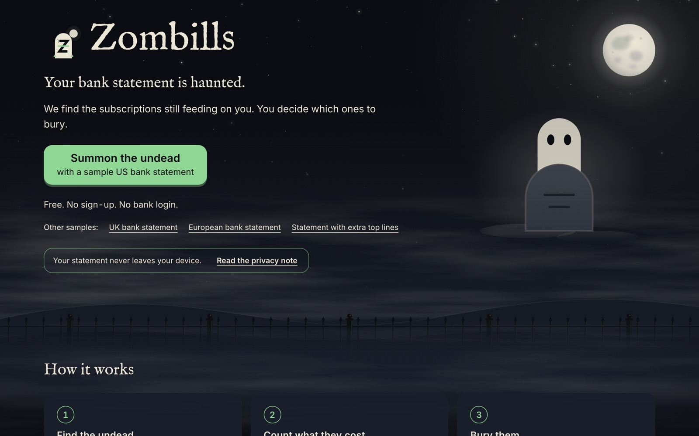
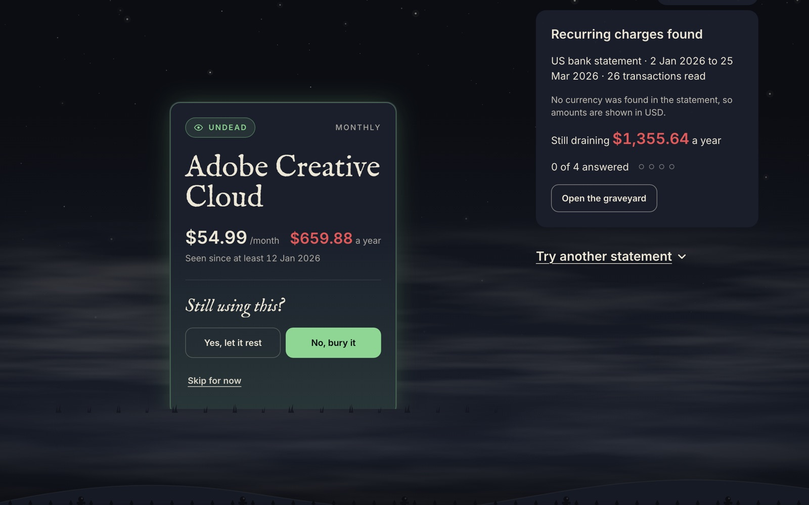
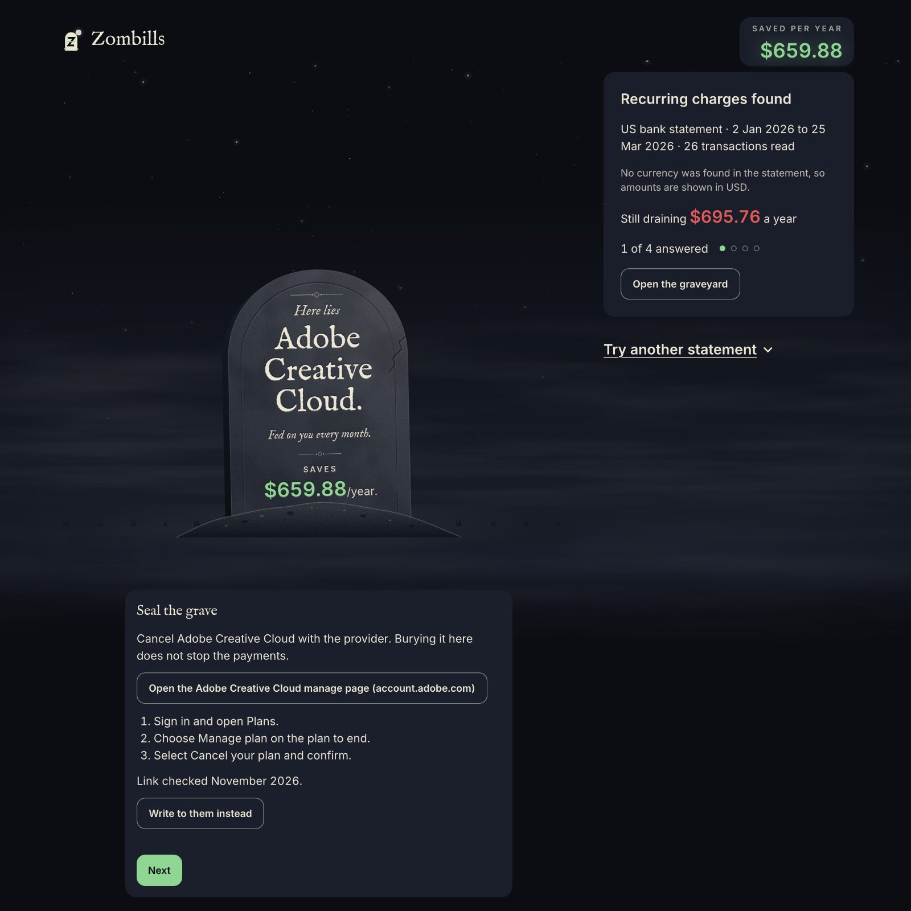
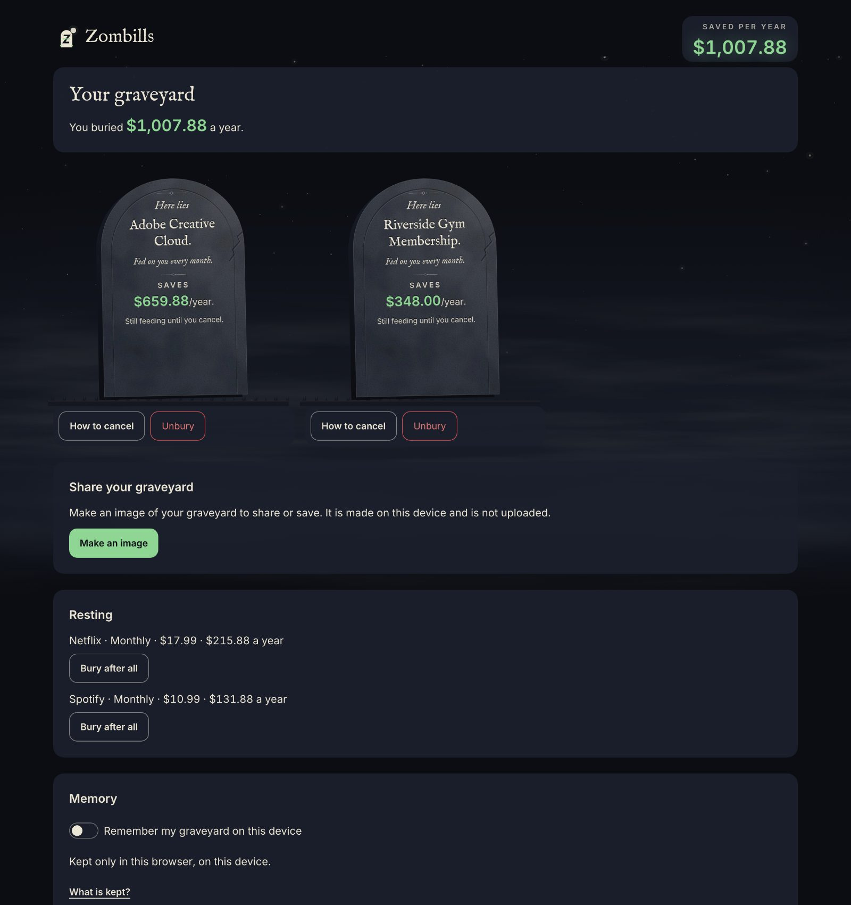
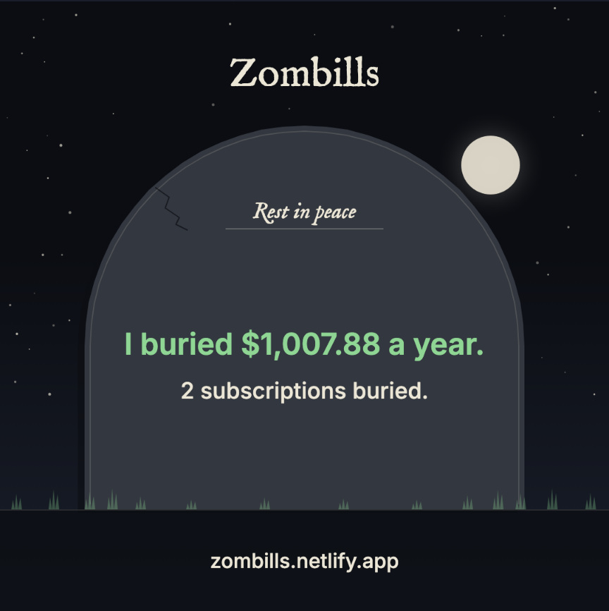
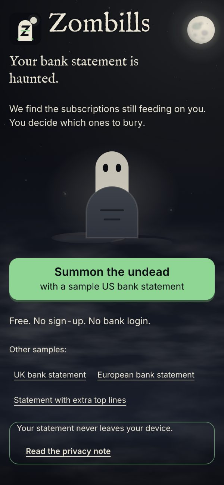
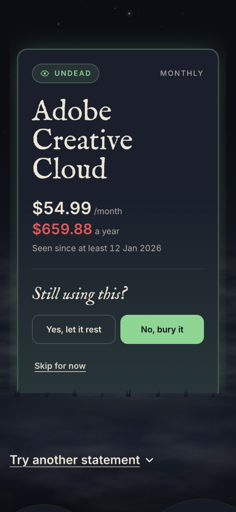
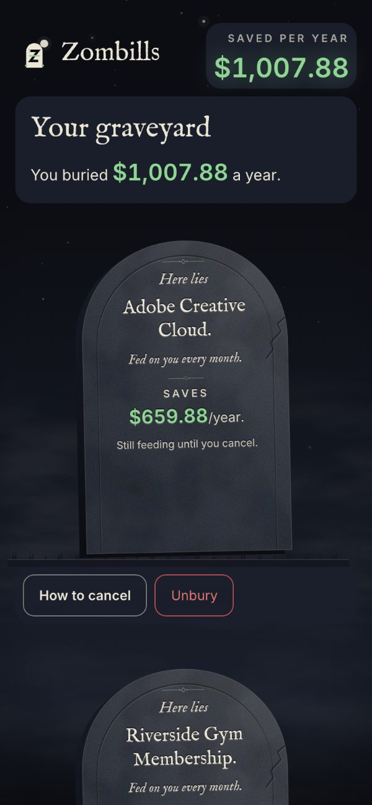

<p align="center">
  
</p>

<h1 align="center">Zombills</h1>

<h3 align="center">Forgotten subscriptions keep billing, every month, for years.<br>Zombills reads your bank statement in your browser, raises every recurring charge as an undead card,<br>and lets you bury the ones still feeding on you.</h3>

<p align="center">
  <a href="https://zombills.netlify.app"></a>
  <a href="#-see-it-in-5-screens"></a>
  <a href="https://github.com/zaxcoraider/zombills-reaper"></a>
  <a href="#-built-with-kiro"></a>
</p>

<p align="center">
  <a href="https://kiroween.devpost.com"></a>
  <a href="#-the-zombills-ecosystem"></a>
  <a href="#-privacy"></a>
  <a href="#-privacy"></a>
  <a href="#-proof"></a>
  <a href="#-proof"></a>
  <a href="https://zombills.netlify.app"></a>
  <a href="LICENSE"></a>
</p>

<p align="center">
  <a href="#-see-it-in-5-screens">See it</a> ·
  <a href="#-the-problem">The problem</a> ·
  <a href="#%EF%B8%8F-how-it-works">How it works</a> ·
  <a href="#-the-zombills-ecosystem">Ecosystem</a> ·
  <a href="#-privacy">Privacy</a> ·
  <a href="#-built-with-kiro">Built with Kiro</a> ·
  <a href="#-proof">Proof</a> ·
  <a href="#-run-it-yourself">Run it</a>
</p>

<p align="center">
  
  <br><sub>One click on "Summon the undead" runs a sample statement. Or drop in your own CSV: it never leaves the page.</sub>
</p>

---

**Zombills** is a browser-only web app that turns a bank statement into a haunted graveyard. It finds every **recurring charge**, works out what each one costs you **a year**, and asks you one question per charge: _"Still using this?"_ Say no and it is buried under a tombstone showing what you save. Say yes and it rests. Zombills then shows you **exactly how to cancel** with the provider, because burying it here doesn't stop the payment.

| 🧟 **Finds the undead**                                                                                                                                    | 💸 **Shows the real cost**                                                                                                                               | 🪦 **Helps you bury them**                                                                                                                            |
| :--------------------------------------------------------------------------------------------------------------------------------------------------------- | :------------------------------------------------------------------------------------------------------------------------------------------------------- | :---------------------------------------------------------------------------------------------------------------------------------------------------- |
| Reads US, UK and European CSV layouts, groups charges by merchant (even `APPLE.COM/BILL`, split by amount), and spots monthly, weekly and yearly cadences. | Every card shows the yearly cost in red. Price rises are flagged **possessed**, and the first paid charge after a free period is flagged **trial trap**. | "Seal the grave" gives the cancel link and steps for 59 services, or a ready cancellation email for any other. Then share your graveyard as an image. |

<table>
  <tr>
    <td align="center" width="25%"><h3>0</h3><sub>bytes of your statement<br>sent anywhere</sub></td>
    <td align="center" width="25%"><h3>59</h3><sub>services with checked<br>cancel links and steps</sub></td>
    <td align="center" width="25%"><h3>3,989</h3><sub>automated tests:<br>unit, property and browser</sub></td>
    <td align="center" width="25%"><h3>12</h3><sub>Kiro specs, each reviewed<br>by a Kiro agent</sub></td>
  </tr>
</table>

## 📸 See it in 5 screens

<table>
  <tr>
    <td width="50%"></td>
    <td width="50%"></td>
  </tr>
  <tr>
    <td><sub><b>1. The rising.</b> Each recurring charge rises as an undead card with its yearly cost. You answer one at a time.</sub></td>
    <td><sub><b>2. Seal the grave.</b> A buried charge gets its tombstone, then the real cancel link, the steps, and an email to send instead.</sub></td>
  </tr>
  <tr>
    <td></td>
    <td align="center"></td>
  </tr>
  <tr>
    <td><sub><b>3. Your graveyard.</b> Every grave with its saving, what you chose to keep, and an opt-in memory that stays on this device.</sub></td>
    <td><sub><b>4. The share image.</b> Made on your device, with totals only: no service names, no amounts per charge.</sub></td>
  </tr>
</table>

<p align="center"><b>5. On your phone</b></p>
<p align="center">
  
  
  
</p>

## 😱 The problem

Subscriptions are built to be forgotten. A free trial turns into a monthly charge, a price goes up by two dollars, a gym membership keeps billing after the last visit. Each one is small, so nobody notices, but together they add up to hundreds a year.

The tools that find them usually want your **bank login**, then keep your transactions on their servers. Many people won't hand that over, and they shouldn't have to.

Zombills needs only the CSV your bank already lets you download, and it reads it **inside your browser tab**. There's no account, no server, no tracking.

One more honest point: a statement can show that you **pay** for something, but never whether you still **use** it. So Zombills doesn't guess. It raises every recurring charge and lets you decide.

## ⚙️ How it works

```
 your bank's CSV ──▶ parse ──▶ normalise merchants ──▶ detect recurring ──▶ classify ──▶ the graveyard
   (stays in           │             │                      │                  │
    your browser)   US, UK, EU    "NETFLIX.COM 866-…"    monthly, weekly,   possessed (price up)
                    layouts,       → Netflix             yearly cadence,    trial trap (free → paid)
                    ; and ,        59 known services     yearly cost        your answer → zombie
```

1. **Parse.** Detects the CSV layout (signed amounts or debit/credit columns, `,` or `;`, extra lines at the top, dates in any common order). If it can't tell, it asks you to map the columns.
2. **Normalise.** Turns raw descriptions like `NETFLIX.COM 866-579-7172 CA` into one stable merchant.
3. **Detect.** Groups each merchant's charges, finds the cadence, and computes the current and yearly cost. Different Apple subscriptions billed as `APPLE.COM/BILL` are split by amount.
4. **Classify.** Flags **possessed** (the price went up) and **trial trap** (the first paid charge after a free or cheap period) from the data alone. **Zombie** comes only from your answer.
5. **Bury.** Tombstones, a running total, the cancel helper, the share image, and an opt-in memory you can wipe with "Forget everything".

All of this logic lives in [`packages/core`](packages/core) (`@zombills/core`), a pure TypeScript library with no network, DOM or console access. Its lint rules enforce that. The same core powers **The Reaper**.

## 🕸 The Zombills ecosystem

Zombills is two apps that share one engine. Use the website to clear out your graveyard today. Use The Reaper so new zombies never get comfortable again.

|                        | 🌐 **Zombills** (this repo)                                                               | 🦇 **[The Reaper](https://github.com/zaxcoraider/zombills-reaper)**                                  |
| ---------------------- | ----------------------------------------------------------------------------------------- | ---------------------------------------------------------------------------------------------------- |
| **What it is**         | A haunted web app                                                                         | A [Kiro Crew](https://kiro.dev/docs/crew) app                                                        |
| **When you use it**    | Once, whenever you want a clean-out                                                       | Every month, on its own                                                                              |
| **What it does**       | Finds every recurring charge, you bury the ones you don't use, and it shows how to cancel | Re-scans your statements folder on the 1st and messages you about **new undead** and **price rises** |
| **Where it runs**      | Your browser tab. Nothing is uploaded.                                                    | Your own machine (or your own EC2 box). Statements are read in place.                                |
| **How you talk to it** | Click, drag, keyboard                                                                     | Telegram or the Crew dashboard: reply `bury Netflix` and it drafts the cancellation                  |
| **Engine**             | `@zombills/core`                                                                          | The same `@zombills/core`, bundled in                                                                |
| **Try it**             | [zombills.netlify.app](https://zombills.netlify.app)                                      | [Install guide](https://github.com/zaxcoraider/zombills-reaper#-install-it)                          |

## 🔒 Privacy

**Your statement never leaves your device.** Parsing, detection and classification run in your browser.

- No network call carries transactions, merchant names or amounts. A strict Content Security Policy and browser tests check this.
- No backend, no analytics, no third-party requests at runtime. Fonts and art are bundled. Every picture is code-drawn SVG.
- No bank login and no account linking.
- Memory is **off** by default. Turn it on and your graveyard (not your statement) is kept in `localStorage` on this device only. "Forget everything" wipes it.
- The share image is drawn on your device and shows only totals.

## 👻 Built with Kiro

Kiro wrote every spec, steering doc, hook, agent, test and line of app code in this repo, and made the commits. Claude Code drove the Kiro CLI, reviewed each batch and ran the browser checks. Everything is committed in [`.kiro/`](.kiro/).

| Kiro feature        | How Zombills uses it                                                                                                                                                                                                                                                                                                                                                                                                                                                                                                                                                                                                                                                                                                                         |
| ------------------- | -------------------------------------------------------------------------------------------------------------------------------------------------------------------------------------------------------------------------------------------------------------------------------------------------------------------------------------------------------------------------------------------------------------------------------------------------------------------------------------------------------------------------------------------------------------------------------------------------------------------------------------------------------------------------------------------------------------------------------------------- |
| 📐 **Specs**        | 12 features, each with `requirements.md` (EARS, with property-based test markers), `design.md` and `tasks.md`: [statement-parser](.kiro/specs/statement-parser), [merchant-normalizer](.kiro/specs/merchant-normalizer), [subscription-detector](.kiro/specs/subscription-detector), [subscription-classifier](.kiro/specs/subscription-classifier), [vertical-slice](.kiro/specs/vertical-slice), [graveyard-ui](.kiro/specs/graveyard-ui), [cancel-helper](.kiro/specs/cancel-helper), [share-card](.kiro/specs/share-card), [graveyard-memory](.kiro/specs/graveyard-memory), [landing-polish](.kiro/specs/landing-polish), [landing-nits](.kiro/specs/landing-nits) (a bugfix spec) and [pro-polish](.kiro/specs/pro-polish) (45 tasks). |
| 🧭 **Steering**     | 6 docs in [`.kiro/steering/`](.kiro/steering): `product`, `tech`, `structure` and `privacy` always apply; `money` loads for `packages/core/**` and `spooky-design` for `apps/web/**`.                                                                                                                                                                                                                                                                                                                                                                                                                                                                                                                                                        |
| 🪝 **Hooks**        | [`.kiro/hooks/`](.kiro/hooks): core tests on every save, a **privacy guard** that lints core for network and DOM APIs, and a gate that runs typecheck, lint and tests after every spec task.                                                                                                                                                                                                                                                                                                                                                                                                                                                                                                                                                 |
| 🕵️ **Custom agent** | [`spec-reviewer`](.kiro/agents/spec-reviewer.json) is read-only. It reviews every requirements, design and task batch against the steering and reports numbered findings. Its reports are kept next to each spec (`review-*.md`).                                                                                                                                                                                                                                                                                                                                                                                                                                                                                                            |
| 💻 **Kiro CLI**     | Specs ran headless, one task per fresh run, with Opus for design and review.                                                                                                                                                                                                                                                                                                                                                                                                                                                                                                                                                                                                                                                                 |
| 🦇 **Kiro Crew**    | [The Reaper](https://github.com/zaxcoraider/zombills-reaper) is a Crew app with a cron job, an MCP server, a dashboard page and a Telegram chat.                                                                                                                                                                                                                                                                                                                                                                                                                                                                                                                                                                                             |

**Kiro stopped instead of guessing more than 20 times.** It caught notes that could never be reached in the Memory panel, a "two passes" test case that could never happen, a title glow that rounded to 4.48:1 contrast, and an old test that would have needed a false tag to pass. Each time it explained the conflict and waited for a decision.

## 🧾 Proof

| Check                                                                                                        | Result                                                                                                                                                                                                         |
| ------------------------------------------------------------------------------------------------------------ | -------------------------------------------------------------------------------------------------------------------------------------------------------------------------------------------------------------- |
| Core unit and property tests (Vitest + fast-check)                                                           | **2,358** passing                                                                                                                                                                                              |
| Web unit and component tests                                                                                 | **1,438** passing                                                                                                                                                                                              |
| Browser tests (Playwright: flows, layout at 320 to 1600 px, 200 % text, reduced motion, no outside requests) | **193** passing                                                                                                                                                                                                |
| The Reaper                                                                                                   | **453** passing                                                                                                                                                                                                |
| Cancel links                                                                                                 | Opened one by one in a real browser on 2026-11-16. 22 were fixed or replaced, and 9 are left unverified (geo-blocked) and say so. See the [record](.kiro/specs/cancel-helper/link-verification-2026-11-16.md). |
| Accessibility                                                                                                | Full keyboard flow, visible focus, 4.5:1 contrast tested per colour pair, `prefers-reduced-motion`, automatic motion stops within 5 s                                                                          |

## 🗺 Roadmap

- PDF statements (today: CSV)
- More known services and verified cancel links, per country
- The Reaper on AWS, so the monthly watch runs while your laptop sleeps

## 🛠 Run it yourself

Tested on Node 24 from a clean clone.

```sh
git clone https://github.com/zaxcoraider/zombills.git
cd zombills
npm ci
npm run build --workspace @zombills/core
npm run dev --workspace @zombills/web
```

Open the local URL it prints, then click **Summon the undead**, or drop in a CSV from [`samples/`](samples/) (four fake statements: US signed amounts, UK debit/credit, EU semicolon, and one with extra top lines).

Checks:

```sh
npm run typecheck && npm run lint && npm test && npm run build
npx playwright install chromium   # once per machine
npm run test:e2e --workspace @zombills/web
```

**Stack:** Vite, React 18, TypeScript, Tailwind CSS, Framer Motion, Papa Parse. Vitest, fast-check, Playwright. An npm workspaces monorepo with `packages/core` (`@zombills/core`) and `apps/web` (`@zombills/web`), hosted on Netlify.

## License

[MIT](LICENSE)

<p align="center"><sub>Made for <a href="https://kiroween.devpost.com">Kiroween 2026</a>. Rest in peace, forgotten subscriptions. 🪦</sub></p>
